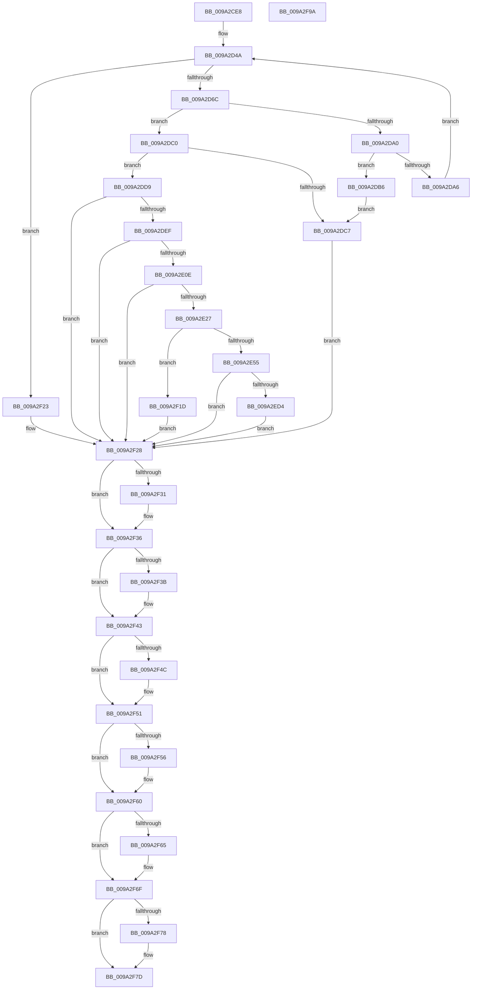

# IopUpdateSecureDeviceClassState

- RVA: `0x009A2CE8`–`0x009A2F9B` (길이 `691` bytes)
- VA: `0x00000001409A2CE8`
- 실행 섹션: `PAGE`
- PDB 이름 있음: `예`; PDB Function 태그: `아니요`
- unwind 정보 RVA: `0x0009C2D8`
- 디코드: `188`개 명령, `691/691` bytes 표시
- 미해석 바이트: `0` (있으면 어셈블리에 `.byte`로 보존)

> 이 문서는 커널 이미지의 기계어와 PDB 기호를 분석해 생성했습니다. 4번과 5번은 함수 원형과 자료형을 바이너리 사용 방식에서 추정한 C 해석이며 원본 소스 복구 결과는 아닙니다.

## 1. Dependencies

- 직접 호출 지점: **20**; 고유 호출 대상: **14**
- 직접 호출자로 확인된 함수: **1**
- RIP 상대 이미지 참조: **5**

### Outgoing calls
- `0x009A2D58` → [ExAllocatePool2](../../poolcode/B8/ExAllocatePool2_function_00B820F0.md) (function, `0x00B820F0`)
- `0x009A2D92` → [RtlGetPersistedStateLocation](../8C/RtlGetPersistedStateLocation_function_008C8DE0.md) (function, `0x008C8DE0`)
- `0x009A2DAF` → [ExFreePoolWithTag](../../poolcode/B8/ExFreePoolWithTag_function_00B82870.md) (function, `0x00B82870`)
- `0x009A2DCC` → [ExFreePoolWithTag](../../poolcode/B8/ExFreePoolWithTag_function_00B82870.md) (function, `0x00B82870`)
- `0x009A2DE0` → [RtlInitUnicodeStringEx](../../text/46/RtlInitUnicodeStringEx_function_00463960.md) (function, `0x00463960`)
- `0x009A2DFF` → [IopOpenRegistryKeyEx](../A5/IopOpenRegistryKeyEx_function_00A51B44.md) (function, `0x00A51B44`)
- `0x009A2E18` → [RtlStringFromGUIDEx](../91/RtlStringFromGUIDEx_function_00915450.md) (function, `0x00915450`)
- `0x009A2E46` → [IopCreateRegistryKeyEx](../A8/IopCreateRegistryKeyEx_function_00A89038.md) (function, `0x00A89038`)
- `0x009A2E67` → [SeConvertStringSecurityDescriptorToSecurityDescriptor](../../text/48/SeConvertStringSecurityDescriptorToSecurityDescriptor_function_00480000.md) (function, `0x00480000`)
- `0x009A2E81` → [RtlInitUnicodeString](../../text/42/RtlInitUnicodeString_function_0042A780.md) (function, `0x0042A780`)
- `0x009A2EC9` → [ZwCreateKey](../../text/6A/ZwCreateKey_function_006AD470.md) (function, `0x006AD470`)
- `0x009A2EDC` → [RtlLengthSecurityDescriptor](../8B/RtlLengthSecurityDescriptor_function_008BC870.md) (function, `0x008BC870`)
- `0x009A2EEE` → [RtlInitUnicodeString](../../text/42/RtlInitUnicodeString_function_0042A780.md) (function, `0x0042A780`)
- `0x009A2F11` → [ZwSetValueKey](../../text/6A/ZwSetValueKey_function_006ADCD0.md) (function, `0x006ADCD0`)
- `0x009A2F31` → [ZwClose](../../text/6A/ZwClose_function_006AD2B0.md) (function, `0x006AD2B0`)
- `0x009A2F3E` → [ZwClose](../../text/6A/ZwClose_function_006AD2B0.md) (function, `0x006AD2B0`)
- `0x009A2F4C` → [ZwClose](../../text/6A/ZwClose_function_006AD2B0.md) (function, `0x006AD2B0`)
- `0x009A2F5B` → [ExFreePoolWithTag](../../poolcode/B8/ExFreePoolWithTag_function_00B82870.md) (function, `0x00B82870`)
- `0x009A2F6A` → [ExFreePoolWithTag](../../poolcode/B8/ExFreePoolWithTag_function_00B82870.md) (function, `0x00B82870`)
- `0x009A2F78` → [ExFreePool](../../poolcode/B8/ExFreePool_function_00B82850.md) (function, `0x00B82850`)

### Direct callers
- [IoCreateDeviceSecure](IoCreateDeviceSecure_function_009A31E0.md) at `0x009A33C7`

### Static image references
- `0x009A2D78` → RVA `0x00AFCBE0` (` ?? ::NNGAKEGL::`string'`; read)
- `0x009A2D84` → RVA `0x00AFCCE0` (` ?? ::NNGAKEGL::`string'`; read)
- `0x009A2E5C` → RVA `0x00AFCD10` (` ?? ::NNGAKEGL::`string'`; read)
- `0x009A2E70` → RVA `0x00AFCD40` (` ?? ::NNGAKEGL::`string'`; read)
- `0x009A2EE1` → RVA `0x00AFCD60` (` ?? ::NNGAKEGL::`string'`; read)

## 2. Other-region calls and transfers

- 다른 실행 섹션으로 향하는 call: **15**
  - `0x009A2D58` → [ExAllocatePool2](../../poolcode/B8/ExAllocatePool2_function_00B820F0.md) (`PAGE` → `POOLCODE`)
  - `0x009A2DAF` → [ExFreePoolWithTag](../../poolcode/B8/ExFreePoolWithTag_function_00B82870.md) (`PAGE` → `POOLCODE`)
  - `0x009A2DCC` → [ExFreePoolWithTag](../../poolcode/B8/ExFreePoolWithTag_function_00B82870.md) (`PAGE` → `POOLCODE`)
  - `0x009A2DE0` → [RtlInitUnicodeStringEx](../../text/46/RtlInitUnicodeStringEx_function_00463960.md) (`PAGE` → `.text`)
  - `0x009A2E67` → [SeConvertStringSecurityDescriptorToSecurityDescriptor](../../text/48/SeConvertStringSecurityDescriptorToSecurityDescriptor_function_00480000.md) (`PAGE` → `.text`)
  - `0x009A2E81` → [RtlInitUnicodeString](../../text/42/RtlInitUnicodeString_function_0042A780.md) (`PAGE` → `.text`)
  - `0x009A2EC9` → [ZwCreateKey](../../text/6A/ZwCreateKey_function_006AD470.md) (`PAGE` → `.text`)
  - `0x009A2EEE` → [RtlInitUnicodeString](../../text/42/RtlInitUnicodeString_function_0042A780.md) (`PAGE` → `.text`)
  - `0x009A2F11` → [ZwSetValueKey](../../text/6A/ZwSetValueKey_function_006ADCD0.md) (`PAGE` → `.text`)
  - `0x009A2F31` → [ZwClose](../../text/6A/ZwClose_function_006AD2B0.md) (`PAGE` → `.text`)
  - `0x009A2F3E` → [ZwClose](../../text/6A/ZwClose_function_006AD2B0.md) (`PAGE` → `.text`)
  - `0x009A2F4C` → [ZwClose](../../text/6A/ZwClose_function_006AD2B0.md) (`PAGE` → `.text`)
  - `0x009A2F5B` → [ExFreePoolWithTag](../../poolcode/B8/ExFreePoolWithTag_function_00B82870.md) (`PAGE` → `POOLCODE`)
  - `0x009A2F6A` → [ExFreePoolWithTag](../../poolcode/B8/ExFreePoolWithTag_function_00B82870.md) (`PAGE` → `POOLCODE`)
  - `0x009A2F78` → [ExFreePool](../../poolcode/B8/ExFreePool_function_00B82850.md) (`PAGE` → `POOLCODE`)
- 별도 외부 분기/꼬리 이동을 확인하지 못했습니다.

## 3. Assembly (complete function range)

```asm
009A2CE8  48 89 5C 24 08                  mov qword ptr [rsp + 8], rbx
009A2CED  48 89 54 24 10                  mov qword ptr [rsp + 0x10], rdx
009A2CF2  55                              push rbp
009A2CF3  56                              push rsi
009A2CF4  57                              push rdi
009A2CF5  41 54                           push r12
009A2CF7  41 55                           push r13
009A2CF9  41 56                           push r14
009A2CFB  41 57                           push r15
009A2CFD  48 8D 6C 24 D9                  lea rbp, [rsp - 0x27]
009A2D02  48 81 EC B0 00 00 00            sub rsp, 0xb0
009A2D09  33 C0                           xor eax, eax
009A2D0B  0F 57 C0                        xorps xmm0, xmm0
009A2D0E  48 21 45 B7                     and qword ptr [rbp - 0x49], rax
009A2D12  45 33 F6                        xor r14d, r14d
009A2D15  48 21 45 BF                     and qword ptr [rbp - 0x41], rax
009A2D19  45 33 E4                        xor r12d, r12d
009A2D1C  21 45 77                        and dword ptr [rbp + 0x77], eax
009A2D1F  0F 57 C9                        xorps xmm1, xmm1
009A2D22  4C 8B E9                        mov r13, rcx
009A2D25  48 89 45 0F                     mov qword ptr [rbp + 0xf], rax
009A2D29  0F 11 45 EF                     movups xmmword ptr [rbp - 0x11], xmm0
009A2D2D  89 45 17                        mov dword ptr [rbp + 0x17], eax
009A2D30  41 BF 00 01 00 00               mov r15d, 0x100
009A2D36  0F 11 45 FF                     movups xmmword ptr [rbp - 1], xmm0
009A2D3A  4C 89 75 7F                     mov qword ptr [rbp + 0x7f], r14
009A2D3E  0F 11 45 CF                     movups xmmword ptr [rbp - 0x31], xmm0
009A2D42  4C 89 65 C7                     mov qword ptr [rbp - 0x39], r12
009A2D46  0F 11 4D DF                     movups xmmword ptr [rbp - 0x21], xmm1
009A2D4A  41 8B D7                        mov edx, r15d
009A2D4D  B9 00 01 00 00                  mov ecx, 0x100
009A2D52  41 B8 49 6F 46 63               mov r8d, 0x63466f49
009A2D58  E8 93 F3 1D 00                  call 0x140b820f0
009A2D5D  48 8B F8                        mov rdi, rax
009A2D60  48 8B F0                        mov rsi, rax
009A2D63  48 85 C0                        test rax, rax
009A2D66  0F 84 B7 01 00 00               je 0x1409a2f23
009A2D6C  48 8D 45 77                     lea rax, [rbp + 0x77]
009A2D70  45 33 C9                        xor r9d, r9d
009A2D73  48 89 44 24 30                  mov qword ptr [rsp + 0x30], rax
009A2D78  4C 8D 05 61 9E 15 00            lea r8, [rip + 0x159e61]
009A2D7F  44 89 7C 24 28                  mov dword ptr [rsp + 0x28], r15d
009A2D84  48 8D 0D 55 9F 15 00            lea rcx, [rip + 0x159f55]
009A2D8B  33 D2                           xor edx, edx
009A2D8D  48 89 74 24 20                  mov qword ptr [rsp + 0x20], rsi
009A2D92  E8 49 60 F2 FF                  call 0x1408c8de0
009A2D97  8B D8                           mov ebx, eax
009A2D99  3D 05 00 00 80                  cmp eax, 0x80000005
009A2D9E  75 20                           jne 0x1409a2dc0
009A2DA0  44 39 7D 77                     cmp dword ptr [rbp + 0x77], r15d
009A2DA4  76 10                           jbe 0x1409a2db6
009A2DA6  44 8B 7D 77                     mov r15d, dword ptr [rbp + 0x77]
009A2DAA  33 D2                           xor edx, edx
009A2DAC  48 8B CE                        mov rcx, rsi
009A2DAF  E8 BC FA 1D 00                  call 0x140b82870
009A2DB4  EB 94                           jmp 0x1409a2d4a
009A2DB6  BB E5 00 00 C0                  mov ebx, 0xc00000e5
009A2DBB  45 33 FF                        xor r15d, r15d
009A2DBE  EB 07                           jmp 0x1409a2dc7
009A2DC0  45 33 FF                        xor r15d, r15d
009A2DC3  85 C0                           test eax, eax
009A2DC5  79 12                           jns 0x1409a2dd9
009A2DC7  33 D2                           xor edx, edx
009A2DC9  48 8B CF                        mov rcx, rdi
009A2DCC  E8 9F FA 1D 00                  call 0x140b82870
009A2DD1  49 8B FF                        mov rdi, r15
009A2DD4  E9 4F 01 00 00                  jmp 0x1409a2f28
009A2DD9  48 8B D6                        mov rdx, rsi
009A2DDC  48 8D 4D CF                     lea rcx, [rbp - 0x31]
009A2DE0  E8 7B 0B AC FF                  call 0x140463960
009A2DE5  8B D8                           mov ebx, eax
009A2DE7  85 C0                           test eax, eax
009A2DE9  0F 88 39 01 00 00               js 0x1409a2f28
009A2DEF  41 B9 3F 00 0F 00               mov r9d, 0xf003f
009A2DF5  4C 8D 45 CF                     lea r8, [rbp - 0x31]
009A2DF9  33 D2                           xor edx, edx
009A2DFB  48 8D 4D B7                     lea rcx, [rbp - 0x49]
009A2DFF  E8 40 ED 0A 00                  call 0x140a51b44
009A2E04  8B D8                           mov ebx, eax
009A2E06  85 C0                           test eax, eax
009A2E08  0F 88 1A 01 00 00               js 0x1409a2f28
009A2E0E  41 B0 01                        mov r8b, 1
009A2E11  48 8D 55 DF                     lea rdx, [rbp - 0x21]
009A2E15  49 8B CD                        mov rcx, r13
009A2E18  E8 33 26 F7 FF                  call 0x140915450
009A2E1D  8B D8                           mov ebx, eax
009A2E1F  85 C0                           test eax, eax
009A2E21  0F 88 01 01 00 00               js 0x1409a2f28
009A2E27  48 8B 55 B7                     mov rdx, qword ptr [rbp - 0x49]
009A2E2B  4C 8D 45 DF                     lea r8, [rbp - 0x21]
009A2E2F  41 BD 3F 00 0F 00               mov r13d, 0xf003f
009A2E35  4C 89 7C 24 28                  mov qword ptr [rsp + 0x28], r15
009A2E3A  45 8B CD                        mov r9d, r13d
009A2E3D  44 89 7C 24 20                  mov dword ptr [rsp + 0x20], r15d
009A2E42  48 8D 4D 7F                     lea rcx, [rbp + 0x7f]
009A2E46  E8 ED 61 0E 00                  call 0x140a89038
009A2E4B  8B D8                           mov ebx, eax
009A2E4D  85 C0                           test eax, eax
009A2E4F  0F 88 C8 00 00 00               js 0x1409a2f1d
009A2E55  45 33 C9                        xor r9d, r9d
009A2E58  4C 8D 45 C7                     lea r8, [rbp - 0x39]
009A2E5C  48 8D 0D AD 9E 15 00            lea rcx, [rip + 0x159ead]
009A2E63  41 8D 51 01                     lea edx, [r9 + 1]
009A2E67  E8 94 D1 AD FF                  call 0x140480000
009A2E6C  4C 8B 65 C7                     mov r12, qword ptr [rbp - 0x39]
009A2E70  48 8D 15 C9 9E 15 00            lea rdx, [rip + 0x159ec9]
009A2E77  85 C0                           test eax, eax
009A2E79  48 8D 4D CF                     lea rcx, [rbp - 0x31]
009A2E7D  4D 0F 48 E7                     cmovs r12, r15
009A2E81  E8 FA 78 A8 FF                  call 0x14042a780
009A2E86  4C 8B 75 7F                     mov r14, qword ptr [rbp + 0x7f]
009A2E8A  48 8D 45 CF                     lea rax, [rbp - 0x31]
009A2E8E  4C 89 7C 24 30                  mov qword ptr [rsp + 0x30], r15
009A2E93  4C 8D 45 EF                     lea r8, [rbp - 0x11]
009A2E97  44 89 7C 24 28                  mov dword ptr [rsp + 0x28], r15d
009A2E9C  48 8D 4D BF                     lea rcx, [rbp - 0x41]
009A2EA0  45 33 C9                        xor r9d, r9d
009A2EA3  48 89 45 FF                     mov qword ptr [rbp - 1], rax
009A2EA7  41 8B D5                        mov edx, r13d
009A2EAA  C7 45 EF 30 00 00 00            mov dword ptr [rbp - 0x11], 0x30
009A2EB1  4C 89 75 F7                     mov qword ptr [rbp - 9], r14
009A2EB5  C7 45 07 40 02 00 00            mov dword ptr [rbp + 7], 0x240
009A2EBC  4C 89 65 0F                     mov qword ptr [rbp + 0xf], r12
009A2EC0  4C 89 7D 17                     mov qword ptr [rbp + 0x17], r15
009A2EC4  4C 89 7C 24 20                  mov qword ptr [rsp + 0x20], r15
009A2EC9  E8 A2 A5 D0 FF                  call 0x1406ad470
009A2ECE  8B D8                           mov ebx, eax
009A2ED0  85 C0                           test eax, eax
009A2ED2  78 54                           js 0x1409a2f28
009A2ED4  48 8B 7D 6F                     mov rdi, qword ptr [rbp + 0x6f]
009A2ED8  48 8B 4F 08                     mov rcx, qword ptr [rdi + 8]
009A2EDC  E8 8F 99 F1 FF                  call 0x1408bc870
009A2EE1  48 8D 15 78 9E 15 00            lea rdx, [rip + 0x159e78]
009A2EE8  8B D8                           mov ebx, eax
009A2EEA  48 8D 4D CF                     lea rcx, [rbp - 0x31]
009A2EEE  E8 8D 78 A8 FF                  call 0x14042a780
009A2EF3  48 8B 47 08                     mov rax, qword ptr [rdi + 8]
009A2EF7  48 8D 55 CF                     lea rdx, [rbp - 0x31]
009A2EFB  48 8B 4D BF                     mov rcx, qword ptr [rbp - 0x41]
009A2EFF  41 B9 03 00 00 00               mov r9d, 3
009A2F05  89 5C 24 28                     mov dword ptr [rsp + 0x28], ebx
009A2F09  45 33 C0                        xor r8d, r8d
009A2F0C  48 89 44 24 20                  mov qword ptr [rsp + 0x20], rax
009A2F11  E8 BA AD D0 FF                  call 0x1406adcd0
009A2F16  8B D8                           mov ebx, eax
009A2F18  48 8B FE                        mov rdi, rsi
009A2F1B  EB 0B                           jmp 0x1409a2f28
009A2F1D  4C 8B 75 7F                     mov r14, qword ptr [rbp + 0x7f]
009A2F21  EB 05                           jmp 0x1409a2f28
009A2F23  BB 9A 00 00 C0                  mov ebx, 0xc000009a
009A2F28  48 8B 4D B7                     mov rcx, qword ptr [rbp - 0x49]
009A2F2C  48 85 C9                        test rcx, rcx
009A2F2F  74 05                           je 0x1409a2f36
009A2F31  E8 7A A3 D0 FF                  call 0x1406ad2b0
009A2F36  4D 85 F6                        test r14, r14
009A2F39  74 08                           je 0x1409a2f43
009A2F3B  49 8B CE                        mov rcx, r14
009A2F3E  E8 6D A3 D0 FF                  call 0x1406ad2b0
009A2F43  48 8B 4D BF                     mov rcx, qword ptr [rbp - 0x41]
009A2F47  48 85 C9                        test rcx, rcx
009A2F4A  74 05                           je 0x1409a2f51
009A2F4C  E8 5F A3 D0 FF                  call 0x1406ad2b0
009A2F51  48 85 FF                        test rdi, rdi
009A2F54  74 0A                           je 0x1409a2f60
009A2F56  33 D2                           xor edx, edx
009A2F58  48 8B CF                        mov rcx, rdi
009A2F5B  E8 10 F9 1D 00                  call 0x140b82870
009A2F60  4D 85 E4                        test r12, r12
009A2F63  74 0A                           je 0x1409a2f6f
009A2F65  33 D2                           xor edx, edx
009A2F67  49 8B CC                        mov rcx, r12
009A2F6A  E8 01 F9 1D 00                  call 0x140b82870
009A2F6F  48 8B 4D E7                     mov rcx, qword ptr [rbp - 0x19]
009A2F73  48 85 C9                        test rcx, rcx
009A2F76  74 05                           je 0x1409a2f7d
009A2F78  E8 D3 F8 1D 00                  call 0x140b82850
009A2F7D  8B C3                           mov eax, ebx
009A2F7F  48 8B 9C 24 F0 00 00 00         mov rbx, qword ptr [rsp + 0xf0]
009A2F87  48 81 C4 B0 00 00 00            add rsp, 0xb0
009A2F8E  41 5F                           pop r15
009A2F90  41 5E                           pop r14
009A2F92  41 5D                           pop r13
009A2F94  41 5C                           pop r12
009A2F96  5F                              pop rdi
009A2F97  5E                              pop rsi
009A2F98  5D                              pop rbp
009A2F99  C3                              ret
009A2F9A  CC                              int3
```

## 4. C-style interpretation (structured pseudocode)

```c
__int64 __fastcall IopUpdateSecureDeviceClassState(__int64 a1, __int64 a2, __int64 a3, int a4)
{
    __int64 result;
    __int64 v_r12;
    __int64 v_r14;
    __int64 v_r15;
    __int64 v_rsp;
    unsigned int v_stack_m48;
    unsigned __int64 v_stack_m50;
    unsigned int v_stack_m58;
    unsigned __int64 v_stack_m5F;
    unsigned __int64 v_stack_m60;
    unsigned __int64 v_stack_m68;
    unsigned __int64 v_stack_m70;
    unsigned __int64 v_stack_m78;
    unsigned __int64 v_stack_m80;
    unsigned __int64 v_stack_m90;
    unsigned __int64 v_stack_m98;
    unsigned __int64 v_stack_mA0;
    unsigned __int64 v_stack_mA8;
    unsigned __int64 v_stack_mB8;
    unsigned int v_stack_mC0;
    unsigned __int64 v_stack_mC8;
    unsigned __int64 v_stack_p10;
    unsigned int v_stack_p18;
    unsigned __int64 v_stack_p20;
    unsigned __int64 v_stack_p8;

    v_stack_p8 = v_rbx;
    v_stack_p10 = a2;
    v_rsp = (v_rsp) - (176);
    result = 0;
    v_r14 = 0;
    v_r12 = 0;
    v_stack_m50 = 0;
    v_stack_m70 = v_xmm0;
    v_stack_m48 = 0;
    v_stack_m60 = v_xmm0;
    v_stack_p20 = 0;
    v_stack_m90 = v_xmm0;
    v_stack_m98 = 0;
    v_stack_m80 = v_xmm1;
loc_009A2D4A:
    result = ExAllocatePool2(256, 256, (unsigned int)(0x63466F49ULL), a4);
    if (result == 0) goto loc_009A2F23;
    a4 = 0;
    v_stack_mB8 = v_stack_p18;
    v_stack_mC0 = 256;
    a2 = 0;
    v_stack_mC8 = result;
    result = RtlGetPersistedStateLocation(v_rip + 1417045, a2, v_rip + 1416801, a4);
    if (((unsigned int)(result)) != 0x80000005ULL) goto loc_009A2DC0;
    if (v_stack_p18 <= 256) goto loc_009A2DB6;
    a2 = 0;
    result = ExFreePoolWithTag(result, a2, v_rip + 1416801, a4);
    goto loc_009A2D4A;
loc_009A2DB6:
    v_r15 = 0;
    goto loc_009A2DC7;
loc_009A2DC0:
    v_r15 = 0;
    if (!sign_flag) goto loc_009A2DD9;
loc_009A2DC7:
    a2 = 0;
    result = ExFreePoolWithTag(result, a2, v_rip + 1416801, a4);
    goto loc_009A2F28;
loc_009A2DD9:
    result = RtlInitUnicodeStringEx(v_stack_m90, result, v_rip + 1416801, a4);
    if (sign_flag) goto loc_009A2F28;
    a2 = 0;
    result = IopOpenRegistryKeyEx(v_stack_mA8, a2, v_stack_m90, (unsigned int)(0xF003FULL));
    if (sign_flag) goto loc_009A2F28;
    result = RtlStringFromGUIDEx(a1, v_stack_m80, 1, (unsigned int)(0xF003FULL));
    if (sign_flag) goto loc_009A2F28;
    v_stack_mC0 = 0;
    v_stack_mC8 = 0;
    result = IopCreateRegistryKeyEx(v_stack_p20, v_stack_mA8, v_stack_m80, (unsigned int)((unsigned int)((unsigned int)(0xF003FULL))));
    if (sign_flag) goto loc_009A2F1D;
    a4 = 0;
    result = SeConvertStringSecurityDescriptorToSecurityDescriptor(v_rip + 1416877, a4 + 1, v_stack_m98, a4);
    v_r12 = v_stack_m98;
    if (sign_flag) { v_r12 = 0; }
    result = RtlInitUnicodeString(v_stack_m90, v_rip + 1416905, v_stack_m98, a4);
    v_stack_mB8 = 0;
    v_stack_mC0 = 0;
    a4 = 0;
    v_stack_m60 = v_stack_m90;
    v_stack_m70 = 48;
    v_stack_m68 = v_stack_p20;
    v_stack_m58 = 576;
    v_stack_m50 = v_r12;
    v_stack_m48 = 0;
    v_stack_mC8 = 0;
    result = ZwCreateKey(v_stack_mA0, (unsigned int)((unsigned int)((unsigned int)(0xF003FULL))), v_stack_m70, a4);
    if (sign_flag) goto loc_009A2F28;
    result = RtlLengthSecurityDescriptor(*(unsigned __int64 *)(v_stack_p10 + 8), (unsigned int)((unsigned int)((unsigned int)(0xF003FULL))), v_stack_m70, a4);
    result = RtlInitUnicodeString(v_stack_m90, v_rip + 1416824, v_stack_m70, a4);
    v_stack_mC0 = (unsigned int)((unsigned int)((unsigned int)(result)));
    a3 = 0;
    v_stack_mC8 = *(unsigned __int64 *)(v_stack_p10 + 8);
    result = ZwSetValueKey(v_stack_mA0, v_stack_m90, a3, 3);
    goto loc_009A2F28;
loc_009A2F1D:
    goto loc_009A2F28;
loc_009A2F23:
loc_009A2F28:
    if (v_stack_mA8 != 0) {
        result = ZwClose(v_stack_mA8, v_stack_m90, a3, 3);
    }
    if (v_stack_p20 != 0) {
        a1 = v_stack_p20;
        result = ZwClose(a1, v_stack_m90, a3, 3);
    }
    if (v_stack_mA0 != 0) {
        result = ZwClose(v_stack_mA0, v_stack_m90, a3, 3);
    }
    if (result != 0) {
        a2 = 0;
        a1 = result;
        result = ExFreePoolWithTag(a1, a2, a3, 3);
    }
    if (v_r12 != 0) {
        a2 = 0;
        a1 = v_r12;
        result = ExFreePoolWithTag(a1, a2, a3, 3);
    }
    if (v_stack_m78 != 0) {
        result = ExFreePool(v_stack_m78, a2, a3, 3);
    }
    v_rsp = (v_rsp) + (176);
    return (unsigned int)((unsigned int)((unsigned int)(0xC000009AULL)));
}
```

## 5. (Beta) C Style

```c
int64_t IopUpdateSecureDeviceClassState(int64_t Arg1, int64_t Arg2, int64_t Arg3, int32_t Arg4)
{
    int64_t result;
    int64_t local_r12;
    int64_t local_r14;
    int64_t local_r15;
    int64_t local_rsp;
    uint32_t v_stack_m48;
    uint64_t v_stack_m50;
    uint32_t v_stack_m58;
    uint64_t v_stack_m5F;
    uint64_t v_stack_m60;
    uint64_t v_stack_m68;
    uint64_t v_stack_m70;
    uint64_t v_stack_m78;
    uint64_t v_stack_m80;
    uint64_t v_stack_m90;
    uint64_t v_stack_m98;
    uint64_t v_stack_mA0;
    uint64_t v_stack_mA8;
    uint64_t v_stack_mB8;
    uint32_t v_stack_mC0;
    uint64_t v_stack_mC8;
    uint64_t v_stack_p10;
    uint32_t v_stack_p18;
    uint64_t v_stack_p20;
    uint64_t v_stack_p8;

    v_stack_p8 = local_rbx;
    v_stack_p10 = Arg2;
    local_rsp = (local_rsp) - (176);
    result = 0;
    local_r14 = 0;
    local_r12 = 0;
    v_stack_m50 = 0;
    v_stack_m70 = v_xmm0;
    v_stack_m48 = 0;
    v_stack_m60 = v_xmm0;
    v_stack_p20 = 0;
    v_stack_m90 = v_xmm0;
    v_stack_m98 = 0;
    v_stack_m80 = v_xmm1;
loc_009A2D4A:
    result = ExAllocatePool2(256, 256, (uint32_t)(0x63466F49ULL), Arg4);
    if (result == 0) goto loc_009A2F23;
    Arg4 = 0;
    v_stack_mB8 = v_stack_p18;
    v_stack_mC0 = 256;
    Arg2 = 0;
    v_stack_mC8 = result;
    result = RtlGetPersistedStateLocation(v_rip + 1417045, Arg2, v_rip + 1416801, Arg4);
    if (((uint32_t)(result)) != 0x80000005ULL) goto loc_009A2DC0;
    if (v_stack_p18 <= 256) goto loc_009A2DB6;
    Arg2 = 0;
    result = ExFreePoolWithTag(result, Arg2, v_rip + 1416801, Arg4);
    goto loc_009A2D4A;
loc_009A2DB6:
    local_r15 = 0;
    goto loc_009A2DC7;
loc_009A2DC0:
    local_r15 = 0;
    if (!sign_flag) goto loc_009A2DD9;
loc_009A2DC7:
    Arg2 = 0;
    result = ExFreePoolWithTag(result, Arg2, v_rip + 1416801, Arg4);
    goto loc_009A2F28;
loc_009A2DD9:
    result = RtlInitUnicodeStringEx(v_stack_m90, result, v_rip + 1416801, Arg4);
    if (sign_flag) goto loc_009A2F28;
    Arg2 = 0;
    result = IopOpenRegistryKeyEx(v_stack_mA8, Arg2, v_stack_m90, (uint32_t)(0xF003FULL));
    if (sign_flag) goto loc_009A2F28;
    result = RtlStringFromGUIDEx(Arg1, v_stack_m80, 1, (uint32_t)(0xF003FULL));
    if (sign_flag) goto loc_009A2F28;
    v_stack_mC0 = 0;
    v_stack_mC8 = 0;
    result = IopCreateRegistryKeyEx(v_stack_p20, v_stack_mA8, v_stack_m80, (uint32_t)((uint32_t)((uint32_t)(0xF003FULL))));
    if (sign_flag) goto loc_009A2F1D;
    Arg4 = 0;
    result = SeConvertStringSecurityDescriptorToSecurityDescriptor(v_rip + 1416877, Arg4 + 1, v_stack_m98, Arg4);
    local_r12 = v_stack_m98;
    if (sign_flag) { local_r12 = 0; }
    result = RtlInitUnicodeString(v_stack_m90, v_rip + 1416905, v_stack_m98, Arg4);
    v_stack_mB8 = 0;
    v_stack_mC0 = 0;
    Arg4 = 0;
    v_stack_m60 = v_stack_m90;
    v_stack_m70 = 48;
    v_stack_m68 = v_stack_p20;
    v_stack_m58 = 576;
    v_stack_m50 = local_r12;
    v_stack_m48 = 0;
    v_stack_mC8 = 0;
    result = ZwCreateKey(v_stack_mA0, (uint32_t)((uint32_t)((uint32_t)(0xF003FULL))), v_stack_m70, Arg4);
    if (sign_flag) goto loc_009A2F28;
    result = RtlLengthSecurityDescriptor(*(uint64_t *)(v_stack_p10 + 0x8), (uint32_t)((uint32_t)((uint32_t)(0xF003FULL))), v_stack_m70, Arg4);
    result = RtlInitUnicodeString(v_stack_m90, v_rip + 1416824, v_stack_m70, Arg4);
    v_stack_mC0 = (uint32_t)((uint32_t)((uint32_t)(result)));
    Arg3 = 0;
    v_stack_mC8 = *(uint64_t *)(v_stack_p10 + 0x8);
    result = ZwSetValueKey(v_stack_mA0, v_stack_m90, Arg3, 3);
    goto loc_009A2F28;
loc_009A2F1D:
    goto loc_009A2F28;
loc_009A2F23:
loc_009A2F28:
    if (v_stack_mA8 != 0) {
        result = ZwClose(v_stack_mA8, v_stack_m90, Arg3, 3);
    }
    if (v_stack_p20 != 0) {
        Arg1 = v_stack_p20;
        result = ZwClose(Arg1, v_stack_m90, Arg3, 3);
    }
    if (v_stack_mA0 != 0) {
        result = ZwClose(v_stack_mA0, v_stack_m90, Arg3, 3);
    }
    if (result != 0) {
        Arg2 = 0;
        Arg1 = result;
        result = ExFreePoolWithTag(Arg1, Arg2, Arg3, 3);
    }
    if (local_r12 != 0) {
        Arg2 = 0;
        Arg1 = local_r12;
        result = ExFreePoolWithTag(Arg1, Arg2, Arg3, 3);
    }
    if (v_stack_m78 != 0) {
        result = ExFreePool(v_stack_m78, Arg2, Arg3, 3);
    }
    local_rsp = (local_rsp) + (176);
    return (uint32_t)((uint32_t)((uint32_t)(0xC000009AULL)));
}
```

## 6. Execution-region graph

[열기: 2D/3D 그래프와 함수 탐색 컨트롤 패널](../../../control-panel.html?section=page&rva=0x009A2CE8&view=graph)

- 2D 그래프는 위에서 아래로 흐르고, 3D 그래프는 빈 공간을 드래그해 회전합니다. Shift+드래그는 이동, 휠은 확대·축소, 함수 노드 선택은 대상 보고서 이동입니다.

### Static fallback


