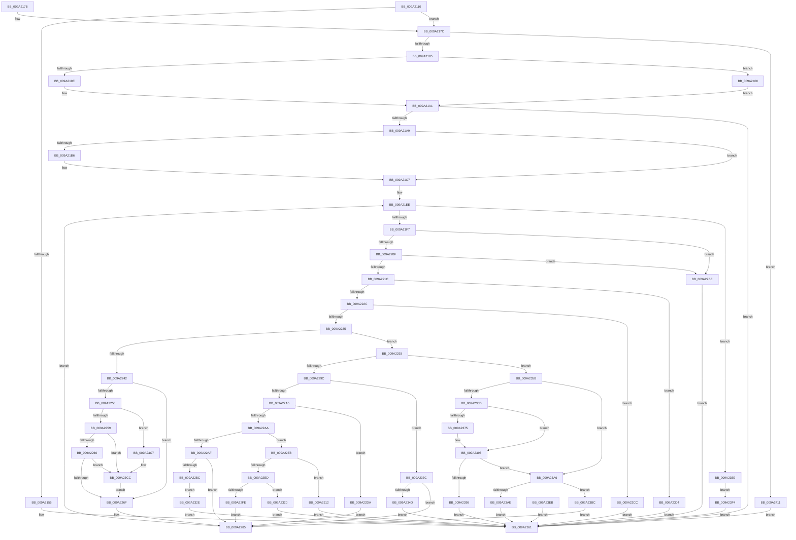

# MiCaptureAllocateMapExtendedParameters

- RVA: `0x009A2110`–`0x009A241B` (길이 `779` bytes)
- VA: `0x00000001409A2110`
- 실행 섹션: `PAGE`
- PDB 이름 있음: `예`; PDB Function 태그: `아니요`
- unwind 정보 RVA: `0x0009B654`
- 디코드: `201`개 명령, `779/779` bytes 표시
- 미해석 바이트: `0` (있으면 어셈블리에 `.byte`로 보존)

> 이 문서는 커널 이미지의 기계어와 PDB 기호를 분석해 생성했습니다. 4번과 5번은 함수 원형과 자료형을 바이너리 사용 방식에서 추정한 C 해석이며 원본 소스 복구 결과는 아닙니다.

## 1. Dependencies

- 직접 호출 지점: **3**; 고유 호출 대상: **3**
- 직접 호출자로 확인된 함수: **3**
- RIP 상대 이미지 참조: **0**

### Outgoing calls
- `0x009A214C` → [memset](../../text/6C/memset_function_006C6C40.md) (function, `0x006C6C40`)
- `0x009A21C2` → [ProbeForWrite](../8E/ProbeForWrite_function_008E91C0.md) (function, `0x008E91C0`)
- `0x009A23C7` → [ExRaiseDatatypeMisalignment](../89/ExRaiseDatatypeMisalignment_function_00899FD0.md) (function, `0x00899FD0`)

### Direct callers
- [MiAllocateUserPhysicalPages](../80/MiAllocateUserPhysicalPages_function_00809828.md) at `0x00809901`
- [MmAllocateVirtualMemory](MmAllocateVirtualMemory_function_009A1A40.md) at `0x009A1B2E`
- [MiMapViewOfSectionExCommon](MiMapViewOfSectionExCommon_function_009A1C60.md) at `0x009A1D48`

### Static image references
- 디코드된 RIP-relative 메모리 참조가 없습니다.

## 2. Other-region calls and transfers

- 다른 실행 섹션으로 향하는 call: **1**
  - `0x009A214C` → [memset](../../text/6C/memset_function_006C6C40.md) (`PAGE` → `.text`)
- 별도 외부 분기/꼬리 이동을 확인하지 못했습니다.

## 3. Assembly (complete function range)

```asm
009A2110  48 89 5C 24 08                  mov qword ptr [rsp + 8], rbx
009A2115  48 89 74 24 18                  mov qword ptr [rsp + 0x18], rsi
009A211A  57                              push rdi
009A211B  41 54                           push r12
009A211D  41 55                           push r13
009A211F  41 56                           push r14
009A2121  41 57                           push r15
009A2123  48 83 EC 60                     sub rsp, 0x60
009A2127  45 8B F9                        mov r15d, r9d
009A212A  45 0F B6 F0                     movzx r14d, r8b
009A212E  8B DA                           mov ebx, edx
009A2130  48 8B F9                        mov rdi, rcx
009A2133  45 33 ED                        xor r13d, r13d
009A2136  4C 89 6C 24 30                  mov qword ptr [rsp + 0x30], r13
009A213B  33 D2                           xor edx, edx
009A213D  45 8D 45 48                     lea r8d, [r13 + 0x48]
009A2141  48 8B B4 24 B0 00 00 00         mov rsi, qword ptr [rsp + 0xb0]
009A2149  48 8B CE                        mov rcx, rsi
009A214C  E8 EF 4A D2 FF                  call 0x1406c6c40
009A2151  85 DB                           test ebx, ebx
009A2153  75 27                           jne 0x1409a217c
009A2155  48 F7 DF                        neg rdi
009A2158  1B C9                           sbb ecx, ecx
009A215A  B8 0D 00 00 C0                  mov eax, 0xc000000d
009A215F  23 C1                           and eax, ecx
009A2161  4C 8D 5C 24 60                  lea r11, [rsp + 0x60]
009A2166  49 8B 5B 30                     mov rbx, qword ptr [r11 + 0x30]
009A216A  49 8B 73 40                     mov rsi, qword ptr [r11 + 0x40]
009A216E  49 8B E3                        mov rsp, r11
009A2171  41 5F                           pop r15
009A2173  41 5E                           pop r14
009A2175  41 5D                           pop r13
009A2177  41 5C                           pop r12
009A2179  5F                              pop rdi
009A217A  C3                              ret
009A217B  CC                              int3
009A217C  48 85 FF                        test rdi, rdi
009A217F  0F 84 8C 02 00 00               je 0x1409a2411
009A2185  B8 10 00 00 00                  mov eax, 0x10
009A218A  48 F7 E3                        mul rbx
009A218D  48 89 54 24 40                  mov qword ptr [rsp + 0x40], rdx
009A2192  48 8B C8                        mov rcx, rax
009A2195  48 85 D2                        test rdx, rdx
009A2198  0F 85 62 02 00 00               jne 0x1409a2400
009A219E  41 8B C5                        mov eax, r13d
009A21A1  89 44 24 20                     mov dword ptr [rsp + 0x20], eax
009A21A5  85 C0                           test eax, eax
009A21A7  78 B8                           js 0x1409a2161
009A21A9  45 8B E5                        mov r12d, r13d
009A21AC  44 89 6C 24 28                  mov dword ptr [rsp + 0x28], r13d
009A21B1  45 84 F6                        test r14b, r14b
009A21B4  74 11                           je 0x1409a21c7
009A21B6  41 B8 08 00 00 00               mov r8d, 8
009A21BC  48 8B D1                        mov rdx, rcx
009A21BF  48 8B CF                        mov rcx, rdi
009A21C2  E8 F9 6F F4 FF                  call 0x1408e91c0
009A21C7  48 89 7C 24 38                  mov qword ptr [rsp + 0x38], rdi
009A21CC  48 C1 E3 04                     shl rbx, 4
009A21D0  48 03 DF                        add rbx, rdi
009A21D3  48 89 5C 24 48                  mov qword ptr [rsp + 0x48], rbx
009A21D8  41 BA C0 FD FF FF               mov r10d, 0xfffffdc0
009A21DE  41 BB FF FF FF FF               mov r11d, 0xffffffff
009A21E4  49 B9 00 00 FF FF FF 7F 00 00   movabs r9, 0x7fffffff0000
009A21EE  48 3B FB                        cmp rdi, rbx
009A21F1  0F 83 F2 01 00 00               jae 0x1409a23e9
009A21F7  8B 0F                           mov ecx, dword ptr [rdi]
009A21F9  0F B6 C9                        movzx ecx, cl
009A21FC  89 8C 24 98 00 00 00            mov dword ptr [rsp + 0x98], ecx
009A2203  8D 41 FF                        lea eax, [rcx - 1]
009A2206  83 F8 05                        cmp eax, 5
009A2209  0F 87 AF 00 00 00               ja 0x1409a22be
009A220F  48 81 3F 00 01 00 00            cmp qword ptr [rdi], 0x100
009A2216  0F 83 A2 00 00 00               jae 0x1409a22be
009A221C  B8 01 00 00 00                  mov eax, 1
009A2221  D3 E0                           shl eax, cl
009A2223  41 85 C7                        test r15d, eax
009A2226  0F 84 D8 00 00 00               je 0x1409a2304
009A222C  41 85 C4                        test r12d, eax
009A222F  0F 85 97 00 00 00               jne 0x1409a22cc
009A2235  44 0B E0                        or r12d, eax
009A2238  44 89 64 24 28                  mov dword ptr [rsp + 0x28], r12d
009A223D  83 F9 01                        cmp ecx, 1
009A2240  75 51                           jne 0x1409a2293
009A2242  48 8B 4F 08                     mov rcx, qword ptr [rdi + 8]
009A2246  48 89 4C 24 50                  mov qword ptr [rsp + 0x50], rcx
009A224B  45 84 F6                        test r14b, r14b
009A224E  74 1F                           je 0x1409a226f
009A2250  F6 C1 07                        test cl, 7
009A2253  0F 85 6E 01 00 00               jne 0x1409a23c7
009A2259  48 8D 41 18                     lea rax, [rcx + 0x18]
009A225D  49 3B C1                        cmp rax, r9
009A2260  0F 87 66 01 00 00               ja 0x1409a23cc
009A2266  48 3B C1                        cmp rax, rcx
009A2269  0F 82 5D 01 00 00               jb 0x1409a23cc
009A226F  48 8B 01                        mov rax, qword ptr [rcx]
009A2272  48 89 06                        mov qword ptr [rsi], rax
009A2275  48 8B 41 08                     mov rax, qword ptr [rcx + 8]
009A2279  48 89 46 08                     mov qword ptr [rsi + 8], rax
009A227D  48 8B 41 10                     mov rax, qword ptr [rcx + 0x10]
009A2281  48 89 46 10                     mov qword ptr [rsi + 0x10], rax
009A2285  48 83 C7 10                     add rdi, 0x10
009A2289  48 89 7C 24 38                  mov qword ptr [rsp + 0x38], rdi
009A228E  E9 5B FF FF FF                  jmp 0x1409a21ee
009A2293  83 E9 02                        sub ecx, 2
009A2296  0F 84 BF 00 00 00               je 0x1409a235b
009A229C  83 E9 01                        sub ecx, 1
009A229F  0F 84 97 00 00 00               je 0x1409a233c
009A22A5  83 E9 01                        sub ecx, 1
009A22A8  74 30                           je 0x1409a22da
009A22AA  83 E9 01                        sub ecx, 1
009A22AD  75 39                           jne 0x1409a22e8
009A22AF  48 8B 47 08                     mov rax, qword ptr [rdi + 8]
009A22B3  48 89 46 38                     mov qword ptr [rsi + 0x38], rax
009A22B7  49 85 C2                        test r10, rax
009A22BA  74 C9                           je 0x1409a2285
009A22BC  EB 70                           jmp 0x1409a232e
009A22BE  B8 0D 00 00 C0                  mov eax, 0xc000000d
009A22C3  89 44 24 20                     mov dword ptr [rsp + 0x20], eax
009A22C7  E9 95 FE FF FF                  jmp 0x1409a2161
009A22CC  B8 0D 00 00 C0                  mov eax, 0xc000000d
009A22D1  89 44 24 20                     mov dword ptr [rsp + 0x20], eax
009A22D5  E9 87 FE FF FF                  jmp 0x1409a2161
009A22DA  48 8B 47 08                     mov rax, qword ptr [rdi + 8]
009A22DE  48 89 46 28                     mov qword ptr [rsi + 0x28], rax
009A22E2  C6 46 30 01                     mov byte ptr [rsi + 0x30], 1
009A22E6  EB 9D                           jmp 0x1409a2285
009A22E8  83 F9 01                        cmp ecx, 1
009A22EB  75 25                           jne 0x1409a2312
009A22ED  48 8B 47 08                     mov rax, qword ptr [rdi + 8]
009A22F1  48 89 44 24 30                  mov qword ptr [rsp + 0x30], rax
009A22F6  48 3D FF FF 00 00               cmp rax, 0xffff
009A22FC  77 22                           ja 0x1409a2320
009A22FE  66 89 46 32                     mov word ptr [rsi + 0x32], ax
009A2302  EB 81                           jmp 0x1409a2285
009A2304  B8 0D 00 00 C0                  mov eax, 0xc000000d
009A2309  89 44 24 20                     mov dword ptr [rsp + 0x20], eax
009A230D  E9 4F FE FF FF                  jmp 0x1409a2161
009A2312  B8 0D 00 00 C0                  mov eax, 0xc000000d
009A2317  89 44 24 20                     mov dword ptr [rsp + 0x20], eax
009A231B  E9 41 FE FF FF                  jmp 0x1409a2161
009A2320  B8 0D 00 00 C0                  mov eax, 0xc000000d
009A2325  89 44 24 20                     mov dword ptr [rsp + 0x20], eax
009A2329  E9 33 FE FF FF                  jmp 0x1409a2161
009A232E  B8 0D 00 00 C0                  mov eax, 0xc000000d
009A2333  89 44 24 20                     mov dword ptr [rsp + 0x20], eax
009A2337  E9 25 FE FF FF                  jmp 0x1409a2161
009A233C  48 8B 47 08                     mov rax, qword ptr [rdi + 8]
009A2340  48 89 46 18                     mov qword ptr [rsi + 0x18], rax
009A2344  48 85 C0                        test rax, rax
009A2347  0F 85 38 FF FF FF               jne 0x1409a2285
009A234D  B8 0D 00 00 C0                  mov eax, 0xc000000d
009A2352  89 44 24 20                     mov dword ptr [rsp + 0x20], eax
009A2356  E9 06 FE FF FF                  jmp 0x1409a2161
009A235B  48 8B 47 08                     mov rax, qword ptr [rdi + 8]
009A235F  48 89 44 24 30                  mov qword ptr [rsp + 0x30], rax
009A2364  8B C8                           mov ecx, eax
009A2366  8B D0                           mov edx, eax
009A2368  49 3B C3                        cmp rax, r11
009A236B  76 39                           jbe 0x1409a23a6
009A236D  4C 8B C0                        mov r8, rax
009A2370  48 85 C0                        test rax, rax
009A2373  79 1E                           jns 0x1409a2393
009A2375  48 B9 FF FF FF FF FF FF FF 7F   movabs rcx, 0x7fffffffffffffff
009A237F  48 23 C1                        and rax, rcx
009A2382  48 8B C8                        mov rcx, rax
009A2385  4C 8B C0                        mov r8, rax
009A2388  48 89 44 24 30                  mov qword ptr [rsp + 0x30], rax
009A238D  C6 46 31 01                     mov byte ptr [rsi + 0x31], 1
009A2391  8B D0                           mov edx, eax
009A2393  4D 3B C3                        cmp r8, r11
009A2396  76 0E                           jbe 0x1409a23a6
009A2398  B8 0D 00 00 C0                  mov eax, 0xc000000d
009A239D  89 44 24 20                     mov dword ptr [rsp + 0x20], eax
009A23A1  E9 BB FD FF FF                  jmp 0x1409a2161
009A23A6  89 46 20                        mov dword ptr [rsi + 0x20], eax
009A23A9  41 3B CB                        cmp ecx, r11d
009A23AC  75 0E                           jne 0x1409a23bc
009A23AE  B8 0D 00 00 C0                  mov eax, 0xc000000d
009A23B3  89 44 24 20                     mov dword ptr [rsp + 0x20], eax
009A23B7  E9 A5 FD FF FF                  jmp 0x1409a2161
009A23BC  8D 42 01                        lea eax, [rdx + 1]
009A23BF  89 46 20                        mov dword ptr [rsi + 0x20], eax
009A23C2  E9 BE FE FF FF                  jmp 0x1409a2285
009A23C7  E8 04 7C EF FF                  call 0x140899fd0
009A23CC  41 0F B6 01                     movzx eax, byte ptr [r9]
009A23D0  48 8B 7C 24 38                  mov rdi, qword ptr [rsp + 0x38]
009A23D5  48 8B 5C 24 48                  mov rbx, qword ptr [rsp + 0x48]
009A23DA  44 8B 64 24 28                  mov r12d, dword ptr [rsp + 0x28]
009A23DF  48 8B 4C 24 50                  mov rcx, qword ptr [rsp + 0x50]
009A23E4  E9 86 FE FF FF                  jmp 0x1409a226f
009A23E9  EB 09                           jmp 0x1409a23f4
009A23EB  89 44 24 20                     mov dword ptr [rsp + 0x20], eax
009A23EF  E9 6D FD FF FF                  jmp 0x1409a2161
009A23F4  44 89 66 34                     mov dword ptr [rsi + 0x34], r12d
009A23F8  41 8B C5                        mov eax, r13d
009A23FB  E9 61 FD FF FF                  jmp 0x1409a2161
009A2400  48 C7 C1 FF FF FF FF            mov rcx, 0xffffffffffffffff
009A2407  B8 95 00 00 C0                  mov eax, 0xc0000095
009A240C  E9 90 FD FF FF                  jmp 0x1409a21a1
009A2411  B8 0D 00 00 C0                  mov eax, 0xc000000d
009A2416  E9 46 FD FF FF                  jmp 0x1409a2161
```

## 4. C-style interpretation (structured pseudocode)

```c
__int64 __fastcall MiCaptureAllocateMapExtendedParameters(__int64 a1, int a2, unsigned __int8 a3, int a4, __int64 a5)
{
    __int64 result;
    __int64 v_r12;
    __int64 v_r13;
    __int64 v_rbx;
    __int64 v_rdi;
    __int64 v_rsp;
    unsigned __int64 v_stack_m10;
    unsigned __int64 v_stack_m18;
    unsigned __int64 v_stack_m20;
    unsigned __int64 v_stack_m28;
    unsigned __int64 v_stack_m30;
    unsigned int v_stack_m38;
    unsigned int v_stack_m40;
    unsigned __int64 v_stack_m58;
    unsigned __int64 v_stack_p18;
    unsigned int v_stack_p38;
    unsigned __int64 v_stack_p8;

    v_stack_p8 = v_rbx;
    v_stack_p18 = v_rsi;
    v_rsp = (v_rsp) - (96);
    v_r13 = 0;
    v_stack_m58 = 0;
    a2 = 0;
    result = memset(a5, a2, v_r13 + 72, a4);
    if ((unsigned int)((unsigned int)(a2)) != 0) goto loc_009A217C;
    v_rdi = -(a1);
    result = (unsigned int)(((unsigned int)(0xC000000DULL)) & ((unsigned int)(a5)));
loc_009A2161:
    return result;
loc_009A217C:
    if (v_rdi == 0) goto loc_009A2411;
    v_stack_m20 = 0;
    if (0 != 0) goto loc_009A2400;
loc_009A21A1:
    v_stack_m40 = 0;
    if (sign_flag) goto loc_009A2161;
    v_stack_m38 = 0;
    result = 0;
    if (a3 != 0) {
        a3 = 8;
        a2 = 16;
        a1 = v_rdi;
        result = ProbeForWrite(a1, a2, a3, a4);
    }
    v_stack_m28 = v_rdi;
    v_rbx = (*(unsigned __int64 *)(v_stack_m28 + 48)) << (4);
    v_rbx = (v_rbx) + (v_rdi);
    v_stack_m18 = v_rbx;
loc_009A21EE:
    if (v_rdi >= v_rbx) goto loc_009A23E9;
    v_stack_p38 = (unsigned int)((unsigned __int8)((unsigned int)(*(unsigned int *)(v_rdi))));
    if (((unsigned int)((unsigned __int8)((unsigned int)(*(unsigned int *)(v_rdi))) - 1)) > 5) goto loc_009A22BE;
    if ((*(unsigned __int64 *)(v_rdi)) >= 256) goto loc_009A22BE;
    result = (unsigned int)((1) << ((unsigned __int8)((unsigned __int8)((unsigned int)(*(unsigned int *)(v_rdi))))));
    if ((((unsigned int)((unsigned int)(a4))) & ((unsigned int)(result))) == 0) goto loc_009A2304;
    if (((0) & ((unsigned int)(result))) != 0) goto loc_009A22CC;
    v_r12 = (unsigned int)((0) | ((unsigned int)(result)));
    v_stack_m38 = (unsigned int)(v_r12);
    if (((unsigned int)((unsigned __int8)((unsigned int)(*(unsigned int *)(v_rdi))))) != 1) goto loc_009A2293;
    v_stack_m10 = *(unsigned __int64 *)(v_rdi + 8);
    if (a3 == 0) goto loc_009A226F;
    if ((((unsigned __int8)(*(unsigned __int64 *)(v_rdi + 8))) & (7)) != 0) goto loc_009A23C7;
    if ((*(unsigned __int64 *)(v_rdi + 8) + 24) > a4) goto loc_009A23CC;
    if ((*(unsigned __int64 *)(v_rdi + 8) + 24) < (*(unsigned __int64 *)(v_rdi + 8))) goto loc_009A23CC;
loc_009A226F:
    *(unsigned __int64 *)(*(unsigned __int64 *)(v_stack_m28 + 64)) = *(unsigned __int64 *)(*(unsigned __int64 *)(v_rdi + 8));
    *(unsigned __int64 *)(*(unsigned __int64 *)(v_stack_m28 + 64) + 8) = *(unsigned __int64 *)(*(unsigned __int64 *)(v_rdi + 8) + 8);
    *(unsigned __int64 *)(*(unsigned __int64 *)(v_stack_m28 + 64) + 16) = *(unsigned __int64 *)(*(unsigned __int64 *)(v_rdi + 8) + 16);
loc_009A2285:
    v_rdi = (v_rdi) + (16);
    v_stack_m28 = v_rdi;
    goto loc_009A21EE;
loc_009A2293:
    a1 = (unsigned int)((*(unsigned __int64 *)(v_rdi + 8)) - (2));
    if (condition_is_equal) goto loc_009A235B;
    a1 = (unsigned int)((a1) - (1));
    if (condition_is_equal) goto loc_009A233C;
    a1 = (unsigned int)((a1) - (1));
    if (condition_is_equal) goto loc_009A22DA;
    a1 = (unsigned int)((a1) - (1));
    if (condition_is_not_equal) goto loc_009A22E8;
    *(unsigned __int64 *)(*(unsigned __int64 *)(v_stack_m28 + 64) + 56) = *(unsigned __int64 *)(v_rdi + 8);
    if ((((unsigned int)(0xFFFFFDC0ULL)) & (*(unsigned __int64 *)(v_rdi + 8))) == 0) goto loc_009A2285;
    goto loc_009A232E;
loc_009A22BE:
    v_stack_m40 = (unsigned int)((unsigned int)(0xC000000DULL));
    goto loc_009A2161;
loc_009A22CC:
    v_stack_m40 = (unsigned int)((unsigned int)(0xC000000DULL));
    goto loc_009A2161;
loc_009A22DA:
    *(unsigned __int64 *)(*(unsigned __int64 *)(v_stack_m28 + 64) + 40) = *(unsigned __int64 *)(v_rdi + 8);
    *(unsigned __int8 *)(*(unsigned __int64 *)(v_stack_m28 + 64) + 48) = 1;
    goto loc_009A2285;
loc_009A22E8:
    if (((unsigned int)(a1)) != 1) goto loc_009A2312;
    v_stack_m30 = *(unsigned __int64 *)(v_rdi + 8);
    if ((*(unsigned __int64 *)(v_rdi + 8)) > 0xFFFFULL) goto loc_009A2320;
    *(unsigned __int16 *)(*(unsigned __int64 *)(v_stack_m28 + 64) + 50) = (unsigned __int16)(*(unsigned __int64 *)(v_rdi + 8));
    goto loc_009A2285;
loc_009A2304:
    v_stack_m40 = (unsigned int)((unsigned int)(0xC000000DULL));
    goto loc_009A2161;
loc_009A2312:
    v_stack_m40 = (unsigned int)((unsigned int)(0xC000000DULL));
    goto loc_009A2161;
loc_009A2320:
    v_stack_m40 = (unsigned int)((unsigned int)(0xC000000DULL));
    goto loc_009A2161;
loc_009A232E:
    v_stack_m40 = (unsigned int)((unsigned int)(0xC000000DULL));
    goto loc_009A2161;
loc_009A233C:
    *(unsigned __int64 *)(*(unsigned __int64 *)(v_stack_m28 + 64) + 24) = *(unsigned __int64 *)(v_rdi + 8);
    if (*(unsigned __int64 *)(v_rdi + 8) != 0) goto loc_009A2285;
    v_stack_m40 = (unsigned int)((unsigned int)(0xC000000DULL));
    goto loc_009A2161;
loc_009A235B:
    v_stack_m30 = *(unsigned __int64 *)(v_rdi + 8);
    if ((*(unsigned __int64 *)(v_rdi + 8)) <= ((unsigned int)(0xFFFFFFFFULL))) goto loc_009A23A6;
    result = *(unsigned __int64 *)(v_rdi + 8);
    if (sign_flag) {
        result = (*(unsigned __int64 *)(v_rdi + 8)) & ((unsigned int)((unsigned int)(*(unsigned __int64 *)(v_rdi + 8))));
        a1 = result;
        a3 = result;
        v_stack_m30 = result;
        *(unsigned __int8 *)(*(unsigned __int64 *)(v_stack_m28 + 64) + 49) = 1;
        a2 = (unsigned int)(result);
    }
    if (a3 <= ((unsigned int)(0xFFFFFFFFULL))) goto loc_009A23A6;
    v_stack_m40 = (unsigned int)((unsigned int)(0xC000000DULL));
    goto loc_009A2161;
loc_009A23A6:
    *(unsigned int *)(*(unsigned __int64 *)(v_stack_m28 + 64) + 32) = (unsigned int)((unsigned int)(0xC000000DULL));
    if (((unsigned int)(a1)) != ((unsigned int)((unsigned int)(0xFFFFFFFFULL)))) goto loc_009A23BC;
    v_stack_m40 = (unsigned int)((unsigned int)(0xC000000DULL));
    goto loc_009A2161;
loc_009A23BC:
    *(unsigned int *)(*(unsigned __int64 *)(v_stack_m28 + 64) + 32) = (unsigned int)(a2 + 1);
    goto loc_009A2285;
loc_009A23C7:
    result = ExRaiseDatatypeMisalignment(a1, a2, a3, a4);
loc_009A23CC:
    goto loc_009A226F;
loc_009A23E9:
    goto loc_009A23F4;
loc_009A23F4:
    *(unsigned int *)(*(unsigned __int64 *)(v_stack_m28 + 64) + 52) = (unsigned int)((unsigned int)(v_stack_m38));
    goto loc_009A2161;
loc_009A2400:
    goto loc_009A21A1;
loc_009A2411:
    goto loc_009A2161;
}
```

## 5. (Beta) C Style

```c
int64_t MiCaptureAllocateMapExtendedParameters(int64_t Arg1, int32_t Arg2, uint8_t Arg3, int32_t Arg4, void *Arg5)
{
    uint8_t *arg5 = (uint8_t *)Arg5;

    int64_t result;
    int64_t local_r12;
    int64_t local_r13;
    int64_t local_rbx;
    int64_t local_rdi;
    int64_t local_rsp;
    uint64_t v_stack_m10;
    uint64_t v_stack_m18;
    uint64_t v_stack_m20;
    uint64_t v_stack_m28;
    uint64_t v_stack_m30;
    uint32_t v_stack_m38;
    uint32_t v_stack_m40;
    uint64_t v_stack_m58;
    uint64_t v_stack_p18;
    uint32_t v_stack_p38;
    uint64_t v_stack_p8;

    v_stack_p8 = local_rbx;
    v_stack_p18 = local_rsi;
    local_rsp = (local_rsp) - (96);
    local_r13 = 0;
    v_stack_m58 = 0;
    Arg2 = 0;
    result = memset(Arg5, Arg2, local_r13 + 72, Arg4);
    if ((uint32_t)((uint32_t)(Arg2)) != 0) goto loc_009A217C;
    local_rdi = -(Arg1);
    result = (uint32_t)(((uint32_t)(0xC000000DULL)) & ((uint32_t)(Arg5)));
loc_009A2161:
    return result;
loc_009A217C:
    if (local_rdi == 0) goto loc_009A2411;
    v_stack_m20 = 0;
    if (0 != 0) goto loc_009A2400;
loc_009A21A1:
    v_stack_m40 = 0;
    if (sign_flag) goto loc_009A2161;
    v_stack_m38 = 0;
    result = 0;
    if (Arg3 != 0) {
        Arg3 = 8;
        Arg2 = 16;
        Arg1 = local_rdi;
        result = ProbeForWrite(Arg1, Arg2, Arg3, Arg4);
    }
    v_stack_m28 = local_rdi;
    local_rbx = (*(uint64_t *)(v_stack_m28 + 0x30)) << (4);
    local_rbx = (local_rbx) + (local_rdi);
    v_stack_m18 = local_rbx;
loc_009A21EE:
    if (local_rdi >= local_rbx) goto loc_009A23E9;
    v_stack_p38 = (uint32_t)((uint8_t)((uint32_t)(*(uint32_t *)(local_rdi))));
    if (((uint32_t)((uint8_t)((uint32_t)(*(uint32_t *)(local_rdi))) - 1)) > 5) goto loc_009A22BE;
    if ((*(uint64_t *)(local_rdi)) >= 256) goto loc_009A22BE;
    result = (uint32_t)((1) << ((uint8_t)((uint8_t)((uint32_t)(*(uint32_t *)(local_rdi))))));
    if ((((uint32_t)((uint32_t)(Arg4))) & ((uint32_t)(result))) == 0) goto loc_009A2304;
    if (((0) & ((uint32_t)(result))) != 0) goto loc_009A22CC;
    local_r12 = (uint32_t)((0) | ((uint32_t)(result)));
    v_stack_m38 = (uint32_t)(local_r12);
    if (((uint32_t)((uint8_t)((uint32_t)(*(uint32_t *)(local_rdi))))) != 1) goto loc_009A2293;
    v_stack_m10 = *(uint64_t *)(local_rdi + 0x8);
    if (Arg3 == 0) goto loc_009A226F;
    if ((((uint8_t)(*(uint64_t *)(local_rdi + 0x8))) & (7)) != 0) goto loc_009A23C7;
    if ((*(uint64_t *)(local_rdi + 0x8) + 24) > Arg4) goto loc_009A23CC;
    if ((*(uint64_t *)(local_rdi + 0x8) + 24) < (*(uint64_t *)(local_rdi + 0x8))) goto loc_009A23CC;
loc_009A226F:
    *(uint64_t *)(*(uint64_t *)(v_stack_m28 + 0x40)) = *(uint64_t *)(*(uint64_t *)(local_rdi + 0x8));
    *(uint64_t *)(*(uint64_t *)(v_stack_m28 + 0x40) + 0x8) = *(uint64_t *)(*(uint64_t *)(local_rdi + 0x8) + 0x8);
    *(uint64_t *)(*(uint64_t *)(v_stack_m28 + 0x40) + 0x10) = *(uint64_t *)(*(uint64_t *)(local_rdi + 0x8) + 0x10);
loc_009A2285:
    local_rdi = (local_rdi) + (16);
    v_stack_m28 = local_rdi;
    goto loc_009A21EE;
loc_009A2293:
    Arg1 = (uint32_t)((*(uint64_t *)(local_rdi + 0x8)) - (2));
    if (condition_is_equal) goto loc_009A235B;
    Arg1 = (uint32_t)((Arg1) - (1));
    if (condition_is_equal) goto loc_009A233C;
    Arg1 = (uint32_t)((Arg1) - (1));
    if (condition_is_equal) goto loc_009A22DA;
    Arg1 = (uint32_t)((Arg1) - (1));
    if (condition_is_not_equal) goto loc_009A22E8;
    *(uint64_t *)(*(uint64_t *)(v_stack_m28 + 0x40) + 0x38) = *(uint64_t *)(local_rdi + 0x8);
    if ((((uint32_t)(0xFFFFFDC0ULL)) & (*(uint64_t *)(local_rdi + 0x8))) == 0) goto loc_009A2285;
    goto loc_009A232E;
loc_009A22BE:
    v_stack_m40 = (uint32_t)((uint32_t)(0xC000000DULL));
    goto loc_009A2161;
loc_009A22CC:
    v_stack_m40 = (uint32_t)((uint32_t)(0xC000000DULL));
    goto loc_009A2161;
loc_009A22DA:
    *(uint64_t *)(*(uint64_t *)(v_stack_m28 + 0x40) + 0x28) = *(uint64_t *)(local_rdi + 0x8);
    *(uint8_t *)(*(uint64_t *)(v_stack_m28 + 0x40) + 0x30) = 1;
    goto loc_009A2285;
loc_009A22E8:
    if (((uint32_t)(Arg1)) != 1) goto loc_009A2312;
    v_stack_m30 = *(uint64_t *)(local_rdi + 0x8);
    if ((*(uint64_t *)(local_rdi + 0x8)) > 0xFFFFULL) goto loc_009A2320;
    *(uint16_t *)(*(uint64_t *)(v_stack_m28 + 0x40) + 0x32) = (uint16_t)(*(uint64_t *)(local_rdi + 0x8));
    goto loc_009A2285;
loc_009A2304:
    v_stack_m40 = (uint32_t)((uint32_t)(0xC000000DULL));
    goto loc_009A2161;
loc_009A2312:
    v_stack_m40 = (uint32_t)((uint32_t)(0xC000000DULL));
    goto loc_009A2161;
loc_009A2320:
    v_stack_m40 = (uint32_t)((uint32_t)(0xC000000DULL));
    goto loc_009A2161;
loc_009A232E:
    v_stack_m40 = (uint32_t)((uint32_t)(0xC000000DULL));
    goto loc_009A2161;
loc_009A233C:
    *(uint64_t *)(*(uint64_t *)(v_stack_m28 + 0x40) + 0x18) = *(uint64_t *)(local_rdi + 0x8);
    if (*(uint64_t *)(local_rdi + 0x8) != 0) goto loc_009A2285;
    v_stack_m40 = (uint32_t)((uint32_t)(0xC000000DULL));
    goto loc_009A2161;
loc_009A235B:
    v_stack_m30 = *(uint64_t *)(local_rdi + 0x8);
    if ((*(uint64_t *)(local_rdi + 0x8)) <= ((uint32_t)(0xFFFFFFFFULL))) goto loc_009A23A6;
    result = *(uint64_t *)(local_rdi + 0x8);
    if (sign_flag) {
        result = (*(uint64_t *)(local_rdi + 0x8)) & ((uint32_t)((uint32_t)(*(uint64_t *)(local_rdi + 0x8))));
        Arg1 = result;
        Arg3 = result;
        v_stack_m30 = result;
        *(uint8_t *)(*(uint64_t *)(v_stack_m28 + 0x40) + 0x31) = 1;
        Arg2 = (uint32_t)(result);
    }
    if (Arg3 <= ((uint32_t)(0xFFFFFFFFULL))) goto loc_009A23A6;
    v_stack_m40 = (uint32_t)((uint32_t)(0xC000000DULL));
    goto loc_009A2161;
loc_009A23A6:
    *(uint32_t *)(*(uint64_t *)(v_stack_m28 + 0x40) + 0x20) = (uint32_t)((uint32_t)(0xC000000DULL));
    if (((uint32_t)(Arg1)) != ((uint32_t)((uint32_t)(0xFFFFFFFFULL)))) goto loc_009A23BC;
    v_stack_m40 = (uint32_t)((uint32_t)(0xC000000DULL));
    goto loc_009A2161;
loc_009A23BC:
    *(uint32_t *)(*(uint64_t *)(v_stack_m28 + 0x40) + 0x20) = (uint32_t)(Arg2 + 1);
    goto loc_009A2285;
loc_009A23C7:
    result = ExRaiseDatatypeMisalignment(Arg1, Arg2, Arg3, Arg4);
loc_009A23CC:
    goto loc_009A226F;
loc_009A23E9:
    goto loc_009A23F4;
loc_009A23F4:
    *(uint32_t *)(*(uint64_t *)(v_stack_m28 + 0x40) + 0x34) = (uint32_t)((uint32_t)(v_stack_m38));
    goto loc_009A2161;
loc_009A2400:
    goto loc_009A21A1;
loc_009A2411:
    goto loc_009A2161;
}
```

### 관측된 메모리 오프셋

구조체 형식이 확인되지 않은 접근은 인자 기준의 오프셋으로만 기록했습니다.

| 기준 인자 | 오프셋 표현 | 폭 (bit) | 접근 |
|---|---:|---:|---|
| `Arg5` | `+ 0x0` | `64` | `W` |
| `Arg5` | `+ 0x8` | `64` | `W` |
| `Arg5` | `+ 0x10` | `64` | `W` |
| `Arg5` | `+ 0x18` | `64` | `W` |
| `Arg5` | `+ 0x20` | `32` | `W` |
| `Arg5` | `+ 0x28` | `64` | `W` |
| `Arg5` | `+ 0x30` | `8` | `W` |
| `Arg5` | `+ 0x31` | `8` | `W` |
| `Arg5` | `+ 0x32` | `16` | `W` |
| `Arg5` | `+ 0x34` | `32` | `W` |
| `Arg5` | `+ 0x38` | `64` | `W` |

## 6. Execution-region graph

[열기: 2D/3D 그래프와 함수 탐색 컨트롤 패널](../../../control-panel.html?section=page&rva=0x009A2110&view=graph)

- 2D 그래프는 위에서 아래로 흐르고, 3D 그래프는 빈 공간을 드래그해 회전합니다. Shift+드래그는 이동, 휠은 확대·축소, 함수 노드 선택은 대상 보고서 이동입니다.

### Static fallback


