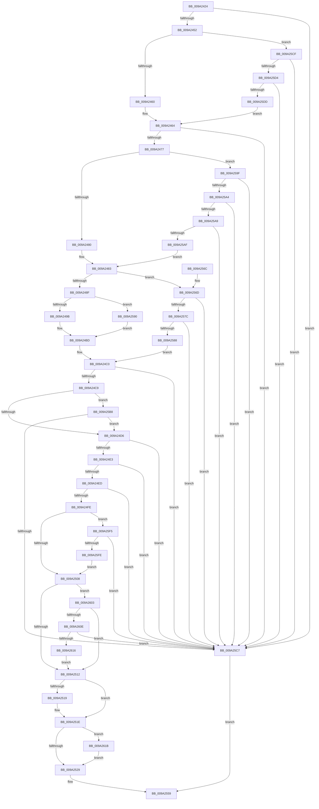

# MiMapExParametersInitialize

- RVA: `0x009A2424`–`0x009A2625` (길이 `513` bytes)
- VA: `0x00000001409A2424`
- 실행 섹션: `PAGE`
- PDB 이름 있음: `예`; PDB Function 태그: `아니요`
- unwind 정보 RVA: `0x0009B694`
- 디코드: `124`개 명령, `513/513` bytes 표시
- 미해석 바이트: `0` (있으면 어셈블리에 `.byte`로 보존)

> 이 문서는 커널 이미지의 기계어와 PDB 기호를 분석해 생성했습니다. 4번과 5번은 함수 원형과 자료형을 바이너리 사용 방식에서 추정한 C 해석이며 원본 소스 복구 결과는 아닙니다.

## 1. Dependencies

- 직접 호출 지점: **1**; 고유 호출 대상: **1**
- 직접 호출자로 확인된 함수: **1**
- RIP 상대 이미지 참조: **1**

### Outgoing calls
- `0x009A243D` → [MiSectionControlArea](../../text/29/MiSectionControlArea_function_00294CB0.md) (function, `0x00294CB0`)

### Direct callers
- [MiMapViewOfSectionExCommon](MiMapViewOfSectionExCommon_function_009A1C60.md) at `0x009A1DCF`

### Static image references
- `0x009A24ED` → RVA `0x00FC5000` (`ALMOSTRO`; read)

## 2. Other-region calls and transfers

- 다른 실행 섹션으로 향하는 call: **1**
  - `0x009A243D` → [MiSectionControlArea](../../text/29/MiSectionControlArea_function_00294CB0.md) (`PAGE` → `.text`)
- 별도 외부 분기/꼬리 이동을 확인하지 못했습니다.

## 3. Assembly (complete function range)

```asm
009A2424  48 89 5C 24 08                  mov qword ptr [rsp + 8], rbx
009A2429  48 89 74 24 10                  mov qword ptr [rsp + 0x10], rsi
009A242E  57                              push rdi
009A242F  48 83 EC 20                     sub rsp, 0x20
009A2433  4C 8B D1                        mov r10, rcx
009A2436  48 8B FA                        mov rdi, rdx
009A2439  48 8B 4A 20                     mov rcx, qword ptr [rdx + 0x20]
009A243D  E8 6E 28 8F FF                  call 0x140294cb0
009A2442  45 33 C9                        xor r9d, r9d
009A2445  48 8B F0                        mov rsi, rax
009A2448  4D 39 48 10                     cmp qword ptr [r8 + 0x10], r9
009A244C  0F 85 75 01 00 00               jne 0x1409a25c7
009A2452  41 F7 42 28 00 40 00 00         test dword ptr [r10 + 0x28], 0x4000
009A245A  0F 85 6F 01 00 00               jne 0x1409a25cf
009A2460  49 8D 50 08                     lea rdx, [r8 + 8]
009A2464  49 8B 42 10                     mov rax, qword ptr [r10 + 0x10]
009A2468  49 8B 18                        mov rbx, qword ptr [r8]
009A246B  48 FF C8                        dec rax
009A246E  48 85 C3                        test rbx, rax
009A2471  0F 85 50 01 00 00               jne 0x1409a25c7
009A2477  4C 39 0F                        cmp qword ptr [rdi], r9
009A247A  0F 85 1F 01 00 00               jne 0x1409a259f
009A2480  4C 8B DA                        mov r11, rdx
009A2483  48 8B 0A                        mov rcx, qword ptr [rdx]
009A2486  48 85 C9                        test rcx, rcx
009A2489  0F 85 DE 00 00 00               jne 0x1409a256d
009A248F  41 8B 42 40                     mov eax, dword ptr [r10 + 0x40]
009A2493  A8 08                           test al, 8
009A2495  0F 85 F5 00 00 00               jne 0x1409a2590
009A249B  48 8B 47 28                     mov rax, qword ptr [rdi + 0x28]
009A249F  48 8B 88 68 03 00 00            mov rcx, qword ptr [rax + 0x368]
009A24A6  48 B8 FF FF FE FF FF 7F 00 00   movabs rax, 0x7ffffffeffff
009A24B0  48 FF C9                        dec rcx
009A24B3  48 3B C8                        cmp rcx, rax
009A24B6  48 0F 43 C8                     cmovae rcx, rax
009A24BA  48 8B C1                        mov rax, rcx
009A24BD  48 89 02                        mov qword ptr [rdx], rax
009A24C0  48 3B D8                        cmp rbx, rax
009A24C3  0F 83 FE 00 00 00               jae 0x1409a25c7
009A24C9  48 8B 4F 08                     mov rcx, qword ptr [rdi + 8]
009A24CD  48 85 C9                        test rcx, rcx
009A24D0  0F 85 E2 00 00 00               jne 0x1409a25b8
009A24D6  41 8B 52 28                     mov edx, dword ptr [r10 + 0x28]
009A24DA  F6 C2 7F                        test dl, 0x7f
009A24DD  0F 85 E4 00 00 00               jne 0x1409a25c7
009A24E3  45 39 4A 34                     cmp dword ptr [r10 + 0x34], r9d
009A24E7  0F 85 DA 00 00 00               jne 0x1409a25c7
009A24ED  0F B7 05 0C 2B 62 00            movzx eax, word ptr [rip + 0x622b0c]
009A24F4  41 39 40 20                     cmp dword ptr [r8 + 0x20], eax
009A24F8  0F 87 C9 00 00 00               ja 0x1409a25c7
009A24FE  0F BA E2 1E                     bt edx, 0x1e
009A2502  0F 82 ED 00 00 00               jb 0x1409a25f5
009A2508  0F BA E2 1D                     bt edx, 0x1d
009A250C  0F 82 F1 00 00 00               jb 0x1409a2603
009A2512  41 F6 40 38 20                  test byte ptr [r8 + 0x38], 0x20
009A2517  74 05                           je 0x1409a251e
009A2519  41 83 4A 40 02                  or dword ptr [r10 + 0x40], 2
009A251E  41 F6 40 38 40                  test byte ptr [r8 + 0x38], 0x40
009A2523  0F 85 F2 00 00 00               jne 0x1409a261b
009A2529  41 8B 40 20                     mov eax, dword ptr [r8 + 0x20]
009A252D  0F BA F2 0E                     btr edx, 0xe
009A2531  41 89 42 34                     mov dword ptr [r10 + 0x34], eax
009A2535  49 8B 08                        mov rcx, qword ptr [r8]
009A2538  49 89 0A                        mov qword ptr [r10], rcx
009A253B  49 8B 48 08                     mov rcx, qword ptr [r8 + 8]
009A253F  49 89 4A 08                     mov qword ptr [r10 + 8], rcx
009A2543  41 0F B7 48 32                  movzx ecx, word ptr [r8 + 0x32]
009A2548  66 41 89 4A 3A                  mov word ptr [r10 + 0x3a], cx
009A254D  49 8B 48 38                     mov rcx, qword ptr [r8 + 0x38]
009A2551  49 89 4A 70                     mov qword ptr [r10 + 0x70], rcx
009A2555  41 89 52 28                     mov dword ptr [r10 + 0x28], edx
009A2559  48 8B 5C 24 30                  mov rbx, qword ptr [rsp + 0x30]
009A255E  41 8B C1                        mov eax, r9d
009A2561  48 8B 74 24 38                  mov rsi, qword ptr [rsp + 0x38]
009A2566  48 83 C4 20                     add rsp, 0x20
009A256A  5F                              pop rdi
009A256B  C3                              ret
009A256C  CC                              int3
009A256D  48 B8 FF FF FE FF FF 7F 00 00   movabs rax, 0x7ffffffeffff
009A2577  48 3B C8                        cmp rcx, rax
009A257A  77 4B                           ja 0x1409a25c7
009A257C  41 8B 03                        mov eax, dword ptr [r11]
009A257F  FF C0                           inc eax
009A2581  A9 FF 0F 00 00                  test eax, 0xfff
009A2586  75 3F                           jne 0x1409a25c7
009A2588  48 8B C1                        mov rax, rcx
009A258B  E9 30 FF FF FF                  jmp 0x1409a24c0
009A2590  48 B8 FF FF FE FF FF 7F 00 00   movabs rax, 0x7ffffffeffff
009A259A  E9 1E FF FF FF                  jmp 0x1409a24bd
009A259F  48 85 DB                        test rbx, rbx
009A25A2  75 23                           jne 0x1409a25c7
009A25A4  4C 39 0A                        cmp qword ptr [rdx], r9
009A25A7  75 1E                           jne 0x1409a25c7
009A25A9  4D 39 48 10                     cmp qword ptr [r8 + 0x10], r9
009A25AD  75 18                           jne 0x1409a25c7
009A25AF  4D 8D 58 08                     lea r11, [r8 + 8]
009A25B3  E9 CB FE FF FF                  jmp 0x1409a2483
009A25B8  48 2B C3                        sub rax, rbx
009A25BB  48 FF C0                        inc rax
009A25BE  48 3B C1                        cmp rax, rcx
009A25C1  0F 83 0F FF FF FF               jae 0x1409a24d6
009A25C7  41 B9 0D 00 00 C0               mov r9d, 0xc000000d
009A25CD  EB 8A                           jmp 0x1409a2559
009A25CF  4D 39 08                        cmp qword ptr [r8], r9
009A25D2  75 F3                           jne 0x1409a25c7
009A25D4  49 8D 50 08                     lea rdx, [r8 + 8]
009A25D8  4C 39 0A                        cmp qword ptr [rdx], r9
009A25DB  75 EA                           jne 0x1409a25c7
009A25DD  41 0F BA 6A 40 1A               bts dword ptr [r10 + 0x40], 0x1a
009A25E3  41 83 4A 3C 02                  or dword ptr [r10 + 0x3c], 2
009A25E8  49 C7 42 10 00 10 00 00         mov qword ptr [r10 + 0x10], 0x1000
009A25F0  E9 6F FE FF FF                  jmp 0x1409a2464
009A25F5  F7 46 38 20 04 00 00            test dword ptr [rsi + 0x38], 0x420
009A25FC  75 C9                           jne 0x1409a25c7
009A25FE  E9 05 FF FF FF                  jmp 0x1409a2508
009A2603  8B 46 38                        mov eax, dword ptr [rsi + 0x38]
009A2606  A8 20                           test al, 0x20
009A2608  0F 84 04 FF FF FF               je 0x1409a2512
009A260E  41 8B 42 3C                     mov eax, dword ptr [r10 + 0x3c]
009A2612  A8 01                           test al, 1
009A2614  75 B1                           jne 0x1409a25c7
009A2616  E9 F7 FE FF FF                  jmp 0x1409a2512
009A261B  41 83 4A 78 08                  or dword ptr [r10 + 0x78], 8
009A2620  E9 04 FF FF FF                  jmp 0x1409a2529
```

## 4. C-style interpretation (structured pseudocode)

```c
__int64 __fastcall MiMapExParametersInitialize(__int64 a1, __int64 a2, __int64 a3, int a4)
{
    __int64 result;
    __int64 v_rsp;
    unsigned __int64 v_stack_p10;
    unsigned __int64 v_stack_p8;

    v_stack_p8 = v_rbx;
    v_stack_p10 = v_rsi;
    v_rsp = (v_rsp) - (32);
    result = MiSectionControlArea(*(unsigned __int64 *)(a2 + 32), a2, a3, a4);
    a4 = 0;
    if ((*(unsigned __int64 *)(a3 + 16)) != 0) goto loc_009A25C7;
    if (((*(unsigned int *)(a1 + 40)) & (0x4000ULL)) != 0) goto loc_009A25CF;
loc_009A2464:
    result = (*(unsigned __int64 *)(a1 + 16)) - 1;
    if (((*(unsigned __int64 *)(a3)) & (result)) != 0) goto loc_009A25C7;
    if ((*(unsigned __int64 *)(a2)) != 0) goto loc_009A259F;
loc_009A2483:
    if (*(unsigned __int64 *)(a3 + 8) != 0) goto loc_009A256D;
    if ((((unsigned __int8)((unsigned int)(*(unsigned int *)(a1 + 64)))) & (8)) != 0) goto loc_009A2590;
    a1 = (*(unsigned __int64 *)(*(unsigned __int64 *)(a2 + 40) + 872)) - 1;
    if (a1 >= (*(unsigned __int64 *)(a2 + 40))) { a1 = *(unsigned __int64 *)(a2 + 40); }
loc_009A24BD:
    *(unsigned __int64 *)(a3 + 8) = a1;
loc_009A24C0:
    if ((*(unsigned __int64 *)(a3)) >= a1) goto loc_009A25C7;
    if (*(unsigned __int64 *)(a2 + 8) != 0) goto loc_009A25B8;
loc_009A24D6:
    if ((((unsigned __int8)((unsigned int)(*(unsigned int *)(a1 + 40)))) & (127)) != 0) goto loc_009A25C7;
    if ((*(unsigned int *)(a1 + 52)) != 0) goto loc_009A25C7;
    if ((*(unsigned int *)(a3 + 32)) > ((unsigned int)(*(unsigned __int16 *)(v_rip + 6433548)))) goto loc_009A25C7;
    if ((*(unsigned int *)(a3 + 32)) < ((unsigned int)(*(unsigned __int16 *)(v_rip + 6433548)))) goto loc_009A25F5;
loc_009A2508:
    if ((*(unsigned int *)(a3 + 32)) < ((unsigned int)(*(unsigned __int16 *)(v_rip + 6433548)))) goto loc_009A2603;
loc_009A2512:
    if (((*(unsigned __int8 *)(a3 + 56)) & (32)) != 0) {
    }
    if (((*(unsigned __int8 *)(a3 + 56)) & (64)) != 0) goto loc_009A261B;
loc_009A2529:
    *(unsigned int *)(a1 + 52) = (unsigned int)((unsigned int)(*(unsigned int *)(a3 + 32)));
    *(unsigned __int64 *)(a1) = *(unsigned __int64 *)(a3);
    *(unsigned __int64 *)(a1 + 8) = *(unsigned __int64 *)(a3 + 8);
    *(unsigned __int16 *)(a1 + 58) = (unsigned __int16)(*(unsigned __int16 *)(a3 + 50));
    *(unsigned __int64 *)(a1 + 112) = *(unsigned __int64 *)(a3 + 56);
    *(unsigned int *)(a1 + 40) = (unsigned int)((unsigned int)(*(unsigned int *)(a1 + 40)));
loc_009A2559:
    v_rsp = (v_rsp) + (32);
    return 0;
loc_009A256D:
    if ((*(unsigned __int64 *)(a3 + 56)) > 0) goto loc_009A25C7;
    result = (unsigned int)(((unsigned int)(*(unsigned int *)(a3 + 8))) + 1);
    if ((((unsigned int)(result)) & (0xFFFULL)) != 0) goto loc_009A25C7;
    goto loc_009A24C0;
loc_009A2590:
    goto loc_009A24BD;
loc_009A259F:
    if (v_stack_p8 != 0) goto loc_009A25C7;
    if ((*(unsigned __int64 *)((unsigned int)(*(unsigned int *)(a1 + 40)))) != 0) goto loc_009A25C7;
    if ((*(unsigned __int64 *)(a3 + 16)) != 0) goto loc_009A25C7;
    goto loc_009A2483;
loc_009A25B8:
    result = (*(unsigned __int64 *)(a3 + 56)) - (v_stack_p8);
    result = (result) + 1;
    if (result >= (*(unsigned __int64 *)(a3 + 56))) goto loc_009A24D6;
loc_009A25C7:
    goto loc_009A2559;
loc_009A25CF:
    if ((*(unsigned __int64 *)(a3)) != ((unsigned int)(0xC000000DULL))) goto loc_009A25C7;
    if ((*(unsigned __int64 *)(a3 + 8)) != ((unsigned int)(0xC000000DULL))) goto loc_009A25C7;
    *(unsigned __int64 *)(a1 + 16) = 0x1000ULL;
    goto loc_009A2464;
loc_009A25F5:
    if (((*(unsigned int *)(v_stack_p10 + 56)) & (0x420ULL)) != 0) goto loc_009A25C7;
    goto loc_009A2508;
loc_009A2603:
    if ((((unsigned __int8)((unsigned int)(*(unsigned int *)(v_stack_p10 + 56)))) & (32)) == 0) goto loc_009A2512;
    if ((((unsigned __int8)((unsigned int)(*(unsigned int *)(a1 + 60)))) & (1)) != 0) goto loc_009A25C7;
    goto loc_009A2512;
loc_009A261B:
    goto loc_009A2529;
}
```

## 5. (Beta) C Style

```c
int64_t MiMapExParametersInitialize(int64_t Arg1, void *Arg2, int64_t Arg3, int32_t Arg4)
{
    uint8_t *arg2 = (uint8_t *)Arg2;

    int64_t result;
    int64_t local_rsp;
    uint64_t v_stack_p10;
    uint64_t v_stack_p8;

    v_stack_p8 = local_rbx;
    v_stack_p10 = local_rsi;
    local_rsp = (local_rsp) - (32);
    result = MiSectionControlArea(*(uint64_t *)(arg2 + 0x20), Arg2, Arg3, Arg4);
    Arg4 = 0;
    if ((*(uint64_t *)(Arg3 + 0x10)) != 0) goto loc_009A25C7;
    if (((*(uint32_t *)(Arg1 + 0x28)) & (0x4000ULL)) != 0) goto loc_009A25CF;
loc_009A2464:
    result = (*(uint64_t *)(Arg1 + 0x10)) - 1;
    if (((*(uint64_t *)(Arg3)) & (result)) != 0) goto loc_009A25C7;
    if ((*(uint64_t *)(arg2)) != 0) goto loc_009A259F;
loc_009A2483:
    if (*(uint64_t *)(Arg3 + 0x8) != 0) goto loc_009A256D;
    if ((((uint8_t)((uint32_t)(*(uint32_t *)(Arg1 + 0x40)))) & (8)) != 0) goto loc_009A2590;
    Arg1 = (*(uint64_t *)(*(uint64_t *)(arg2 + 0x28) + 0x368)) - 1;
    if (Arg1 >= (*(uint64_t *)(arg2 + 0x28))) { Arg1 = *(uint64_t *)(arg2 + 0x28); }
loc_009A24BD:
    *(uint64_t *)(Arg3 + 0x8) = Arg1;
loc_009A24C0:
    if ((*(uint64_t *)(Arg3)) >= Arg1) goto loc_009A25C7;
    if (*(uint64_t *)(arg2 + 0x8) != 0) goto loc_009A25B8;
loc_009A24D6:
    if ((((uint8_t)((uint32_t)(*(uint32_t *)(Arg1 + 0x28)))) & (127)) != 0) goto loc_009A25C7;
    if ((*(uint32_t *)(Arg1 + 0x34)) != 0) goto loc_009A25C7;
    if ((*(uint32_t *)(Arg3 + 0x20)) > ((uint32_t)(*(uint16_t *)(v_rip + 0x622B0C)))) goto loc_009A25C7;
    if ((*(uint32_t *)(Arg3 + 0x20)) < ((uint32_t)(*(uint16_t *)(v_rip + 0x622B0C)))) goto loc_009A25F5;
loc_009A2508:
    if ((*(uint32_t *)(Arg3 + 0x20)) < ((uint32_t)(*(uint16_t *)(v_rip + 0x622B0C)))) goto loc_009A2603;
loc_009A2512:
    if (((*(uint8_t *)(Arg3 + 0x38)) & (32)) != 0) {
    }
    if (((*(uint8_t *)(Arg3 + 0x38)) & (64)) != 0) goto loc_009A261B;
loc_009A2529:
    *(uint32_t *)(Arg1 + 0x34) = (uint32_t)((uint32_t)(*(uint32_t *)(Arg3 + 0x20)));
    *(uint64_t *)(Arg1) = *(uint64_t *)(Arg3);
    *(uint64_t *)(Arg1 + 0x8) = *(uint64_t *)(Arg3 + 0x8);
    *(uint16_t *)(Arg1 + 0x3A) = (uint16_t)(*(uint16_t *)(Arg3 + 0x32));
    *(uint64_t *)(Arg1 + 0x70) = *(uint64_t *)(Arg3 + 0x38);
    *(uint32_t *)(Arg1 + 0x28) = (uint32_t)((uint32_t)(*(uint32_t *)(Arg1 + 0x28)));
loc_009A2559:
    local_rsp = (local_rsp) + (32);
    return 0;
loc_009A256D:
    if ((*(uint64_t *)(Arg3 + 0x38)) > 0) goto loc_009A25C7;
    result = (uint32_t)(((uint32_t)(*(uint32_t *)(Arg3 + 0x8))) + 1);
    if ((((uint32_t)(result)) & (0xFFFULL)) != 0) goto loc_009A25C7;
    goto loc_009A24C0;
loc_009A2590:
    goto loc_009A24BD;
loc_009A259F:
    if (v_stack_p8 != 0) goto loc_009A25C7;
    if ((*(uint64_t *)((uint32_t)(*(uint32_t *)(Arg1 + 0x28)))) != 0) goto loc_009A25C7;
    if ((*(uint64_t *)(Arg3 + 0x10)) != 0) goto loc_009A25C7;
    goto loc_009A2483;
loc_009A25B8:
    result = (*(uint64_t *)(Arg3 + 0x38)) - (v_stack_p8);
    result = (result) + 1;
    if (result >= (*(uint64_t *)(Arg3 + 0x38))) goto loc_009A24D6;
loc_009A25C7:
    goto loc_009A2559;
loc_009A25CF:
    if ((*(uint64_t *)(Arg3)) != ((uint32_t)(0xC000000DULL))) goto loc_009A25C7;
    if ((*(uint64_t *)(Arg3 + 0x8)) != ((uint32_t)(0xC000000DULL))) goto loc_009A25C7;
    *(uint64_t *)(Arg1 + 0x10) = 0x1000ULL;
    goto loc_009A2464;
loc_009A25F5:
    if (((*(uint32_t *)(v_stack_p10 + 0x38)) & (0x420ULL)) != 0) goto loc_009A25C7;
    goto loc_009A2508;
loc_009A2603:
    if ((((uint8_t)((uint32_t)(*(uint32_t *)(v_stack_p10 + 0x38)))) & (32)) == 0) goto loc_009A2512;
    if ((((uint8_t)((uint32_t)(*(uint32_t *)(Arg1 + 0x3C)))) & (1)) != 0) goto loc_009A25C7;
    goto loc_009A2512;
loc_009A261B:
    goto loc_009A2529;
}
```

### 관측된 메모리 오프셋

구조체 형식이 확인되지 않은 접근은 인자 기준의 오프셋으로만 기록했습니다.

| 기준 인자 | 오프셋 표현 | 폭 (bit) | 접근 |
|---|---:|---:|---|
| `Arg2` | `+ 0x0` | `64` | `R` |
| `Arg2` | `+ 0x8` | `64` | `R` |
| `Arg2` | `+ 0x20` | `64` | `R` |
| `Arg2` | `+ 0x28` | `64` | `R` |

## 6. Execution-region graph

[열기: 2D/3D 그래프와 함수 탐색 컨트롤 패널](../../../control-panel.html?section=page&rva=0x009A2424&view=graph)

- 2D 그래프는 위에서 아래로 흐르고, 3D 그래프는 빈 공간을 드래그해 회전합니다. Shift+드래그는 이동, 휠은 확대·축소, 함수 노드 선택은 대상 보고서 이동입니다.

### Static fallback


