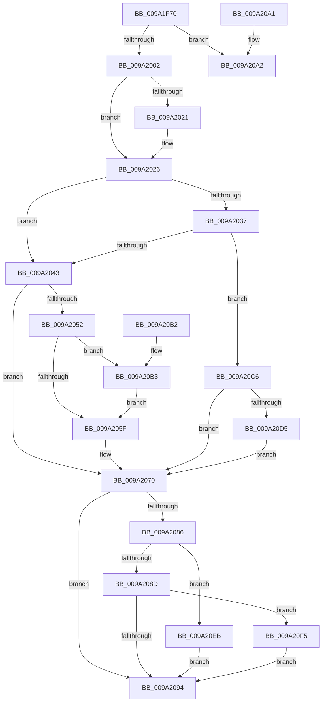

# MiMapParametersInitialize

- RVA: `0x009A1F70`–`0x009A20FF` (길이 `399` bytes)
- VA: `0x00000001409A1F70`
- 실행 섹션: `PAGE`
- PDB 이름 있음: `예`; PDB Function 태그: `아니요`
- unwind 정보 RVA: `0x0009B640`
- 디코드: `99`개 명령, `399/399` bytes 표시
- 미해석 바이트: `0` (있으면 어셈블리에 `.byte`로 보존)

> 이 문서는 커널 이미지의 기계어와 PDB 기호를 분석해 생성했습니다. 4번과 5번은 함수 원형과 자료형을 바이너리 사용 방식에서 추정한 C 해석이며 원본 소스 복구 결과는 아닙니다.

## 1. Dependencies

- 직접 호출 지점: **1**; 고유 호출 대상: **1**
- 직접 호출자로 확인된 함수: **1**
- RIP 상대 이미지 참조: **1**

### Outgoing calls
- `0x009A1F86` → [MiSectionControlArea](../../text/29/MiSectionControlArea_function_00294CB0.md) (function, `0x00294CB0`)

### Direct callers
- [MiMapViewOfSectionExCommon](MiMapViewOfSectionExCommon_function_009A1C60.md) at `0x009A1DAB`

### Static image references
- `0x009A1FE5` → RVA `0x00FC5000` (`ALMOSTRO`; read)

## 2. Other-region calls and transfers

- 다른 실행 섹션으로 향하는 call: **1**
  - `0x009A1F86` → [MiSectionControlArea](../../text/29/MiSectionControlArea_function_00294CB0.md) (`PAGE` → `.text`)
- 별도 외부 분기/꼬리 이동을 확인하지 못했습니다.

## 3. Assembly (complete function range)

```asm
009A1F70  48 89 5C 24 08                  mov qword ptr [rsp + 8], rbx
009A1F75  57                              push rdi
009A1F76  48 83 EC 20                     sub rsp, 0x20
009A1F7A  4C 8B D1                        mov r10, rcx
009A1F7D  49 8B D9                        mov rbx, r9
009A1F80  48 8B CA                        mov rcx, rdx
009A1F83  49 8B F8                        mov rdi, r8
009A1F86  E8 25 2D 8F FF                  call 0x140294cb0
009A1F8B  44 8B 4C 24 58                  mov r9d, dword ptr [rsp + 0x58]
009A1F90  0F 57 C0                        xorps xmm0, xmm0
009A1F93  41 0F 11 02                     movups xmmword ptr [r10], xmm0
009A1F97  4C 8B D8                        mov r11, rax
009A1F9A  41 0F 11 42 10                  movups xmmword ptr [r10 + 0x10], xmm0
009A1F9F  41 0F 11 42 20                  movups xmmword ptr [r10 + 0x20], xmm0
009A1FA4  41 0F 11 42 30                  movups xmmword ptr [r10 + 0x30], xmm0
009A1FA9  41 0F 11 42 40                  movups xmmword ptr [r10 + 0x40], xmm0
009A1FAE  41 0F 11 42 50                  movups xmmword ptr [r10 + 0x50], xmm0
009A1FB3  41 0F 11 42 60                  movups xmmword ptr [r10 + 0x60], xmm0
009A1FB8  41 0F 11 42 70                  movups xmmword ptr [r10 + 0x70], xmm0
009A1FBD  65 48 8B 0C 25 88 01 00 00      mov rcx, qword ptr gs:[0x188]
009A1FC6  48 8B 91 B8 00 00 00            mov rdx, qword ptr [rcx + 0xb8]
009A1FCD  49 89 52 60                     mov qword ptr [r10 + 0x60], rdx
009A1FD1  4D 89 42 58                     mov qword ptr [r10 + 0x58], r8
009A1FD5  65 48 8B 04 25 88 01 00 00      mov rax, qword ptr gs:[0x188]
009A1FDE  0F B6 88 32 02 00 00            movzx ecx, byte ptr [rax + 0x232]
009A1FE5  0F B7 05 14 30 62 00            movzx eax, word ptr [rip + 0x623014]
009A1FEC  41 88 4A 39                     mov byte ptr [r10 + 0x39], cl
009A1FF0  41 8B C9                        mov ecx, r9d
009A1FF3  83 E1 7F                        and ecx, 0x7f
009A1FF6  41 89 4A 34                     mov dword ptr [r10 + 0x34], ecx
009A1FFA  3B C8                           cmp ecx, eax
009A1FFC  0F 87 A0 00 00 00               ja 0x1409a20a2
009A2002  8B 54 24 70                     mov edx, dword ptr [rsp + 0x70]
009A2006  41 8B C1                        mov eax, r9d
009A2009  83 E0 80                        and eax, 0xffffff80
009A200C  41 89 52 40                     mov dword ptr [r10 + 0x40], edx
009A2010  41 89 42 28                     mov dword ptr [r10 + 0x28], eax
009A2014  8B 44 24 60                     mov eax, dword ptr [rsp + 0x60]
009A2018  41 89 42 2C                     mov dword ptr [r10 + 0x2c], eax
009A201C  48 85 DB                        test rbx, rbx
009A201F  74 05                           je 0x1409a2026
009A2021  41 83 4A 3C 01                  or dword ptr [r10 + 0x3c], 1
009A2026  48 8B 44 24 50                  mov rax, qword ptr [rsp + 0x50]
009A202B  49 89 42 18                     mov qword ptr [r10 + 0x18], rax
009A202F  41 8B 43 38                     mov eax, dword ptr [r11 + 0x38]
009A2033  A8 20                           test al, 0x20
009A2035  75 0C                           jne 0x1409a2043
009A2037  41 8B 42 3C                     mov eax, dword ptr [r10 + 0x3c]
009A203B  A8 01                           test al, 1
009A203D  0F 85 83 00 00 00               jne 0x1409a20c6
009A2043  F6 C2 08                        test dl, 8
009A2046  48 BA FF FF FE FF FF 7F 00 00   movabs rdx, 0x7ffffffeffff
009A2050  75 1E                           jne 0x1409a2070
009A2052  48 8B 4C 24 68                  mov rcx, qword ptr [rsp + 0x68]
009A2057  4C 8B C2                        mov r8, rdx
009A205A  48 85 C9                        test rcx, rcx
009A205D  75 54                           jne 0x1409a20b3
009A205F  48 8B 97 68 03 00 00            mov rdx, qword ptr [rdi + 0x368]
009A2066  48 FF CA                        dec rdx
009A2069  4C 3B C2                        cmp r8, rdx
009A206C  49 0F 46 D0                     cmovbe rdx, r8
009A2070  49 89 52 08                     mov qword ptr [r10 + 8], rdx
009A2074  49 C7 42 10 00 00 01 00         mov qword ptr [r10 + 0x10], 0x10000
009A207C  41 F7 43 38 20 04 00 00         test dword ptr [r11 + 0x38], 0x420
009A2084  75 0E                           jne 0x1409a2094
009A2086  41 0F BA E1 1D                  bt r9d, 0x1d
009A208B  72 5E                           jb 0x1409a20eb
009A208D  41 0F BA E1 1E                  bt r9d, 0x1e
009A2092  72 61                           jb 0x1409a20f5
009A2094  33 C0                           xor eax, eax
009A2096  48 8B 5C 24 30                  mov rbx, qword ptr [rsp + 0x30]
009A209B  48 83 C4 20                     add rsp, 0x20
009A209F  5F                              pop rdi
009A20A0  C3                              ret
009A20A1  CC                              int3
009A20A2  48 8B 5C 24 30                  mov rbx, qword ptr [rsp + 0x30]
009A20A7  B8 0D 00 00 C0                  mov eax, 0xc000000d
009A20AC  48 83 C4 20                     add rsp, 0x20
009A20B0  5F                              pop rdi
009A20B1  C3                              ret
009A20B2  CC                              int3
009A20B3  49 C7 C0 FF FF FF FF            mov r8, 0xffffffffffffffff
009A20BA  49 D3 E8                        shr r8, cl
009A20BD  4C 3B C2                        cmp r8, rdx
009A20C0  4C 0F 47 C2                     cmova r8, rdx
009A20C4  EB 99                           jmp 0x1409a205f
009A20C6  F6 C2 08                        test dl, 8
009A20C9  48 BA FF FF FE FF FF 7F 00 00   movabs rdx, 0x7ffffffeffff
009A20D3  75 9B                           jne 0x1409a2070
009A20D5  49 8B 80 68 03 00 00            mov rax, qword ptr [r8 + 0x368]
009A20DC  48 FF C8                        dec rax
009A20DF  48 3B C2                        cmp rax, rdx
009A20E2  48 0F 43 C2                     cmovae rax, rdx
009A20E6  48 8B D0                        mov rdx, rax
009A20E9  EB 85                           jmp 0x1409a2070
009A20EB  49 C7 42 10 00 00 20 00         mov qword ptr [r10 + 0x10], 0x200000
009A20F3  EB 9F                           jmp 0x1409a2094
009A20F5  49 C7 42 10 00 10 00 00         mov qword ptr [r10 + 0x10], 0x1000
009A20FD  EB 95                           jmp 0x1409a2094
```

## 4. C-style interpretation (structured pseudocode)

```c
__int64 __fastcall MiMapParametersInitialize(__int64 a1, __int64 a2, __int64 a3, __int64 a4, __int64 a5, unsigned int a6, unsigned int a7, __int64 a8, unsigned int a9)
{
    __int64 result;
    __int64 v_rsp;
    unsigned __int64 v_stack_p30;
    unsigned __int64 v_stack_p8;

    v_stack_p8 = v_rbx;
    v_rsp = (v_rsp) - (32);
    result = MiSectionControlArea(a2, a2, a3, a4);
    *(unsigned __int64 *)(a1) = v_xmm0;
    *(unsigned __int64 *)(a1 + 16) = v_xmm0;
    *(unsigned __int64 *)(a1 + 32) = v_xmm0;
    *(unsigned __int64 *)(a1 + 48) = v_xmm0;
    *(unsigned __int64 *)(a1 + 64) = v_xmm0;
    *(unsigned __int64 *)(a1 + 80) = v_xmm0;
    *(unsigned __int64 *)(a1 + 96) = v_xmm0;
    *(unsigned __int64 *)(a1 + 112) = v_xmm0;
    *(unsigned __int64 *)(a1 + 96) = *(unsigned __int64 *)(*(unsigned __int64 *)(gs_base + (0 + 392)) + 184);
    *(unsigned __int64 *)(a1 + 88) = a3;
    *(unsigned __int8 *)(a1 + 57) = (unsigned __int8)(*(unsigned __int8 *)(*(unsigned __int64 *)(gs_base + (0 + 392)) + 562));
    a1 = (unsigned int)(((unsigned int)((unsigned int)((unsigned int)(a6)))) & (127));
    *(unsigned int *)(a1 + 52) = (unsigned int)(a1);
    if (((unsigned int)(a1)) > ((unsigned int)(*(unsigned __int16 *)(v_rip + 6434836)))) goto loc_009A20A2;
    result = (unsigned int)(((unsigned int)((unsigned int)((unsigned int)(a6)))) & (0xFFFFFF80ULL));
    *(unsigned int *)(a1 + 64) = (unsigned int)((unsigned int)(a9));
    *(unsigned int *)(a1 + 40) = (unsigned int)(result);
    *(unsigned int *)(a1 + 44) = (unsigned int)((unsigned int)(a7));
    if (a4 != 0) {
    }
    *(unsigned __int64 *)(a1 + 24) = a5;
    if ((((unsigned __int8)((unsigned int)(*(unsigned int *)(result + 56)))) & (32)) != 0) goto loc_009A2043;
    if ((((unsigned __int8)((unsigned int)(*(unsigned int *)(a1 + 60)))) & (1)) != 0) goto loc_009A20C6;
loc_009A2043:
    if ((((unsigned __int8)((unsigned int)(a9))) & (8)) != 0) goto loc_009A2070;
    if (a8 != 0) goto loc_009A20B3;
loc_009A205F:
    a2 = (*(unsigned __int64 *)(a3 + 872)) - 1;
    if (((unsigned int)(a9)) <= a2) { a2 = (unsigned int)(a9); }
loc_009A2070:
    *(unsigned __int64 *)(a1 + 8) = a2;
    *(unsigned __int64 *)(a1 + 16) = 0x10000ULL;
    if (((*(unsigned int *)(result + 56)) & (0x420ULL)) != 0) goto loc_009A2094;
    if (condition_is_below) goto loc_009A20EB;
    if (condition_is_below) goto loc_009A20F5;
loc_009A2094:
    result = 0;
    v_rsp = (v_rsp) + (32);
    return result;
loc_009A20A2:
    v_rsp = (v_rsp) + (32);
    return (unsigned int)(0xC000000DULL);
loc_009A20B3:
    a3 = (-1) >> ((unsigned __int8)(a8));
    if (a3 > a2) { a3 = a2; }
    goto loc_009A205F;
loc_009A20C6:
    if ((((unsigned __int8)(a2)) & (8)) != 0) goto loc_009A2070;
    result = (*(unsigned __int64 *)(a3 + 872)) - 1;
    if (result >= a2) { result = a2; }
    goto loc_009A2070;
loc_009A20EB:
    *(unsigned __int64 *)(a1 + 16) = 0x200000ULL;
    goto loc_009A2094;
loc_009A20F5:
    *(unsigned __int64 *)(a1 + 16) = 0x1000ULL;
    goto loc_009A2094;
}
```

## 5. (Beta) C Style

```c
int64_t MiMapParametersInitialize(int64_t Arg1, int64_t Arg2, void *Arg3, int64_t Arg4, int64_t Arg5, uint32_t Arg6, uint32_t Arg7, int64_t Arg8, uint32_t Arg9)
{
    uint8_t *arg3 = (uint8_t *)Arg3;

    int64_t result;
    int64_t local_rsp;
    uint64_t v_stack_p30;
    uint64_t v_stack_p8;

    v_stack_p8 = local_rbx;
    local_rsp = (local_rsp) - (32);
    result = MiSectionControlArea(Arg2, Arg2, Arg3, Arg4);
    *(uint64_t *)(Arg1) = v_xmm0;
    *(uint64_t *)(Arg1 + 0x10) = v_xmm0;
    *(uint64_t *)(Arg1 + 0x20) = v_xmm0;
    *(uint64_t *)(Arg1 + 0x30) = v_xmm0;
    *(uint64_t *)(Arg1 + 0x40) = v_xmm0;
    *(uint64_t *)(Arg1 + 0x50) = v_xmm0;
    *(uint64_t *)(Arg1 + 0x60) = v_xmm0;
    *(uint64_t *)(Arg1 + 0x70) = v_xmm0;
    *(uint64_t *)(Arg1 + 0x60) = *(uint64_t *)(*(uint64_t *)(gs_base + (0 + 0x188)) + 0xB8);
    *(void **)(Arg1 + 0x58) = Arg3;
    *(uint8_t *)(Arg1 + 0x39) = (uint8_t)(*(uint8_t *)(*(uint64_t *)(gs_base + (0 + 0x188)) + 0x232));
    Arg1 = (uint32_t)(((uint32_t)((uint32_t)((uint32_t)(Arg6)))) & (127));
    *(uint32_t *)(Arg1 + 0x34) = (uint32_t)(Arg1);
    if (((uint32_t)(Arg1)) > ((uint32_t)(*(uint16_t *)(v_rip + 0x623014)))) goto loc_009A20A2;
    result = (uint32_t)(((uint32_t)((uint32_t)((uint32_t)(Arg6)))) & (0xFFFFFF80ULL));
    *(uint32_t *)(Arg1 + 0x40) = (uint32_t)((uint32_t)(Arg9));
    *(uint32_t *)(Arg1 + 0x28) = (uint32_t)(result);
    *(uint32_t *)(Arg1 + 0x2C) = (uint32_t)((uint32_t)(Arg7));
    if (Arg4 != 0) {
    }
    *(uint64_t *)(Arg1 + 0x18) = Arg5;
    if ((((uint8_t)((uint32_t)(*(uint32_t *)(result + 0x38)))) & (32)) != 0) goto loc_009A2043;
    if ((((uint8_t)((uint32_t)(*(uint32_t *)(Arg1 + 0x3C)))) & (1)) != 0) goto loc_009A20C6;
loc_009A2043:
    if ((((uint8_t)((uint32_t)(Arg9))) & (8)) != 0) goto loc_009A2070;
    if (Arg8 != 0) goto loc_009A20B3;
loc_009A205F:
    Arg2 = (*(uint64_t *)(arg3 + 0x368)) - 1;
    if (((uint32_t)(Arg9)) <= Arg2) { Arg2 = (uint32_t)(Arg9); }
loc_009A2070:
    *(uint64_t *)(Arg1 + 0x8) = Arg2;
    *(uint64_t *)(Arg1 + 0x10) = 0x10000ULL;
    if (((*(uint32_t *)(result + 0x38)) & (0x420ULL)) != 0) goto loc_009A2094;
    if (condition_is_below) goto loc_009A20EB;
    if (condition_is_below) goto loc_009A20F5;
loc_009A2094:
    result = 0;
    local_rsp = (local_rsp) + (32);
    return result;
loc_009A20A2:
    local_rsp = (local_rsp) + (32);
    return (uint32_t)(0xC000000DULL);
loc_009A20B3:
    Arg3 = (-1) >> ((uint8_t)(Arg8));
    if (Arg3 > Arg2) { Arg3 = Arg2; }
    goto loc_009A205F;
loc_009A20C6:
    if ((((uint8_t)(Arg2)) & (8)) != 0) goto loc_009A2070;
    result = (*(uint64_t *)(arg3 + 0x368)) - 1;
    if (result >= Arg2) { result = Arg2; }
    goto loc_009A2070;
loc_009A20EB:
    *(uint64_t *)(Arg1 + 0x10) = 0x200000ULL;
    goto loc_009A2094;
loc_009A20F5:
    *(uint64_t *)(Arg1 + 0x10) = 0x1000ULL;
    goto loc_009A2094;
}
```

### 관측된 메모리 오프셋

구조체 형식이 확인되지 않은 접근은 인자 기준의 오프셋으로만 기록했습니다.

| 기준 인자 | 오프셋 표현 | 폭 (bit) | 접근 |
|---|---:|---:|---|
| `Arg3` | `+ 0x368` | `64` | `R` |

## 6. Execution-region graph

[열기: 2D/3D 그래프와 함수 탐색 컨트롤 패널](../../../control-panel.html?section=page&rva=0x009A1F70&view=graph)

- 2D 그래프는 위에서 아래로 흐르고, 3D 그래프는 빈 공간을 드래그해 회전합니다. Shift+드래그는 이동, 휠은 확대·축소, 함수 노드 선택은 대상 보고서 이동입니다.

### Static fallback


