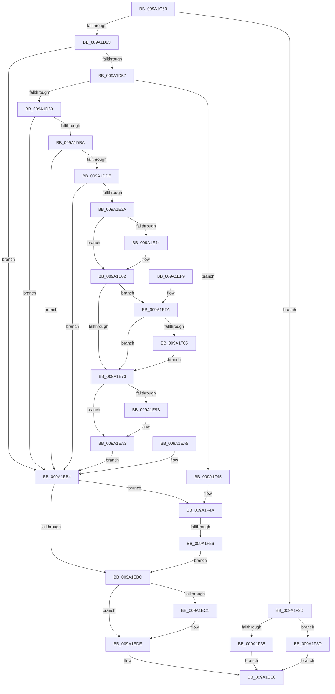

# MiMapViewOfSectionExCommon

- RVA: `0x009A1C60`–`0x009A1F61` (길이 `769` bytes)
- VA: `0x00000001409A1C60`
- 실행 섹션: `PAGE`
- PDB 이름 있음: `예`; PDB Function 태그: `예`
- unwind 정보 RVA: `0x0009B5FC`
- 디코드: `162`개 명령, `769/769` bytes 표시
- 미해석 바이트: `0` (있으면 어셈블리에 `.byte`로 보존)

> 이 문서는 커널 이미지의 기계어와 PDB 기호를 분석해 생성했습니다. 4번과 5번은 함수 원형과 자료형을 바이너리 사용 방식에서 추정한 C 해석이며 원본 소스 복구 결과는 아닙니다.

## 1. Dependencies

- 직접 호출 지점: **11**; 고유 호출 대상: **9**
- 직접 호출자로 확인된 함수: **3**
- RIP 상대 이미지 참조: **2**

### Outgoing calls
- `0x009A1C97` → [memset](../../text/6C/memset_function_006C6C40.md) (function, `0x006C6C40`)
- `0x009A1CBC` → [memset](../../text/6C/memset_function_006C6C40.md) (function, `0x006C6C40`)
- `0x009A1D16` → [MiMapViewOfSectionCommon](../89/MiMapViewOfSectionCommon_function_00898C90.md) (function, `0x00898C90`)
- `0x009A1D48` → [MiCaptureAllocateMapExtendedParameters](MiCaptureAllocateMapExtendedParameters_function_009A2110.md) (function, `0x009A2110`)
- `0x009A1DAB` → [MiMapParametersInitialize](MiMapParametersInitialize_function_009A1F70.md) (function, `0x009A1F70`)
- `0x009A1DCF` → [MiMapExParametersInitialize](MiMapExParametersInitialize_function_009A2424.md) (function, `0x009A2424`)
- `0x009A1E28` → [MiMapViewOfSection](../89/MiMapViewOfSection_function_00898F10.md) (function, `0x00898F10`)
- `0x009A1E5D` → [DbgkMapViewOfSection](../89/DbgkMapViewOfSection_function_00897460.md) (function, `0x00897460`)
- `0x009A1ECD` → [ObfDereferenceObjectWithTag](../../text/2F/ObfDereferenceObjectWithTag_function_002F78E0.md) (function, `0x002F78E0`)
- `0x009A1ED9` → [ObfDereferenceObjectWithTag](../../text/2F/ObfDereferenceObjectWithTag_function_002F78E0.md) (function, `0x002F78E0`)
- `0x009A1F23` → [EtwTiLogMapExecView](../A5/EtwTiLogMapExecView_function_00A573E0.md) (function, `0x00A573E0`)

### Direct callers
- [MmMapViewOfSectionEx](../../text/48/MmMapViewOfSectionEx_function_0048E244.md) at `0x0048E2B8`
- [PspMapView](../../text/4C/PspMapView_function_004C77E8.md) at `0x004C78A1`
- [NtMapViewOfSectionEx](NtMapViewOfSectionEx_function_009A1BE0.md) at `0x009A1C4C`

### Static image references
- `0x009A1F35` → RVA `0x00E302A8` (`.data`; read/write)
- `0x009A1F3D` → RVA `0x00E302AC` (`.data`; read/write)

## 2. Other-region calls and transfers

- 다른 실행 섹션으로 향하는 call: **4**
  - `0x009A1C97` → [memset](../../text/6C/memset_function_006C6C40.md) (`PAGE` → `.text`)
  - `0x009A1CBC` → [memset](../../text/6C/memset_function_006C6C40.md) (`PAGE` → `.text`)
  - `0x009A1ECD` → [ObfDereferenceObjectWithTag](../../text/2F/ObfDereferenceObjectWithTag_function_002F78E0.md) (`PAGE` → `.text`)
  - `0x009A1ED9` → [ObfDereferenceObjectWithTag](../../text/2F/ObfDereferenceObjectWithTag_function_002F78E0.md) (`PAGE` → `.text`)
- call이 아닌 외부 분기/꼬리 이동: **1**
  - `0x009A1F50` → [sub_00B2D1B4](../B2/Unknown_function_00B2D1B4.md) (`tail-transfer`)

## 3. Assembly (complete function range)

```asm
009A1C60  48 8B C4                        mov rax, rsp
009A1C63  48 89 58 08                     mov qword ptr [rax + 8], rbx
009A1C67  4C 89 48 20                     mov qword ptr [rax + 0x20], r9
009A1C6B  44 89 40 18                     mov dword ptr [rax + 0x18], r8d
009A1C6F  57                              push rdi
009A1C70  41 54                           push r12
009A1C72  41 55                           push r13
009A1C74  41 56                           push r14
009A1C76  41 57                           push r15
009A1C78  48 81 EC 60 01 00 00            sub rsp, 0x160
009A1C7F  45 8B F0                        mov r14d, r8d
009A1C82  48 8B FA                        mov rdi, rdx
009A1C85  48 8B D9                        mov rbx, rcx
009A1C88  33 D2                           xor edx, edx
009A1C8A  41 B8 80 00 00 00               mov r8d, 0x80
009A1C90  48 8D 88 08 FF FF FF            lea rcx, [rax - 0xf8]
009A1C97  E8 A4 4F D2 FF                  call 0x1406c6c40
009A1C9C  0F 57 C0                        xorps xmm0, xmm0
009A1C9F  0F 11 44 24 50                  movups xmmword ptr [rsp + 0x50], xmm0
009A1CA4  0F 11 44 24 60                  movups xmmword ptr [rsp + 0x60], xmm0
009A1CA9  0F 11 44 24 70                  movups xmmword ptr [rsp + 0x70], xmm0
009A1CAE  33 D2                           xor edx, edx
009A1CB0  44 8D 42 48                     lea r8d, [rdx + 0x48]
009A1CB4  48 8D 8C 24 10 01 00 00         lea rcx, [rsp + 0x110]
009A1CBC  E8 7F 4F D2 FF                  call 0x1406c6c40
009A1CC1  48 8D 44 24 50                  lea rax, [rsp + 0x50]
009A1CC6  48 89 44 24 48                  mov qword ptr [rsp + 0x48], rax
009A1CCB  44 8A A4 24 F0 01 00 00         mov r12b, byte ptr [rsp + 0x1f0]
009A1CD3  44 88 64 24 40                  mov byte ptr [rsp + 0x40], r12b
009A1CD8  48 83 64 24 38 00               and qword ptr [rsp + 0x38], 0
009A1CDE  44 8B AC 24 C8 01 00 00         mov r13d, dword ptr [rsp + 0x1c8]
009A1CE6  44 89 6C 24 30                  mov dword ptr [rsp + 0x30], r13d
009A1CEB  4C 8B BC 24 B0 01 00 00         mov r15, qword ptr [rsp + 0x1b0]
009A1CF3  4C 89 7C 24 28                  mov qword ptr [rsp + 0x28], r15
009A1CF8  48 8B 84 24 B8 01 00 00         mov rax, qword ptr [rsp + 0x1b8]
009A1D00  48 89 44 24 20                  mov qword ptr [rsp + 0x20], rax
009A1D05  4C 8B 8C 24 A8 01 00 00         mov r9, qword ptr [rsp + 0x1a8]
009A1D0D  45 8B C6                        mov r8d, r14d
009A1D10  48 8B D3                        mov rdx, rbx
009A1D13  48 8B CF                        mov rcx, rdi
009A1D16  E8 75 6F EF FF                  call 0x140898c90
009A1D1B  85 C0                           test eax, eax
009A1D1D  0F 88 0A 02 00 00               js 0x1409a1f2d
009A1D23  48 8D 84 24 10 01 00 00         lea rax, [rsp + 0x110]
009A1D2B  48 89 44 24 20                  mov qword ptr [rsp + 0x20], rax
009A1D30  41 B9 66 00 00 00               mov r9d, 0x66
009A1D36  45 8A C4                        mov r8b, r12b
009A1D39  8B 94 24 D8 01 00 00            mov edx, dword ptr [rsp + 0x1d8]
009A1D40  48 8B 8C 24 D0 01 00 00         mov rcx, qword ptr [rsp + 0x1d0]
009A1D48  E8 C3 03 00 00                  call 0x1409a2110
009A1D4D  8B D8                           mov ebx, eax
009A1D4F  85 C0                           test eax, eax
009A1D51  0F 88 5D 01 00 00               js 0x1409a1eb4
009A1D57  48 F7 84 24 48 01 00 00 9F FD FF FF  test qword ptr [rsp + 0x148], -0x261
009A1D63  0F 85 DC 01 00 00               jne 0x1409a1f45
009A1D69  8B 84 24 F8 01 00 00            mov eax, dword ptr [rsp + 0x1f8]
009A1D70  89 44 24 40                     mov dword ptr [rsp + 0x40], eax
009A1D74  48 83 64 24 38 00               and qword ptr [rsp + 0x38], 0
009A1D7A  44 89 6C 24 30                  mov dword ptr [rsp + 0x30], r13d
009A1D7F  8B BC 24 C0 01 00 00            mov edi, dword ptr [rsp + 0x1c0]
009A1D86  89 7C 24 28                     mov dword ptr [rsp + 0x28], edi
009A1D8A  48 8B 44 24 58                  mov rax, qword ptr [rsp + 0x58]
009A1D8F  48 89 44 24 20                  mov qword ptr [rsp + 0x20], rax
009A1D94  4C 8B 4C 24 50                  mov r9, qword ptr [rsp + 0x50]
009A1D99  4C 8B 44 24 78                  mov r8, qword ptr [rsp + 0x78]
009A1D9E  48 8B 54 24 70                  mov rdx, qword ptr [rsp + 0x70]
009A1DA3  48 8D 8C 24 90 00 00 00         lea rcx, [rsp + 0x90]
009A1DAB  E8 C0 01 00 00                  call 0x1409a1f70
009A1DB0  8B D8                           mov ebx, eax
009A1DB2  85 C0                           test eax, eax
009A1DB4  0F 88 FA 00 00 00               js 0x1409a1eb4
009A1DBA  4C 8D 84 24 10 01 00 00         lea r8, [rsp + 0x110]
009A1DC2  48 8D 54 24 50                  lea rdx, [rsp + 0x50]
009A1DC7  48 8D 8C 24 90 00 00 00         lea rcx, [rsp + 0x90]
009A1DCF  E8 50 06 00 00                  call 0x1409a2424
009A1DD4  8B D8                           mov ebx, eax
009A1DD6  85 C0                           test eax, eax
009A1DD8  0F 88 D6 00 00 00               js 0x1409a1eb4
009A1DDE  8B 84 24 E0 01 00 00            mov eax, dword ptr [rsp + 0x1e0]
009A1DE5  89 84 24 D4 00 00 00            mov dword ptr [rsp + 0xd4], eax
009A1DEC  48 8B 84 24 E8 01 00 00         mov rax, qword ptr [rsp + 0x1e8]
009A1DF4  48 89 84 24 D8 00 00 00         mov qword ptr [rsp + 0xd8], rax
009A1DFC  83 64 24 30 00                  and dword ptr [rsp + 0x30], 0
009A1E01  C7 44 24 28 01 00 00 00         mov dword ptr [rsp + 0x28], 1
009A1E09  48 8D 44 24 60                  lea rax, [rsp + 0x60]
009A1E0E  48 89 44 24 20                  mov qword ptr [rsp + 0x20], rax
009A1E13  45 33 C9                        xor r9d, r9d
009A1E16  4C 8D 44 24 50                  lea r8, [rsp + 0x50]
009A1E1B  48 8D 94 24 90 00 00 00         lea rdx, [rsp + 0x90]
009A1E23  48 8B 4C 24 70                  mov rcx, qword ptr [rsp + 0x70]
009A1E28  E8 E3 70 EF FF                  call 0x140898f10
009A1E2D  8B D8                           mov ebx, eax
009A1E2F  89 84 24 80 00 00 00            mov dword ptr [rsp + 0x80], eax
009A1E36  85 C0                           test eax, eax
009A1E38  78 7A                           js 0x1409a1eb4
009A1E3A  F6 84 24 CC 00 00 00 04         test byte ptr [rsp + 0xcc], 4
009A1E42  74 1E                           je 0x1409a1e62
009A1E44  83 64 24 30 00                  and dword ptr [rsp + 0x30], 0
009A1E49  83 64 24 28 00                  and dword ptr [rsp + 0x28], 0
009A1E4E  4C 8B 44 24 50                  mov r8, qword ptr [rsp + 0x50]
009A1E53  48 8B 54 24 70                  mov rdx, qword ptr [rsp + 0x70]
009A1E58  48 8B 4C 24 78                  mov rcx, qword ptr [rsp + 0x78]
009A1E5D  E8 FE 55 EF FF                  call 0x140897460
009A1E62  48 8B 44 24 70                  mov rax, qword ptr [rsp + 0x70]
009A1E67  8B 48 38                        mov ecx, dword ptr [rax + 0x38]
009A1E6A  F6 C1 20                        test cl, 0x20
009A1E6D  0F 84 87 00 00 00               je 0x1409a1efa
009A1E73  48 8B 44 24 50                  mov rax, qword ptr [rsp + 0x50]
009A1E78  48 8B 8C 24 A8 01 00 00         mov rcx, qword ptr [rsp + 0x1a8]
009A1E80  48 89 01                        mov qword ptr [rcx], rax
009A1E83  48 8B 84 24 A8 00 00 00         mov rax, qword ptr [rsp + 0xa8]
009A1E8B  48 8B 8C 24 B8 01 00 00         mov rcx, qword ptr [rsp + 0x1b8]
009A1E93  48 89 01                        mov qword ptr [rcx], rax
009A1E96  4D 85 FF                        test r15, r15
009A1E99  74 08                           je 0x1409a1ea3
009A1E9B  48 8B 44 24 60                  mov rax, qword ptr [rsp + 0x60]
009A1EA0  49 89 07                        mov qword ptr [r15], rax
009A1EA3  EB 0F                           jmp 0x1409a1eb4
009A1EA5  44 8B B4 24 A0 01 00 00         mov r14d, dword ptr [rsp + 0x1a0]
009A1EAD  8B 9C 24 80 00 00 00            mov ebx, dword ptr [rsp + 0x80]
009A1EB4  85 DB                           test ebx, ebx
009A1EB6  0F 88 8E 00 00 00               js 0x1409a1f4a
009A1EBC  45 85 F6                        test r14d, r14d
009A1EBF  75 1D                           jne 0x1409a1ede
009A1EC1  BF 4D 6D 56 77                  mov edi, 0x77566d4d
009A1EC6  8B D7                           mov edx, edi
009A1EC8  48 8B 4C 24 70                  mov rcx, qword ptr [rsp + 0x70]
009A1ECD  E8 0E 5A 95 FF                  call 0x1402f78e0
009A1ED2  8B D7                           mov edx, edi
009A1ED4  48 8B 4C 24 78                  mov rcx, qword ptr [rsp + 0x78]
009A1ED9  E8 02 5A 95 FF                  call 0x1402f78e0
009A1EDE  8B C3                           mov eax, ebx
009A1EE0  48 8B 9C 24 90 01 00 00         mov rbx, qword ptr [rsp + 0x190]
009A1EE8  48 81 C4 60 01 00 00            add rsp, 0x160
009A1EEF  41 5F                           pop r15
009A1EF1  41 5E                           pop r14
009A1EF3  41 5D                           pop r13
009A1EF5  41 5C                           pop r12
009A1EF7  5F                              pop rdi
009A1EF8  C3                              ret
009A1EF9  CC                              int3
009A1EFA  F6 44 24 68 02                  test byte ptr [rsp + 0x68], 2
009A1EFF  0F 84 6E FF FF FF               je 0x1409a1e73
009A1F05  44 89 6C 24 28                  mov dword ptr [rsp + 0x28], r13d
009A1F0A  89 7C 24 20                     mov dword ptr [rsp + 0x20], edi
009A1F0E  4C 8B 8C 24 A8 00 00 00         mov r9, qword ptr [rsp + 0xa8]
009A1F16  4C 8B 44 24 50                  mov r8, qword ptr [rsp + 0x50]
009A1F1B  41 8A D4                        mov dl, r12b
009A1F1E  48 8B 4C 24 78                  mov rcx, qword ptr [rsp + 0x78]
009A1F23  E8 B8 54 0B 00                  call 0x140a573e0
009A1F28  E9 46 FF FF FF                  jmp 0x1409a1e73
009A1F2D  48 83 7C 24 50 00               cmp qword ptr [rsp + 0x50], 0
009A1F33  75 08                           jne 0x1409a1f3d
009A1F35  FF 05 6D E3 48 00               inc dword ptr [rip + 0x48e36d]
009A1F3B  EB A3                           jmp 0x1409a1ee0
009A1F3D  FF 05 69 E3 48 00               inc dword ptr [rip + 0x48e369]
009A1F43  EB 9B                           jmp 0x1409a1ee0
009A1F45  BB 0D 00 00 C0                  mov ebx, 0xc000000d
009A1F4A  48 83 7C 24 50 00               cmp qword ptr [rsp + 0x50], 0
009A1F50  0F 85 5E B2 18 00               jne 0x140b2d1b4
009A1F56  FF 05 4C E3 48 00               inc dword ptr [rip + 0x48e34c]
009A1F5C  E9 5B FF FF FF                  jmp 0x1409a1ebc
```

## 4. C-style interpretation (structured pseudocode)

```c
__int64 __fastcall MiMapViewOfSectionExCommon(__int64 a1, __int64 a2, int a3, __int64 a4, __int64 a5, __int64 a6, unsigned int a7, unsigned int a8, __int64 a9, unsigned int a10, unsigned int a11, __int64 a12, unsigned __int8 a13, unsigned int a14)
{
    __int64 result;
    __int64 v_rdi;
    __int64 v_rsp;
    unsigned int v_stack_m108;
    unsigned __int64 v_stack_m110;
    unsigned __int64 v_stack_m118;
    unsigned __int64 v_stack_m128;
    unsigned __int64 v_stack_m130;
    unsigned __int64 v_stack_m138;
    unsigned __int64 v_stack_m140;
    unsigned __int8 v_stack_m148;
    unsigned __int64 v_stack_m150;
    unsigned int v_stack_m158;
    unsigned __int64 v_stack_m160;
    unsigned __int64 v_stack_m168;
    unsigned __int64 v_stack_m40;
    unsigned __int64 v_stack_m78;
    unsigned __int64 v_stack_mB0;
    unsigned int v_stack_mB4;
    unsigned __int8 v_stack_mBC;
    unsigned __int64 v_stack_mE0;
    unsigned __int64 v_stack_mF8;
    unsigned int v_stack_p18;
    unsigned __int64 v_stack_p20;
    unsigned int v_stack_p28;
    unsigned __int64 v_stack_p50;
    unsigned __int8 v_stack_p68;
    unsigned __int64 v_stack_p78;
    unsigned __int64 v_stack_p8;
    unsigned __int64 v_stack_pA8;

    *(unsigned __int64 *)(v_rsp + 8) = v_rbx;
    *(unsigned __int64 *)(v_rsp + 32) = a4;
    *(unsigned int *)(v_rsp + 24) = a3;
    v_rsp = (v_rsp) - (352);
    a2 = 0;
    result = memset(v_rsp - 248, a2, 128, a4);
    v_stack_m138 = v_xmm0;
    v_stack_m128 = v_xmm0;
    v_stack_m118 = v_xmm0;
    a2 = 0;
    result = memset(v_stack_m78, a2, a2 + 72, a4);
    v_stack_m140 = v_stack_m138;
    v_stack_m148 = a13;
    v_stack_m158 = (unsigned int)((unsigned int)(a8));
    v_stack_m160 = a5;
    v_stack_m168 = a6;
    result = MiMapViewOfSectionCommon(0, a1, (unsigned int)((unsigned int)((unsigned int)(a3))), v_stack_p20);
    if (sign_flag) goto loc_009A1F2D;
    v_stack_m168 = v_stack_m78;
    result = MiCaptureAllocateMapExtendedParameters(a9, (unsigned int)(a10), a13, 102);
    if (sign_flag) goto loc_009A1EB4;
    if (((v_stack_m40) & (-609)) != 0) goto loc_009A1F45;
    v_stack_m148 = (unsigned int)((unsigned int)(a14));
    v_stack_m158 = (unsigned int)((unsigned int)(a8));
    v_stack_m160 = (unsigned int)((unsigned int)(a7));
    v_stack_m168 = v_stack_m130;
    result = MiMapParametersInitialize(v_stack_mF8, v_stack_m118, v_stack_m110, v_stack_m138);
    if (sign_flag) goto loc_009A1EB4;
    result = MiMapExParametersInitialize(v_stack_mF8, v_stack_m138, v_stack_m78, v_stack_m138);
    if (sign_flag) goto loc_009A1EB4;
    v_stack_mB4 = (unsigned int)((unsigned int)(a11));
    v_stack_mB0 = a12;
    v_stack_m160 = 1;
    v_stack_m168 = v_stack_m128;
    a4 = 0;
    result = MiMapViewOfSection(v_stack_m118, v_stack_mF8, v_stack_m138, a4);
    v_stack_m108 = (unsigned int)(result);
    if (sign_flag) goto loc_009A1EB4;
    if (((v_stack_mBC) & (4)) != 0) {
        a3 = v_stack_m138;
        a2 = v_stack_m118;
        a1 = v_stack_m110;
        result = DbgkMapViewOfSection(a1, a2, a3, a4);
    }
    if ((((unsigned __int8)((unsigned int)(*(unsigned int *)(v_stack_m118 + 56)))) & (32)) == 0) goto loc_009A1EFA;
loc_009A1E73:
    *(unsigned __int64 *)(v_stack_p20) = v_stack_m138;
    *(unsigned __int64 *)(a6) = v_stack_mE0;
    result = v_stack_mE0;
    if (a5 != 0) {
        result = v_stack_m128;
        *(unsigned __int64 *)(a5) = result;
    }
    goto loc_009A1EB4;
loc_009A1EB4:
    if (sign_flag) goto loc_009A1F4A;
loc_009A1EBC:
    v_rdi = (unsigned int)(a7);
    if ((unsigned int)((unsigned int)(a3)) == 0) {
        v_rdi = 0x77566D4DULL;
        a2 = (unsigned int)(v_rdi);
        a1 = v_stack_m118;
        result = ObfDereferenceObjectWithTag(a1, a2, a3, a4);
        a2 = (unsigned int)(v_rdi);
        a1 = v_stack_m110;
        result = ObfDereferenceObjectWithTag(a1, a2, a3, a4);
    }
loc_009A1EE0:
    v_rsp = (v_rsp) + (352);
    return (unsigned int)((unsigned int)((unsigned int)((unsigned int)(result))));
loc_009A1EFA:
    if (((v_stack_p68) & (2)) == 0) goto loc_009A1E73;
    v_stack_p28 = (unsigned int)((unsigned int)(a8));
    v_stack_p20 = (unsigned int)(v_rdi);
    result = EtwTiLogMapExecView(v_stack_p78, a13, v_stack_p50, v_stack_pA8);
    goto loc_009A1E73;
loc_009A1F2D:
    if (v_stack_p50 != 0) goto loc_009A1F3D;
    goto loc_009A1EE0;
loc_009A1F3D:
    goto loc_009A1EE0;
loc_009A1F45:
loc_009A1F4A:
    goto loc_009A1EBC;
}
```

## 5. (Beta) C Style

```c
int64_t MiMapViewOfSectionExCommon(int64_t Arg1, int64_t Arg2, int32_t Arg3, int64_t Arg4, int64_t Arg5, void *Arg6, uint32_t Arg7, uint32_t Arg8, int64_t Arg9, uint32_t Arg10, uint32_t Arg11, int64_t Arg12, uint8_t Arg13, uint32_t Arg14)
{
    uint8_t *arg6 = (uint8_t *)Arg6;

    int64_t result;
    int64_t local_rdi;
    int64_t local_rsp;
    uint32_t v_stack_m108;
    uint64_t v_stack_m110;
    uint64_t v_stack_m118;
    uint64_t v_stack_m128;
    uint64_t v_stack_m130;
    uint64_t v_stack_m138;
    uint64_t v_stack_m140;
    uint8_t v_stack_m148;
    uint64_t v_stack_m150;
    uint32_t v_stack_m158;
    uint64_t v_stack_m160;
    uint64_t v_stack_m168;
    uint64_t v_stack_m40;
    uint64_t v_stack_m78;
    uint64_t v_stack_mB0;
    uint32_t v_stack_mB4;
    uint8_t v_stack_mBC;
    uint64_t v_stack_mE0;
    uint64_t v_stack_mF8;
    uint32_t v_stack_p18;
    uint64_t v_stack_p20;
    uint32_t v_stack_p28;
    uint64_t v_stack_p50;
    uint8_t v_stack_p68;
    uint64_t v_stack_p78;
    uint64_t v_stack_p8;
    uint64_t v_stack_pA8;

    *(uint64_t *)(local_rsp + 0x8) = local_rbx;
    *(uint64_t *)(local_rsp + 0x20) = Arg4;
    *(uint32_t *)(local_rsp + 0x18) = Arg3;
    local_rsp = (local_rsp) - (352);
    Arg2 = 0;
    result = memset(local_rsp - 248, Arg2, 128, Arg4);
    v_stack_m138 = v_xmm0;
    v_stack_m128 = v_xmm0;
    v_stack_m118 = v_xmm0;
    Arg2 = 0;
    result = memset(v_stack_m78, Arg2, Arg2 + 72, Arg4);
    v_stack_m140 = v_stack_m138;
    v_stack_m148 = Arg13;
    v_stack_m158 = (uint32_t)((uint32_t)(Arg8));
    v_stack_m160 = Arg5;
    v_stack_m168 = Arg6;
    result = MiMapViewOfSectionCommon(0, Arg1, (uint32_t)((uint32_t)((uint32_t)(Arg3))), v_stack_p20);
    if (sign_flag) goto loc_009A1F2D;
    v_stack_m168 = v_stack_m78;
    result = MiCaptureAllocateMapExtendedParameters(Arg9, (uint32_t)(Arg10), Arg13, 102);
    if (sign_flag) goto loc_009A1EB4;
    if (((v_stack_m40) & (-609)) != 0) goto loc_009A1F45;
    v_stack_m148 = (uint32_t)((uint32_t)(Arg14));
    v_stack_m158 = (uint32_t)((uint32_t)(Arg8));
    v_stack_m160 = (uint32_t)((uint32_t)(Arg7));
    v_stack_m168 = v_stack_m130;
    result = MiMapParametersInitialize(v_stack_mF8, v_stack_m118, v_stack_m110, v_stack_m138);
    if (sign_flag) goto loc_009A1EB4;
    result = MiMapExParametersInitialize(v_stack_mF8, v_stack_m138, v_stack_m78, v_stack_m138);
    if (sign_flag) goto loc_009A1EB4;
    v_stack_mB4 = (uint32_t)((uint32_t)(Arg11));
    v_stack_mB0 = Arg12;
    v_stack_m160 = 1;
    v_stack_m168 = v_stack_m128;
    Arg4 = 0;
    result = MiMapViewOfSection(v_stack_m118, v_stack_mF8, v_stack_m138, Arg4);
    v_stack_m108 = (uint32_t)(result);
    if (sign_flag) goto loc_009A1EB4;
    if (((v_stack_mBC) & (4)) != 0) {
        Arg3 = v_stack_m138;
        Arg2 = v_stack_m118;
        Arg1 = v_stack_m110;
        result = DbgkMapViewOfSection(Arg1, Arg2, Arg3, Arg4);
    }
    if ((((uint8_t)((uint32_t)(*(uint32_t *)(v_stack_m118 + 0x38)))) & (32)) == 0) goto loc_009A1EFA;
loc_009A1E73:
    *(uint64_t *)(v_stack_p20) = v_stack_m138;
    *(uint64_t *)(arg6) = v_stack_mE0;
    result = v_stack_mE0;
    if (Arg5 != 0) {
        result = v_stack_m128;
        *(uint64_t *)(Arg5) = result;
    }
    goto loc_009A1EB4;
loc_009A1EB4:
    if (sign_flag) goto loc_009A1F4A;
loc_009A1EBC:
    local_rdi = (uint32_t)(Arg7);
    if ((uint32_t)((uint32_t)(Arg3)) == 0) {
        local_rdi = 0x77566D4DULL;
        Arg2 = (uint32_t)(local_rdi);
        Arg1 = v_stack_m118;
        result = ObfDereferenceObjectWithTag(Arg1, Arg2, Arg3, Arg4);
        Arg2 = (uint32_t)(local_rdi);
        Arg1 = v_stack_m110;
        result = ObfDereferenceObjectWithTag(Arg1, Arg2, Arg3, Arg4);
    }
loc_009A1EE0:
    local_rsp = (local_rsp) + (352);
    return (uint32_t)((uint32_t)((uint32_t)((uint32_t)(result))));
loc_009A1EFA:
    if (((v_stack_p68) & (2)) == 0) goto loc_009A1E73;
    v_stack_p28 = (uint32_t)((uint32_t)(Arg8));
    v_stack_p20 = (uint32_t)(local_rdi);
    result = EtwTiLogMapExecView(v_stack_p78, Arg13, v_stack_p50, v_stack_pA8);
    goto loc_009A1E73;
loc_009A1F2D:
    if (v_stack_p50 != 0) goto loc_009A1F3D;
    goto loc_009A1EE0;
loc_009A1F3D:
    goto loc_009A1EE0;
loc_009A1F45:
loc_009A1F4A:
    goto loc_009A1EBC;
}
```

### 관측된 메모리 오프셋

구조체 형식이 확인되지 않은 접근은 인자 기준의 오프셋으로만 기록했습니다.

| 기준 인자 | 오프셋 표현 | 폭 (bit) | 접근 |
|---|---:|---:|---|
| `Arg6` | `+ 0x0` | `64` | `W` |

## 6. Execution-region graph

[열기: 2D/3D 그래프와 함수 탐색 컨트롤 패널](../../../control-panel.html?section=page&rva=0x009A1C60&view=graph)

- 2D 그래프는 위에서 아래로 흐르고, 3D 그래프는 빈 공간을 드래그해 회전합니다. Shift+드래그는 이동, 휠은 확대·축소, 함수 노드 선택은 대상 보고서 이동입니다.

### Static fallback


