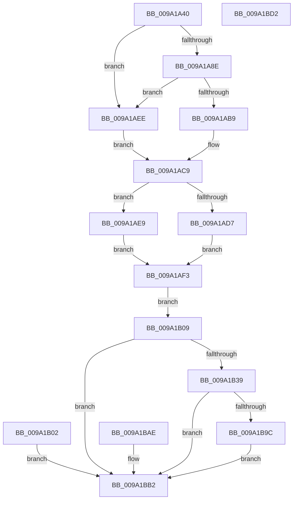

# MmAllocateVirtualMemory

- RVA: `0x009A1A40`–`0x009A1BD3` (길이 `403` bytes)
- VA: `0x00000001409A1A40`
- 실행 섹션: `PAGE`
- PDB 이름 있음: `예`; PDB Function 태그: `아니요`
- unwind 정보 RVA: `0x0009B5A8`
- 디코드: `99`개 명령, `403/403` bytes 표시
- 미해석 바이트: `0` (있으면 어셈블리에 `.byte`로 보존)

> 이 문서는 커널 이미지의 기계어와 PDB 기호를 분석해 생성했습니다. 4번과 5번은 함수 원형과 자료형을 바이너리 사용 방식에서 추정한 C 해석이며 원본 소스 복구 결과는 아닙니다.

## 1. Dependencies

- 직접 호출 지점: **5**; 고유 호출 대상: **4**
- 직접 호출자로 확인된 함수: **3**
- RIP 상대 이미지 참조: **0**

### Outgoing calls
- `0x009A1A72` → [memset](../../text/6C/memset_function_006C6C40.md) (function, `0x006C6C40`)
- `0x009A1ABC` → [RtlReadULong64FromUser](../70/RtlReadULong64FromUser_function_00705DCC.md) (function, `0x00705DCC`)
- `0x009A1ADA` → [RtlReadULong64FromUser](../70/RtlReadULong64FromUser_function_00705DCC.md) (function, `0x00705DCC`)
- `0x009A1B2E` → [MiCaptureAllocateMapExtendedParameters](MiCaptureAllocateMapExtendedParameters_function_009A2110.md) (function, `0x009A2110`)
- `0x009A1B8D` → [MiAllocateVirtualMemoryCommon](../88/MiAllocateVirtualMemoryCommon_function_00883000.md) (function, `0x00883000`)

### Direct callers
- [PsDispatchIumService](../../text/4A/PsDispatchIumService_function_004A2F0C.md) at `0x004A3123`
- [sub_009A0C94](Unknown_function_009A0C94.md) at `0x009A0D83`
- [NtAllocateVirtualMemoryEx](NtAllocateVirtualMemoryEx_function_009A19E0.md) at `0x009A1A2C`

### Static image references
- 디코드된 RIP-relative 메모리 참조가 없습니다.

## 2. Other-region calls and transfers

- 다른 실행 섹션으로 향하는 call: **1**
  - `0x009A1A72` → [memset](../../text/6C/memset_function_006C6C40.md) (`PAGE` → `.text`)
- 별도 외부 분기/꼬리 이동을 확인하지 못했습니다.

## 3. Assembly (complete function range)

```asm
009A1A40  48 8B C4                        mov rax, rsp
009A1A43  48 89 58 08                     mov qword ptr [rax + 8], rbx
009A1A47  48 89 70 10                     mov qword ptr [rax + 0x10], rsi
009A1A4B  48 89 78 18                     mov qword ptr [rax + 0x18], rdi
009A1A4F  4C 89 70 20                     mov qword ptr [rax + 0x20], r14
009A1A53  41 57                           push r15
009A1A55  48 81 EC F0 00 00 00            sub rsp, 0xf0
009A1A5C  45 8B F1                        mov r14d, r9d
009A1A5F  49 8B F8                        mov rdi, r8
009A1A62  48 8B F2                        mov rsi, rdx
009A1A65  4C 8B F9                        mov r15, rcx
009A1A68  33 D2                           xor edx, edx
009A1A6A  44 8D 42 48                     lea r8d, [rdx + 0x48]
009A1A6E  48 8D 48 A8                     lea rcx, [rax - 0x58]
009A1A72  E8 C9 51 D2 FF                  call 0x1406c6c40
009A1A77  48 83 64 24 70 00               and qword ptr [rsp + 0x70], 0
009A1A7D  48 83 64 24 78 00               and qword ptr [rsp + 0x78], 0
009A1A83  8A 9C 24 38 01 00 00            mov bl, byte ptr [rsp + 0x138]
009A1A8A  84 DB                           test bl, bl
009A1A8C  74 60                           je 0x1409a1aee
009A1A8E  48 BA 00 00 FF FF FF 7F 00 00   movabs rdx, 0x7fffffff0000
009A1A98  48 8B CA                        mov rcx, rdx
009A1A9B  48 3B F2                        cmp rsi, rdx
009A1A9E  48 0F 42 CE                     cmovb rcx, rsi
009A1AA2  48 8B 01                        mov rax, qword ptr [rcx]
009A1AA5  48 89 01                        mov qword ptr [rcx], rax
009A1AA8  48 3B FA                        cmp rdi, rdx
009A1AAB  48 0F 42 D7                     cmovb rdx, rdi
009A1AAF  48 8B 02                        mov rax, qword ptr [rdx]
009A1AB2  48 89 02                        mov qword ptr [rdx], rax
009A1AB5  84 DB                           test bl, bl
009A1AB7  74 35                           je 0x1409a1aee
009A1AB9  48 8B CE                        mov rcx, rsi
009A1ABC  E8 0B 43 D6 FF                  call 0x140705dcc
009A1AC1  48 89 84 24 90 00 00 00         mov qword ptr [rsp + 0x90], rax
009A1AC9  48 89 44 24 68                  mov qword ptr [rsp + 0x68], rax
009A1ACE  48 89 44 24 70                  mov qword ptr [rsp + 0x70], rax
009A1AD3  84 DB                           test bl, bl
009A1AD5  74 12                           je 0x1409a1ae9
009A1AD7  48 8B CF                        mov rcx, rdi
009A1ADA  E8 ED 42 D6 FF                  call 0x140705dcc
009A1ADF  48 89 84 24 98 00 00 00         mov qword ptr [rsp + 0x98], rax
009A1AE7  EB 0A                           jmp 0x1409a1af3
009A1AE9  48 8B 07                        mov rax, qword ptr [rdi]
009A1AEC  EB 05                           jmp 0x1409a1af3
009A1AEE  48 8B 06                        mov rax, qword ptr [rsi]
009A1AF1  EB D6                           jmp 0x1409a1ac9
009A1AF3  48 89 84 24 80 00 00 00         mov qword ptr [rsp + 0x80], rax
009A1AFB  48 89 44 24 78                  mov qword ptr [rsp + 0x78], rax
009A1B00  EB 07                           jmp 0x1409a1b09
009A1B02  8B C8                           mov ecx, eax
009A1B04  E9 A9 00 00 00                  jmp 0x1409a1bb2
009A1B09  48 8D 84 24 A0 00 00 00         lea rax, [rsp + 0xa0]
009A1B11  48 89 44 24 20                  mov qword ptr [rsp + 0x20], rax
009A1B16  41 B9 3E 00 00 00               mov r9d, 0x3e
009A1B1C  44 8A C3                        mov r8b, bl
009A1B1F  8B 94 24 30 01 00 00            mov edx, dword ptr [rsp + 0x130]
009A1B26  48 8B 8C 24 28 01 00 00         mov rcx, qword ptr [rsp + 0x128]
009A1B2E  E8 DD 05 00 00                  call 0x1409a2110
009A1B33  8B C8                           mov ecx, eax
009A1B35  85 C0                           test eax, eax
009A1B37  78 79                           js 0x1409a1bb2
009A1B39  48 8B 84 24 50 01 00 00         mov rax, qword ptr [rsp + 0x150]
009A1B41  48 89 44 24 50                  mov qword ptr [rsp + 0x50], rax
009A1B46  8B 84 24 48 01 00 00            mov eax, dword ptr [rsp + 0x148]
009A1B4D  89 44 24 48                     mov dword ptr [rsp + 0x48], eax
009A1B51  8B 84 24 40 01 00 00            mov eax, dword ptr [rsp + 0x140]
009A1B58  89 44 24 40                     mov dword ptr [rsp + 0x40], eax
009A1B5C  88 5C 24 38                     mov byte ptr [rsp + 0x38], bl
009A1B60  48 8D 84 24 A0 00 00 00         lea rax, [rsp + 0xa0]
009A1B68  48 89 44 24 30                  mov qword ptr [rsp + 0x30], rax
009A1B6D  8B 84 24 20 01 00 00            mov eax, dword ptr [rsp + 0x120]
009A1B74  89 44 24 28                     mov dword ptr [rsp + 0x28], eax
009A1B78  44 89 74 24 20                  mov dword ptr [rsp + 0x20], r14d
009A1B7D  4C 8D 4C 24 78                  lea r9, [rsp + 0x78]
009A1B82  45 33 C0                        xor r8d, r8d
009A1B85  48 8D 54 24 70                  lea rdx, [rsp + 0x70]
009A1B8A  49 8B CF                        mov rcx, r15
009A1B8D  E8 6E 14 EE FF                  call 0x140883000
009A1B92  8B C8                           mov ecx, eax
009A1B94  89 44 24 68                     mov dword ptr [rsp + 0x68], eax
009A1B98  85 C0                           test eax, eax
009A1B9A  78 16                           js 0x1409a1bb2
009A1B9C  48 8B 44 24 70                  mov rax, qword ptr [rsp + 0x70]
009A1BA1  48 89 06                        mov qword ptr [rsi], rax
009A1BA4  48 8B 44 24 78                  mov rax, qword ptr [rsp + 0x78]
009A1BA9  48 89 07                        mov qword ptr [rdi], rax
009A1BAC  EB 04                           jmp 0x1409a1bb2
009A1BAE  8B 4C 24 68                     mov ecx, dword ptr [rsp + 0x68]
009A1BB2  8B C1                           mov eax, ecx
009A1BB4  4C 8D 9C 24 F0 00 00 00         lea r11, [rsp + 0xf0]
009A1BBC  49 8B 5B 10                     mov rbx, qword ptr [r11 + 0x10]
009A1BC0  49 8B 73 18                     mov rsi, qword ptr [r11 + 0x18]
009A1BC4  49 8B 7B 20                     mov rdi, qword ptr [r11 + 0x20]
009A1BC8  4D 8B 73 28                     mov r14, qword ptr [r11 + 0x28]
009A1BCC  49 8B E3                        mov rsp, r11
009A1BCF  41 5F                           pop r15
009A1BD1  C3                              ret
009A1BD2  CC                              int3
```

## 4. C-style interpretation (structured pseudocode)

```c
__int64 __fastcall MmAllocateVirtualMemory(__int64 a1, __int64 a2, __int64 a3, int a4, unsigned int a5, __int64 a6, unsigned int a7, unsigned __int8 a8, unsigned int a9, unsigned int a10, __int64 a11)
{
    __int64 result;
    __int64 v_rsp;
    unsigned __int64 v_stack_m58;
    unsigned __int64 v_stack_m60;
    unsigned __int64 v_stack_m68;
    unsigned __int64 v_stack_m78;
    unsigned __int64 v_stack_m8;
    unsigned __int64 v_stack_m80;
    unsigned __int64 v_stack_m88;
    unsigned __int64 v_stack_m90;
    unsigned __int64 v_stack_mA8;
    unsigned int v_stack_mB0;
    unsigned int v_stack_mB8;
    unsigned __int8 v_stack_mC0;
    unsigned __int64 v_stack_mC8;
    unsigned int v_stack_mD0;
    unsigned __int64 v_stack_mD8;

    *(unsigned __int64 *)(v_rsp + 8) = v_rbx;
    *(unsigned __int64 *)(v_rsp + 16) = v_rsi;
    *(unsigned __int64 *)(v_rsp + 24) = v_rdi;
    *(unsigned __int64 *)(v_rsp + 32) = v_r14;
    v_rsp = (v_rsp) - (240);
    a2 = 0;
    result = memset(v_rsp - 88, a2, a2 + 72, a4);
    if (a8 == 0) goto loc_009A1AEE;
    a1 = 0;
    if (0 < 0) { a1 = 0; }
    *(unsigned __int64 *)(a1) = *(unsigned __int64 *)(a1);
    if (a3 < 0) { a2 = a3; }
    *(unsigned __int64 *)(a2) = *(unsigned __int64 *)(a2);
    if (a8 == 0) goto loc_009A1AEE;
    result = RtlReadULong64FromUser(a2, a2, a2 + 72, a4);
    v_stack_m68 = result;
loc_009A1AC9:
    v_stack_m90 = result;
    v_stack_m88 = result;
    if (a8 == 0) goto loc_009A1AE9;
    result = RtlReadULong64FromUser(a3, a2, a2 + 72, a4);
    v_stack_m60 = result;
    goto loc_009A1AF3;
loc_009A1AE9:
    goto loc_009A1AF3;
loc_009A1AEE:
    goto loc_009A1AC9;
loc_009A1AF3:
    v_stack_m78 = *(unsigned __int64 *)(a2);
    v_stack_m80 = *(unsigned __int64 *)(a2);
    goto loc_009A1B09;
loc_009A1B09:
    v_stack_mD8 = v_stack_m58;
    result = MiCaptureAllocateMapExtendedParameters(a6, (unsigned int)(a7), a8, 62);
    if (sign_flag) goto loc_009A1BB2;
    v_stack_mA8 = a11;
    v_stack_mB0 = (unsigned int)((unsigned int)(a10));
    v_stack_mB8 = (unsigned int)((unsigned int)(a9));
    v_stack_mC0 = a8;
    v_stack_mC8 = v_stack_m58;
    v_stack_mD0 = (unsigned int)((unsigned int)(a5));
    v_stack_mD8 = (unsigned int)((unsigned int)(a4));
    a3 = 0;
    result = MiAllocateVirtualMemoryCommon(a1, v_stack_m88, a3, v_stack_m80);
    v_stack_m90 = (unsigned int)(result);
    if (sign_flag) goto loc_009A1BB2;
    *(unsigned __int64 *)(a2) = v_stack_m88;
    *(unsigned __int64 *)(a3) = v_stack_m80;
    goto loc_009A1BB2;
loc_009A1BB2:
    return (unsigned int)((unsigned int)((unsigned int)((unsigned int)(result))));
}
```

## 5. (Beta) C Style

```c
int64_t MmAllocateVirtualMemory(int64_t Arg1, int64_t Arg2, int64_t Arg3, int32_t Arg4, uint32_t Arg5, int64_t Arg6, uint32_t Arg7, uint8_t Arg8, uint32_t Arg9, uint32_t Arg10, int64_t Arg11)
{
    int64_t result;
    int64_t local_rsp;
    uint64_t v_stack_m58;
    uint64_t v_stack_m60;
    uint64_t v_stack_m68;
    uint64_t v_stack_m78;
    uint64_t v_stack_m8;
    uint64_t v_stack_m80;
    uint64_t v_stack_m88;
    uint64_t v_stack_m90;
    uint64_t v_stack_mA8;
    uint32_t v_stack_mB0;
    uint32_t v_stack_mB8;
    uint8_t v_stack_mC0;
    uint64_t v_stack_mC8;
    uint32_t v_stack_mD0;
    uint64_t v_stack_mD8;

    *(uint64_t *)(local_rsp + 0x8) = local_rbx;
    *(uint64_t *)(local_rsp + 0x10) = local_rsi;
    *(uint64_t *)(local_rsp + 0x18) = local_rdi;
    *(uint64_t *)(local_rsp + 0x20) = local_r14;
    local_rsp = (local_rsp) - (240);
    Arg2 = 0;
    result = memset(local_rsp - 88, Arg2, Arg2 + 72, Arg4);
    if (Arg8 == 0) goto loc_009A1AEE;
    Arg1 = 0;
    if (0 < 0) { Arg1 = 0; }
    *(uint64_t *)(Arg1) = *(uint64_t *)(Arg1);
    if (Arg3 < 0) { Arg2 = Arg3; }
    *(uint64_t *)(Arg2) = *(uint64_t *)(Arg2);
    if (Arg8 == 0) goto loc_009A1AEE;
    result = RtlReadULong64FromUser(Arg2, Arg2, Arg2 + 72, Arg4);
    v_stack_m68 = result;
loc_009A1AC9:
    v_stack_m90 = result;
    v_stack_m88 = result;
    if (Arg8 == 0) goto loc_009A1AE9;
    result = RtlReadULong64FromUser(Arg3, Arg2, Arg2 + 72, Arg4);
    v_stack_m60 = result;
    goto loc_009A1AF3;
loc_009A1AE9:
    goto loc_009A1AF3;
loc_009A1AEE:
    goto loc_009A1AC9;
loc_009A1AF3:
    v_stack_m78 = *(uint64_t *)(Arg2);
    v_stack_m80 = *(uint64_t *)(Arg2);
    goto loc_009A1B09;
loc_009A1B09:
    v_stack_mD8 = v_stack_m58;
    result = MiCaptureAllocateMapExtendedParameters(Arg6, (uint32_t)(Arg7), Arg8, 62);
    if (sign_flag) goto loc_009A1BB2;
    v_stack_mA8 = Arg11;
    v_stack_mB0 = (uint32_t)((uint32_t)(Arg10));
    v_stack_mB8 = (uint32_t)((uint32_t)(Arg9));
    v_stack_mC0 = Arg8;
    v_stack_mC8 = v_stack_m58;
    v_stack_mD0 = (uint32_t)((uint32_t)(Arg5));
    v_stack_mD8 = (uint32_t)((uint32_t)(Arg4));
    Arg3 = 0;
    result = MiAllocateVirtualMemoryCommon(Arg1, v_stack_m88, Arg3, v_stack_m80);
    v_stack_m90 = (uint32_t)(result);
    if (sign_flag) goto loc_009A1BB2;
    *(uint64_t *)(Arg2) = v_stack_m88;
    *(uint64_t *)(Arg3) = v_stack_m80;
    goto loc_009A1BB2;
loc_009A1BB2:
    return (uint32_t)((uint32_t)((uint32_t)((uint32_t)(result))));
}
```

## 6. Execution-region graph

[열기: 2D/3D 그래프와 함수 탐색 컨트롤 패널](../../../control-panel.html?section=page&rva=0x009A1A40&view=graph)

- 2D 그래프는 위에서 아래로 흐르고, 3D 그래프는 빈 공간을 드래그해 회전합니다. Shift+드래그는 이동, 휠은 확대·축소, 함수 노드 선택은 대상 보고서 이동입니다.

### Static fallback


