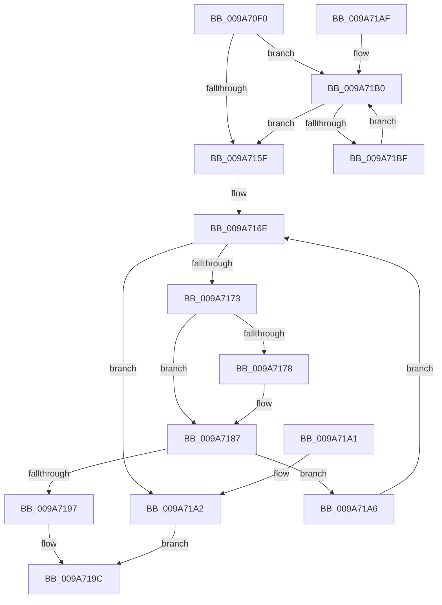

# MmHardFaultBytesRequired

- RVA: `0x009A70F0`–`0x009A71C1` (길이 `209` bytes)
- VA: `0x00000001409A70F0`
- 실행 섹션: `PAGE`
- PDB 이름 있음: `예`; PDB Function 태그: `아니요`
- unwind 정보 RVA: `0x0006E680`
- 디코드: `60`개 명령, `209/209` bytes 표시
- 미해석 바이트: `0` (있으면 어셈블리에 `.byte`로 보존)

> 이 문서는 커널 이미지의 기계어와 PDB 기호를 분석해 생성했습니다. 4번과 5번은 함수 원형과 자료형을 바이너리 사용 방식에서 추정한 C 해석이며 원본 소스 복구 결과는 아닙니다.

## 1. Dependencies

- 직접 호출 지점: **1**; 고유 호출 대상: **1**
- 직접 호출자로 확인된 함수: **1**
- RIP 상대 이미지 참조: **0**

### Outgoing calls
- `0x009A70FE` → [MiGetSystemCacheReverseMap](../../text/29/MiGetSystemCacheReverseMap_function_00294BF0.md) (function, `0x00294BF0`)

### Direct callers
- [CcFetchDataForRead](../../text/2F/CcFetchDataForRead_function_002F8720.md) at `0x002F8795`

### Static image references
- 디코드된 RIP-relative 메모리 참조가 없습니다.

## 2. Other-region calls and transfers

- 다른 실행 섹션으로 향하는 call: **1**
  - `0x009A70FE` → [MiGetSystemCacheReverseMap](../../text/29/MiGetSystemCacheReverseMap_function_00294BF0.md) (`PAGE` → `.text`)
- 별도 외부 분기/꼬리 이동을 확인하지 못했습니다.

## 3. Assembly (complete function range)

```asm
009A70F0  48 83 EC 28                     sub rsp, 0x28
009A70F4  48 81 E1 00 00 FC FF            and rcx, 0xfffffffffffc0000
009A70FB  4C 8B CA                        mov r9, rdx
009A70FE  E8 ED DA 8E FF                  call 0x140294bf0
009A7103  4D 8B D1                        mov r10, r9
009A7106  48 8B 50 18                     mov rdx, qword ptr [rax + 0x18]
009A710A  48 8B CA                        mov rcx, rdx
009A710D  48 83 E1 FE                     and rcx, 0xfffffffffffffffe
009A7111  F6 C2 01                        test dl, 1
009A7114  48 0F 44 CA                     cmove rcx, rdx
009A7118  41 81 E2 FF 0F 00 00            and r10d, 0xfff
009A711F  49 81 C2 FF 0F 00 00            add r10, 0xfff
009A7126  4D 03 D0                        add r10, r8
009A7129  49 C1 EA 0C                     shr r10, 0xc
009A712D  44 8B 41 20                     mov r8d, dword ptr [rcx + 0x20]
009A7131  8B 41 24                        mov eax, dword ptr [rcx + 0x24]
009A7134  41 81 E0 C0 FF 00 00            and r8d, 0xffc0
009A713B  49 C1 E0 1A                     shl r8, 0x1a
009A713F  4C 0B C0                        or r8, rax
009A7142  49 8B C1                        mov rax, r9
009A7145  48 99                           cqo
009A7147  81 E2 FF 0F 00 00               and edx, 0xfff
009A714D  48 03 C2                        add rax, rdx
009A7150  8B 51 2C                        mov edx, dword ptr [rcx + 0x2c]
009A7153  48 C1 F8 0C                     sar rax, 0xc
009A7157  49 2B C0                        sub rax, r8
009A715A  48 3B C2                        cmp rax, rdx
009A715D  73 51                           jae 0x1409a71b0
009A715F  48 8B 51 08                     mov rdx, qword ptr [rcx + 8]
009A7163  4C 8D 04 C2                     lea r8, [rdx + rax*8]
009A7167  8B 41 2C                        mov eax, dword ptr [rcx + 0x2c]
009A716A  4C 8D 0C C2                     lea r9, [rdx + rax*8]
009A716E  4D 85 D2                        test r10, r10
009A7171  74 2F                           je 0x1409a71a2
009A7173  4D 3B C1                        cmp r8, r9
009A7176  72 0F                           jb 0x1409a7187
009A7178  48 8B 49 10                     mov rcx, qword ptr [rcx + 0x10]
009A717C  4C 8B 41 08                     mov r8, qword ptr [rcx + 8]
009A7180  8B 41 2C                        mov eax, dword ptr [rcx + 0x2c]
009A7183  4D 8D 0C C0                     lea r9, [r8 + rax*8]
009A7187  49 8B 00                        mov rax, qword ptr [r8]
009A718A  25 01 04 00 00                  and eax, 0x401
009A718F  48 3D 00 04 00 00               cmp rax, 0x400
009A7195  75 0F                           jne 0x1409a71a6
009A7197  B8 01 00 00 00                  mov eax, 1
009A719C  48 83 C4 28                     add rsp, 0x28
009A71A0  C3                              ret
009A71A1  CC                              int3
009A71A2  33 C0                           xor eax, eax
009A71A4  EB F6                           jmp 0x1409a719c
009A71A6  49 83 C0 08                     add r8, 8
009A71AA  49 FF CA                        dec r10
009A71AD  EB BF                           jmp 0x1409a716e
009A71AF  90                              nop
009A71B0  48 8B 49 10                     mov rcx, qword ptr [rcx + 0x10]
009A71B4  48 2B C2                        sub rax, rdx
009A71B7  8B 51 2C                        mov edx, dword ptr [rcx + 0x2c]
009A71BA  48 3B C2                        cmp rax, rdx
009A71BD  72 A0                           jb 0x1409a715f
009A71BF  EB EF                           jmp 0x1409a71b0
```

## 4. C-style interpretation (structured pseudocode)

```c
__int64 __fastcall MmHardFaultBytesRequired(__int64 a1, __int64 a2, __int64 a3)
{
    __int64 result;
    __int64 v_r10;
    __int64 v_rsp;

    v_rsp = (v_rsp) - (40);
    a1 = (a1) & (0xFFFFFFFFFFFC0000ULL);
    result = MiGetSystemCacheReverseMap(a1, a2, a3, a2);
    a1 = (*(unsigned __int64 *)(result + 24)) & (-2);
    if ((((unsigned __int8)(*(unsigned __int64 *)(result + 24))) & (1)) == 0) { a1 = *(unsigned __int64 *)(result + 24); }
    v_r10 = (unsigned int)((a2) & (0xFFFULL));
    v_r10 = (v_r10) + (0xFFFULL);
    v_r10 = (v_r10) + (a3);
    v_r10 = (v_r10) >> (12);
    a3 = (unsigned int)(((unsigned int)(*(unsigned int *)(a1 + 32))) & (0xFFC0ULL));
    a3 = (a3) << (26);
    a3 = (a3) | ((unsigned int)(*(unsigned int *)(a1 + 36)));
    a2 = (unsigned int)((*(unsigned __int64 *)(result + 24)) & (0xFFFULL));
    result = (a2) + (a2);
    result = (result) >> (12);
    result = (result) - (a3);
    if (result >= ((unsigned int)(*(unsigned int *)(a1 + 44)))) goto loc_009A71B0;
loc_009A715F:
loc_009A716E:
    if (v_r10 == 0) goto loc_009A71A2;
    result = (unsigned int)(*(unsigned int *)(a1 + 44));
    if ((*(unsigned __int64 *)(a1 + 8) + result * 8) >= (*(unsigned __int64 *)(a1 + 8) + (unsigned int)(*(unsigned int *)(a1 + 44)) * 8)) {
        a1 = *(unsigned __int64 *)(a1 + 16);
        a3 = *(unsigned __int64 *)(a1 + 8);
        result = *(unsigned int *)(a1 + 44);
        a4 = a3 + result * 8;
    }
    result = (unsigned int)((*(unsigned __int64 *)(a3)) & (0x401ULL));
    if (result != 0x400ULL) goto loc_009A71A6;
loc_009A719C:
    v_rsp = (v_rsp) + (40);
    return 1;
loc_009A71A2:
    result = 0;
    goto loc_009A719C;
loc_009A71A6:
    a3 = (a3) + (8);
    v_r10 = (v_r10) - 1;
    goto loc_009A716E;
loc_009A71B0:
    result = (result) - (*(unsigned __int64 *)(a1 + 8));
    if (result < ((unsigned int)(*(unsigned int *)(*(unsigned __int64 *)(a1 + 16) + 44)))) goto loc_009A715F;
    goto loc_009A71B0;
}
```

## 5. (Beta) C Style

```c
int64_t MmHardFaultBytesRequired(int64_t Arg1, int64_t Arg2, int64_t Arg3)
{
    int64_t result;
    int64_t local_r10;
    int64_t local_rsp;

    local_rsp = (local_rsp) - (40);
    Arg1 = (Arg1) & (0xFFFFFFFFFFFC0000ULL);
    result = MiGetSystemCacheReverseMap(Arg1, Arg2, Arg3, Arg2);
    Arg1 = (*(uint64_t *)(result + 0x18)) & (-2);
    if ((((uint8_t)(*(uint64_t *)(result + 0x18))) & (1)) == 0) { Arg1 = *(uint64_t *)(result + 0x18); }
    local_r10 = (uint32_t)((Arg2) & (0xFFFULL));
    local_r10 = (local_r10) + (0xFFFULL);
    local_r10 = (local_r10) + (Arg3);
    local_r10 = (local_r10) >> (12);
    Arg3 = (uint32_t)(((uint32_t)(*(uint32_t *)(Arg1 + 0x20))) & (0xFFC0ULL));
    Arg3 = (Arg3) << (26);
    Arg3 = (Arg3) | ((uint32_t)(*(uint32_t *)(Arg1 + 0x24)));
    Arg2 = (uint32_t)((*(uint64_t *)(result + 0x18)) & (0xFFFULL));
    result = (Arg2) + (Arg2);
    result = (result) >> (12);
    result = (result) - (Arg3);
    if (result >= ((uint32_t)(*(uint32_t *)(Arg1 + 0x2C)))) goto loc_009A71B0;
loc_009A715F:
loc_009A716E:
    if (local_r10 == 0) goto loc_009A71A2;
    result = (uint32_t)(*(uint32_t *)(Arg1 + 0x2C));
    if ((*(uint64_t *)(Arg1 + 0x8) + result * 8) >= (*(uint64_t *)(Arg1 + 0x8) + (uint32_t)(*(uint32_t *)(Arg1 + 0x2C)) * 8)) {
        Arg1 = *(uint64_t *)(Arg1 + 0x10);
        Arg3 = *(uint64_t *)(Arg1 + 0x8);
        result = *(uint32_t *)(Arg1 + 0x2C);
        a4 = Arg3 + result * 8;
    }
    result = (uint32_t)((*(uint64_t *)(Arg3)) & (0x401ULL));
    if (result != 0x400ULL) goto loc_009A71A6;
loc_009A719C:
    local_rsp = (local_rsp) + (40);
    return 1;
loc_009A71A2:
    result = 0;
    goto loc_009A719C;
loc_009A71A6:
    Arg3 = (Arg3) + (8);
    local_r10 = (local_r10) - 1;
    goto loc_009A716E;
loc_009A71B0:
    result = (result) - (*(uint64_t *)(Arg1 + 0x8));
    if (result < ((uint32_t)(*(uint32_t *)(*(uint64_t *)(Arg1 + 0x10) + 0x2C)))) goto loc_009A715F;
    goto loc_009A71B0;
}
```

## 6. Execution-region graph

[열기: 2D/3D 그래프와 함수 탐색 컨트롤 패널](../../../control-panel.html?section=page&rva=0x009A70F0&view=graph)

- 2D 그래프는 위에서 아래로 흐르고, 3D 그래프는 빈 공간을 드래그해 회전합니다. Shift+드래그는 이동, 휠은 확대·축소, 함수 노드 선택은 대상 보고서 이동입니다.

### Static fallback


