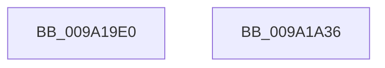

# NtAllocateVirtualMemoryEx

- RVA: `0x009A19E0`–`0x009A1A37` (길이 `87` bytes)
- VA: `0x00000001409A19E0`
- 실행 섹션: `PAGE`
- PDB 이름 있음: `예`; PDB Function 태그: `아니요`
- unwind 정보 RVA: `0x0006E590`
- 디코드: `18`개 명령, `87/87` bytes 표시
- 미해석 바이트: `0` (있으면 어셈블리에 `.byte`로 보존)

> 이 문서는 커널 이미지의 기계어와 PDB 기호를 분석해 생성했습니다. 4번과 5번은 함수 원형과 자료형을 바이너리 사용 방식에서 추정한 C 해석이며 원본 소스 복구 결과는 아닙니다.

## 1. Dependencies

- 직접 호출 지점: **1**; 고유 호출 대상: **1**
- 직접 호출자로 확인된 함수: **0**
- RIP 상대 이미지 참조: **0**

### Outgoing calls
- `0x009A1A2C` → [MmAllocateVirtualMemory](MmAllocateVirtualMemory_function_009A1A40.md) (function, `0x009A1A40`)

### Direct callers
- 이 함수 시작 RVA로 연결되는 직접 call은 확인되지 않았습니다. 간접 호출은 완전히 역산할 수 없습니다.

### Static image references
- 디코드된 RIP-relative 메모리 참조가 없습니다.

## 2. Other-region calls and transfers

- 다른 실행 섹션으로 향하는 call: **0**
- 별도 외부 분기/꼬리 이동을 확인하지 못했습니다.

## 3. Assembly (complete function range)

```asm
009A19E0  48 83 EC 68                     sub rsp, 0x68
009A19E4  65 48 8B 04 25 88 01 00 00      mov rax, qword ptr gs:[0x188]
009A19ED  44 0F B6 90 32 02 00 00         movzx r10d, byte ptr [rax + 0x232]
009A19F5  33 C0                           xor eax, eax
009A19F7  48 89 44 24 50                  mov qword ptr [rsp + 0x50], rax
009A19FC  89 44 24 48                     mov dword ptr [rsp + 0x48], eax
009A1A00  89 44 24 40                     mov dword ptr [rsp + 0x40], eax
009A1A04  8B 84 24 A0 00 00 00            mov eax, dword ptr [rsp + 0xa0]
009A1A0B  44 88 54 24 38                  mov byte ptr [rsp + 0x38], r10b
009A1A10  89 44 24 30                     mov dword ptr [rsp + 0x30], eax
009A1A14  48 8B 84 24 98 00 00 00         mov rax, qword ptr [rsp + 0x98]
009A1A1C  48 89 44 24 28                  mov qword ptr [rsp + 0x28], rax
009A1A21  8B 84 24 90 00 00 00            mov eax, dword ptr [rsp + 0x90]
009A1A28  89 44 24 20                     mov dword ptr [rsp + 0x20], eax
009A1A2C  E8 0F 00 00 00                  call 0x1409a1a40
009A1A31  48 83 C4 68                     add rsp, 0x68
009A1A35  C3                              ret
009A1A36  CC                              int3
```

## 4. C-style interpretation (structured pseudocode)

```c
__int64 __fastcall NtAllocateVirtualMemoryEx(__int64 a1, __int64 a2, __int64 a3, __int64 a4, unsigned int a5, __int64 a6, unsigned int a7)
{
    __int64 result;
    __int64 v_rsp;
    unsigned __int64 v_stack_m18;
    unsigned int v_stack_m20;
    unsigned int v_stack_m28;
    unsigned __int8 v_stack_m30;
    unsigned int v_stack_m38;
    unsigned __int64 v_stack_m40;
    unsigned int v_stack_m48;

    v_rsp = (v_rsp) - (104);
    result = 0;
    v_stack_m18 = 0;
    v_stack_m20 = 0;
    v_stack_m28 = 0;
    v_stack_m30 = (unsigned __int8)(*(unsigned __int8 *)(*(unsigned __int64 *)(gs_base + (0 + 392)) + 562));
    v_stack_m38 = (unsigned int)((unsigned int)(a7));
    v_stack_m40 = a6;
    v_stack_m48 = (unsigned int)((unsigned int)(a5));
    result = MmAllocateVirtualMemory(a1, a2, a3, a4);
    v_rsp = (v_rsp) + (104);
    return result;
}
```

## 5. (Beta) C Style

```c
int64_t NtAllocateVirtualMemoryEx(int64_t Arg1, int64_t Arg2, int64_t Arg3, int64_t Arg4, uint32_t Arg5, int64_t Arg6, uint32_t Arg7)
{
    int64_t result;
    int64_t local_rsp;
    uint64_t v_stack_m18;
    uint32_t v_stack_m20;
    uint32_t v_stack_m28;
    uint8_t v_stack_m30;
    uint32_t v_stack_m38;
    uint64_t v_stack_m40;
    uint32_t v_stack_m48;

    local_rsp = (local_rsp) - (104);
    result = 0;
    v_stack_m18 = 0;
    v_stack_m20 = 0;
    v_stack_m28 = 0;
    v_stack_m30 = (uint8_t)(*(uint8_t *)(*(uint64_t *)(gs_base + (0 + 0x188)) + 0x232));
    v_stack_m38 = (uint32_t)((uint32_t)(Arg7));
    v_stack_m40 = Arg6;
    v_stack_m48 = (uint32_t)((uint32_t)(Arg5));
    result = MmAllocateVirtualMemory(Arg1, Arg2, Arg3, Arg4);
    local_rsp = (local_rsp) + (104);
    return result;
}
```

## 6. Execution-region graph

[열기: 2D/3D 그래프와 함수 탐색 컨트롤 패널](../../../control-panel.html?section=page&rva=0x009A19E0&view=graph)

- 2D 그래프는 위에서 아래로 흐르고, 3D 그래프는 빈 공간을 드래그해 회전합니다. Shift+드래그는 이동, 휠은 확대·축소, 함수 노드 선택은 대상 보고서 이동입니다.

### Static fallback


