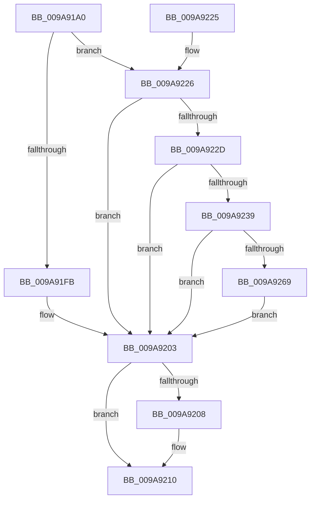

# NtClearEvent

- RVA: `0x009A91A0`–`0x009A9277` (길이 `215` bytes)
- VA: `0x00000001409A91A0`
- 실행 섹션: `PAGE`
- PDB 이름 있음: `예`; PDB Function 태그: `아니요`
- unwind 정보 RVA: `0x0009D4F8`
- 디코드: `59`개 명령, `215/215` bytes 표시
- 미해석 바이트: `0` (있으면 어셈블리에 `.byte`로 보존)

> 이 문서는 커널 이미지의 기계어와 PDB 기호를 분석해 생성했습니다. 4번과 5번은 함수 원형과 자료형을 바이너리 사용 방식에서 추정한 C 해석이며 원본 소스 복구 결과는 아닙니다.

## 1. Dependencies

- 직접 호출 지점: **5**; 고유 호출 대상: **4**
- 직접 호출자로 확인된 함수: **0**
- RIP 상대 이미지 참조: **2**

### Outgoing calls
- `0x009A91EB` → [ObReferenceObjectByHandle](../86/ObReferenceObjectByHandle_function_00868DB0.md) (function, `0x00868DB0`)
- `0x009A91FE` → [KeResetEvent](../../text/24/KeResetEvent_function_00248350.md) (function, `0x00248350`)
- `0x009A920B` → [ObfDereferenceObject](../../text/2F/ObfDereferenceObject_function_002F9350.md) (function, `0x002F9350`)
- `0x009A9259` → [ObReferenceObjectByHandle](../86/ObReferenceObjectByHandle_function_00868DB0.md) (function, `0x00868DB0`)
- `0x009A926E` → [ExpResetCrossVmEvent](../7D/ExpResetCrossVmEvent_function_007D585C.md) (function, `0x007D585C`)

### Direct callers
- 이 함수 시작 RVA로 연결되는 직접 call은 확인되지 않았습니다. 간접 호출은 완전히 역산할 수 없습니다.

### Static image references
- `0x009A91BE` → RVA `0x00FC6B80` (`ALMOSTRO`; read)
- `0x009A922D` → RVA `0x00EFA110` (`.data`; read)

## 2. Other-region calls and transfers

- 다른 실행 섹션으로 향하는 call: **2**
  - `0x009A91FE` → [KeResetEvent](../../text/24/KeResetEvent_function_00248350.md) (`PAGE` → `.text`)
  - `0x009A920B` → [ObfDereferenceObject](../../text/2F/ObfDereferenceObject_function_002F9350.md) (`PAGE` → `.text`)
- 별도 외부 분기/꼬리 이동을 확인하지 못했습니다.

## 3. Assembly (complete function range)

```asm
009A91A0  48 89 5C 24 08                  mov qword ptr [rsp + 8], rbx
009A91A5  48 89 6C 24 18                  mov qword ptr [rsp + 0x18], rbp
009A91AA  56                              push rsi
009A91AB  57                              push rdi
009A91AC  41 56                           push r14
009A91AE  48 83 EC 30                     sub rsp, 0x30
009A91B2  65 48 8B 04 25 88 01 00 00      mov rax, qword ptr gs:[0x188]
009A91BB  45 33 F6                        xor r14d, r14d
009A91BE  4C 8B 05 BB D9 61 00            mov r8, qword ptr [rip + 0x61d9bb]
009A91C5  48 8B F1                        mov rsi, rcx
009A91C8  4C 89 74 24 28                  mov qword ptr [rsp + 0x28], r14
009A91CD  4C 89 74 24 58                  mov qword ptr [rsp + 0x58], r14
009A91D2  0F B6 A8 32 02 00 00            movzx ebp, byte ptr [rax + 0x232]
009A91D9  41 8D 56 02                     lea edx, [r14 + 2]
009A91DD  48 8D 44 24 58                  lea rax, [rsp + 0x58]
009A91E2  44 0F B6 CD                     movzx r9d, bpl
009A91E6  48 89 44 24 20                  mov qword ptr [rsp + 0x20], rax
009A91EB  E8 C0 FB EB FF                  call 0x140868db0
009A91F0  48 8B 5C 24 58                  mov rbx, qword ptr [rsp + 0x58]
009A91F5  8B F8                           mov edi, eax
009A91F7  85 C0                           test eax, eax
009A91F9  78 2B                           js 0x1409a9226
009A91FB  48 8B CB                        mov rcx, rbx
009A91FE  E8 4D F1 89 FF                  call 0x140248350
009A9203  48 85 DB                        test rbx, rbx
009A9206  74 08                           je 0x1409a9210
009A9208  48 8B CB                        mov rcx, rbx
009A920B  E8 40 01 95 FF                  call 0x1402f9350
009A9210  48 8B 5C 24 50                  mov rbx, qword ptr [rsp + 0x50]
009A9215  8B C7                           mov eax, edi
009A9217  48 8B 6C 24 60                  mov rbp, qword ptr [rsp + 0x60]
009A921C  48 83 C4 30                     add rsp, 0x30
009A9220  41 5E                           pop r14
009A9222  5F                              pop rdi
009A9223  5E                              pop rsi
009A9224  C3                              ret
009A9225  CC                              int3
009A9226  3D 24 00 00 C0                  cmp eax, 0xc0000024
009A922B  75 D6                           jne 0x1409a9203
009A922D  4C 8B 05 DC 0E 55 00            mov r8, qword ptr [rip + 0x550edc]
009A9234  4D 85 C0                        test r8, r8
009A9237  74 CA                           je 0x1409a9203
009A9239  48 8D 44 24 58                  lea rax, [rsp + 0x58]
009A923E  4C 89 74 24 28                  mov qword ptr [rsp + 0x28], r14
009A9243  44 0F B6 CD                     movzx r9d, bpl
009A9247  48 89 44 24 20                  mov qword ptr [rsp + 0x20], rax
009A924C  BA 02 00 00 00                  mov edx, 2
009A9251  4C 89 74 24 58                  mov qword ptr [rsp + 0x58], r14
009A9256  48 8B CE                        mov rcx, rsi
009A9259  E8 52 FB EB FF                  call 0x140868db0
009A925E  48 8B 5C 24 58                  mov rbx, qword ptr [rsp + 0x58]
009A9263  8B F8                           mov edi, eax
009A9265  85 C0                           test eax, eax
009A9267  78 9A                           js 0x1409a9203
009A9269  33 D2                           xor edx, edx
009A926B  48 8B CB                        mov rcx, rbx
009A926E  E8 E9 C5 E2 FF                  call 0x1407d585c
009A9273  8B F8                           mov edi, eax
009A9275  EB 8C                           jmp 0x1409a9203
```

## 4. C-style interpretation (structured pseudocode)

```c
__int64 __fastcall NtClearEvent(__int64 a1)
{
    __int64 result;
    __int64 v_r14;
    __int64 v_rsp;
    unsigned __int64 v_stack_m20;
    unsigned __int64 v_stack_m28;
    unsigned __int64 v_stack_p10;
    unsigned __int64 v_stack_p18;
    unsigned __int64 v_stack_p20;
    unsigned __int64 v_stack_p28;
    unsigned __int64 v_stack_p58;
    unsigned __int64 v_stack_p8;

    v_stack_p8 = v_rbx;
    v_stack_p18 = v_rbp;
    v_rsp = (v_rsp) - (48);
    v_r14 = 0;
    v_stack_m20 = 0;
    v_stack_p10 = 0;
    v_stack_m28 = v_stack_p10;
    result = ObReferenceObjectByHandle(a1, v_r14 + 2, *(unsigned __int64 *)(v_rip + 6412731), (unsigned __int8)(*(unsigned __int8 *)(*(unsigned __int64 *)(gs_base + (0 + 392)) + 562)));
    if (sign_flag) goto loc_009A9226;
    result = KeResetEvent(v_stack_p10, v_r14 + 2, *(unsigned __int64 *)(v_rip + 6412731), (unsigned __int8)(*(unsigned __int8 *)(*(unsigned __int64 *)(gs_base + (0 + 392)) + 562)));
loc_009A9203:
    if (v_stack_p10 != 0) {
        a1 = v_stack_p10;
        result = ObfDereferenceObject(a1, v_r14 + 2, *(unsigned __int64 *)(v_rip + 6412731), (unsigned __int8)(*(unsigned __int8 *)(*(unsigned __int64 *)(gs_base + (0 + 392)) + 562)));
    }
    v_rsp = (v_rsp) + (48);
    return (unsigned int)((unsigned int)((unsigned int)((unsigned int)(result))));
loc_009A9226:
    if (((unsigned int)((unsigned int)((unsigned int)((unsigned int)((unsigned int)(result)))))) != 0xC0000024ULL) goto loc_009A9203;
    if (*(unsigned __int64 *)(v_rip + 5574364) == 0) goto loc_009A9203;
    v_stack_p28 = 0;
    v_stack_p20 = v_stack_p58;
    v_stack_p58 = 0;
    result = ObReferenceObjectByHandle(a1, 2, *(unsigned __int64 *)(v_rip + 5574364), (unsigned __int8)(v_stack_p18));
    if (sign_flag) goto loc_009A9203;
    a2 = 0;
    result = ExpResetCrossVmEvent(v_stack_p58, a2, *(unsigned __int64 *)(v_rip + 5574364), (unsigned __int8)(v_stack_p18));
    goto loc_009A9203;
}
```

## 5. (Beta) C Style

```c
int64_t NtClearEvent(int64_t Arg1)
{
    int64_t result;
    int64_t local_r14;
    int64_t local_rsp;
    uint64_t v_stack_m20;
    uint64_t v_stack_m28;
    uint64_t v_stack_p10;
    uint64_t v_stack_p18;
    uint64_t v_stack_p20;
    uint64_t v_stack_p28;
    uint64_t v_stack_p58;
    uint64_t v_stack_p8;

    v_stack_p8 = local_rbx;
    v_stack_p18 = local_rbp;
    local_rsp = (local_rsp) - (48);
    local_r14 = 0;
    v_stack_m20 = 0;
    v_stack_p10 = 0;
    v_stack_m28 = v_stack_p10;
    result = ObReferenceObjectByHandle(Arg1, local_r14 + 2, *(uint64_t *)(v_rip + 0x61D9BB), (uint8_t)(*(uint8_t *)(*(uint64_t *)(gs_base + (0 + 0x188)) + 0x232)));
    if (sign_flag) goto loc_009A9226;
    result = KeResetEvent(v_stack_p10, local_r14 + 2, *(uint64_t *)(v_rip + 0x61D9BB), (uint8_t)(*(uint8_t *)(*(uint64_t *)(gs_base + (0 + 0x188)) + 0x232)));
loc_009A9203:
    if (v_stack_p10 != 0) {
        Arg1 = v_stack_p10;
        result = ObfDereferenceObject(Arg1, local_r14 + 2, *(uint64_t *)(v_rip + 0x61D9BB), (uint8_t)(*(uint8_t *)(*(uint64_t *)(gs_base + (0 + 0x188)) + 0x232)));
    }
    local_rsp = (local_rsp) + (48);
    return (uint32_t)((uint32_t)((uint32_t)((uint32_t)(result))));
loc_009A9226:
    if (((uint32_t)((uint32_t)((uint32_t)((uint32_t)((uint32_t)(result)))))) != 0xC0000024ULL) goto loc_009A9203;
    if (*(uint64_t *)(v_rip + 0x550EDC) == 0) goto loc_009A9203;
    v_stack_p28 = 0;
    v_stack_p20 = v_stack_p58;
    v_stack_p58 = 0;
    result = ObReferenceObjectByHandle(Arg1, 2, *(uint64_t *)(v_rip + 0x550EDC), (uint8_t)(v_stack_p18));
    if (sign_flag) goto loc_009A9203;
    a2 = 0;
    result = ExpResetCrossVmEvent(v_stack_p58, a2, *(uint64_t *)(v_rip + 0x550EDC), (uint8_t)(v_stack_p18));
    goto loc_009A9203;
}
```

## 6. Execution-region graph

[열기: 2D/3D 그래프와 함수 탐색 컨트롤 패널](../../../control-panel.html?section=page&rva=0x009A91A0&view=graph)

- 2D 그래프는 위에서 아래로 흐르고, 3D 그래프는 빈 공간을 드래그해 회전합니다. Shift+드래그는 이동, 휠은 확대·축소, 함수 노드 선택은 대상 보고서 이동입니다.

### Static fallback


