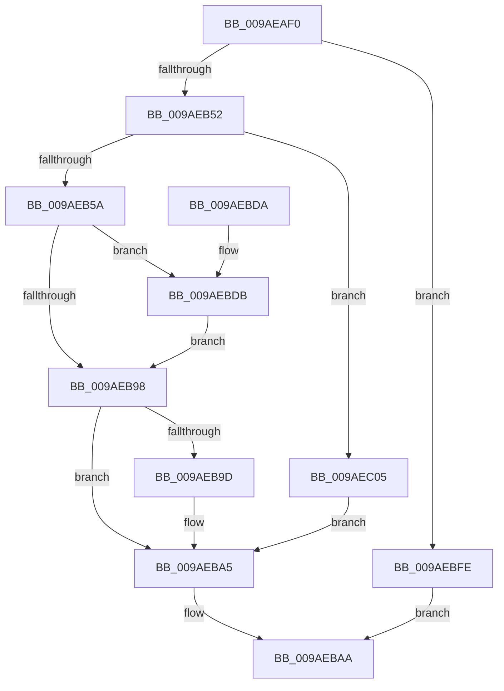

# NtCommitRegistryTransaction

- RVA: `0x009AEAF0`–`0x009AEC0C` (길이 `284` bytes)
- VA: `0x00000001409AEAF0`
- 실행 섹션: `PAGE`
- PDB 이름 있음: `예`; PDB Function 태그: `아니요`
- unwind 정보 RVA: `0x0009DFFC`
- 디코드: `75`개 명령, `284/284` bytes 표시
- 미해석 바이트: `0` (있으면 어셈블리에 `.byte`로 보존)

> 이 문서는 커널 이미지의 기계어와 PDB 기호를 분석해 생성했습니다. 4번과 5번은 함수 원형과 자료형을 바이너리 사용 방식에서 추정한 C 해석이며 원본 소스 복구 결과는 아닙니다.

## 1. Dependencies

- 직접 호출 지점: **10**; 고유 호출 대상: **10**
- 직접 호출자로 확인된 함수: **0**
- RIP 상대 이미지 참조: **2**

### Outgoing calls
- `0x009AEB3E` → [CmpInitializeThreadInfo](../../text/3F/CmpInitializeThreadInfo_function_003FBE70.md) (function, `0x003FBE70`)
- `0x009AEB43` → [CmpAcquireShutdownRundown](../../pagecmrc/BC/CmpAcquireShutdownRundown_function_00BC9400.md) (function, `0x00BC9400`)
- `0x009AEB89` → [ObReferenceObjectByHandle](../86/ObReferenceObjectByHandle_function_00868DB0.md) (function, `0x00868DB0`)
- `0x009AEBA0` → [ObfDereferenceObject](../../text/2F/ObfDereferenceObject_function_002F9350.md) (function, `0x002F9350`)
- `0x009AEBA5` → [CmpReleaseShutdownRundown](../../pagecmrc/BC/CmpReleaseShutdownRundown_function_00BC9880.md) (function, `0x00BC9880`)
- `0x009AEBAE` → [CmCleanupThreadInfo](../../text/41/CmCleanupThreadInfo_function_0041FD50.md) (function, `0x0041FD50`)
- `0x009AEBBC` → [_security_check_cookie](../../text/6A/_security_check_cookie_function_006AC640.md) (function, `0x006AC640`)
- `0x009AEBDF` → [CmpAttachToRegistryProcess](../../pagecmrc/BC/CmpAttachToRegistryProcess_function_00BC98E0.md) (function, `0x00BC98E0`)
- `0x009AEBE7` → [CmpCommitLightWeightTransaction](../9B/CmpCommitLightWeightTransaction_function_009B0868.md) (function, `0x009B0868`)
- `0x009AEBF2` → [CmpDetachFromRegistryProcess](../../pagecmrc/BC/CmpDetachFromRegistryProcess_function_00BC9920.md) (function, `0x00BC9920`)

### Direct callers
- 이 함수 시작 RVA로 연결되는 직접 call은 확인되지 않았습니다. 간접 호출은 완전히 역산할 수 없습니다.

### Static image references
- `0x009AEB0B` → RVA `0x00E0A740` (`.data`; read)
- `0x009AEB66` → RVA `0x00EF5720` (`.data`; read)

## 2. Other-region calls and transfers

- 다른 실행 섹션으로 향하는 call: **8**
  - `0x009AEB3E` → [CmpInitializeThreadInfo](../../text/3F/CmpInitializeThreadInfo_function_003FBE70.md) (`PAGE` → `.text`)
  - `0x009AEB43` → [CmpAcquireShutdownRundown](../../pagecmrc/BC/CmpAcquireShutdownRundown_function_00BC9400.md) (`PAGE` → `PAGECMRC`)
  - `0x009AEBA0` → [ObfDereferenceObject](../../text/2F/ObfDereferenceObject_function_002F9350.md) (`PAGE` → `.text`)
  - `0x009AEBA5` → [CmpReleaseShutdownRundown](../../pagecmrc/BC/CmpReleaseShutdownRundown_function_00BC9880.md) (`PAGE` → `PAGECMRC`)
  - `0x009AEBAE` → [CmCleanupThreadInfo](../../text/41/CmCleanupThreadInfo_function_0041FD50.md) (`PAGE` → `.text`)
  - `0x009AEBBC` → [_security_check_cookie](../../text/6A/_security_check_cookie_function_006AC640.md) (`PAGE` → `.text`)
  - `0x009AEBDF` → [CmpAttachToRegistryProcess](../../pagecmrc/BC/CmpAttachToRegistryProcess_function_00BC98E0.md) (`PAGE` → `PAGECMRC`)
  - `0x009AEBF2` → [CmpDetachFromRegistryProcess](../../pagecmrc/BC/CmpDetachFromRegistryProcess_function_00BC9920.md) (`PAGE` → `PAGECMRC`)
- 별도 외부 분기/꼬리 이동을 확인하지 못했습니다.

## 3. Assembly (complete function range)

```asm
009AEAF0  48 8B C4                        mov rax, rsp
009AEAF3  48 89 58 10                     mov qword ptr [rax + 0x10], rbx
009AEAF7  48 89 70 18                     mov qword ptr [rax + 0x18], rsi
009AEAFB  48 89 78 20                     mov qword ptr [rax + 0x20], rdi
009AEAFF  55                              push rbp
009AEB00  48 8D 68 A1                     lea rbp, [rax - 0x5f]
009AEB04  48 81 EC 90 00 00 00            sub rsp, 0x90
009AEB0B  48 8B 05 2E BC 45 00            mov rax, qword ptr [rip + 0x45bc2e]
009AEB12  48 33 C4                        xor rax, rsp
009AEB15  48 89 45 47                     mov qword ptr [rbp + 0x47], rax
009AEB19  0F 57 C9                        xorps xmm1, xmm1
009AEB1C  0F 57 C0                        xorps xmm0, xmm0
009AEB1F  33 C0                           xor eax, eax
009AEB21  48 8B F9                        mov rdi, rcx
009AEB24  48 8D 4D FF                     lea rcx, [rbp - 1]
009AEB28  48 89 45 0F                     mov qword ptr [rbp + 0xf], rax
009AEB2C  0F 11 45 FF                     movups xmmword ptr [rbp - 1], xmm0
009AEB30  8B DA                           mov ebx, edx
009AEB32  0F 11 4D 17                     movups xmmword ptr [rbp + 0x17], xmm1
009AEB36  0F 11 4D 27                     movups xmmword ptr [rbp + 0x27], xmm1
009AEB3A  0F 11 4D 37                     movups xmmword ptr [rbp + 0x37], xmm1
009AEB3E  E8 2D D3 A4 FF                  call 0x1403fbe70
009AEB43  E8 B8 A8 21 00                  call 0x140bc9400
009AEB48  33 F6                           xor esi, esi
009AEB4A  84 C0                           test al, al
009AEB4C  0F 84 AC 00 00 00               je 0x1409aebfe
009AEB52  85 DB                           test ebx, ebx
009AEB54  0F 85 AB 00 00 00               jne 0x1409aec05
009AEB5A  65 48 8B 04 25 88 01 00 00      mov rax, qword ptr gs:[0x188]
009AEB63  8D 56 08                        lea edx, [rsi + 8]
009AEB66  4C 8B 05 B3 6B 54 00            mov r8, qword ptr [rip + 0x546bb3]
009AEB6D  48 8B CF                        mov rcx, rdi
009AEB70  48 89 74 24 28                  mov qword ptr [rsp + 0x28], rsi
009AEB75  48 89 75 F7                     mov qword ptr [rbp - 9], rsi
009AEB79  44 8A 88 32 02 00 00            mov r9b, byte ptr [rax + 0x232]
009AEB80  48 8D 45 F7                     lea rax, [rbp - 9]
009AEB84  48 89 44 24 20                  mov qword ptr [rsp + 0x20], rax
009AEB89  E8 22 A2 EB FF                  call 0x140868db0
009AEB8E  48 8B 7D F7                     mov rdi, qword ptr [rbp - 9]
009AEB92  8B D8                           mov ebx, eax
009AEB94  85 C0                           test eax, eax
009AEB96  79 43                           jns 0x1409aebdb
009AEB98  48 85 FF                        test rdi, rdi
009AEB9B  74 08                           je 0x1409aeba5
009AEB9D  48 8B CF                        mov rcx, rdi
009AEBA0  E8 AB A7 94 FF                  call 0x1402f9350
009AEBA5  E8 D6 AC 21 00                  call 0x140bc9880
009AEBAA  48 8D 4D FF                     lea rcx, [rbp - 1]
009AEBAE  E8 9D 11 A7 FF                  call 0x14041fd50
009AEBB3  8B C3                           mov eax, ebx
009AEBB5  48 8B 4D 47                     mov rcx, qword ptr [rbp + 0x47]
009AEBB9  48 33 CC                        xor rcx, rsp
009AEBBC  E8 7F DA CF FF                  call 0x1406ac640
009AEBC1  4C 8D 9C 24 90 00 00 00         lea r11, [rsp + 0x90]
009AEBC9  49 8B 5B 18                     mov rbx, qword ptr [r11 + 0x18]
009AEBCD  49 8B 73 20                     mov rsi, qword ptr [r11 + 0x20]
009AEBD1  49 8B 7B 28                     mov rdi, qword ptr [r11 + 0x28]
009AEBD5  49 8B E3                        mov rsp, r11
009AEBD8  5D                              pop rbp
009AEBD9  C3                              ret
009AEBDA  CC                              int3
009AEBDB  48 8D 4D 17                     lea rcx, [rbp + 0x17]
009AEBDF  E8 FC AC 21 00                  call 0x140bc98e0
009AEBE4  48 8B CF                        mov rcx, rdi
009AEBE7  E8 7C 1C 00 00                  call 0x1409b0868
009AEBEC  48 8D 4D 17                     lea rcx, [rbp + 0x17]
009AEBF0  8B D8                           mov ebx, eax
009AEBF2  E8 29 AD 21 00                  call 0x140bc9920
009AEBF7  85 DB                           test ebx, ebx
009AEBF9  0F 49 DE                        cmovns ebx, esi
009AEBFC  EB 9A                           jmp 0x1409aeb98
009AEBFE  BB 89 01 00 C0                  mov ebx, 0xc0000189
009AEC03  EB A5                           jmp 0x1409aebaa
009AEC05  BB 0D 00 00 C0                  mov ebx, 0xc000000d
009AEC0A  EB 99                           jmp 0x1409aeba5
```

## 4. C-style interpretation (structured pseudocode)

```c
__int64 __fastcall NtCommitRegistryTransaction(__int64 a1, int a2)
{
    __int64 result;
    __int64 v_rbx;
    __int64 v_rsi;
    __int64 v_rsp;
    unsigned __int64 v_stack_m70;
    unsigned __int64 v_stack_m78;
    unsigned __int64 v_stack_m8;

    *(unsigned __int64 *)(v_rsp + 16) = v_rbx;
    *(unsigned __int64 *)(v_rsp + 24) = v_rsi;
    *(unsigned __int64 *)(v_rsp + 32) = v_rdi;
    v_rsp = (v_rsp) - (144);
    result = (*(unsigned __int64 *)(v_rip + 4570158)) ^ (v_rsp);
    *(unsigned __int64 *)(v_rsp - 95 + 71) = result;
    result = 0;
    *(unsigned __int64 *)(v_rsp - 95 + 15) = 0;
    *(unsigned __int64 *)(v_rsp - 95 - 1) = v_xmm0;
    *(unsigned __int64 *)(v_rsp - 95 + 23) = v_xmm1;
    *(unsigned __int64 *)(v_rsp - 95 + 39) = v_xmm1;
    *(unsigned __int64 *)(v_rsp - 95 + 55) = v_xmm1;
    result = CmpInitializeThreadInfo(v_rsp - 95 - 1, a2, a3, a4);
    result = CmpAcquireShutdownRundown(v_rsp - 95 - 1, a2, a3, a4);
    v_rsi = 0;
    if ((unsigned __int8)(result) == 0) goto loc_009AEBFE;
    if ((unsigned int)((unsigned int)(a2)) != 0) goto loc_009AEC05;
    v_stack_m70 = 0;
    *(unsigned __int64 *)(v_rsp - 95 - 9) = 0;
    v_stack_m78 = v_rsp - 95 - 9;
    result = ObReferenceObjectByHandle(a1, v_rsi + 8, *(unsigned __int64 *)(v_rip + 5532595), *(unsigned __int8 *)(*(unsigned __int64 *)(gs_base + (0 + 392)) + 562));
    if (!sign_flag) goto loc_009AEBDB;
loc_009AEB98:
    if (*(unsigned __int64 *)(v_rsp - 95 - 9) != 0) {
        a1 = *(unsigned __int64 *)(v_rsp - 95 - 9);
        result = ObfDereferenceObject(a1, v_rsi + 8, *(unsigned __int64 *)(v_rip + 5532595), *(unsigned __int8 *)(*(unsigned __int64 *)(gs_base + (0 + 392)) + 562));
    }
    result = CmpReleaseShutdownRundown(a1, v_rsi + 8, *(unsigned __int64 *)(v_rip + 5532595), *(unsigned __int8 *)(*(unsigned __int64 *)(gs_base + (0 + 392)) + 562));
loc_009AEBAA:
    result = CmCleanupThreadInfo(v_rsp - 95 - 1, v_rsi + 8, *(unsigned __int64 *)(v_rip + 5532595), *(unsigned __int8 *)(*(unsigned __int64 *)(gs_base + (0 + 392)) + 562));
    a1 = (*(unsigned __int64 *)(v_rsp - 95 + 71)) ^ (v_rsp);
    result = _security_check_cookie(a1, v_rsi + 8, *(unsigned __int64 *)(v_rip + 5532595), *(unsigned __int8 *)(*(unsigned __int64 *)(gs_base + (0 + 392)) + 562));
    return result;
loc_009AEBDB:
    result = CmpAttachToRegistryProcess(v_rsp - 95 + 23, v_rsi + 8, *(unsigned __int64 *)(v_rip + 5532595), *(unsigned __int8 *)(*(unsigned __int64 *)(gs_base + (0 + 392)) + 562));
    result = CmpCommitLightWeightTransaction(*(unsigned __int64 *)(v_stack_m8 + 40), v_rsi + 8, *(unsigned __int64 *)(v_rip + 5532595), *(unsigned __int8 *)(*(unsigned __int64 *)(gs_base + (0 + 392)) + 562));
    result = CmpDetachFromRegistryProcess(v_rsp - 95 + 23, v_rsi + 8, *(unsigned __int64 *)(v_rip + 5532595), *(unsigned __int8 *)(*(unsigned __int64 *)(gs_base + (0 + 392)) + 562));
    v_rbx = (unsigned int)((unsigned int)(result));
    if (!sign_flag) { v_rbx = (unsigned int)(*(unsigned __int64 *)(v_stack_m8 + 32)); }
    goto loc_009AEB98;
loc_009AEBFE:
    goto loc_009AEBAA;
loc_009AEC05:
    goto loc_009AEBA5;
}
```

## 5. (Beta) C Style

```c
int64_t NtCommitRegistryTransaction(int64_t Arg1, int32_t Arg2)
{
    int64_t result;
    int64_t local_rbx;
    int64_t local_rsi;
    int64_t local_rsp;
    uint64_t v_stack_m70;
    uint64_t v_stack_m78;
    uint64_t v_stack_m8;

    *(uint64_t *)(local_rsp + 0x10) = local_rbx;
    *(uint64_t *)(local_rsp + 0x18) = local_rsi;
    *(uint64_t *)(local_rsp + 0x20) = local_rdi;
    local_rsp = (local_rsp) - (144);
    result = (*(uint64_t *)(v_rip + 0x45BC2E)) ^ (local_rsp);
    *(uint64_t *)(local_rsp - 0x5F + 0x47) = result;
    result = 0;
    *(uint64_t *)(local_rsp - 0x5F + 0xF) = 0;
    *(uint64_t *)(local_rsp - 0x5F - 0x1) = v_xmm0;
    *(uint64_t *)(local_rsp - 0x5F + 0x17) = v_xmm1;
    *(uint64_t *)(local_rsp - 0x5F + 0x27) = v_xmm1;
    *(uint64_t *)(local_rsp - 0x5F + 0x37) = v_xmm1;
    result = CmpInitializeThreadInfo(local_rsp - 95 - 1, Arg2, a3, a4);
    result = CmpAcquireShutdownRundown(local_rsp - 95 - 1, Arg2, a3, a4);
    local_rsi = 0;
    if ((uint8_t)(result) == 0) goto loc_009AEBFE;
    if ((uint32_t)((uint32_t)(Arg2)) != 0) goto loc_009AEC05;
    v_stack_m70 = 0;
    *(uint64_t *)(local_rsp - 0x5F - 0x9) = 0;
    v_stack_m78 = local_rsp - 95 - 9;
    result = ObReferenceObjectByHandle(Arg1, local_rsi + 8, *(uint64_t *)(v_rip + 0x546BB3), *(uint8_t *)(*(uint64_t *)(gs_base + (0 + 0x188)) + 0x232));
    if (!sign_flag) goto loc_009AEBDB;
loc_009AEB98:
    if (*(uint64_t *)(local_rsp - 0x5F - 0x9) != 0) {
        Arg1 = *(uint64_t *)(local_rsp - 0x5F - 0x9);
        result = ObfDereferenceObject(Arg1, local_rsi + 8, *(uint64_t *)(v_rip + 0x546BB3), *(uint8_t *)(*(uint64_t *)(gs_base + (0 + 0x188)) + 0x232));
    }
    result = CmpReleaseShutdownRundown(Arg1, local_rsi + 8, *(uint64_t *)(v_rip + 0x546BB3), *(uint8_t *)(*(uint64_t *)(gs_base + (0 + 0x188)) + 0x232));
loc_009AEBAA:
    result = CmCleanupThreadInfo(local_rsp - 95 - 1, local_rsi + 8, *(uint64_t *)(v_rip + 0x546BB3), *(uint8_t *)(*(uint64_t *)(gs_base + (0 + 0x188)) + 0x232));
    Arg1 = (*(uint64_t *)(local_rsp - 0x5F + 0x47)) ^ (local_rsp);
    result = _security_check_cookie(Arg1, local_rsi + 8, *(uint64_t *)(v_rip + 0x546BB3), *(uint8_t *)(*(uint64_t *)(gs_base + (0 + 0x188)) + 0x232));
    return result;
loc_009AEBDB:
    result = CmpAttachToRegistryProcess(local_rsp - 95 + 23, local_rsi + 8, *(uint64_t *)(v_rip + 0x546BB3), *(uint8_t *)(*(uint64_t *)(gs_base + (0 + 0x188)) + 0x232));
    result = CmpCommitLightWeightTransaction(*(uint64_t *)(v_stack_m8 + 0x28), local_rsi + 8, *(uint64_t *)(v_rip + 0x546BB3), *(uint8_t *)(*(uint64_t *)(gs_base + (0 + 0x188)) + 0x232));
    result = CmpDetachFromRegistryProcess(local_rsp - 95 + 23, local_rsi + 8, *(uint64_t *)(v_rip + 0x546BB3), *(uint8_t *)(*(uint64_t *)(gs_base + (0 + 0x188)) + 0x232));
    local_rbx = (uint32_t)((uint32_t)(result));
    if (!sign_flag) { local_rbx = (uint32_t)(*(uint64_t *)(v_stack_m8 + 0x20)); }
    goto loc_009AEB98;
loc_009AEBFE:
    goto loc_009AEBAA;
loc_009AEC05:
    goto loc_009AEBA5;
}
```

## 6. Execution-region graph

[열기: 2D/3D 그래프와 함수 탐색 컨트롤 패널](../../../control-panel.html?section=page&rva=0x009AEAF0&view=graph)

- 2D 그래프는 위에서 아래로 흐르고, 3D 그래프는 빈 공간을 드래그해 회전합니다. Shift+드래그는 이동, 휠은 확대·축소, 함수 노드 선택은 대상 보고서 이동입니다.

### Static fallback


