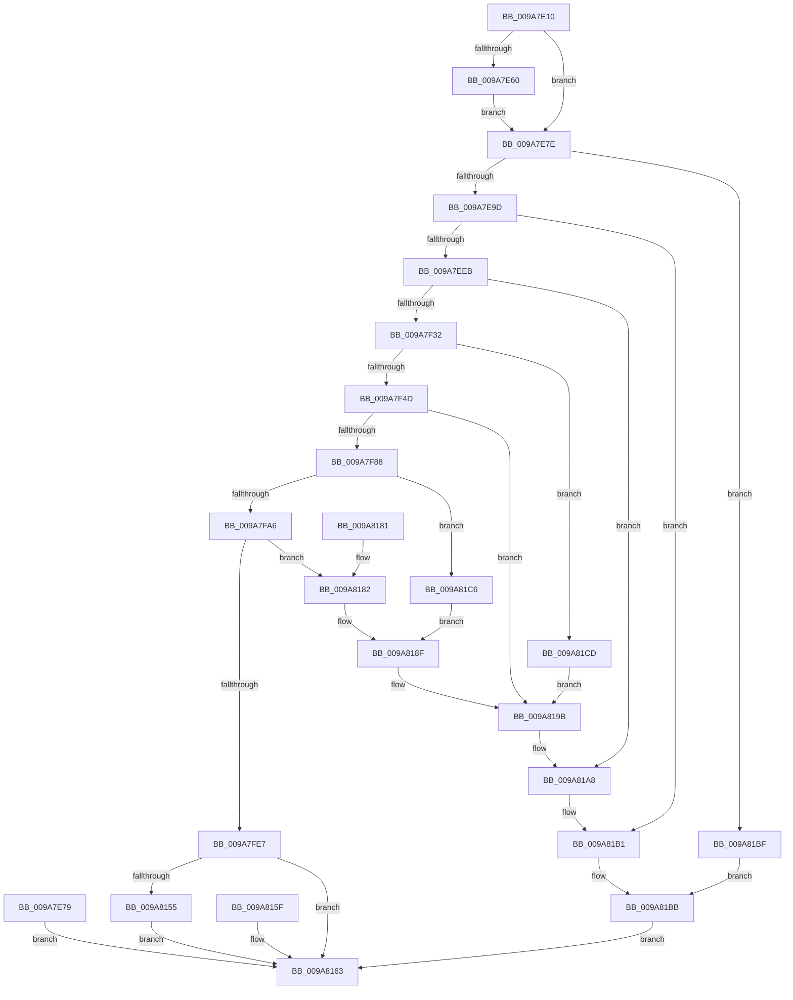

# NtCreateWorkerFactory

- RVA: `0x009A7E10`–`0x009A81D4` (길이 `964` bytes)
- VA: `0x00000001409A7E10`
- 실행 섹션: `PAGE`
- PDB 이름 있음: `예`; PDB Function 태그: `아니요`
- unwind 정보 RVA: `0x0009CDDC`
- 디코드: `212`개 명령, `964/964` bytes 표시
- 미해석 바이트: `0` (있으면 어셈블리에 `.byte`로 보존)

> 이 문서는 커널 이미지의 기계어와 PDB 기호를 분석해 생성했습니다. 4번과 5번은 함수 원형과 자료형을 바이너리 사용 방식에서 추정한 C 해석이며 원본 소스 복구 결과는 아닙니다.

## 1. Dependencies

- 직접 호출 지점: **19**; 고유 호출 대상: **19**
- 직접 호출자로 확인된 함수: **0**
- RIP 상대 이미지 참조: **6**

### Outgoing calls
- `0x009A7E8C` → [ExAllocatePool2](../../poolcode/B8/ExAllocatePool2_function_00B820F0.md) (function, `0x00B820F0`)
- `0x009A7ED3` → [ObReferenceObjectByHandle](../86/ObReferenceObjectByHandle_function_00868DB0.md) (function, `0x00868DB0`)
- `0x009A7EEB` → [KeDisableQueueingPriorityIncrement](../../text/49/KeDisableQueueingPriorityIncrement_function_00499BDC.md) (function, `0x00499BDC`)
- `0x009A7F23` → [ObpReferenceObjectByHandleWithTag](../86/ObpReferenceObjectByHandleWithTag_function_00869650.md) (function, `0x00869650`)
- `0x009A7F79` → [ObOpenObjectByPointer](../8B/ObOpenObjectByPointer_function_008B7420.md) (function, `0x008B7420`)
- `0x009A7F92` → [IoAllocateMiniCompletionPacket](IoAllocateMiniCompletionPacket_function_009A81E0.md) (function, `0x009A81E0`)
- `0x009A7FD5` → [ObCreateObjectEx](../89/ObCreateObjectEx_function_0089B1E0.md) (function, `0x0089B1E0`)
- `0x009A8048` → [memset](../../text/6C/memset_function_006C6C40.md) (function, `0x006C6C40`)
- `0x009A80CD` → [KeInitializeTimer2](../../text/3A/KeInitializeTimer2_function_003A30B0.md) (function, `0x003A30B0`)
- `0x009A80D5` → [ExpInitializeThreadHistory](../../text/49/ExpInitializeThreadHistory_function_00497CD0.md) (function, `0x00497CD0`)
- `0x009A80DE` → [ObfReferenceObject](../../text/20/ObfReferenceObject_function_0020FA20.md) (function, `0x0020FA20`)
- `0x009A80F4` → [KeRegisterObjectNotification](../../text/39/KeRegisterObjectNotification_function_00393454.md) (function, `0x00393454`)
- `0x009A811F` → [KeSetTimer2](../../text/3A/KeSetTimer2_function_003A08E0.md) (function, `0x003A08E0`)
- `0x009A8148` → [ObInsertObjectEx](../8B/ObInsertObjectEx_function_008B97A0.md) (function, `0x008B97A0`)
- `0x009A818A` → [IopFreeMiniCompletionPacket](IopFreeMiniCompletionPacket_function_009A82D0.md) (function, `0x009A82D0`)
- `0x009A8196` → [ObCloseHandle](../8A/ObCloseHandle_function_008A1870.md) (function, `0x008A1870`)
- `0x009A81A3` → [ObfDereferenceObjectWithTag](../../text/2F/ObfDereferenceObjectWithTag_function_002F78E0.md) (function, `0x002F78E0`)
- `0x009A81AC` → [ObfDereferenceObject](../../text/2F/ObfDereferenceObject_function_002F9350.md) (function, `0x002F9350`)
- `0x009A81B6` → [ExFreePoolWithTag](../../poolcode/B8/ExFreePoolWithTag_function_00B82870.md) (function, `0x00B82870`)

### Direct callers
- 이 함수 시작 RVA로 연결되는 직접 call은 확인되지 않았습니다. 간접 호출은 완전히 역산할 수 없습니다.

### Static image references
- `0x009A7EAD` → RVA `0x00FC6CC0` (`ALMOSTRO`; read)
- `0x009A7EF0` → RVA `0x00FC6A98` (`ALMOSTRO`; read)
- `0x009A7F8B` → RVA `0x00344810` (`ExpWorkerFactoryCompletionPacketRoutine`; read)
- `0x009A7FA6` → RVA `0x00FC51E0` (`ALMOSTRO`; read)
- `0x009A7FF0` → RVA `0x00E0EBFC` (`.data`; read)
- `0x009A80EA` → RVA `0x00EFA1A0` (`.data`; read)

## 2. Other-region calls and transfers

- 다른 실행 섹션으로 향하는 call: **11**
  - `0x009A7E8C` → [ExAllocatePool2](../../poolcode/B8/ExAllocatePool2_function_00B820F0.md) (`PAGE` → `POOLCODE`)
  - `0x009A7EEB` → [KeDisableQueueingPriorityIncrement](../../text/49/KeDisableQueueingPriorityIncrement_function_00499BDC.md) (`PAGE` → `.text`)
  - `0x009A8048` → [memset](../../text/6C/memset_function_006C6C40.md) (`PAGE` → `.text`)
  - `0x009A80CD` → [KeInitializeTimer2](../../text/3A/KeInitializeTimer2_function_003A30B0.md) (`PAGE` → `.text`)
  - `0x009A80D5` → [ExpInitializeThreadHistory](../../text/49/ExpInitializeThreadHistory_function_00497CD0.md) (`PAGE` → `.text`)
  - `0x009A80DE` → [ObfReferenceObject](../../text/20/ObfReferenceObject_function_0020FA20.md) (`PAGE` → `.text`)
  - `0x009A80F4` → [KeRegisterObjectNotification](../../text/39/KeRegisterObjectNotification_function_00393454.md) (`PAGE` → `.text`)
  - `0x009A811F` → [KeSetTimer2](../../text/3A/KeSetTimer2_function_003A08E0.md) (`PAGE` → `.text`)
  - `0x009A81A3` → [ObfDereferenceObjectWithTag](../../text/2F/ObfDereferenceObjectWithTag_function_002F78E0.md) (`PAGE` → `.text`)
  - `0x009A81AC` → [ObfDereferenceObject](../../text/2F/ObfDereferenceObject_function_002F9350.md) (`PAGE` → `.text`)
  - `0x009A81B6` → [ExFreePoolWithTag](../../poolcode/B8/ExFreePoolWithTag_function_00B82870.md) (`PAGE` → `POOLCODE`)
- 별도 외부 분기/꼬리 이동을 확인하지 못했습니다.

## 3. Assembly (complete function range)

```asm
009A7E10  48 8B C4                        mov rax, rsp
009A7E13  48 89 58 08                     mov qword ptr [rax + 8], rbx
009A7E17  48 89 70 18                     mov qword ptr [rax + 0x18], rsi
009A7E1B  48 89 78 20                     mov qword ptr [rax + 0x20], rdi
009A7E1F  89 50 10                        mov dword ptr [rax + 0x10], edx
009A7E22  41 54                           push r12
009A7E24  41 56                           push r14
009A7E26  41 57                           push r15
009A7E28  48 81 EC A0 00 00 00            sub rsp, 0xa0
009A7E2F  49 8B D9                        mov rbx, r9
009A7E32  4D 8B E0                        mov r12, r8
009A7E35  4C 8B F9                        mov r15, rcx
009A7E38  45 33 F6                        xor r14d, r14d
009A7E3B  4C 89 70 A0                     mov qword ptr [rax - 0x60], r14
009A7E3F  4C 89 70 B8                     mov qword ptr [rax - 0x48], r14
009A7E43  4C 89 70 C0                     mov qword ptr [rax - 0x40], r14
009A7E47  4C 89 70 B0                     mov qword ptr [rax - 0x50], r14
009A7E4B  65 48 8B 04 25 88 01 00 00      mov rax, qword ptr gs:[0x188]
009A7E54  40 8A B8 32 02 00 00            mov dil, byte ptr [rax + 0x232]
009A7E5B  40 84 FF                        test dil, dil
009A7E5E  74 1E                           je 0x1409a7e7e
009A7E60  48 B9 00 00 FF FF FF 7F 00 00   movabs rcx, 0x7fffffff0000
009A7E6A  4C 3B F9                        cmp r15, rcx
009A7E6D  49 0F 42 CF                     cmovb rcx, r15
009A7E71  48 8B 01                        mov rax, qword ptr [rcx]
009A7E74  48 89 01                        mov qword ptr [rcx], rax
009A7E77  EB 05                           jmp 0x1409a7e7e
009A7E79  E9 E5 02 00 00                  jmp 0x1409a8163
009A7E7E  BA 28 00 00 00                  mov edx, 0x28
009A7E83  8D 4A 19                        lea ecx, [rdx + 0x19]
009A7E86  41 B8 54 70 57 63               mov r8d, 0x63577054
009A7E8C  E8 5F A2 1D 00                  call 0x140b820f0
009A7E91  48 8B F0                        mov rsi, rax
009A7E94  48 85 C0                        test rax, rax
009A7E97  0F 84 22 03 00 00               je 0x1409a81bf
009A7E9D  4C 89 30                        mov qword ptr [rax], r14
009A7EA0  4C 89 70 18                     mov qword ptr [rax + 0x18], r14
009A7EA4  66 44 89 70 20                  mov word ptr [rax + 0x20], r14w
009A7EA9  44 88 70 22                     mov byte ptr [rax + 0x22], r14b
009A7EAD  4C 8B 05 0C EE 61 00            mov r8, qword ptr [rip + 0x61ee0c]
009A7EB4  4C 89 74 24 60                  mov qword ptr [rsp + 0x60], r14
009A7EB9  4C 89 74 24 28                  mov qword ptr [rsp + 0x28], r14
009A7EBE  48 8D 44 24 60                  lea rax, [rsp + 0x60]
009A7EC3  48 89 44 24 20                  mov qword ptr [rsp + 0x20], rax
009A7EC8  44 8A CF                        mov r9b, dil
009A7ECB  BA 02 00 00 00                  mov edx, 2
009A7ED0  48 8B CB                        mov rcx, rbx
009A7ED3  E8 D8 0E EC FF                  call 0x140868db0
009A7ED8  8B D8                           mov ebx, eax
009A7EDA  48 8B 4C 24 60                  mov rcx, qword ptr [rsp + 0x60]
009A7EDF  48 89 4E 08                     mov qword ptr [rsi + 8], rcx
009A7EE3  85 C0                           test eax, eax
009A7EE5  0F 88 C6 02 00 00               js 0x1409a81b1
009A7EEB  E8 EC 1C AF FF                  call 0x140499bdc
009A7EF0  4C 8B 05 A1 EB 61 00            mov r8, qword ptr [rip + 0x61eba1]
009A7EF7  4C 89 74 24 38                  mov qword ptr [rsp + 0x38], r14
009A7EFC  4C 89 74 24 30                  mov qword ptr [rsp + 0x30], r14
009A7F01  48 8D 44 24 68                  lea rax, [rsp + 0x68]
009A7F06  48 89 44 24 28                  mov qword ptr [rsp + 0x28], rax
009A7F0B  C7 44 24 20 45 78 57 66         mov dword ptr [rsp + 0x20], 0x66577845
009A7F13  44 8A CF                        mov r9b, dil
009A7F16  BA 2A 00 00 00                  mov edx, 0x2a
009A7F1B  48 8B 8C 24 E0 00 00 00         mov rcx, qword ptr [rsp + 0xe0]
009A7F23  E8 28 17 EC FF                  call 0x140869650
009A7F28  8B D8                           mov ebx, eax
009A7F2A  85 C0                           test eax, eax
009A7F2C  0F 88 76 02 00 00               js 0x1409a81a8
009A7F32  65 48 8B 04 25 88 01 00 00      mov rax, qword ptr gs:[0x188]
009A7F3B  4C 8B 74 24 68                  mov r14, qword ptr [rsp + 0x68]
009A7F40  4C 39 B0 B8 00 00 00            cmp qword ptr [rax + 0xb8], r14
009A7F47  0F 85 80 02 00 00               jne 0x1409a81cd
009A7F4D  48 8D 44 24 58                  lea rax, [rsp + 0x58]
009A7F52  48 89 44 24 30                  mov qword ptr [rsp + 0x30], rax
009A7F57  C6 44 24 28 00                  mov byte ptr [rsp + 0x28], 0
009A7F5C  48 8B 05 35 EB 61 00            mov rax, qword ptr [rip + 0x61eb35]
009A7F63  48 89 44 24 20                  mov qword ptr [rsp + 0x20], rax
009A7F68  41 B9 2A 00 00 00               mov r9d, 0x2a
009A7F6E  45 33 C0                        xor r8d, r8d
009A7F71  BA 00 02 00 00                  mov edx, 0x200
009A7F76  49 8B CE                        mov rcx, r14
009A7F79  E8 A2 F4 F0 FF                  call 0x1408b7420
009A7F7E  8B D8                           mov ebx, eax
009A7F80  85 C0                           test eax, eax
009A7F82  0F 88 13 02 00 00               js 0x1409a819b
009A7F88  48 8B D6                        mov rdx, rsi
009A7F8B  48 8D 0D 7E C8 99 FF            lea rcx, [rip - 0x663782]
009A7F92  E8 49 02 00 00                  call 0x1409a81e0
009A7F97  48 89 46 10                     mov qword ptr [rsi + 0x10], rax
009A7F9B  33 C9                           xor ecx, ecx
009A7F9D  48 85 C0                        test rax, rax
009A7FA0  0F 84 20 02 00 00               je 0x1409a81c6
009A7FA6  48 8B 15 33 D2 61 00            mov rdx, qword ptr [rip + 0x61d233]
009A7FAD  48 89 4C 24 48                  mov qword ptr [rsp + 0x48], rcx
009A7FB2  48 8D 44 24 70                  lea rax, [rsp + 0x70]
009A7FB7  48 89 44 24 40                  mov qword ptr [rsp + 0x40], rax
009A7FBC  89 4C 24 38                     mov dword ptr [rsp + 0x38], ecx
009A7FC0  89 4C 24 30                     mov dword ptr [rsp + 0x30], ecx
009A7FC4  C7 44 24 28 A0 02 00 00         mov dword ptr [rsp + 0x28], 0x2a0
009A7FCC  44 8A CF                        mov r9b, dil
009A7FCF  4D 8B C4                        mov r8, r12
009A7FD2  40 8A CF                        mov cl, dil
009A7FD5  E8 06 32 EF FF                  call 0x14089b1e0
009A7FDA  8B D8                           mov ebx, eax
009A7FDC  45 33 E4                        xor r12d, r12d
009A7FDF  85 C0                           test eax, eax
009A7FE1  0F 88 9B 01 00 00               js 0x1409a8182
009A7FE7  48 8B 7C 24 70                  mov rdi, qword ptr [rsp + 0x70]
009A7FEC  48 89 77 10                     mov qword ptr [rdi + 0x10], rsi
009A7FF0  48 63 05 05 6C 46 00            movsxd rax, dword ptr [rip + 0x466c05]
009A7FF7  48 69 C8 80 69 67 FF            imul rcx, rax, -0x989680
009A7FFE  48 89 4F 70                     mov qword ptr [rdi + 0x70], rcx
009A8002  44 89 A7 78 01 00 00            mov dword ptr [rdi + 0x178], r12d
009A8009  8B 84 24 F8 00 00 00            mov eax, dword ptr [rsp + 0xf8]
009A8010  89 87 7C 01 00 00               mov dword ptr [rdi + 0x17c], eax
009A8016  44 89 A7 8C 01 00 00            mov dword ptr [rdi + 0x18c], r12d
009A801D  4C 89 A7 80 01 00 00            mov qword ptr [rdi + 0x180], r12
009A8024  B8 00 00 01 00                  mov eax, 0x10000
009A8029  48 8B 8C 24 00 01 00 00         mov rcx, qword ptr [rsp + 0x100]
009A8031  48 85 C9                        test rcx, rcx
009A8034  48 0F 45 C1                     cmovne rax, rcx
009A8038  48 89 47 38                     mov qword ptr [rdi + 0x38], rax
009A803C  48 8D 4F 78                     lea rcx, [rdi + 0x78]
009A8040  33 D2                           xor edx, edx
009A8042  41 B8 00 01 00 00               mov r8d, 0x100
009A8048  E8 F3 EB D1 FF                  call 0x1406c6c40
009A804D  4C 89 A7 98 01 00 00            mov qword ptr [rdi + 0x198], r12
009A8054  B8 00 10 00 00                  mov eax, 0x1000
009A8059  4C 39 A4 24 08 01 00 00         cmp qword ptr [rsp + 0x108], r12
009A8061  48 0F 45 84 24 08 01 00 00      cmovne rax, qword ptr [rsp + 0x108]
009A806A  48 89 47 40                     mov qword ptr [rdi + 0x40], rax
009A806E  48 8B 84 24 E8 00 00 00         mov rax, qword ptr [rsp + 0xe8]
009A8076  48 89 47 18                     mov qword ptr [rdi + 0x18], rax
009A807A  48 8B 84 24 F0 00 00 00         mov rax, qword ptr [rsp + 0xf0]
009A8082  48 89 47 20                     mov qword ptr [rdi + 0x20], rax
009A8086  4C 89 A7 90 01 00 00            mov qword ptr [rdi + 0x190], r12
009A808D  44 89 A7 A0 01 00 00            mov dword ptr [rdi + 0x1a0], r12d
009A8094  48 8B 44 24 58                  mov rax, qword ptr [rsp + 0x58]
009A8099  48 89 47 28                     mov qword ptr [rdi + 0x28], rax
009A809D  4C 89 77 30                     mov qword ptr [rdi + 0x30], r14
009A80A1  44 89 A7 88 01 00 00            mov dword ptr [rdi + 0x188], r12d
009A80A8  44 89 A7 98 02 00 00            mov dword ptr [rdi + 0x298], r12d
009A80AF  C7 87 60 02 00 00 01 00 00 00   mov dword ptr [rdi + 0x260], 1
009A80B9  48 8D 9F A8 01 00 00            lea rbx, [rdi + 0x1a8]
009A80C0  45 8D 4C 24 08                  lea r9d, [r12 + 8]
009A80C5  45 33 C0                        xor r8d, r8d
009A80C8  33 D2                           xor edx, edx
009A80CA  48 8B CB                        mov rcx, rbx
009A80CD  E8 DE AF 9F FF                  call 0x1403a30b0
009A80D2  48 8B CF                        mov rcx, rdi
009A80D5  E8 F6 FB AE FF                  call 0x140497cd0
009A80DA  4C 89 67 68                     mov qword ptr [rdi + 0x68], r12
009A80DE  E8 3D 79 86 FF                  call 0x14020fa20
009A80E3  4C 8D 87 30 02 00 00            lea r8, [rdi + 0x230]
009A80EA  48 8D 15 AF 20 55 00            lea rdx, [rip + 0x5520af]
009A80F1  48 8B CB                        mov rcx, rbx
009A80F4  E8 5B B3 9E FF                  call 0x140393454
009A80F9  4C 89 A4 24 88 00 00 00         mov qword ptr [rsp + 0x88], r12
009A8101  48 83 8C 24 90 00 00 00 FF      or qword ptr [rsp + 0x90], 0xffffffffffffffff
009A810A  48 8B 57 70                     mov rdx, qword ptr [rdi + 0x70]
009A810E  4C 8B C2                        mov r8, rdx
009A8111  49 F7 D8                        neg r8
009A8114  4C 8D 8C 24 88 00 00 00         lea r9, [rsp + 0x88]
009A811C  48 8B CB                        mov rcx, rbx
009A811F  E8 BC 87 9F FF                  call 0x1403a08e0
009A8124  48 8D 44 24 78                  lea rax, [rsp + 0x78]
009A8129  48 89 44 24 30                  mov qword ptr [rsp + 0x30], rax
009A812E  4C 89 64 24 28                  mov qword ptr [rsp + 0x28], r12
009A8133  44 89 64 24 20                  mov dword ptr [rsp + 0x20], r12d
009A8138  45 33 C9                        xor r9d, r9d
009A813B  44 8B 84 24 C8 00 00 00         mov r8d, dword ptr [rsp + 0xc8]
009A8143  33 D2                           xor edx, edx
009A8145  48 8B CF                        mov rcx, rdi
009A8148  E8 53 16 F1 FF                  call 0x1408b97a0
009A814D  89 44 24 54                     mov dword ptr [rsp + 0x54], eax
009A8151  85 C0                           test eax, eax
009A8153  78 0E                           js 0x1409a8163
009A8155  48 8B 4C 24 78                  mov rcx, qword ptr [rsp + 0x78]
009A815A  49 89 0F                        mov qword ptr [r15], rcx
009A815D  EB 04                           jmp 0x1409a8163
009A815F  8B 44 24 54                     mov eax, dword ptr [rsp + 0x54]
009A8163  4C 8D 9C 24 A0 00 00 00         lea r11, [rsp + 0xa0]
009A816B  49 8B 5B 20                     mov rbx, qword ptr [r11 + 0x20]
009A816F  49 8B 73 30                     mov rsi, qword ptr [r11 + 0x30]
009A8173  49 8B 7B 38                     mov rdi, qword ptr [r11 + 0x38]
009A8177  49 8B E3                        mov rsp, r11
009A817A  41 5F                           pop r15
009A817C  41 5E                           pop r14
009A817E  41 5C                           pop r12
009A8180  C3                              ret
009A8181  CC                              int3
009A8182  48 8B 4E 10                     mov rcx, qword ptr [rsi + 0x10]
009A8186  4C 89 61 38                     mov qword ptr [rcx + 0x38], r12
009A818A  E8 41 01 00 00                  call 0x1409a82d0
009A818F  33 D2                           xor edx, edx
009A8191  48 8B 4C 24 58                  mov rcx, qword ptr [rsp + 0x58]
009A8196  E8 D5 96 EF FF                  call 0x1408a1870
009A819B  BA 45 78 57 66                  mov edx, 0x66577845
009A81A0  49 8B CE                        mov rcx, r14
009A81A3  E8 38 F7 94 FF                  call 0x1402f78e0
009A81A8  48 8B 4E 08                     mov rcx, qword ptr [rsi + 8]
009A81AC  E8 9F 11 95 FF                  call 0x1402f9350
009A81B1  33 D2                           xor edx, edx
009A81B3  48 8B CE                        mov rcx, rsi
009A81B6  E8 B5 A6 1D 00                  call 0x140b82870
009A81BB  8B C3                           mov eax, ebx
009A81BD  EB A4                           jmp 0x1409a8163
009A81BF  BB 17 00 00 C0                  mov ebx, 0xc0000017
009A81C4  EB F5                           jmp 0x1409a81bb
009A81C6  BB 17 00 00 C0                  mov ebx, 0xc0000017
009A81CB  EB C2                           jmp 0x1409a818f
009A81CD  BB 0D 00 00 C0                  mov ebx, 0xc000000d
009A81D2  EB C7                           jmp 0x1409a819b
```

## 4. C-style interpretation (structured pseudocode)

```c
__int64 __fastcall NtCreateWorkerFactory(__int64 a1, int a2, __int64 a3, __int64 a4, __int64 a5, __int64 a6, __int64 a7, unsigned int a8, __int64 a9, __int64 a10)
{
    __int64 result;
    __int64 v_r12;
    __int64 v_r14;
    __int64 v_rsp;
    unsigned __int64 v_stack_m18;
    unsigned __int64 v_stack_m28;
    unsigned __int64 v_stack_m30;
    unsigned __int64 v_stack_m40;
    unsigned __int64 v_stack_m48;
    unsigned __int64 v_stack_m50;
    unsigned __int64 v_stack_m58;
    unsigned __int64 v_stack_m60;
    unsigned int v_stack_m64;
    unsigned __int64 v_stack_m70;
    unsigned __int64 v_stack_m78;
    unsigned __int64 v_stack_m80;
    unsigned __int64 v_stack_m88;
    unsigned __int64 v_stack_m90;
    unsigned __int64 v_stack_m98;
    unsigned int v_stack_p10;

    *(unsigned __int64 *)(v_rsp + 8) = v_rbx;
    *(unsigned __int64 *)(v_rsp + 24) = v_rsi;
    *(unsigned __int64 *)(v_rsp + 32) = v_rdi;
    *(unsigned int *)(v_rsp + 16) = a2;
    v_rsp = (v_rsp) - (160);
    v_r14 = 0;
    *(unsigned __int64 *)(v_rsp - 96) = 0;
    *(unsigned __int64 *)(v_rsp - 72) = 0;
    *(unsigned __int64 *)(v_rsp - 64) = 0;
    *(unsigned __int64 *)(v_rsp - 80) = 0;
    if ((unsigned __int8)(*(unsigned __int8 *)(*(unsigned __int64 *)(gs_base + (0 + 392)) + 562)) == 0) goto loc_009A7E7E;
    if (a1 < a1) { a1 = a1; }
    *(unsigned __int64 *)(a1) = *(unsigned __int64 *)(a1);
    goto loc_009A7E7E;
loc_009A7E7E:
    result = ExAllocatePool2(40 + 25, 40, (unsigned int)(0x63577054ULL), a4);
    if (result == 0) goto loc_009A81BF;
    *(unsigned __int64 *)(result) = 0;
    *(unsigned __int64 *)(result + 24) = 0;
    *(unsigned __int16 *)(result + 32) = 0;
    *(unsigned __int8 *)(result + 34) = 0;
    v_stack_m58 = 0;
    v_stack_m90 = 0;
    v_stack_m98 = v_stack_m58;
    result = ObReferenceObjectByHandle(a4, 2, *(unsigned __int64 *)(v_rip + 6417932), (unsigned __int8)(*(unsigned __int8 *)(*(unsigned __int64 *)(gs_base + (0 + 392)) + 562)));
    *(unsigned __int64 *)(result + 8) = v_stack_m58;
    if (sign_flag) goto loc_009A81B1;
    result = KeDisableQueueingPriorityIncrement(v_stack_m58, 2, *(unsigned __int64 *)(v_rip + 6417932), (unsigned __int8)(*(unsigned __int8 *)(*(unsigned __int64 *)(gs_base + (0 + 392)) + 562)));
    v_stack_m80 = 0;
    v_stack_m88 = 0;
    v_stack_m90 = v_stack_m50;
    v_stack_m98 = 0x66577845ULL;
    result = ObpReferenceObjectByHandleWithTag(a5, 42, *(unsigned __int64 *)(v_rip + 6417313), (unsigned __int8)(*(unsigned __int8 *)(*(unsigned __int64 *)(gs_base + (0 + 392)) + 562)));
    if (sign_flag) goto loc_009A81A8;
    if ((*(unsigned __int64 *)(*(unsigned __int64 *)(gs_base + (0 + 392)) + 184)) != v_stack_m50) goto loc_009A81CD;
    v_stack_m88 = v_stack_m60;
    v_stack_m90 = 0;
    v_stack_m98 = *(unsigned __int64 *)(v_rip + 6417205);
    a3 = 0;
    result = ObOpenObjectByPointer(v_stack_m50, 512, a3, 42);
    if (sign_flag) goto loc_009A819B;
    result = IoAllocateMiniCompletionPacket(v_rip - 6698882, result, a3, 42);
    *(unsigned __int64 *)(result + 16) = result;
    a1 = 0;
    if (result == 0) goto loc_009A81C6;
    v_stack_m70 = 0;
    v_stack_m78 = v_stack_m48;
    v_stack_m80 = 0;
    v_stack_m88 = 0;
    v_stack_m90 = 672;
    result = ObCreateObjectEx((unsigned __int8)(*(unsigned __int8 *)(*(unsigned __int64 *)(gs_base + (0 + 392)) + 562)), *(unsigned __int64 *)(v_rip + 6410803), 0, (unsigned __int8)(*(unsigned __int8 *)(*(unsigned __int64 *)(gs_base + (0 + 392)) + 562)));
    v_r12 = 0;
    if (sign_flag) goto loc_009A8182;
    *(unsigned __int64 *)(v_stack_m48 + 16) = result;
    a1 = ((unsigned __int8)(*(unsigned __int8 *)(*(unsigned __int64 *)(gs_base + (0 + 392)) + 562))) * ((int)(*(unsigned int *)(v_rip + 4615173)));
    *(unsigned __int64 *)(v_stack_m48 + 112) = a1;
    *(unsigned int *)(v_stack_m48 + 376) = 0;
    *(unsigned int *)(v_stack_m48 + 380) = (unsigned int)((unsigned int)(a8));
    *(unsigned int *)(v_stack_m48 + 396) = 0;
    *(unsigned __int64 *)(v_stack_m48 + 384) = 0;
    result = (unsigned int)(0x10000ULL);
    if (a9 != 0) { result = a9; }
    *(unsigned __int64 *)(v_stack_m48 + 56) = result;
    a2 = 0;
    result = memset(v_stack_m48 + 120, a2, 256, (unsigned __int8)(*(unsigned __int8 *)(*(unsigned __int64 *)(gs_base + (0 + 392)) + 562)));
    *(unsigned __int64 *)(v_stack_m48 + 408) = 0;
    result = (unsigned int)(0x1000ULL);
    if (a10 != 0) { result = a10; }
    *(unsigned __int64 *)(v_stack_m48 + 64) = result;
    *(unsigned __int64 *)(v_stack_m48 + 24) = a6;
    *(unsigned __int64 *)(v_stack_m48 + 32) = a7;
    *(unsigned __int64 *)(v_stack_m48 + 400) = 0;
    *(unsigned int *)(v_stack_m48 + 416) = 0;
    *(unsigned __int64 *)(v_stack_m48 + 40) = v_stack_m60;
    *(unsigned __int64 *)(v_stack_m48 + 48) = v_stack_m50;
    *(unsigned int *)(v_stack_m48 + 392) = 0;
    *(unsigned int *)(v_stack_m48 + 664) = 0;
    *(unsigned int *)(v_stack_m48 + 608) = 1;
    a3 = 0;
    a2 = 0;
    result = KeInitializeTimer2(v_stack_m48 + 424, a2, a3, v_r12 + 8);
    result = ExpInitializeThreadHistory(v_stack_m48, a2, a3, v_r12 + 8);
    *(unsigned __int64 *)(v_stack_m48 + 104) = 0;
    result = ObfReferenceObject(v_stack_m48, a2, a3, v_r12 + 8);
    result = KeRegisterObjectNotification(v_stack_m48 + 424, v_rip + 5578927, v_stack_m48 + 560, v_r12 + 8);
    v_stack_m30 = 0;
    a3 = -(*(unsigned __int64 *)(v_stack_m48 + 112));
    result = KeSetTimer2(v_stack_m48 + 424, *(unsigned __int64 *)(v_stack_m48 + 112), a3, v_stack_m30);
    v_stack_m88 = v_stack_m40;
    v_stack_m90 = 0;
    v_stack_m98 = 0;
    a4 = 0;
    a2 = 0;
    result = ObInsertObjectEx(v_stack_m48, a2, (unsigned int)(v_stack_p10), a4);
    v_stack_m64 = (unsigned int)(result);
    if (sign_flag) goto loc_009A8163;
    *(unsigned __int64 *)(a1) = v_stack_m40;
    goto loc_009A8163;
loc_009A8163:
    return result;
loc_009A8182:
    *(unsigned __int64 *)(*(unsigned __int64 *)(*(unsigned __int64 *)(v_stack_m18 + 48) + 16) + 56) = 0;
    result = IopFreeMiniCompletionPacket(*(unsigned __int64 *)(*(unsigned __int64 *)(v_stack_m18 + 48) + 16), a2, (unsigned int)(v_stack_p10), a4);
loc_009A818F:
    a2 = 0;
    result = ObCloseHandle(v_stack_m48, a2, (unsigned int)(v_stack_p10), a4);
loc_009A819B:
    result = ObfDereferenceObjectWithTag(v_stack_m50, (unsigned int)(0x66577845ULL), (unsigned int)(v_stack_p10), a4);
loc_009A81A8:
    result = ObfDereferenceObject(*(unsigned __int64 *)(*(unsigned __int64 *)(v_stack_m18 + 48) + 8), (unsigned int)(0x66577845ULL), (unsigned int)(v_stack_p10), a4);
loc_009A81B1:
    a2 = 0;
    result = ExFreePoolWithTag(*(unsigned __int64 *)(v_stack_m18 + 48), a2, (unsigned int)(v_stack_p10), a4);
loc_009A81BB:
    goto loc_009A8163;
loc_009A81BF:
    goto loc_009A81BB;
loc_009A81C6:
    goto loc_009A818F;
loc_009A81CD:
    goto loc_009A819B;
}
```

## 5. (Beta) C Style

```c
int64_t NtCreateWorkerFactory(int64_t Arg1, int32_t Arg2, int64_t Arg3, int64_t Arg4, int64_t Arg5, int64_t Arg6, int64_t Arg7, uint32_t Arg8, int64_t Arg9, int64_t Arg10)
{
    int64_t result;
    int64_t local_r12;
    int64_t local_r14;
    int64_t local_rsp;
    uint64_t v_stack_m18;
    uint64_t v_stack_m28;
    uint64_t v_stack_m30;
    uint64_t v_stack_m40;
    uint64_t v_stack_m48;
    uint64_t v_stack_m50;
    uint64_t v_stack_m58;
    uint64_t v_stack_m60;
    uint32_t v_stack_m64;
    uint64_t v_stack_m70;
    uint64_t v_stack_m78;
    uint64_t v_stack_m80;
    uint64_t v_stack_m88;
    uint64_t v_stack_m90;
    uint64_t v_stack_m98;
    uint32_t v_stack_p10;

    *(uint64_t *)(local_rsp + 0x8) = local_rbx;
    *(uint64_t *)(local_rsp + 0x18) = local_rsi;
    *(uint64_t *)(local_rsp + 0x20) = local_rdi;
    *(uint32_t *)(local_rsp + 0x10) = Arg2;
    local_rsp = (local_rsp) - (160);
    local_r14 = 0;
    *(uint64_t *)(local_rsp - 0x60) = 0;
    *(uint64_t *)(local_rsp - 0x48) = 0;
    *(uint64_t *)(local_rsp - 0x40) = 0;
    *(uint64_t *)(local_rsp - 0x50) = 0;
    if ((uint8_t)(*(uint8_t *)(*(uint64_t *)(gs_base + (0 + 0x188)) + 0x232)) == 0) goto loc_009A7E7E;
    if (Arg1 < Arg1) { Arg1 = Arg1; }
    *(uint64_t *)(Arg1) = *(uint64_t *)(Arg1);
    goto loc_009A7E7E;
loc_009A7E7E:
    result = ExAllocatePool2(40 + 25, 40, (uint32_t)(0x63577054ULL), Arg4);
    if (result == 0) goto loc_009A81BF;
    *(uint64_t *)(result) = 0;
    *(uint64_t *)(result + 0x18) = 0;
    *(uint16_t *)(result + 0x20) = 0;
    *(uint8_t *)(result + 0x22) = 0;
    v_stack_m58 = 0;
    v_stack_m90 = 0;
    v_stack_m98 = v_stack_m58;
    result = ObReferenceObjectByHandle(Arg4, 2, *(uint64_t *)(v_rip + 0x61EE0C), (uint8_t)(*(uint8_t *)(*(uint64_t *)(gs_base + (0 + 0x188)) + 0x232)));
    *(uint64_t *)(result + 0x8) = v_stack_m58;
    if (sign_flag) goto loc_009A81B1;
    result = KeDisableQueueingPriorityIncrement(v_stack_m58, 2, *(uint64_t *)(v_rip + 0x61EE0C), (uint8_t)(*(uint8_t *)(*(uint64_t *)(gs_base + (0 + 0x188)) + 0x232)));
    v_stack_m80 = 0;
    v_stack_m88 = 0;
    v_stack_m90 = v_stack_m50;
    v_stack_m98 = 0x66577845ULL;
    result = ObpReferenceObjectByHandleWithTag(Arg5, 42, *(uint64_t *)(v_rip + 0x61EBA1), (uint8_t)(*(uint8_t *)(*(uint64_t *)(gs_base + (0 + 0x188)) + 0x232)));
    if (sign_flag) goto loc_009A81A8;
    if ((*(uint64_t *)(*(uint64_t *)(gs_base + (0 + 0x188)) + 0xB8)) != v_stack_m50) goto loc_009A81CD;
    v_stack_m88 = v_stack_m60;
    v_stack_m90 = 0;
    v_stack_m98 = *(uint64_t *)(v_rip + 0x61EB35);
    Arg3 = 0;
    result = ObOpenObjectByPointer(v_stack_m50, 512, Arg3, 42);
    if (sign_flag) goto loc_009A819B;
    result = IoAllocateMiniCompletionPacket(v_rip - 6698882, result, Arg3, 42);
    *(uint64_t *)(result + 0x10) = result;
    Arg1 = 0;
    if (result == 0) goto loc_009A81C6;
    v_stack_m70 = 0;
    v_stack_m78 = v_stack_m48;
    v_stack_m80 = 0;
    v_stack_m88 = 0;
    v_stack_m90 = 672;
    result = ObCreateObjectEx((uint8_t)(*(uint8_t *)(*(uint64_t *)(gs_base + (0 + 0x188)) + 0x232)), *(uint64_t *)(v_rip + 0x61D233), 0, (uint8_t)(*(uint8_t *)(*(uint64_t *)(gs_base + (0 + 0x188)) + 0x232)));
    local_r12 = 0;
    if (sign_flag) goto loc_009A8182;
    *(uint64_t *)(v_stack_m48 + 0x10) = result;
    Arg1 = ((uint8_t)(*(uint8_t *)(*(uint64_t *)(gs_base + (0 + 0x188)) + 0x232))) * ((int32_t)(*(uint32_t *)(v_rip + 0x466C05)));
    *(uint64_t *)(v_stack_m48 + 0x70) = Arg1;
    *(uint32_t *)(v_stack_m48 + 0x178) = 0;
    *(uint32_t *)(v_stack_m48 + 0x17C) = (uint32_t)((uint32_t)(Arg8));
    *(uint32_t *)(v_stack_m48 + 0x18C) = 0;
    *(uint64_t *)(v_stack_m48 + 0x180) = 0;
    result = (uint32_t)(0x10000ULL);
    if (Arg9 != 0) { result = Arg9; }
    *(uint64_t *)(v_stack_m48 + 0x38) = result;
    Arg2 = 0;
    result = memset(v_stack_m48 + 120, Arg2, 256, (uint8_t)(*(uint8_t *)(*(uint64_t *)(gs_base + (0 + 0x188)) + 0x232)));
    *(uint64_t *)(v_stack_m48 + 0x198) = 0;
    result = (uint32_t)(0x1000ULL);
    if (Arg10 != 0) { result = Arg10; }
    *(uint64_t *)(v_stack_m48 + 0x40) = result;
    *(uint64_t *)(v_stack_m48 + 0x18) = Arg6;
    *(uint64_t *)(v_stack_m48 + 0x20) = Arg7;
    *(uint64_t *)(v_stack_m48 + 0x190) = 0;
    *(uint32_t *)(v_stack_m48 + 0x1A0) = 0;
    *(uint64_t *)(v_stack_m48 + 0x28) = v_stack_m60;
    *(uint64_t *)(v_stack_m48 + 0x30) = v_stack_m50;
    *(uint32_t *)(v_stack_m48 + 0x188) = 0;
    *(uint32_t *)(v_stack_m48 + 0x298) = 0;
    *(uint32_t *)(v_stack_m48 + 0x260) = 1;
    Arg3 = 0;
    Arg2 = 0;
    result = KeInitializeTimer2(v_stack_m48 + 424, Arg2, Arg3, local_r12 + 8);
    result = ExpInitializeThreadHistory(v_stack_m48, Arg2, Arg3, local_r12 + 8);
    *(uint64_t *)(v_stack_m48 + 0x68) = 0;
    result = ObfReferenceObject(v_stack_m48, Arg2, Arg3, local_r12 + 8);
    result = KeRegisterObjectNotification(v_stack_m48 + 424, v_rip + 5578927, v_stack_m48 + 560, local_r12 + 8);
    v_stack_m30 = 0;
    Arg3 = -(*(uint64_t *)(v_stack_m48 + 0x70));
    result = KeSetTimer2(v_stack_m48 + 424, *(uint64_t *)(v_stack_m48 + 0x70), Arg3, v_stack_m30);
    v_stack_m88 = v_stack_m40;
    v_stack_m90 = 0;
    v_stack_m98 = 0;
    Arg4 = 0;
    Arg2 = 0;
    result = ObInsertObjectEx(v_stack_m48, Arg2, (uint32_t)(v_stack_p10), Arg4);
    v_stack_m64 = (uint32_t)(result);
    if (sign_flag) goto loc_009A8163;
    *(uint64_t *)(Arg1) = v_stack_m40;
    goto loc_009A8163;
loc_009A8163:
    return result;
loc_009A8182:
    *(uint64_t *)(*(uint64_t *)(*(uint64_t *)(v_stack_m18 + 0x30) + 0x10) + 0x38) = 0;
    result = IopFreeMiniCompletionPacket(*(uint64_t *)(*(uint64_t *)(v_stack_m18 + 0x30) + 0x10), Arg2, (uint32_t)(v_stack_p10), Arg4);
loc_009A818F:
    Arg2 = 0;
    result = ObCloseHandle(v_stack_m48, Arg2, (uint32_t)(v_stack_p10), Arg4);
loc_009A819B:
    result = ObfDereferenceObjectWithTag(v_stack_m50, (uint32_t)(0x66577845ULL), (uint32_t)(v_stack_p10), Arg4);
loc_009A81A8:
    result = ObfDereferenceObject(*(uint64_t *)(*(uint64_t *)(v_stack_m18 + 0x30) + 0x8), (uint32_t)(0x66577845ULL), (uint32_t)(v_stack_p10), Arg4);
loc_009A81B1:
    Arg2 = 0;
    result = ExFreePoolWithTag(*(uint64_t *)(v_stack_m18 + 0x30), Arg2, (uint32_t)(v_stack_p10), Arg4);
loc_009A81BB:
    goto loc_009A8163;
loc_009A81BF:
    goto loc_009A81BB;
loc_009A81C6:
    goto loc_009A818F;
loc_009A81CD:
    goto loc_009A819B;
}
```

## 6. Execution-region graph

[열기: 2D/3D 그래프와 함수 탐색 컨트롤 패널](../../../control-panel.html?section=page&rva=0x009A7E10&view=graph)

- 2D 그래프는 위에서 아래로 흐르고, 3D 그래프는 빈 공간을 드래그해 회전합니다. Shift+드래그는 이동, 휠은 확대·축소, 함수 노드 선택은 대상 보고서 이동입니다.

### Static fallback


