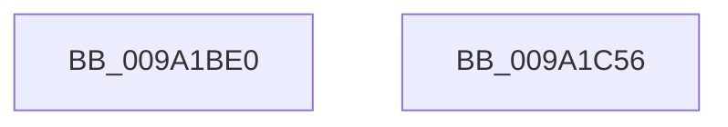

# NtMapViewOfSectionEx

- RVA: `0x009A1BE0`–`0x009A1C57` (길이 `119` bytes)
- VA: `0x00000001409A1BE0`
- 실행 섹션: `PAGE`
- PDB 이름 있음: `예`; PDB Function 태그: `아니요`
- unwind 정보 RVA: `0x0006C9B8`
- 디코드: `26`개 명령, `119/119` bytes 표시
- 미해석 바이트: `0` (있으면 어셈블리에 `.byte`로 보존)

> 이 문서는 커널 이미지의 기계어와 PDB 기호를 분석해 생성했습니다. 4번과 5번은 함수 원형과 자료형을 바이너리 사용 방식에서 추정한 C 해석이며 원본 소스 복구 결과는 아닙니다.

## 1. Dependencies

- 직접 호출 지점: **1**; 고유 호출 대상: **1**
- 직접 호출자로 확인된 함수: **0**
- RIP 상대 이미지 참조: **0**

### Outgoing calls
- `0x009A1C4C` → [MiMapViewOfSectionExCommon](MiMapViewOfSectionExCommon_function_009A1C60.md) (function, `0x009A1C60`)

### Direct callers
- 이 함수 시작 RVA로 연결되는 직접 call은 확인되지 않았습니다. 간접 호출은 완전히 역산할 수 없습니다.

### Static image references
- 디코드된 RIP-relative 메모리 참조가 없습니다.

## 2. Other-region calls and transfers

- 다른 실행 섹션으로 향하는 call: **0**
- 별도 외부 분기/꼬리 이동을 확인하지 못했습니다.

## 3. Assembly (complete function range)

```asm
009A1BE0  4C 8B DC                        mov r11, rsp
009A1BE3  48 83 EC 78                     sub rsp, 0x78
009A1BE7  65 48 8B 04 25 88 01 00 00      mov rax, qword ptr gs:[0x188]
009A1BF0  44 8A 90 32 02 00 00            mov r10b, byte ptr [rax + 0x232]
009A1BF7  33 C0                           xor eax, eax
009A1BF9  89 44 24 68                     mov dword ptr [rsp + 0x68], eax
009A1BFD  45 88 53 E8                     mov byte ptr [r11 - 0x18], r10b
009A1C01  49 89 43 E0                     mov qword ptr [r11 - 0x20], rax
009A1C05  89 44 24 50                     mov dword ptr [rsp + 0x50], eax
009A1C09  8B 84 24 C0 00 00 00            mov eax, dword ptr [rsp + 0xc0]
009A1C10  89 44 24 48                     mov dword ptr [rsp + 0x48], eax
009A1C14  48 8B 84 24 B8 00 00 00         mov rax, qword ptr [rsp + 0xb8]
009A1C1C  49 89 43 C8                     mov qword ptr [r11 - 0x38], rax
009A1C20  8B 84 24 B0 00 00 00            mov eax, dword ptr [rsp + 0xb0]
009A1C27  89 44 24 38                     mov dword ptr [rsp + 0x38], eax
009A1C2B  8B 84 24 A8 00 00 00            mov eax, dword ptr [rsp + 0xa8]
009A1C32  89 44 24 30                     mov dword ptr [rsp + 0x30], eax
009A1C36  48 8B 84 24 A0 00 00 00         mov rax, qword ptr [rsp + 0xa0]
009A1C3E  49 89 43 B0                     mov qword ptr [r11 - 0x50], rax
009A1C42  4D 89 4B A8                     mov qword ptr [r11 - 0x58], r9
009A1C46  4D 8B C8                        mov r9, r8
009A1C49  45 33 C0                        xor r8d, r8d
009A1C4C  E8 0F 00 00 00                  call 0x1409a1c60
009A1C51  48 83 C4 78                     add rsp, 0x78
009A1C55  C3                              ret
009A1C56  CC                              int3
```

## 4. C-style interpretation (structured pseudocode)

```c
__int64 __fastcall NtMapViewOfSectionEx(__int64 a1, __int64 a2, __int64 a3, __int64 a4, __int64 a5, unsigned int a6, unsigned int a7, __int64 a8, unsigned int a9)
{
    __int64 result;
    __int64 v_rsp;
    unsigned int v_stack_m10;
    unsigned int v_stack_m28;
    unsigned int v_stack_m30;
    unsigned int v_stack_m40;
    unsigned int v_stack_m48;

    v_rsp = (v_rsp) - (120);
    result = 0;
    v_stack_m10 = 0;
    *(unsigned __int8 *)(v_rsp - 24) = (unsigned __int8)(*(unsigned __int8 *)(*(unsigned __int64 *)(gs_base + (0 + 392)) + 562));
    *(unsigned __int64 *)(v_rsp - 32) = 0;
    v_stack_m28 = 0;
    v_stack_m30 = (unsigned int)((unsigned int)(a9));
    *(unsigned __int64 *)(v_rsp - 56) = a8;
    v_stack_m40 = (unsigned int)((unsigned int)(a7));
    v_stack_m48 = (unsigned int)((unsigned int)(a6));
    *(unsigned __int64 *)(v_rsp - 80) = a5;
    *(unsigned __int64 *)(v_rsp - 88) = a4;
    a3 = 0;
    result = MiMapViewOfSectionExCommon(a1, a2, a3, a3);
    v_rsp = (v_rsp) + (120);
    return result;
}
```

## 5. (Beta) C Style

```c
int64_t NtMapViewOfSectionEx(int64_t Arg1, int64_t Arg2, int64_t Arg3, int64_t Arg4, int64_t Arg5, uint32_t Arg6, uint32_t Arg7, int64_t Arg8, uint32_t Arg9)
{
    int64_t result;
    int64_t local_rsp;
    uint32_t v_stack_m10;
    uint32_t v_stack_m28;
    uint32_t v_stack_m30;
    uint32_t v_stack_m40;
    uint32_t v_stack_m48;

    local_rsp = (local_rsp) - (120);
    result = 0;
    v_stack_m10 = 0;
    *(uint8_t *)(local_rsp - 0x18) = (uint8_t)(*(uint8_t *)(*(uint64_t *)(gs_base + (0 + 0x188)) + 0x232));
    *(uint64_t *)(local_rsp - 0x20) = 0;
    v_stack_m28 = 0;
    v_stack_m30 = (uint32_t)((uint32_t)(Arg9));
    *(uint64_t *)(local_rsp - 0x38) = Arg8;
    v_stack_m40 = (uint32_t)((uint32_t)(Arg7));
    v_stack_m48 = (uint32_t)((uint32_t)(Arg6));
    *(uint64_t *)(local_rsp - 0x50) = Arg5;
    *(uint64_t *)(local_rsp - 0x58) = Arg4;
    Arg3 = 0;
    result = MiMapViewOfSectionExCommon(Arg1, Arg2, Arg3, Arg3);
    local_rsp = (local_rsp) + (120);
    return result;
}
```

## 6. Execution-region graph

[열기: 2D/3D 그래프와 함수 탐색 컨트롤 패널](../../../control-panel.html?section=page&rva=0x009A1BE0&view=graph)

- 2D 그래프는 위에서 아래로 흐르고, 3D 그래프는 빈 공간을 드래그해 회전합니다. Shift+드래그는 이동, 휠은 확대·축소, 함수 노드 선택은 대상 보고서 이동입니다.

### Static fallback


