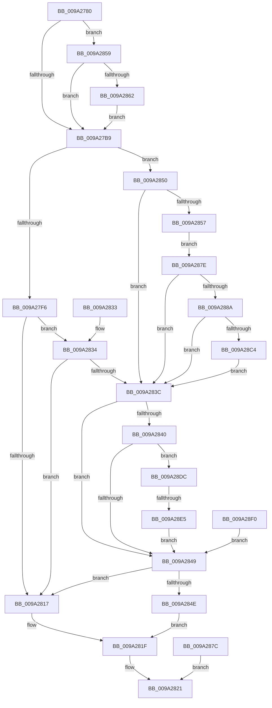

# NtReleaseMutant

- RVA: `0x009A2780`–`0x009A28FE` (길이 `382` bytes)
- VA: `0x00000001409A2780`
- 실행 섹션: `PAGE`
- PDB 이름 있음: `예`; PDB Function 태그: `예`
- unwind 정보 RVA: `0x0009B710`
- 디코드: `103`개 명령, `382/382` bytes 표시
- 미해석 바이트: `0` (있으면 어셈블리에 `.byte`로 보존)

> 이 문서는 커널 이미지의 기계어와 PDB 기호를 분석해 생성했습니다. 4번과 5번은 함수 원형과 자료형을 바이너리 사용 방식에서 추정한 C 해석이며 원본 소스 복구 결과는 아닙니다.

## 1. Dependencies

- 직접 호출 지점: **5**; 고유 호출 대상: **4**
- 직접 호출자로 확인된 함수: **0**
- RIP 상대 이미지 참조: **2**

### Outgoing calls
- `0x009A27DD` → [ObReferenceObjectByHandle](../86/ObReferenceObjectByHandle_function_00868DB0.md) (function, `0x00868DB0`)
- `0x009A2805` → [KeReleaseMutantEx](../../text/39/KeReleaseMutantEx_function_00396850.md) (function, `0x00396850`)
- `0x009A281A` → [ObfDereferenceObject](../../text/2F/ObfDereferenceObject_function_002F9350.md) (function, `0x002F9350`)
- `0x009A28A7` → [ObReferenceObjectByHandle](../86/ObReferenceObjectByHandle_function_00868DB0.md) (function, `0x00868DB0`)
- `0x009A28CC` → [ExpReleaseCrossVmMutant](../7D/ExpReleaseCrossVmMutant_function_007D5800.md) (function, `0x007D5800`)

### Direct callers
- 이 함수 시작 RVA로 연결되는 직접 call은 확인되지 않았습니다. 간접 호출은 완전히 역산할 수 없습니다.

### Static image references
- `0x009A27B9` → RVA `0x00FC52B8` (`ALMOSTRO`; read)
- `0x009A287E` → RVA `0x00EFA128` (`.data`; read)

## 2. Other-region calls and transfers

- 다른 실행 섹션으로 향하는 call: **2**
  - `0x009A2805` → [KeReleaseMutantEx](../../text/39/KeReleaseMutantEx_function_00396850.md) (`PAGE` → `.text`)
  - `0x009A281A` → [ObfDereferenceObject](../../text/2F/ObfDereferenceObject_function_002F9350.md) (`PAGE` → `.text`)
- call이 아닌 외부 분기/꼬리 이동: **1**
  - `0x009A28DF` → [sub_00B2D1C0](../B2/Unknown_function_00B2D1C0.md) (`tail-transfer`)

## 3. Assembly (complete function range)

```asm
009A2780  48 89 5C 24 08                  mov qword ptr [rsp + 8], rbx
009A2785  56                              push rsi
009A2786  57                              push rdi
009A2787  41 54                           push r12
009A2789  41 56                           push r14
009A278B  41 57                           push r15
009A278D  48 83 EC 30                     sub rsp, 0x30
009A2791  48 8B F2                        mov rsi, rdx
009A2794  4C 8B F1                        mov r14, rcx
009A2797  45 33 E4                        xor r12d, r12d
009A279A  44 89 64 24 70                  mov dword ptr [rsp + 0x70], r12d
009A279F  65 48 8B 04 25 88 01 00 00      mov rax, qword ptr gs:[0x188]
009A27A8  44 0F B6 B8 32 02 00 00         movzx r15d, byte ptr [rax + 0x232]
009A27B0  48 85 D2                        test rdx, rdx
009A27B3  0F 85 A0 00 00 00               jne 0x1409a2859
009A27B9  4C 8B 05 F8 2A 62 00            mov r8, qword ptr [rip + 0x622af8]
009A27C0  4C 89 64 24 68                  mov qword ptr [rsp + 0x68], r12
009A27C5  4C 89 64 24 28                  mov qword ptr [rsp + 0x28], r12
009A27CA  48 8D 44 24 68                  lea rax, [rsp + 0x68]
009A27CF  48 89 44 24 20                  mov qword ptr [rsp + 0x20], rax
009A27D4  45 0F B6 CF                     movzx r9d, r15b
009A27D8  33 D2                           xor edx, edx
009A27DA  49 8B CE                        mov rcx, r14
009A27DD  E8 CE 65 EC FF                  call 0x140868db0
009A27E2  8B D8                           mov ebx, eax
009A27E4  48 8B 7C 24 68                  mov rdi, qword ptr [rsp + 0x68]
009A27E9  48 89 7C 24 78                  mov qword ptr [rsp + 0x78], rdi
009A27EE  89 44 24 68                     mov dword ptr [rsp + 0x68], eax
009A27F2  85 C0                           test eax, eax
009A27F4  78 5A                           js 0x1409a2850
009A27F6  4C 8D 4C 24 70                  lea r9, [rsp + 0x70]
009A27FB  45 33 C0                        xor r8d, r8d
009A27FE  41 8D 50 01                     lea edx, [r8 + 1]
009A2802  48 8B CF                        mov rcx, rdi
009A2805  E8 46 40 9F FF                  call 0x140396850
009A280A  8B D8                           mov ebx, eax
009A280C  89 44 24 68                     mov dword ptr [rsp + 0x68], eax
009A2810  3D 80 00 00 00                  cmp eax, 0x80
009A2815  75 1D                           jne 0x1409a2834
009A2817  48 8B CF                        mov rcx, rdi
009A281A  E8 31 6B 95 FF                  call 0x1402f9350
009A281F  8B C3                           mov eax, ebx
009A2821  48 8B 5C 24 60                  mov rbx, qword ptr [rsp + 0x60]
009A2826  48 83 C4 30                     add rsp, 0x30
009A282A  41 5F                           pop r15
009A282C  41 5E                           pop r14
009A282E  41 5C                           pop r12
009A2830  5F                              pop rdi
009A2831  5E                              pop rsi
009A2832  C3                              ret
009A2833  CC                              int3
009A2834  81 FB 46 00 00 C0               cmp ebx, 0xc0000046
009A283A  74 DB                           je 0x1409a2817
009A283C  85 DB                           test ebx, ebx
009A283E  78 09                           js 0x1409a2849
009A2840  48 85 F6                        test rsi, rsi
009A2843  0F 85 93 00 00 00               jne 0x1409a28dc
009A2849  48 85 FF                        test rdi, rdi
009A284C  75 C9                           jne 0x1409a2817
009A284E  EB CF                           jmp 0x1409a281f
009A2850  3D 24 00 00 C0                  cmp eax, 0xc0000024
009A2855  75 E5                           jne 0x1409a283c
009A2857  EB 25                           jmp 0x1409a287e
009A2859  45 84 FF                        test r15b, r15b
009A285C  0F 84 57 FF FF FF               je 0x1409a27b9
009A2862  48 B9 00 00 FF FF FF 7F 00 00   movabs rcx, 0x7fffffff0000
009A286C  48 3B F1                        cmp rsi, rcx
009A286F  48 0F 42 CE                     cmovb rcx, rsi
009A2873  8B 01                           mov eax, dword ptr [rcx]
009A2875  89 01                           mov dword ptr [rcx], eax
009A2877  E9 3D FF FF FF                  jmp 0x1409a27b9
009A287C  EB A3                           jmp 0x1409a2821
009A287E  4C 8B 05 A3 78 55 00            mov r8, qword ptr [rip + 0x5578a3]
009A2885  4D 85 C0                        test r8, r8
009A2888  74 B2                           je 0x1409a283c
009A288A  4C 89 64 24 68                  mov qword ptr [rsp + 0x68], r12
009A288F  4C 89 64 24 28                  mov qword ptr [rsp + 0x28], r12
009A2894  48 8D 44 24 68                  lea rax, [rsp + 0x68]
009A2899  48 89 44 24 20                  mov qword ptr [rsp + 0x20], rax
009A289E  45 0F B6 CF                     movzx r9d, r15b
009A28A2  33 D2                           xor edx, edx
009A28A4  49 8B CE                        mov rcx, r14
009A28A7  E8 04 65 EC FF                  call 0x140868db0
009A28AC  8B D8                           mov ebx, eax
009A28AE  48 8B 7C 24 68                  mov rdi, qword ptr [rsp + 0x68]
009A28B3  48 89 7C 24 78                  mov qword ptr [rsp + 0x78], rdi
009A28B8  89 44 24 68                     mov dword ptr [rsp + 0x68], eax
009A28BC  85 C0                           test eax, eax
009A28BE  0F 88 78 FF FF FF               js 0x1409a283c
009A28C4  48 8D 54 24 70                  lea rdx, [rsp + 0x70]
009A28C9  48 8B CF                        mov rcx, rdi
009A28CC  E8 2F 2F E3 FF                  call 0x1407d5800
009A28D1  8B D8                           mov ebx, eax
009A28D3  89 44 24 68                     mov dword ptr [rsp + 0x68], eax
009A28D7  E9 60 FF FF FF                  jmp 0x1409a283c
009A28DC  45 84 FF                        test r15b, r15b
009A28DF  0F 84 DB A8 18 00               je 0x140b2d1c0
009A28E5  8B 44 24 70                     mov eax, dword ptr [rsp + 0x70]
009A28E9  89 06                           mov dword ptr [rsi], eax
009A28EB  E9 59 FF FF FF                  jmp 0x1409a2849
009A28F0  48 8B 7C 24 78                  mov rdi, qword ptr [rsp + 0x78]
009A28F5  8B 5C 24 68                     mov ebx, dword ptr [rsp + 0x68]
009A28F9  E9 4B FF FF FF                  jmp 0x1409a2849
```

## 4. C-style interpretation (structured pseudocode)

```c
__int64 __fastcall NtReleaseMutant(__int64 a1, __int64 a2)
{
    __int64 result;
    __int64 v_r12;
    __int64 v_rsp;
    unsigned __int64 v_stack_m30;
    unsigned __int64 v_stack_m38;
    unsigned __int64 v_stack_p10;
    unsigned int v_stack_p18;
    unsigned __int64 v_stack_p20;
    unsigned __int64 v_stack_p28;
    unsigned __int64 v_stack_p68;
    unsigned __int64 v_stack_p70;
    unsigned __int64 v_stack_p78;
    unsigned __int64 v_stack_p8;

    v_stack_p8 = v_rbx;
    v_rsp = (v_rsp) - (48);
    v_r12 = 0;
    v_stack_p18 = 0;
    if (a2 != 0) goto loc_009A2859;
loc_009A27B9:
    v_stack_p10 = 0;
    v_stack_m30 = 0;
    v_stack_m38 = v_stack_p10;
    a2 = 0;
    result = ObReferenceObjectByHandle(a1, a2, *(unsigned __int64 *)(v_rip + 6433528), (unsigned __int8)(*(unsigned __int8 *)(*(unsigned __int64 *)(gs_base + (0 + 392)) + 562)));
    v_stack_p20 = v_stack_p10;
    v_stack_p10 = (unsigned int)(result);
    if (sign_flag) goto loc_009A2850;
    a3 = 0;
    result = KeReleaseMutantEx(v_stack_p10, a3 + 1, a3, v_stack_p18);
    v_stack_p10 = (unsigned int)(result);
    if (((unsigned int)(result)) != 128) goto loc_009A2834;
loc_009A2817:
    result = ObfDereferenceObject(v_stack_p10, a3 + 1, a3, v_stack_p18);
loc_009A281F:
loc_009A2821:
    v_rsp = (v_rsp) + (48);
    return (unsigned int)((unsigned int)((unsigned int)((unsigned int)(result))));
loc_009A2834:
    if (((unsigned int)(v_stack_p8)) == 0xC0000046ULL) goto loc_009A2817;
loc_009A283C:
    if (sign_flag) goto loc_009A2849;
    if (0 != 0) goto loc_009A28DC;
loc_009A2849:
    if (v_stack_p10 != 0) goto loc_009A2817;
    goto loc_009A281F;
loc_009A2850:
    if (((unsigned int)((unsigned int)((unsigned int)((unsigned int)((unsigned int)(result)))))) != 0xC0000024ULL) goto loc_009A283C;
    goto loc_009A287E;
loc_009A2859:
    if ((unsigned __int8)(*(unsigned __int8 *)(*(unsigned __int64 *)(gs_base + (0 + 392)) + 562)) == 0) goto loc_009A27B9;
    a1 = v_stack_p10;
    if (0 < v_stack_p10) { a1 = 0; }
    *(unsigned int *)(a1) = (unsigned int)((unsigned int)(*(unsigned int *)(a1)));
    goto loc_009A27B9;
loc_009A287E:
    if (*(unsigned __int64 *)(v_rip + 5601443) == 0) goto loc_009A283C;
    v_stack_p68 = 0;
    v_stack_p28 = 0;
    v_stack_p20 = v_stack_p68;
    a2 = 0;
    result = ObReferenceObjectByHandle(a1, a2, *(unsigned __int64 *)(v_rip + 5601443), (unsigned __int8)(*(unsigned __int8 *)(*(unsigned __int64 *)(gs_base + (0 + 392)) + 562)));
    v_stack_p78 = v_stack_p68;
    v_stack_p68 = (unsigned int)(result);
    if (sign_flag) goto loc_009A283C;
    result = ExpReleaseCrossVmMutant(v_stack_p68, v_stack_p70, *(unsigned __int64 *)(v_rip + 5601443), (unsigned __int8)(*(unsigned __int8 *)(*(unsigned __int64 *)(gs_base + (0 + 392)) + 562)));
    v_stack_p68 = (unsigned int)(result);
    goto loc_009A283C;
loc_009A28DC:
    *(unsigned int *)(a2) = (unsigned int)((unsigned int)(v_stack_p70));
    goto loc_009A2849;
}
```

## 5. (Beta) C Style

```c
int64_t NtReleaseMutant(int64_t Arg1, int64_t Arg2)
{
    int64_t result;
    int64_t local_r12;
    int64_t local_rsp;
    uint64_t v_stack_m30;
    uint64_t v_stack_m38;
    uint64_t v_stack_p10;
    uint32_t v_stack_p18;
    uint64_t v_stack_p20;
    uint64_t v_stack_p28;
    uint64_t v_stack_p68;
    uint64_t v_stack_p70;
    uint64_t v_stack_p78;
    uint64_t v_stack_p8;

    v_stack_p8 = local_rbx;
    local_rsp = (local_rsp) - (48);
    local_r12 = 0;
    v_stack_p18 = 0;
    if (Arg2 != 0) goto loc_009A2859;
loc_009A27B9:
    v_stack_p10 = 0;
    v_stack_m30 = 0;
    v_stack_m38 = v_stack_p10;
    Arg2 = 0;
    result = ObReferenceObjectByHandle(Arg1, Arg2, *(uint64_t *)(v_rip + 0x622AF8), (uint8_t)(*(uint8_t *)(*(uint64_t *)(gs_base + (0 + 0x188)) + 0x232)));
    v_stack_p20 = v_stack_p10;
    v_stack_p10 = (uint32_t)(result);
    if (sign_flag) goto loc_009A2850;
    a3 = 0;
    result = KeReleaseMutantEx(v_stack_p10, a3 + 1, a3, v_stack_p18);
    v_stack_p10 = (uint32_t)(result);
    if (((uint32_t)(result)) != 128) goto loc_009A2834;
loc_009A2817:
    result = ObfDereferenceObject(v_stack_p10, a3 + 1, a3, v_stack_p18);
loc_009A281F:
loc_009A2821:
    local_rsp = (local_rsp) + (48);
    return (uint32_t)((uint32_t)((uint32_t)((uint32_t)(result))));
loc_009A2834:
    if (((uint32_t)(v_stack_p8)) == 0xC0000046ULL) goto loc_009A2817;
loc_009A283C:
    if (sign_flag) goto loc_009A2849;
    if (0 != 0) goto loc_009A28DC;
loc_009A2849:
    if (v_stack_p10 != 0) goto loc_009A2817;
    goto loc_009A281F;
loc_009A2850:
    if (((uint32_t)((uint32_t)((uint32_t)((uint32_t)((uint32_t)(result)))))) != 0xC0000024ULL) goto loc_009A283C;
    goto loc_009A287E;
loc_009A2859:
    if ((uint8_t)(*(uint8_t *)(*(uint64_t *)(gs_base + (0 + 0x188)) + 0x232)) == 0) goto loc_009A27B9;
    Arg1 = v_stack_p10;
    if (0 < v_stack_p10) { Arg1 = 0; }
    *(uint32_t *)(Arg1) = (uint32_t)((uint32_t)(*(uint32_t *)(Arg1)));
    goto loc_009A27B9;
loc_009A287E:
    if (*(uint64_t *)(v_rip + 0x5578A3) == 0) goto loc_009A283C;
    v_stack_p68 = 0;
    v_stack_p28 = 0;
    v_stack_p20 = v_stack_p68;
    Arg2 = 0;
    result = ObReferenceObjectByHandle(Arg1, Arg2, *(uint64_t *)(v_rip + 0x5578A3), (uint8_t)(*(uint8_t *)(*(uint64_t *)(gs_base + (0 + 0x188)) + 0x232)));
    v_stack_p78 = v_stack_p68;
    v_stack_p68 = (uint32_t)(result);
    if (sign_flag) goto loc_009A283C;
    result = ExpReleaseCrossVmMutant(v_stack_p68, v_stack_p70, *(uint64_t *)(v_rip + 0x5578A3), (uint8_t)(*(uint8_t *)(*(uint64_t *)(gs_base + (0 + 0x188)) + 0x232)));
    v_stack_p68 = (uint32_t)(result);
    goto loc_009A283C;
loc_009A28DC:
    *(uint32_t *)(Arg2) = (uint32_t)((uint32_t)(v_stack_p70));
    goto loc_009A2849;
}
```

## 6. Execution-region graph

[열기: 2D/3D 그래프와 함수 탐색 컨트롤 패널](../../../control-panel.html?section=page&rva=0x009A2780&view=graph)

- 2D 그래프는 위에서 아래로 흐르고, 3D 그래프는 빈 공간을 드래그해 회전합니다. Shift+드래그는 이동, 휠은 확대·축소, 함수 노드 선택은 대상 보고서 이동입니다.

### Static fallback


