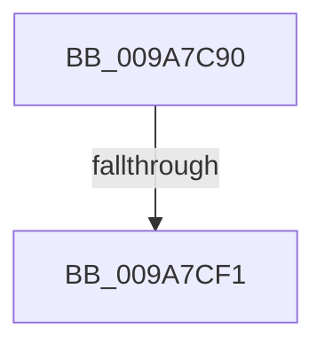

# NtSetIoCompletionEx

- RVA: `0x009A7C90`–`0x009A7D0D` (길이 `125` bytes)
- VA: `0x00000001409A7C90`
- 실행 섹션: `PAGE`
- PDB 이름 있음: `예`; PDB Function 태그: `아니요`
- unwind 정보 RVA: `0x0009CD08`
- 디코드: `27`개 명령, `125/125` bytes 표시
- 미해석 바이트: `0` (있으면 어셈블리에 `.byte`로 보존)

> 이 문서는 커널 이미지의 기계어와 PDB 기호를 분석해 생성했습니다. 4번과 5번은 함수 원형과 자료형을 바이너리 사용 방식에서 추정한 C 해석이며 원본 소스 복구 결과는 아닙니다.

## 1. Dependencies

- 직접 호출 지점: **1**; 고유 호출 대상: **1**
- 직접 호출자로 확인된 함수: **0**
- RIP 상대 이미지 참조: **2**

### Outgoing calls
- `0x009A7CDF` → [ObReferenceObjectByHandle](../86/ObReferenceObjectByHandle_function_00868DB0.md) (function, `0x00868DB0`)

### Direct callers
- 이 함수 시작 RVA로 연결되는 직접 call은 확인되지 않았습니다. 간접 호출은 완전히 역산할 수 없습니다.

### Static image references
- `0x009A7CBF` → RVA `0x00FC6CC0` (`ALMOSTRO`; read)
- `0x009A7CFE` → RVA `0x00FC7348` (`ALMOSTRO`; read)

## 2. Other-region calls and transfers

- 다른 실행 섹션으로 향하는 call: **0**
- call이 아닌 외부 분기/꼬리 이동: **1**
  - `0x009A7CEB` → [sub_009A7D89 + 0xA](Unknown_function_009A7D89.md) (`tail-transfer`)

## 3. Assembly (complete function range)

```asm
009A7C90  48 89 5C 24 10                  mov qword ptr [rsp + 0x10], rbx
009A7C95  48 89 6C 24 18                  mov qword ptr [rsp + 0x18], rbp
009A7C9A  57                              push rdi
009A7C9B  41 56                           push r14
009A7C9D  41 57                           push r15
009A7C9F  48 83 EC 50                     sub rsp, 0x50
009A7CA3  65 48 8B 04 25 88 01 00 00      mov rax, qword ptr gs:[0x188]
009A7CAC  45 33 FF                        xor r15d, r15d
009A7CAF  49 8B E9                        mov rbp, r9
009A7CB2  4C 89 7C 24 28                  mov qword ptr [rsp + 0x28], r15
009A7CB7  4D 8B F0                        mov r14, r8
009A7CBA  4C 89 7C 24 40                  mov qword ptr [rsp + 0x40], r15
009A7CBF  4C 8B 05 FA EF 61 00            mov r8, qword ptr [rip + 0x61effa]
009A7CC6  48 8B DA                        mov rbx, rdx
009A7CC9  44 0F B6 88 32 02 00 00         movzx r9d, byte ptr [rax + 0x232]
009A7CD1  41 8D 57 02                     lea edx, [r15 + 2]
009A7CD5  48 8D 44 24 40                  lea rax, [rsp + 0x40]
009A7CDA  48 89 44 24 20                  mov qword ptr [rsp + 0x20], rax
009A7CDF  E8 CC 10 EC FF                  call 0x140868db0
009A7CE4  48 8B 7C 24 40                  mov rdi, qword ptr [rsp + 0x40]
009A7CE9  85 C0                           test eax, eax
009A7CEB  0F 88 A2 00 00 00               js 0x1409a7d93
009A7CF1  65 48 8B 04 25 88 01 00 00      mov rax, qword ptr gs:[0x188]
009A7CFA  41 8D 57 02                     lea edx, [r15 + 2]
009A7CFE  4C 8B 05 43 F6 61 00            mov r8, qword ptr [rip + 0x61f643]
009A7D05  48 8B CB                        mov rcx, rbx
009A7D08  4C 89 7C 24 28                  mov qword ptr [rsp + 0x28], r15
```

## 4. C-style interpretation (structured pseudocode)

```c
__int64 __fastcall NtSetIoCompletionEx(__int64 a1, __int64 a2, __int64 a3, __int64 a4)
{
    __int64 result;
    __int64 v_r15;
    __int64 v_rsp;
    unsigned __int64 v_stack_m28;
    unsigned __int64 v_stack_m40;
    unsigned __int64 v_stack_m48;
    unsigned __int64 v_stack_p10;
    unsigned __int64 v_stack_p18;

    v_stack_p10 = v_rbx;
    v_stack_p18 = v_rbp;
    v_rsp = (v_rsp) - (80);
    v_r15 = 0;
    v_stack_m40 = 0;
    v_stack_m28 = 0;
    v_stack_m48 = v_stack_m28;
    result = ObReferenceObjectByHandle(a1, v_r15 + 2, *(unsigned __int64 *)(v_rip + 6418426), *(unsigned __int8 *)(*(unsigned __int64 *)(gs_base + (0 + 392)) + 562));
    v_stack_m40 = 0;
    return *(unsigned __int64 *)(gs_base + (0 + 392));
}
```

## 5. (Beta) C Style

```c
int64_t NtSetIoCompletionEx(int64_t Arg1, int64_t Arg2, int64_t Arg3, int64_t Arg4)
{
    int64_t result;
    int64_t local_r15;
    int64_t local_rsp;
    uint64_t v_stack_m28;
    uint64_t v_stack_m40;
    uint64_t v_stack_m48;
    uint64_t v_stack_p10;
    uint64_t v_stack_p18;

    v_stack_p10 = local_rbx;
    v_stack_p18 = local_rbp;
    local_rsp = (local_rsp) - (80);
    local_r15 = 0;
    v_stack_m40 = 0;
    v_stack_m28 = 0;
    v_stack_m48 = v_stack_m28;
    result = ObReferenceObjectByHandle(Arg1, local_r15 + 2, *(uint64_t *)(v_rip + 0x61EFFA), *(uint8_t *)(*(uint64_t *)(gs_base + (0 + 0x188)) + 0x232));
    v_stack_m40 = 0;
    return *(uint64_t *)(gs_base + (0 + 0x188));
}
```

## 6. Execution-region graph

[열기: 2D/3D 그래프와 함수 탐색 컨트롤 패널](../../../control-panel.html?section=page&rva=0x009A7C90&view=graph)

- 2D 그래프는 위에서 아래로 흐르고, 3D 그래프는 빈 공간을 드래그해 회전합니다. Shift+드래그는 이동, 휠은 확대·축소, 함수 노드 선택은 대상 보고서 이동입니다.

### Static fallback


