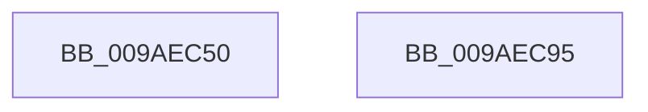

# NtUnloadKeyEx

- RVA: `0x009AEC50`–`0x009AEC96` (길이 `70` bytes)
- VA: `0x00000001409AEC50`
- 실행 섹션: `PAGE`
- PDB 이름 있음: `예`; PDB Function 태그: `아니요`
- unwind 정보 RVA: `0x00063458`
- 디코드: `20`개 명령, `70/70` bytes 표시
- 미해석 바이트: `0` (있으면 어셈블리에 `.byte`로 보존)

> 이 문서는 커널 이미지의 기계어와 PDB 기호를 분석해 생성했습니다. 4번과 5번은 함수 원형과 자료형을 바이너리 사용 방식에서 추정한 C 해석이며 원본 소스 복구 결과는 아닙니다.

## 1. Dependencies

- 직접 호출 지점: **3**; 고유 호출 대상: **3**
- 직접 호출자로 확인된 함수: **0**
- RIP 상대 이미지 참조: **0**

### Outgoing calls
- `0x009AEC6E` → [CmpInitializeThreadInfo](../../text/3F/CmpInitializeThreadInfo_function_003FBE70.md) (function, `0x003FBE70`)
- `0x009AEC7B` → [CmUnloadKey](CmUnloadKey_function_009AF2FC.md) (function, `0x009AF2FC`)
- `0x009AEC88` → [CmCleanupThreadInfo](../../text/41/CmCleanupThreadInfo_function_0041FD50.md) (function, `0x0041FD50`)

### Direct callers
- 이 함수 시작 RVA로 연결되는 직접 call은 확인되지 않았습니다. 간접 호출은 완전히 역산할 수 없습니다.

### Static image references
- 디코드된 RIP-relative 메모리 참조가 없습니다.

## 2. Other-region calls and transfers

- 다른 실행 섹션으로 향하는 call: **2**
  - `0x009AEC6E` → [CmpInitializeThreadInfo](../../text/3F/CmpInitializeThreadInfo_function_003FBE70.md) (`PAGE` → `.text`)
  - `0x009AEC88` → [CmCleanupThreadInfo](../../text/41/CmCleanupThreadInfo_function_0041FD50.md) (`PAGE` → `.text`)
- 별도 외부 분기/꼬리 이동을 확인하지 못했습니다.

## 3. Assembly (complete function range)

```asm
009AEC50  48 83 EC 48                     sub rsp, 0x48
009AEC54  0F 57 C0                        xorps xmm0, xmm0
009AEC57  33 C0                           xor eax, eax
009AEC59  4C 8B D1                        mov r10, rcx
009AEC5C  48 89 44 24 30                  mov qword ptr [rsp + 0x30], rax
009AEC61  48 8D 4C 24 20                  lea rcx, [rsp + 0x20]
009AEC66  4C 8B CA                        mov r9, rdx
009AEC69  0F 11 44 24 20                  movups xmmword ptr [rsp + 0x20], xmm0
009AEC6E  E8 FD D1 A4 FF                  call 0x1403fbe70
009AEC73  41 B0 01                        mov r8b, 1
009AEC76  33 D2                           xor edx, edx
009AEC78  49 8B CA                        mov rcx, r10
009AEC7B  E8 7C 06 00 00                  call 0x1409af2fc
009AEC80  48 8D 4C 24 20                  lea rcx, [rsp + 0x20]
009AEC85  44 8B C0                        mov r8d, eax
009AEC88  E8 C3 10 A7 FF                  call 0x14041fd50
009AEC8D  41 8B C0                        mov eax, r8d
009AEC90  48 83 C4 48                     add rsp, 0x48
009AEC94  C3                              ret
009AEC95  CC                              int3
```

## 4. C-style interpretation (structured pseudocode)

```c
__int64 __fastcall NtUnloadKeyEx(__int64 a1, __int64 a2)
{
    __int64 result;
    __int64 v_rsp;
    unsigned __int64 v_stack_m18;
    unsigned __int64 v_stack_m28;

    v_rsp = (v_rsp) - (72);
    result = 0;
    v_stack_m18 = 0;
    v_stack_m28 = v_xmm0;
    result = CmpInitializeThreadInfo(v_stack_m28, a2, a3, a2);
    a2 = 0;
    result = CmUnloadKey(a1, a2, 1, a2);
    result = CmCleanupThreadInfo(v_stack_m28, a2, (unsigned int)((unsigned int)(result)), a2);
    v_rsp = (v_rsp) + (72);
    return (unsigned int)((unsigned int)((unsigned int)((unsigned int)(result))));
}
```

## 5. (Beta) C Style

```c
int64_t NtUnloadKeyEx(int64_t Arg1, int64_t Arg2)
{
    int64_t result;
    int64_t local_rsp;
    uint64_t v_stack_m18;
    uint64_t v_stack_m28;

    local_rsp = (local_rsp) - (72);
    result = 0;
    v_stack_m18 = 0;
    v_stack_m28 = v_xmm0;
    result = CmpInitializeThreadInfo(v_stack_m28, Arg2, a3, Arg2);
    Arg2 = 0;
    result = CmUnloadKey(Arg1, Arg2, 1, Arg2);
    result = CmCleanupThreadInfo(v_stack_m28, Arg2, (uint32_t)((uint32_t)(result)), Arg2);
    local_rsp = (local_rsp) + (72);
    return (uint32_t)((uint32_t)((uint32_t)((uint32_t)(result))));
}
```

## 6. Execution-region graph

[열기: 2D/3D 그래프와 함수 탐색 컨트롤 패널](../../../control-panel.html?section=page&rva=0x009AEC50&view=graph)

- 2D 그래프는 위에서 아래로 흐르고, 3D 그래프는 빈 공간을 드래그해 회전합니다. Shift+드래그는 이동, 휠은 확대·축소, 함수 노드 선택은 대상 보고서 이동입니다.

### Static fallback


