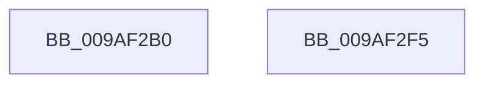

# NtUnloadKey

- RVA: `0x009AF2B0`–`0x009AF2F6` (길이 `70` bytes)
- VA: `0x00000001409AF2B0`
- 실행 섹션: `PAGE`
- PDB 이름 있음: `예`; PDB Function 태그: `아니요`
- unwind 정보 RVA: `0x00063458`
- 디코드: `20`개 명령, `70/70` bytes 표시
- 미해석 바이트: `0` (있으면 어셈블리에 `.byte`로 보존)

> 이 문서는 커널 이미지의 기계어와 PDB 기호를 분석해 생성했습니다. 4번과 5번은 함수 원형과 자료형을 바이너리 사용 방식에서 추정한 C 해석이며 원본 소스 복구 결과는 아닙니다.

## 1. Dependencies

- 직접 호출 지점: **3**; 고유 호출 대상: **3**
- 직접 호출자로 확인된 함수: **0**
- RIP 상대 이미지 참조: **0**

### Outgoing calls
- `0x009AF2CB` → [CmpInitializeThreadInfo](../../text/3F/CmpInitializeThreadInfo_function_003FBE70.md) (function, `0x003FBE70`)
- `0x009AF2DB` → [CmUnloadKey](CmUnloadKey_function_009AF2FC.md) (function, `0x009AF2FC`)
- `0x009AF2E8` → [CmCleanupThreadInfo](../../text/41/CmCleanupThreadInfo_function_0041FD50.md) (function, `0x0041FD50`)

### Direct callers
- 이 함수 시작 RVA로 연결되는 직접 call은 확인되지 않았습니다. 간접 호출은 완전히 역산할 수 없습니다.

### Static image references
- 디코드된 RIP-relative 메모리 참조가 없습니다.

## 2. Other-region calls and transfers

- 다른 실행 섹션으로 향하는 call: **2**
  - `0x009AF2CB` → [CmpInitializeThreadInfo](../../text/3F/CmpInitializeThreadInfo_function_003FBE70.md) (`PAGE` → `.text`)
  - `0x009AF2E8` → [CmCleanupThreadInfo](../../text/41/CmCleanupThreadInfo_function_0041FD50.md) (`PAGE` → `.text`)
- 별도 외부 분기/꼬리 이동을 확인하지 못했습니다.

## 3. Assembly (complete function range)

```asm
009AF2B0  48 83 EC 48                     sub rsp, 0x48
009AF2B4  0F 57 C0                        xorps xmm0, xmm0
009AF2B7  33 C0                           xor eax, eax
009AF2B9  4C 8B D1                        mov r10, rcx
009AF2BC  48 89 44 24 30                  mov qword ptr [rsp + 0x30], rax
009AF2C1  48 8D 4C 24 20                  lea rcx, [rsp + 0x20]
009AF2C6  0F 11 44 24 20                  movups xmmword ptr [rsp + 0x20], xmm0
009AF2CB  E8 A0 CB A4 FF                  call 0x1403fbe70
009AF2D0  45 33 C0                        xor r8d, r8d
009AF2D3  33 D2                           xor edx, edx
009AF2D5  45 33 C9                        xor r9d, r9d
009AF2D8  49 8B CA                        mov rcx, r10
009AF2DB  E8 1C 00 00 00                  call 0x1409af2fc
009AF2E0  48 8D 4C 24 20                  lea rcx, [rsp + 0x20]
009AF2E5  44 8B C0                        mov r8d, eax
009AF2E8  E8 63 0A A7 FF                  call 0x14041fd50
009AF2ED  41 8B C0                        mov eax, r8d
009AF2F0  48 83 C4 48                     add rsp, 0x48
009AF2F4  C3                              ret
009AF2F5  CC                              int3
```

## 4. C-style interpretation (structured pseudocode)

```c
__int64 __fastcall NtUnloadKey(__int64 a1, int a2, int a3, int a4)
{
    __int64 result;
    __int64 v_rsp;
    unsigned __int64 v_stack_m18;
    unsigned __int64 v_stack_m28;

    v_rsp = (v_rsp) - (72);
    result = 0;
    v_stack_m18 = 0;
    v_stack_m28 = v_xmm0;
    result = CmpInitializeThreadInfo(v_stack_m28, a2, a3, a4);
    a3 = 0;
    a2 = 0;
    a4 = 0;
    result = CmUnloadKey(a1, a2, a3, a4);
    result = CmCleanupThreadInfo(v_stack_m28, a2, (unsigned int)((unsigned int)(result)), a4);
    v_rsp = (v_rsp) + (72);
    return (unsigned int)((unsigned int)((unsigned int)((unsigned int)(result))));
}
```

## 5. (Beta) C Style

```c
int64_t NtUnloadKey(int64_t Arg1, int32_t Arg2, int32_t Arg3, int32_t Arg4)
{
    int64_t result;
    int64_t local_rsp;
    uint64_t v_stack_m18;
    uint64_t v_stack_m28;

    local_rsp = (local_rsp) - (72);
    result = 0;
    v_stack_m18 = 0;
    v_stack_m28 = v_xmm0;
    result = CmpInitializeThreadInfo(v_stack_m28, Arg2, Arg3, Arg4);
    Arg3 = 0;
    Arg2 = 0;
    Arg4 = 0;
    result = CmUnloadKey(Arg1, Arg2, Arg3, Arg4);
    result = CmCleanupThreadInfo(v_stack_m28, Arg2, (uint32_t)((uint32_t)(result)), Arg4);
    local_rsp = (local_rsp) + (72);
    return (uint32_t)((uint32_t)((uint32_t)((uint32_t)(result))));
}
```

## 6. Execution-region graph

[열기: 2D/3D 그래프와 함수 탐색 컨트롤 패널](../../../control-panel.html?section=page&rva=0x009AF2B0&view=graph)

- 2D 그래프는 위에서 아래로 흐르고, 3D 그래프는 빈 공간을 드래그해 회전합니다. Shift+드래그는 이동, 휠은 확대·축소, 함수 노드 선택은 대상 보고서 이동입니다.

### Static fallback


