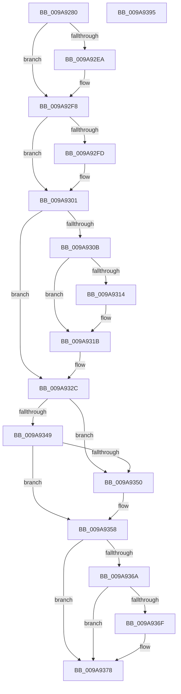

# ObHandleRevocationBlockAddObject

- RVA: `0x009A9280`–`0x009A9396` (길이 `278` bytes)
- VA: `0x00000001409A9280`
- 실행 섹션: `PAGE`
- PDB 이름 있음: `예`; PDB Function 태그: `아니요`
- unwind 정보 RVA: `0x0005D79C`
- 디코드: `82`개 명령, `278/278` bytes 표시
- 미해석 바이트: `0` (있으면 어셈블리에 `.byte`로 보존)

> 이 문서는 커널 이미지의 기계어와 PDB 기호를 분석해 생성했습니다. 4번과 5번은 함수 원형과 자료형을 바이너리 사용 방식에서 추정한 C 해석이며 원본 소스 복구 결과는 아닙니다.

## 1. Dependencies

- 직접 호출 지점: **8**; 고유 호출 대상: **8**
- 직접 호출자로 확인된 함수: **1**
- RIP 상대 이미지 참조: **0**

### Outgoing calls
- `0x009A92A9` → [OBJECT_HEADER_TO_HANDLE_REVOCATION_INFO](../../text/3A/OBJECT_HEADER_TO_HANDLE_REVOCATION_INFO_function_003A1840.md) (function, `0x003A1840`)
- `0x009A92B5` → [ExAcquireRundownProtection](../../text/21/ExAcquireRundownProtection_function_00216620.md) (function, `0x00216620`)
- `0x009A92DA` → [KeAbPreAcquire](../../text/21/KeAbPreAcquire_function_00210230.md) (function, `0x00210230`)
- `0x009A92F3` → [ExfAcquirePushLockExclusiveEx](../../text/20/ExfAcquirePushLockExclusiveEx_function_0020FC90.md) (function, `0x0020FC90`)
- `0x009A9353` → [ExfReleasePushLock](../../text/26/ExfReleasePushLock_function_002638D0.md) (function, `0x002638D0`)
- `0x009A935B` → [KeAbPostRelease](../../text/2E/KeAbPostRelease_function_002E1600.md) (function, `0x002E1600`)
- `0x009A9360` → [KeLeaveCriticalRegion](../../text/25/KeLeaveCriticalRegion_function_0025D8B0.md) (function, `0x0025D8B0`)
- `0x009A9373` → [ExReleaseRundownProtection](../../text/34/ExReleaseRundownProtection_function_00349E80.md) (function, `0x00349E80`)

### Direct callers
- [ObpCreateHandle](../86/ObpCreateHandle_function_0086B950.md) at `0x0086CF5E`

### Static image references
- 디코드된 RIP-relative 메모리 참조가 없습니다.

## 2. Other-region calls and transfers

- 다른 실행 섹션으로 향하는 call: **8**
  - `0x009A92A9` → [OBJECT_HEADER_TO_HANDLE_REVOCATION_INFO](../../text/3A/OBJECT_HEADER_TO_HANDLE_REVOCATION_INFO_function_003A1840.md) (`PAGE` → `.text`)
  - `0x009A92B5` → [ExAcquireRundownProtection](../../text/21/ExAcquireRundownProtection_function_00216620.md) (`PAGE` → `.text`)
  - `0x009A92DA` → [KeAbPreAcquire](../../text/21/KeAbPreAcquire_function_00210230.md) (`PAGE` → `.text`)
  - `0x009A92F3` → [ExfAcquirePushLockExclusiveEx](../../text/20/ExfAcquirePushLockExclusiveEx_function_0020FC90.md) (`PAGE` → `.text`)
  - `0x009A9353` → [ExfReleasePushLock](../../text/26/ExfReleasePushLock_function_002638D0.md) (`PAGE` → `.text`)
  - `0x009A935B` → [KeAbPostRelease](../../text/2E/KeAbPostRelease_function_002E1600.md) (`PAGE` → `.text`)
  - `0x009A9360` → [KeLeaveCriticalRegion](../../text/25/KeLeaveCriticalRegion_function_0025D8B0.md) (`PAGE` → `.text`)
  - `0x009A9373` → [ExReleaseRundownProtection](../../text/34/ExReleaseRundownProtection_function_00349E80.md) (`PAGE` → `.text`)
- 별도 외부 분기/꼬리 이동을 확인하지 못했습니다.

## 3. Assembly (complete function range)

```asm
009A9280  48 89 5C 24 10                  mov qword ptr [rsp + 0x10], rbx
009A9285  48 89 6C 24 18                  mov qword ptr [rsp + 0x18], rbp
009A928A  48 89 74 24 20                  mov qword ptr [rsp + 0x20], rsi
009A928F  57                              push rdi
009A9290  41 54                           push r12
009A9292  41 55                           push r13
009A9294  41 56                           push r14
009A9296  41 57                           push r15
009A9298  48 83 EC 20                     sub rsp, 0x20
009A929C  48 8B F1                        mov rsi, rcx
009A929F  45 33 ED                        xor r13d, r13d
009A92A2  48 8D 4A D0                     lea rcx, [rdx - 0x30]
009A92A6  45 8A F5                        mov r14b, r13b
009A92A9  E8 92 85 9F FF                  call 0x1403a1840
009A92AE  48 8D 4E 18                     lea rcx, [rsi + 0x18]
009A92B2  48 8B F8                        mov rdi, rax
009A92B5  E8 66 D3 86 FF                  call 0x140216620
009A92BA  65 48 8B 14 25 88 01 00 00      mov rdx, qword ptr gs:[0x188]
009A92C3  48 8D 5E 10                     lea rbx, [rsi + 0x10]
009A92C7  45 33 C0                        xor r8d, r8d
009A92CA  48 8B CB                        mov rcx, rbx
009A92CD  44 8A E0                        mov r12b, al
009A92D0  66 FF 8A E4 01 00 00            dec word ptr [rdx + 0x1e4]
009A92D7  33 D2                           xor edx, edx
009A92D9  90                              nop
009A92DA  E8 51 6F 86 FF                  call 0x140210230
009A92DF  F0 48 0F BA 2B 00               lock bts qword ptr [rbx], 0
009A92E5  48 8B E8                        mov rbp, rax
009A92E8  73 0E                           jae 0x1409a92f8
009A92EA  4C 8B C3                        mov r8, rbx
009A92ED  48 8B D0                        mov rdx, rax
009A92F0  48 8B CB                        mov rcx, rbx
009A92F3  E8 98 69 86 FF                  call 0x14020fc90
009A92F8  48 85 ED                        test rbp, rbp
009A92FB  74 04                           je 0x1409a9301
009A92FD  C6 45 0A 01                     mov byte ptr [rbp + 0xa], 1
009A9301  33 C0                           xor eax, eax
009A9303  F0 48 0F B1 77 10               lock cmpxchg qword ptr [rdi + 0x10], rsi
009A9309  75 21                           jne 0x1409a932c
009A930B  48 8B 46 08                     mov rax, qword ptr [rsi + 8]
009A930F  48 39 30                        cmp qword ptr [rax], rsi
009A9312  74 07                           je 0x1409a931b
009A9314  B9 03 00 00 00                  mov ecx, 3
009A9319  CD 29                           int 0x29
009A931B  48 89 37                        mov qword ptr [rdi], rsi
009A931E  41 B6 01                        mov r14b, 1
009A9321  48 89 47 08                     mov qword ptr [rdi + 8], rax
009A9325  48 89 38                        mov qword ptr [rax], rdi
009A9328  48 89 7E 08                     mov qword ptr [rsi + 8], rdi
009A932C  0F 0D 0B                        prefetchw byte ptr [rbx]
009A932F  48 8B 03                        mov rax, qword ptr [rbx]
009A9332  48 8B C8                        mov rcx, rax
009A9335  48 83 E1 F0                     and rcx, 0xfffffffffffffff0
009A9339  48 83 F9 10                     cmp rcx, 0x10
009A933D  48 8D 50 F0                     lea rdx, [rax - 0x10]
009A9341  49 0F 46 D5                     cmovbe rdx, r13
009A9345  A8 02                           test al, 2
009A9347  75 07                           jne 0x1409a9350
009A9349  F0 48 0F B1 13                  lock cmpxchg qword ptr [rbx], rdx
009A934E  74 08                           je 0x1409a9358
009A9350  48 8B CB                        mov rcx, rbx
009A9353  E8 78 A5 8B FF                  call 0x1402638d0
009A9358  48 8B CB                        mov rcx, rbx
009A935B  E8 A0 82 93 FF                  call 0x1402e1600
009A9360  E8 4B 45 8B FF                  call 0x14025d8b0
009A9365  45 84 E4                        test r12b, r12b
009A9368  74 0E                           je 0x1409a9378
009A936A  45 84 F6                        test r14b, r14b
009A936D  75 09                           jne 0x1409a9378
009A936F  48 8D 4E 18                     lea rcx, [rsi + 0x18]
009A9373  E8 08 0B 9A FF                  call 0x140349e80
009A9378  48 8B 5C 24 58                  mov rbx, qword ptr [rsp + 0x58]
009A937D  48 8B 6C 24 60                  mov rbp, qword ptr [rsp + 0x60]
009A9382  48 8B 74 24 68                  mov rsi, qword ptr [rsp + 0x68]
009A9387  48 83 C4 20                     add rsp, 0x20
009A938B  41 5F                           pop r15
009A938D  41 5E                           pop r14
009A938F  41 5D                           pop r13
009A9391  41 5C                           pop r12
009A9393  5F                              pop rdi
009A9394  C3                              ret
009A9395  CC                              int3
```

## 4. C-style interpretation (structured pseudocode)

```c
__int64 __fastcall ObHandleRevocationBlockAddObject(__int64 a1, __int64 a2, int a3)
{
    __int64 result;
    __int64 v_r13;
    __int64 v_rsp;
    unsigned __int64 v_stack_p10;
    unsigned __int64 v_stack_p18;
    unsigned __int64 v_stack_p20;

    v_stack_p10 = v_rbx;
    v_stack_p18 = v_rbp;
    v_stack_p20 = v_rsi;
    v_rsp = (v_rsp) - (32);
    v_r13 = 0;
    result = OBJECT_HEADER_TO_HANDLE_REVOCATION_INFO(a2 - 48, a2, a3, a4);
    result = ExAcquireRundownProtection(a1 + 24, a2, a3, a4);
    a3 = 0;
    a2 = 0;
    result = KeAbPreAcquire(a1 + 16, a2, a3, a4);
    if (!(condition_is_above_or_equal)) {
        a3 = a1 + 16;
        a2 = result;
        a1 = a1 + 16;
        result = ExfAcquirePushLockExclusiveEx(a1, a2, a3, a4);
    }
    if (result != 0) {
        *(unsigned __int8 *)(result + 10) = 1;
    }
    result = 0;
    if (condition_is_not_equal) goto loc_009A932C;
    if ((*(unsigned __int64 *)(*(unsigned __int64 *)(a1 + 8))) != a1) {
        a1 = 3;
    }
    *(unsigned __int64 *)(result) = a1;
    *(unsigned __int64 *)(result + 8) = *(unsigned __int64 *)(a1 + 8);
    *(unsigned __int64 *)(*(unsigned __int64 *)(a1 + 8)) = 0;
    *(unsigned __int64 *)(a1 + 8) = 0;
loc_009A932C:
    a1 = (*(unsigned __int64 *)(a1 + 16)) & (-16);
    a2 = *(unsigned __int64 *)(a1 + 16) - 16;
    if (a1 <= 16) { a2 = 0; }
    if ((((unsigned __int8)(*(unsigned __int64 *)(a1 + 16))) & (2)) != 0) goto loc_009A9350;
    result = *(unsigned __int64 *)(a1 + 16);
    if ((((unsigned __int8)(*(unsigned __int64 *)(a1 + 16))) & (2)) != 0) {
        a1 = a1 + 16;
        result = ExfReleasePushLock(a1, a2, a3, a4);
    }
    result = KeAbPostRelease(a1 + 16, a2, a3, a4);
    result = KeLeaveCriticalRegion(a1 + 16, a2, a3, a4);
    if ((unsigned __int8)((unsigned __int8)(result)) == 0) goto loc_009A9378;
    if (1 == 0) {
        a1 = a1 + 24;
        result = ExReleaseRundownProtection(a1, a2, a3, a4);
    }
    v_rsp = (v_rsp) + (32);
    return result;
}
```

## 5. (Beta) C Style

```c
int64_t ObHandleRevocationBlockAddObject(void *Arg1, void *Arg2, int32_t Arg3)
{
    uint8_t *arg1 = (uint8_t *)Arg1;
    uint8_t *arg2 = (uint8_t *)Arg2;

    int64_t result;
    int64_t local_r13;
    int64_t local_rsp;
    uint64_t v_stack_p10;
    uint64_t v_stack_p18;
    uint64_t v_stack_p20;

    v_stack_p10 = local_rbx;
    v_stack_p18 = local_rbp;
    v_stack_p20 = local_rsi;
    local_rsp = (local_rsp) - (32);
    local_r13 = 0;
    result = OBJECT_HEADER_TO_HANDLE_REVOCATION_INFO(Arg2 - 48, Arg2, Arg3, a4);
    result = ExAcquireRundownProtection(Arg1 + 24, Arg2, Arg3, a4);
    Arg3 = 0;
    Arg2 = 0;
    result = KeAbPreAcquire(Arg1 + 16, Arg2, Arg3, a4);
    if (!(condition_is_above_or_equal)) {
        Arg3 = Arg1 + 16;
        Arg2 = result;
        Arg1 = Arg1 + 16;
        result = ExfAcquirePushLockExclusiveEx(Arg1, Arg2, Arg3, a4);
    }
    if (result != 0) {
        *(uint8_t *)(result + 0xA) = 1;
    }
    result = 0;
    if (condition_is_not_equal) goto loc_009A932C;
    if ((*(uint64_t *)(*(uint64_t *)(arg1 + 0x8))) != Arg1) {
        Arg1 = 3;
    }
    *(void **)(result) = Arg1;
    *(uint64_t *)(result + 0x8) = *(uint64_t *)(arg1 + 0x8);
    *(uint64_t *)(*(uint64_t *)(arg1 + 0x8)) = 0;
    *(uint64_t *)(arg1 + 0x8) = 0;
loc_009A932C:
    Arg1 = (*(uint64_t *)(arg1 + 0x10)) & (-16);
    Arg2 = *(uint64_t *)(arg1 + 0x10) - 16;
    if (Arg1 <= 16) { Arg2 = 0; }
    if ((((uint8_t)(*(uint64_t *)(arg1 + 0x10))) & (2)) != 0) goto loc_009A9350;
    result = *(uint64_t *)(arg1 + 0x10);
    if ((((uint8_t)(*(uint64_t *)(arg1 + 0x10))) & (2)) != 0) {
        Arg1 = Arg1 + 16;
        result = ExfReleasePushLock(Arg1, Arg2, Arg3, a4);
    }
    result = KeAbPostRelease(Arg1 + 16, Arg2, Arg3, a4);
    result = KeLeaveCriticalRegion(Arg1 + 16, Arg2, Arg3, a4);
    if ((uint8_t)((uint8_t)(result)) == 0) goto loc_009A9378;
    if (1 == 0) {
        Arg1 = Arg1 + 24;
        result = ExReleaseRundownProtection(Arg1, Arg2, Arg3, a4);
    }
    local_rsp = (local_rsp) + (32);
    return result;
}
```

### 관측된 메모리 오프셋

구조체 형식이 확인되지 않은 접근은 인자 기준의 오프셋으로만 기록했습니다.

| 기준 인자 | 오프셋 표현 | 폭 (bit) | 접근 |
|---|---:|---:|---|
| `Arg1` | `+ 0x0` | `8` | `R` |
| `Arg1` | `+ 0x0` | `64` | `R` |
| `Arg1` | `+ 0x0` | `64` | `R/W` |
| `Arg1` | `+ 0x8` | `64` | `R` |
| `Arg1` | `+ 0x8` | `64` | `W` |
| `Arg1` | `+ 0x10` | `64` | `R` |
| `Arg1` | `+ 0x18` | `64` | `R` |
| `Arg2` | `- 0x30` | `64` | `R` |

## 6. Execution-region graph

[열기: 2D/3D 그래프와 함수 탐색 컨트롤 패널](../../../control-panel.html?section=page&rva=0x009A9280&view=graph)

- 2D 그래프는 위에서 아래로 흐르고, 3D 그래프는 빈 공간을 드래그해 회전합니다. Shift+드래그는 이동, 휠은 확대·축소, 함수 노드 선택은 대상 보고서 이동입니다.

### Static fallback


