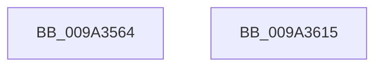

# ObQuerySecurityObject

- RVA: `0x009A3564`–`0x009A3616` (길이 `178` bytes)
- VA: `0x00000001409A3564`
- 실행 섹션: `PAGE`
- PDB 이름 있음: `예`; PDB Function 태그: `아니요`
- unwind 정보 RVA: `0x0009C37C`
- 디코드: `44`개 명령, `178/178` bytes 표시
- 미해석 바이트: `0` (있으면 어셈블리에 `.byte`로 보존)

> 이 문서는 커널 이미지의 기계어와 PDB 기호를 분석해 생성했습니다. 4번과 5번은 함수 원형과 자료형을 바이너리 사용 방식에서 추정한 C 해석이며 원본 소스 복구 결과는 아닙니다.

## 1. Dependencies

- 직접 호출 지점: **2**; 고유 호출 대상: **2**
- 직접 호출자로 확인된 함수: **5**
- RIP 상대 이미지 참조: **2**

### Outgoing calls
- `0x009A358B` → [SeQuerySecurityAccessMask](../87/SeQuerySecurityAccessMask_function_008739EC.md) (function, `0x008739EC`)
- `0x009A35F7` → [guard_dispatch_icall](../../text/6B/guard_dispatch_icall_function_006BAAD0.md) (function, `0x006BAAD0`)

### Direct callers
- [RtlIsUntrustedObject](../../text/49/RtlIsUntrustedObject_function_0049BC50.md) at `0x0049BCBB`
- [RtlIsUntrustedObject](../../text/49/RtlIsUntrustedObject_function_0049BC50.md) at `0x0049BDCA`
- [SepMandatorySubProcessToken](../../text/4C/SepMandatorySubProcessToken_function_004C0B88.md) at `0x004C0C4D`
- [SepMandatorySubProcessToken](../../text/4C/SepMandatorySubProcessToken_function_004C0B88.md) at `0x004C0CB2`
- [SepVerifyDesktopAppxImage](../../text/60/SepVerifyDesktopAppxImage_function_0060885C.md) at `0x00608979`
- [SepVerifyDesktopAppxImage](../../text/60/SepVerifyDesktopAppxImage_function_0060885C.md) at `0x006089D9`
- [CmpCheckExeOwnerForPca](CmpCheckExeOwnerForPca_function_009A343C.md) at `0x009A3494`
- [CmpCheckExeOwnerForPca](CmpCheckExeOwnerForPca_function_009A343C.md) at `0x009A34DE`
- [AstLogDeviceSDDLUpdated](AstLogDeviceSDDLUpdated_function_009A36A8.md) at `0x009A3705`
- [AstLogDeviceSDDLUpdated](AstLogDeviceSDDLUpdated_function_009A36A8.md) at `0x009A375F`

### Static image references
- `0x009A359D` → RVA `0x00FC7800` (`ALMOSTRO`; read)
- `0x009A35B1` → RVA `0x00FC6E4C` (`ALMOSTRO`; read)

## 2. Other-region calls and transfers

- 다른 실행 섹션으로 향하는 call: **1**
  - `0x009A35F7` → [guard_dispatch_icall](../../text/6B/guard_dispatch_icall_function_006BAAD0.md) (`PAGE` → `.text`)
- 별도 외부 분기/꼬리 이동을 확인하지 못했습니다.

## 3. Assembly (complete function range)

```asm
009A3564  48 89 5C 24 18                  mov qword ptr [rsp + 0x18], rbx
009A3569  44 89 4C 24 20                  mov dword ptr [rsp + 0x20], r9d
009A356E  89 54 24 10                     mov dword ptr [rsp + 0x10], edx
009A3572  57                              push rdi
009A3573  48 83 EC 50                     sub rsp, 0x50
009A3577  83 64 24 60 00                  and dword ptr [rsp + 0x60], 0
009A357C  8B C2                           mov eax, edx
009A357E  48 8B F9                        mov rdi, rcx
009A3581  48 8D 54 24 60                  lea rdx, [rsp + 0x60]
009A3586  8B C8                           mov ecx, eax
009A3588  49 8B D8                        mov rbx, r8
009A358B  E8 5C 04 ED FF                  call 0x1408739ec
009A3590  C6 44 24 40 00                  mov byte ptr [rsp + 0x40], 0
009A3595  48 8D 47 D0                     lea rax, [rdi - 0x30]
009A3599  48 C1 E8 08                     shr rax, 8
009A359D  4C 8D 05 5C 42 62 00            lea r8, [rip + 0x62425c]
009A35A4  0F B6 D0                        movzx edx, al
009A35A7  4C 8B CB                        mov r9, rbx
009A35AA  0F B6 47 E8                     movzx eax, byte ptr [rdi - 0x18]
009A35AE  48 33 D0                        xor rdx, rax
009A35B1  0F B6 05 94 38 62 00            movzx eax, byte ptr [rip + 0x623894]
009A35B8  48 33 D0                        xor rdx, rax
009A35BB  4D 8B 04 D0                     mov r8, qword ptr [r8 + rdx*8]
009A35BF  48 8D 57 F8                     lea rdx, [rdi - 8]
009A35C3  49 8B 80 98 00 00 00            mov rax, qword ptr [r8 + 0x98]
009A35CA  49 8D 48 4C                     lea rcx, [r8 + 0x4c]
009A35CE  48 89 4C 24 38                  mov qword ptr [rsp + 0x38], rcx
009A35D3  41 8B 48 64                     mov ecx, dword ptr [r8 + 0x64]
009A35D7  4C 8D 44 24 68                  lea r8, [rsp + 0x68]
009A35DC  89 4C 24 30                     mov dword ptr [rsp + 0x30], ecx
009A35E0  48 8D 4C 24 78                  lea rcx, [rsp + 0x78]
009A35E5  48 89 54 24 28                  mov qword ptr [rsp + 0x28], rdx
009A35EA  BA 01 00 00 00                  mov edx, 1
009A35EF  48 89 4C 24 20                  mov qword ptr [rsp + 0x20], rcx
009A35F4  48 8B CF                        mov rcx, rdi
009A35F7  E8 D4 74 D1 FF                  call 0x1406baad0
009A35FC  48 8B 94 24 80 00 00 00         mov rdx, qword ptr [rsp + 0x80]
009A3604  8B 4C 24 78                     mov ecx, dword ptr [rsp + 0x78]
009A3608  48 8B 5C 24 70                  mov rbx, qword ptr [rsp + 0x70]
009A360D  89 0A                           mov dword ptr [rdx], ecx
009A360F  48 83 C4 50                     add rsp, 0x50
009A3613  5F                              pop rdi
009A3614  C3                              ret
009A3615  CC                              int3
```

## 4. C-style interpretation (structured pseudocode)

```c
__int64 __fastcall ObQuerySecurityObject(__int64 a1, int a2, __int64 a3, int a4, __int64 a5)
{
    __int64 result;
    __int64 v_rsp;
    unsigned __int8 v_stack_m18;
    unsigned __int64 v_stack_m20;
    unsigned int v_stack_m28;
    unsigned __int64 v_stack_m30;
    unsigned __int64 v_stack_m38;
    unsigned int v_stack_p10;
    unsigned __int64 v_stack_p18;
    unsigned int v_stack_p20;
    unsigned int v_stack_p8;

    v_stack_p18 = v_rbx;
    v_stack_p20 = a4;
    v_stack_p10 = a2;
    v_rsp = (v_rsp) - (80);
    result = SeQuerySecurityAccessMask((unsigned int)((unsigned int)((unsigned int)(a2))), v_stack_p8, a3, a4);
    v_stack_m18 = 0;
    result = (a1 - 48) >> (8);
    a2 = ((unsigned __int8)(result)) ^ (*(unsigned __int8 *)(a1 - 24));
    a2 = (a2) ^ (*(unsigned __int8 *)(v_rip + 6437012));
    v_stack_m20 = *(unsigned __int64 *)(v_rip + 6439516 + a2 * 8) + 76;
    v_stack_m28 = (unsigned int)((unsigned int)(*(unsigned int *)(*(unsigned __int64 *)(v_rip + 6439516 + a2 * 8) + 100)));
    v_stack_m30 = a1 - 8;
    v_stack_m38 = v_stack_p20;
    result = guard_dispatch_icall(a1, 1, v_stack_p10, a3);
    *(unsigned int *)(a5) = (unsigned int)((unsigned int)(v_stack_p20));
    v_rsp = (v_rsp) + (80);
    return result;
}
```

## 5. (Beta) C Style

```c
int64_t ObQuerySecurityObject(void *Arg1, int32_t Arg2, int64_t Arg3, int32_t Arg4, void *Arg5)
{
    uint8_t *arg1 = (uint8_t *)Arg1;
    uint8_t *arg5 = (uint8_t *)Arg5;

    int64_t result;
    int64_t local_rsp;
    uint8_t v_stack_m18;
    uint64_t v_stack_m20;
    uint32_t v_stack_m28;
    uint64_t v_stack_m30;
    uint64_t v_stack_m38;
    uint32_t v_stack_p10;
    uint64_t v_stack_p18;
    uint32_t v_stack_p20;
    uint32_t v_stack_p8;

    v_stack_p18 = local_rbx;
    v_stack_p20 = Arg4;
    v_stack_p10 = Arg2;
    local_rsp = (local_rsp) - (80);
    result = SeQuerySecurityAccessMask((uint32_t)((uint32_t)((uint32_t)(Arg2))), v_stack_p8, Arg3, Arg4);
    v_stack_m18 = 0;
    result = (Arg1 - 48) >> (8);
    Arg2 = ((uint8_t)(result)) ^ (*(uint8_t *)(arg1 - 0x18));
    Arg2 = (Arg2) ^ (*(uint8_t *)(v_rip + 0x623894));
    v_stack_m20 = *(uint64_t *)(v_rip + 0x62425C + Arg2 * 8) + 76;
    v_stack_m28 = (uint32_t)((uint32_t)(*(uint32_t *)(*(uint64_t *)(v_rip + 0x62425C + Arg2 * 8) + 0x64)));
    v_stack_m30 = Arg1 - 8;
    v_stack_m38 = v_stack_p20;
    result = guard_dispatch_icall(Arg1, 1, v_stack_p10, Arg3);
    *(uint32_t *)(arg5) = (uint32_t)((uint32_t)(v_stack_p20));
    local_rsp = (local_rsp) + (80);
    return result;
}
```

### 관측된 메모리 오프셋

구조체 형식이 확인되지 않은 접근은 인자 기준의 오프셋으로만 기록했습니다.

| 기준 인자 | 오프셋 표현 | 폭 (bit) | 접근 |
|---|---:|---:|---|
| `Arg1` | `- 0x30` | `64` | `R` |
| `Arg1` | `- 0x18` | `8` | `R` |
| `Arg1` | `- 0x8` | `64` | `R` |
| `Arg5` | `+ 0x0` | `32` | `W` |

## 6. Execution-region graph

[열기: 2D/3D 그래프와 함수 탐색 컨트롤 패널](../../../control-panel.html?section=page&rva=0x009A3564&view=graph)

- 2D 그래프는 위에서 아래로 흐르고, 3D 그래프는 빈 공간을 드래그해 회전합니다. Shift+드래그는 이동, 휠은 확대·축소, 함수 노드 선택은 대상 보고서 이동입니다.

### Static fallback


