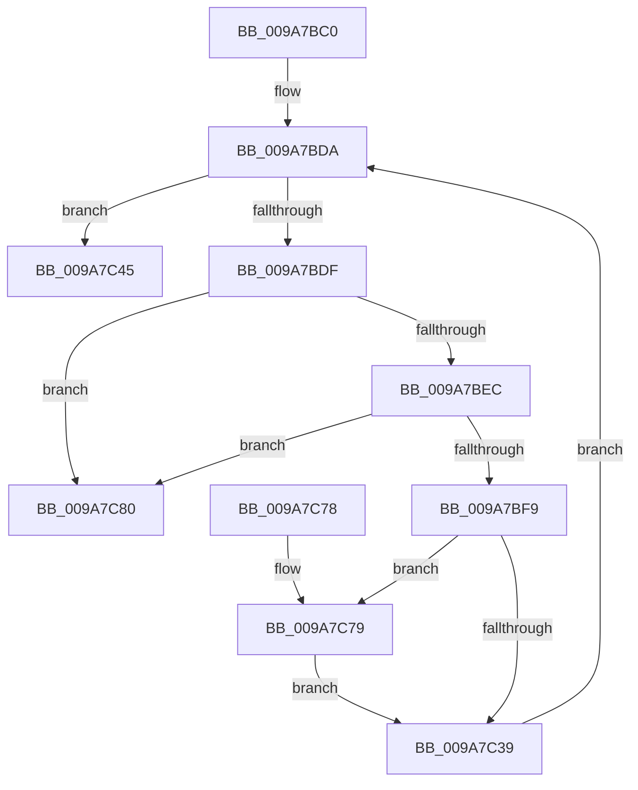

# ObpCallPostOperationCallbacks

- RVA: `0x009A7BC0`–`0x009A7C87` (길이 `199` bytes)
- VA: `0x00000001409A7BC0`
- 실행 섹션: `PAGE`
- PDB 이름 있음: `예`; PDB Function 태그: `아니요`
- unwind 정보 RVA: `0x0009CCF0`
- 디코드: `53`개 명령, `199/199` bytes 표시
- 미해석 바이트: `0` (있으면 어셈블리에 `.byte`로 보존)

> 이 문서는 커널 이미지의 기계어와 PDB 기호를 분석해 생성했습니다. 4번과 5번은 함수 원형과 자료형을 바이너리 사용 방식에서 추정한 C 해석이며 원본 소스 복구 결과는 아닙니다.

## 1. Dependencies

- 직접 호출 지점: **5**; 고유 호출 대상: **5**
- 직접 호출자로 확인된 함수: **3**
- RIP 상대 이미지 참조: **0**

### Outgoing calls
- `0x009A7C1B` → [guard_dispatch_icall](../../text/6B/guard_dispatch_icall_function_006BAAD0.md) (function, `0x006BAAD0`)
- `0x009A7C3E` → [ExFreePoolWithTag](../../poolcode/B8/ExFreePoolWithTag_function_00B82870.md) (function, `0x00B82870`)
- `0x009A7C4E` → [ObfDereferenceObjectWithTag](../../text/2F/ObfDereferenceObjectWithTag_function_002F78E0.md) (function, `0x002F78E0`)
- `0x009A7C5C` → [KeLeaveCriticalRegionThread](../../text/25/KeLeaveCriticalRegionThread_function_0025EFF0.md) (function, `0x0025EFF0`)
- `0x009A7C79` → [ExfReleaseRundownProtection](../../text/34/ExfReleaseRundownProtection_function_00349EB0.md) (function, `0x00349EB0`)

### Direct callers
- [ObpCreateHandle](../86/ObpCreateHandle_function_0086B950.md) at `0x0086D4A4`
- [ObCompleteObjectDuplication](../89/ObCompleteObjectDuplication_function_0089387C.md) at `0x00893A2C`
- [ObpCallPreOperationCallbacks](../8C/ObpCallPreOperationCallbacks_function_008C6570.md) at `0x008C6940`

### Static image references
- 디코드된 RIP-relative 메모리 참조가 없습니다.

## 2. Other-region calls and transfers

- 다른 실행 섹션으로 향하는 call: **5**
  - `0x009A7C1B` → [guard_dispatch_icall](../../text/6B/guard_dispatch_icall_function_006BAAD0.md) (`PAGE` → `.text`)
  - `0x009A7C3E` → [ExFreePoolWithTag](../../poolcode/B8/ExFreePoolWithTag_function_00B82870.md) (`PAGE` → `POOLCODE`)
  - `0x009A7C4E` → [ObfDereferenceObjectWithTag](../../text/2F/ObfDereferenceObjectWithTag_function_002F78E0.md) (`PAGE` → `.text`)
  - `0x009A7C5C` → [KeLeaveCriticalRegionThread](../../text/25/KeLeaveCriticalRegionThread_function_0025EFF0.md) (`PAGE` → `.text`)
  - `0x009A7C79` → [ExfReleaseRundownProtection](../../text/34/ExfReleaseRundownProtection_function_00349EB0.md) (`PAGE` → `.text`)
- 별도 외부 분기/꼬리 이동을 확인하지 못했습니다.

## 3. Assembly (complete function range)

```asm
009A7BC0  48 89 5C 24 20                  mov qword ptr [rsp + 0x20], rbx
009A7BC5  55                              push rbp
009A7BC6  48 83 EC 20                     sub rsp, 0x20
009A7BCA  48 89 74 24 30                  mov qword ptr [rsp + 0x30], rsi
009A7BCF  48 8B DA                        mov rbx, rdx
009A7BD2  48 89 7C 24 40                  mov qword ptr [rsp + 0x40], rdi
009A7BD7  48 8B E9                        mov rbp, rcx
009A7BDA  48 39 1B                        cmp qword ptr [rbx], rbx
009A7BDD  74 66                           je 0x1409a7c45
009A7BDF  48 8B 73 08                     mov rsi, qword ptr [rbx + 8]
009A7BE3  48 39 1E                        cmp qword ptr [rsi], rbx
009A7BE6  0F 85 94 00 00 00               jne 0x1409a7c80
009A7BEC  48 8B 46 08                     mov rax, qword ptr [rsi + 8]
009A7BF0  48 39 30                        cmp qword ptr [rax], rsi
009A7BF3  0F 85 87 00 00 00               jne 0x1409a7c80
009A7BF9  48 89 43 08                     mov qword ptr [rbx + 8], rax
009A7BFD  48 8B D5                        mov rdx, rbp
009A7C00  48 89 18                        mov qword ptr [rax], rbx
009A7C03  48 8B 7E 10                     mov rdi, qword ptr [rsi + 0x10]
009A7C07  48 8B 46 18                     mov rax, qword ptr [rsi + 0x18]
009A7C0B  48 89 45 18                     mov qword ptr [rbp + 0x18], rax
009A7C0F  48 8B 4F 18                     mov rcx, qword ptr [rdi + 0x18]
009A7C13  48 8B 47 30                     mov rax, qword ptr [rdi + 0x30]
009A7C17  48 8B 49 08                     mov rcx, qword ptr [rcx + 8]
009A7C1B  E8 B0 2E D1 FF                  call 0x1406baad0
009A7C20  48 8D 4F 38                     lea rcx, [rdi + 0x38]
009A7C24  0F 0D 09                        prefetchw byte ptr [rcx]
009A7C27  48 8B 01                        mov rax, qword ptr [rcx]
009A7C2A  48 83 E0 FE                     and rax, 0xfffffffffffffffe
009A7C2E  48 8D 50 FE                     lea rdx, [rax - 2]
009A7C32  F0 48 0F B1 11                  lock cmpxchg qword ptr [rcx], rdx
009A7C37  75 40                           jne 0x1409a7c79
009A7C39  33 D2                           xor edx, edx
009A7C3B  48 8B CE                        mov rcx, rsi
009A7C3E  E8 2D AC 1D 00                  call 0x140b82870
009A7C43  EB 95                           jmp 0x1409a7bda
009A7C45  48 8B 4D 08                     mov rcx, qword ptr [rbp + 8]
009A7C49  BA 4F 62 43 62                  mov edx, 0x6243624f
009A7C4E  E8 8D FC 94 FF                  call 0x1402f78e0
009A7C53  65 48 8B 0C 25 88 01 00 00      mov rcx, qword ptr gs:[0x188]
009A7C5C  E8 8F 73 8B FF                  call 0x14025eff0
009A7C61  48 8B 7C 24 40                  mov rdi, qword ptr [rsp + 0x40]
009A7C66  33 C0                           xor eax, eax
009A7C68  48 8B 74 24 30                  mov rsi, qword ptr [rsp + 0x30]
009A7C6D  48 8B 5C 24 48                  mov rbx, qword ptr [rsp + 0x48]
009A7C72  48 83 C4 20                     add rsp, 0x20
009A7C76  5D                              pop rbp
009A7C77  C3                              ret
009A7C78  CC                              int3
009A7C79  E8 32 22 9A FF                  call 0x140349eb0
009A7C7E  EB B9                           jmp 0x1409a7c39
009A7C80  B9 03 00 00 00                  mov ecx, 3
009A7C85  CD 29                           int 0x29
```

## 4. C-style interpretation (structured pseudocode)

```c
__int64 __fastcall ObpCallPostOperationCallbacks(__int64 a1, __int64 a2)
{
    __int64 result;
    __int64 v_rsp;
    unsigned __int64 v_stack_p18;
    unsigned __int64 v_stack_p20;
    unsigned __int64 v_stack_p8;

    v_stack_p20 = v_rbx;
    v_rsp = (v_rsp) - (32);
    v_stack_p8 = v_rsi;
    v_stack_p18 = v_rdi;
loc_009A7BDA:
    if ((*(unsigned __int64 *)(a2)) == a2) goto loc_009A7C45;
    if ((*(unsigned __int64 *)(*(unsigned __int64 *)(a2 + 8))) != a2) goto loc_009A7C80;
    if ((*(unsigned __int64 *)(*(unsigned __int64 *)(*(unsigned __int64 *)(a2 + 8) + 8))) != (*(unsigned __int64 *)(a2 + 8))) goto loc_009A7C80;
    *(unsigned __int64 *)(a2 + 8) = *(unsigned __int64 *)(*(unsigned __int64 *)(a2 + 8) + 8);
    *(unsigned __int64 *)(*(unsigned __int64 *)(*(unsigned __int64 *)(a2 + 8) + 8)) = a2;
    *(unsigned __int64 *)(a1 + 24) = *(unsigned __int64 *)(*(unsigned __int64 *)(a2 + 8) + 24);
    result = guard_dispatch_icall(*(unsigned __int64 *)(*(unsigned __int64 *)(*(unsigned __int64 *)(*(unsigned __int64 *)(a2 + 8) + 16) + 24) + 8), a1, a3, a4);
    result = (*(unsigned __int64 *)(*(unsigned __int64 *)(*(unsigned __int64 *)(a2 + 8) + 16) + 56)) & (-2);
    if (condition_is_not_equal) goto loc_009A7C79;
loc_009A7C39:
    a2 = 0;
    result = ExFreePoolWithTag(*(unsigned __int64 *)(a2 + 8), a2, a3, a4);
    goto loc_009A7BDA;
loc_009A7C45:
    result = ObfDereferenceObjectWithTag(*(unsigned __int64 *)(a1 + 8), (unsigned int)(0x6243624FULL), a3, a4);
    result = KeLeaveCriticalRegionThread(*(unsigned __int64 *)(gs_base + (0 + 392)), (unsigned int)(0x6243624FULL), a3, a4);
    result = 0;
    v_rsp = (v_rsp) + (32);
    return result;
loc_009A7C79:
    result = ExfReleaseRundownProtection(*(unsigned __int64 *)(gs_base + (0 + 392)), (unsigned int)(0x6243624FULL), a3, a4);
    goto loc_009A7C39;
loc_009A7C80:
    return result;
}
```

## 5. (Beta) C Style

```c
int64_t ObpCallPostOperationCallbacks(void *Arg1, void *Arg2)
{
    uint8_t *arg1 = (uint8_t *)Arg1;
    uint8_t *arg2 = (uint8_t *)Arg2;

    int64_t result;
    int64_t local_rsp;
    uint64_t v_stack_p18;
    uint64_t v_stack_p20;
    uint64_t v_stack_p8;

    v_stack_p20 = local_rbx;
    local_rsp = (local_rsp) - (32);
    v_stack_p8 = local_rsi;
    v_stack_p18 = local_rdi;
loc_009A7BDA:
    if ((*(uint64_t *)(arg2)) == Arg2) goto loc_009A7C45;
    if ((*(uint64_t *)(*(uint64_t *)(arg2 + 0x8))) != Arg2) goto loc_009A7C80;
    if ((*(uint64_t *)(*(uint64_t *)(*(uint64_t *)(arg2 + 0x8) + 0x8))) != (*(uint64_t *)(arg2 + 0x8))) goto loc_009A7C80;
    *(uint64_t *)(arg2 + 0x8) = *(uint64_t *)(*(uint64_t *)(arg2 + 0x8) + 0x8);
    *(void **)(*(uint64_t *)(*(uint64_t *)(arg2 + 0x8) + 0x8)) = Arg2;
    *(uint64_t *)(arg1 + 0x18) = *(uint64_t *)(*(uint64_t *)(arg2 + 0x8) + 0x18);
    result = guard_dispatch_icall(*(uint64_t *)(*(uint64_t *)(*(uint64_t *)(*(uint64_t *)(arg2 + 0x8) + 0x10) + 0x18) + 0x8), Arg1, a3, a4);
    result = (*(uint64_t *)(*(uint64_t *)(*(uint64_t *)(arg2 + 0x8) + 0x10) + 0x38)) & (-2);
    if (condition_is_not_equal) goto loc_009A7C79;
loc_009A7C39:
    Arg2 = 0;
    result = ExFreePoolWithTag(*(uint64_t *)(arg2 + 0x8), Arg2, a3, a4);
    goto loc_009A7BDA;
loc_009A7C45:
    result = ObfDereferenceObjectWithTag(*(uint64_t *)(arg1 + 0x8), (uint32_t)(0x6243624FULL), a3, a4);
    result = KeLeaveCriticalRegionThread(*(uint64_t *)(gs_base + (0 + 0x188)), (uint32_t)(0x6243624FULL), a3, a4);
    result = 0;
    local_rsp = (local_rsp) + (32);
    return result;
loc_009A7C79:
    result = ExfReleaseRundownProtection(*(uint64_t *)(gs_base + (0 + 0x188)), (uint32_t)(0x6243624FULL), a3, a4);
    goto loc_009A7C39;
loc_009A7C80:
    return result;
}
```

### 관측된 메모리 오프셋

구조체 형식이 확인되지 않은 접근은 인자 기준의 오프셋으로만 기록했습니다.

| 기준 인자 | 오프셋 표현 | 폭 (bit) | 접근 |
|---|---:|---:|---|
| `Arg1` | `+ 0x8` | `64` | `R` |
| `Arg1` | `+ 0x18` | `64` | `W` |
| `Arg2` | `+ 0x0` | `64` | `R` |
| `Arg2` | `+ 0x8` | `64` | `R` |
| `Arg2` | `+ 0x8` | `64` | `W` |

## 6. Execution-region graph

[열기: 2D/3D 그래프와 함수 탐색 컨트롤 패널](../../../control-panel.html?section=page&rva=0x009A7BC0&view=graph)

- 2D 그래프는 위에서 아래로 흐르고, 3D 그래프는 빈 공간을 드래그해 회전합니다. Shift+드래그는 이동, 휠은 확대·축소, 함수 노드 선택은 대상 보고서 이동입니다.

### Static fallback


