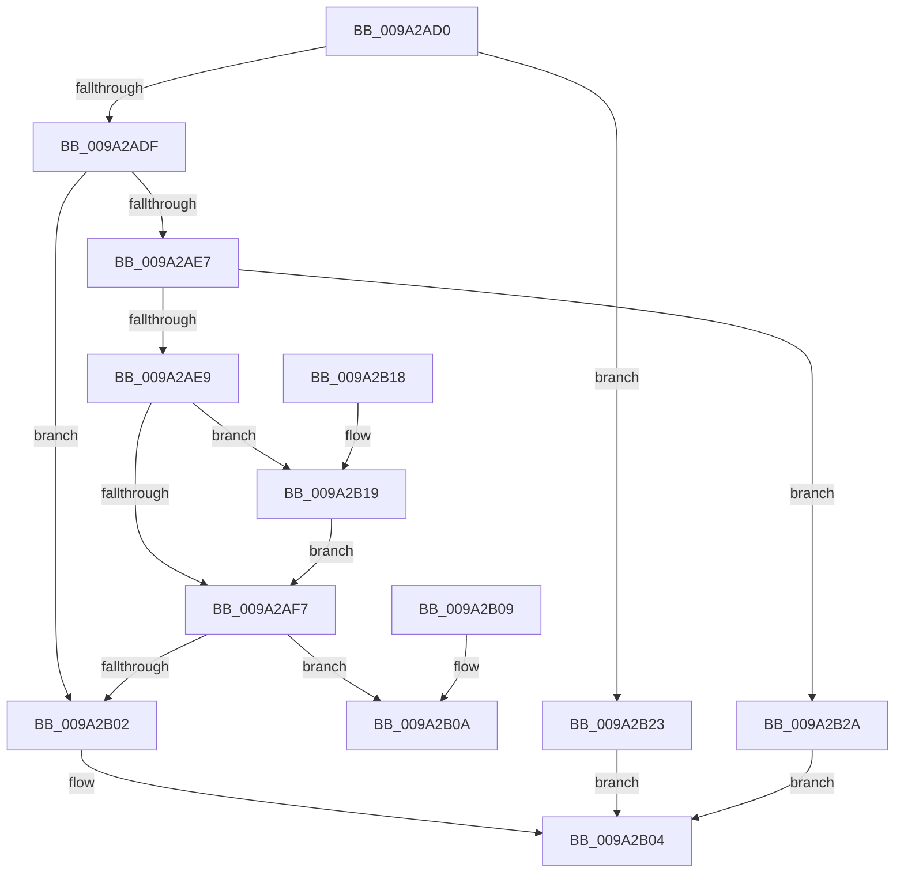

# PiDmCompareObjects

- RVA: `0x009A2AD0`–`0x009A2B31` (길이 `97` bytes)
- VA: `0x00000001409A2AD0`
- 실행 섹션: `PAGE`
- PDB 이름 있음: `예`; PDB Function 태그: `아니요`
- unwind 정보 RVA: `0x0009BA94`
- 디코드: `35`개 명령, `97/97` bytes 표시
- 미해석 바이트: `0` (있으면 어셈블리에 `.byte`로 보존)

> 이 문서는 커널 이미지의 기계어와 PDB 기호를 분석해 생성했습니다. 4번과 5번은 함수 원형과 자료형을 바이너리 사용 방식에서 추정한 C 해석이며 원본 소스 복구 결과는 아닙니다.

## 1. Dependencies

- 직접 호출 지점: **1**; 고유 호출 대상: **1**
- 직접 호출자로 확인된 함수: **5**
- RIP 상대 이미지 참조: **0**

### Outgoing calls
- `0x009A2AF7` → [wcsicmp](../../text/50/wcsicmp_function_00500080.md) (function, `0x00500080`)

### Direct callers
- [sub_003E5C2C](../../text/3E/Unknown_function_003E5C2C.md) at `0x003E5C73`
- [RtlInsertElementGenericTableAvl](../../text/3E/RtlInsertElementGenericTableAvl_function_003EE510.md) at `0x003EE564`
- [RtlDeleteElementGenericTableAvl](../../text/3E/RtlDeleteElementGenericTableAvl_function_003EE750.md) at `0x003EE7A3`
- [RtlLookupElementGenericTableFullAvl](../../text/3E/RtlLookupElementGenericTableFullAvl_function_003EF460.md) at `0x003EF4C3`
- [sub_003FEFD3](../../text/3F/Unknown_function_003FEFD3.md) at `0x003FF013`

### Static image references
- 디코드된 RIP-relative 메모리 참조가 없습니다.

## 2. Other-region calls and transfers

- 다른 실행 섹션으로 향하는 call: **1**
  - `0x009A2AF7` → [wcsicmp](../../text/50/wcsicmp_function_00500080.md) (`PAGE` → `.text`)
- 별도 외부 분기/꼬리 이동을 확인하지 못했습니다.

## 3. Assembly (complete function range)

```asm
009A2AD0  48 83 EC 28                     sub rsp, 0x28
009A2AD4  48 8B 02                        mov rax, qword ptr [rdx]
009A2AD7  49 8B 08                        mov rcx, qword ptr [r8]
009A2ADA  48 3B C1                        cmp rax, rcx
009A2ADD  74 44                           je 0x1409a2b23
009A2ADF  8B 50 18                        mov edx, dword ptr [rax + 0x18]
009A2AE2  3B 51 18                        cmp edx, dword ptr [rcx + 0x18]
009A2AE5  72 1B                           jb 0x1409a2b02
009A2AE7  77 41                           ja 0x1409a2b2a
009A2AE9  83 78 1C 03                     cmp dword ptr [rax + 0x1c], 3
009A2AED  48 8B 51 10                     mov rdx, qword ptr [rcx + 0x10]
009A2AF1  48 8B 48 10                     mov rcx, qword ptr [rax + 0x10]
009A2AF5  74 22                           je 0x1409a2b19
009A2AF7  E8 84 D5 B5 FF                  call 0x140500080
009A2AFC  8B C8                           mov ecx, eax
009A2AFE  85 C0                           test eax, eax
009A2B00  79 08                           jns 0x1409a2b0a
009A2B02  33 C0                           xor eax, eax
009A2B04  48 83 C4 28                     add rsp, 0x28
009A2B08  C3                              ret
009A2B09  CC                              int3
009A2B0A  33 C0                           xor eax, eax
009A2B0C  85 C9                           test ecx, ecx
009A2B0E  0F 9E C0                        setle al
009A2B11  FF C0                           inc eax
009A2B13  48 83 C4 28                     add rsp, 0x28
009A2B17  C3                              ret
009A2B18  CC                              int3
009A2B19  48 83 C1 08                     add rcx, 8
009A2B1D  48 83 C2 08                     add rdx, 8
009A2B21  EB D4                           jmp 0x1409a2af7
009A2B23  B8 02 00 00 00                  mov eax, 2
009A2B28  EB DA                           jmp 0x1409a2b04
009A2B2A  B8 01 00 00 00                  mov eax, 1
009A2B2F  EB D3                           jmp 0x1409a2b04
```

## 4. C-style interpretation (structured pseudocode)

```c
__int64 __fastcall PiDmCompareObjects(__int64 a1, __int64 a2, __int64 a3)
{
    __int64 result;
    __int64 v_rsp;

    v_rsp = (v_rsp) - (40);
    if ((*(unsigned __int64 *)(a2)) == (*(unsigned __int64 *)(a3))) goto loc_009A2B23;
    if (((unsigned int)((unsigned int)(*(unsigned int *)(*(unsigned __int64 *)(a2) + 24)))) < (*(unsigned int *)(*(unsigned __int64 *)(a3) + 24))) goto loc_009A2B02;
    if (((unsigned int)((unsigned int)(*(unsigned int *)(*(unsigned __int64 *)(a2) + 24)))) > (*(unsigned int *)(*(unsigned __int64 *)(a3) + 24))) goto loc_009A2B2A;
    if ((*(unsigned int *)(*(unsigned __int64 *)(a2) + 28)) == 3) goto loc_009A2B19;
loc_009A2AF7:
    result = wcsicmp(*(unsigned __int64 *)(*(unsigned __int64 *)(a2) + 16), *(unsigned __int64 *)(*(unsigned __int64 *)(a3) + 16), a3, a4);
    if (!sign_flag) goto loc_009A2B0A;
loc_009A2B02:
    result = 0;
loc_009A2B04:
    v_rsp = (v_rsp) + (40);
    return result;
loc_009A2B0A:
    result = 0;
    result = (condition_is_less_or_equal) ? 1 : 0;
    result = (unsigned int)((result) + 1);
    v_rsp = (v_rsp) + (40);
    return result;
loc_009A2B19:
    a1 = ((unsigned int)((unsigned int)(result))) + (8);
    a2 = (*(unsigned __int64 *)(*(unsigned __int64 *)(a3) + 16)) + (8);
    goto loc_009A2AF7;
loc_009A2B23:
    goto loc_009A2B04;
loc_009A2B2A:
    goto loc_009A2B04;
}
```

## 5. (Beta) C Style

```c
int64_t PiDmCompareObjects(int64_t Arg1, void *Arg2, void *Arg3)
{
    uint8_t *arg2 = (uint8_t *)Arg2;
    uint8_t *arg3 = (uint8_t *)Arg3;

    int64_t result;
    int64_t local_rsp;

    local_rsp = (local_rsp) - (40);
    if ((*(uint64_t *)(arg2)) == (*(uint64_t *)(arg3))) goto loc_009A2B23;
    if (((uint32_t)((uint32_t)(*(uint32_t *)(*(uint64_t *)(arg2) + 0x18)))) < (*(uint32_t *)(*(uint64_t *)(arg3) + 0x18))) goto loc_009A2B02;
    if (((uint32_t)((uint32_t)(*(uint32_t *)(*(uint64_t *)(arg2) + 0x18)))) > (*(uint32_t *)(*(uint64_t *)(arg3) + 0x18))) goto loc_009A2B2A;
    if ((*(uint32_t *)(*(uint64_t *)(arg2) + 0x1C)) == 3) goto loc_009A2B19;
loc_009A2AF7:
    result = wcsicmp(*(uint64_t *)(*(uint64_t *)(arg2) + 0x10), *(uint64_t *)(*(uint64_t *)(arg3) + 0x10), Arg3, a4);
    if (!sign_flag) goto loc_009A2B0A;
loc_009A2B02:
    result = 0;
loc_009A2B04:
    local_rsp = (local_rsp) + (40);
    return result;
loc_009A2B0A:
    result = 0;
    result = (condition_is_less_or_equal) ? 1 : 0;
    result = (uint32_t)((result) + 1);
    local_rsp = (local_rsp) + (40);
    return result;
loc_009A2B19:
    Arg1 = ((uint32_t)((uint32_t)(result))) + (8);
    Arg2 = (*(uint64_t *)(*(uint64_t *)(arg3) + 0x10)) + (8);
    goto loc_009A2AF7;
loc_009A2B23:
    goto loc_009A2B04;
loc_009A2B2A:
    goto loc_009A2B04;
}
```

### 관측된 메모리 오프셋

구조체 형식이 확인되지 않은 접근은 인자 기준의 오프셋으로만 기록했습니다.

| 기준 인자 | 오프셋 표현 | 폭 (bit) | 접근 |
|---|---:|---:|---|
| `Arg2` | `+ 0x0` | `64` | `R` |
| `Arg3` | `+ 0x0` | `64` | `R` |

## 6. Execution-region graph

[열기: 2D/3D 그래프와 함수 탐색 컨트롤 패널](../../../control-panel.html?section=page&rva=0x009A2AD0&view=graph)

- 2D 그래프는 위에서 아래로 흐르고, 3D 그래프는 빈 공간을 드래그해 회전합니다. Shift+드래그는 이동, 휠은 확대·축소, 함수 노드 선택은 대상 보고서 이동입니다.

### Static fallback


