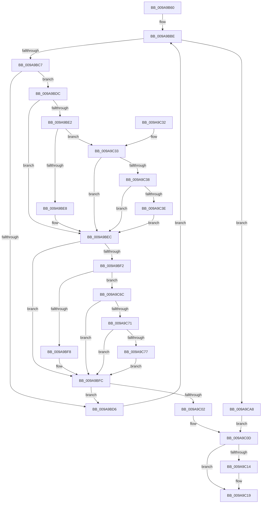

# PnpCompareInstancePath

- RVA: `0x009A9B60`–`0x009A9CB0` (길이 `336` bytes)
- VA: `0x00000001409A9B60`
- 실행 섹션: `PAGE`
- PDB 이름 있음: `예`; PDB Function 태그: `아니요`
- unwind 정보 RVA: `0x00096A74`
- 디코드: `97`개 명령, `336/336` bytes 표시
- 미해석 바이트: `0` (있으면 어셈블리에 `.byte`로 보존)

> 이 문서는 커널 이미지의 기계어와 PDB 기호를 분석해 생성했습니다. 4번과 5번은 함수 원형과 자료형을 바이너리 사용 방식에서 추정한 C 해석이며 원본 소스 복구 결과는 아닙니다.

## 1. Dependencies

- 직접 호출 지점: **1**; 고유 호출 대상: **1**
- 직접 호출자로 확인된 함수: **5**
- RIP 상대 이미지 참조: **0**

### Outgoing calls
- `0x009A9B95` → [PsGetCurrentServerSiloGlobals](../../text/2F/PsGetCurrentServerSiloGlobals_function_002FE1F0.md) (function, `0x002FE1F0`)

### Direct callers
- [sub_003E5C2C](../../text/3E/Unknown_function_003E5C2C.md) at `0x003E5CA2`
- [RtlInsertElementGenericTableAvl](../../text/3E/RtlInsertElementGenericTableAvl_function_003EE510.md) at `0x003EE5AC`
- [RtlDeleteElementGenericTableAvl](../../text/3E/RtlDeleteElementGenericTableAvl_function_003EE750.md) at `0x003EE7D0`
- [RtlLookupElementGenericTableFullAvl](../../text/3E/RtlLookupElementGenericTableFullAvl_function_003EF460.md) at `0x003EF4F2`
- [sub_003FEFD3](../../text/3F/Unknown_function_003FEFD3.md) at `0x003FF042`

### Static image references
- 디코드된 RIP-relative 메모리 참조가 없습니다.

## 2. Other-region calls and transfers

- 다른 실행 섹션으로 향하는 call: **1**
  - `0x009A9B95` → [PsGetCurrentServerSiloGlobals](../../text/2F/PsGetCurrentServerSiloGlobals_function_002FE1F0.md) (`PAGE` → `.text`)
- 별도 외부 분기/꼬리 이동을 확인하지 못했습니다.

## 3. Assembly (complete function range)

```asm
009A9B60  48 89 5C 24 08                  mov qword ptr [rsp + 8], rbx
009A9B65  48 89 6C 24 10                  mov qword ptr [rsp + 0x10], rbp
009A9B6A  48 89 74 24 18                  mov qword ptr [rsp + 0x18], rsi
009A9B6F  57                              push rdi
009A9B70  41 56                           push r14
009A9B72  41 57                           push r15
009A9B74  48 83 EC 20                     sub rsp, 0x20
009A9B78  48 8B 52 08                     mov rdx, qword ptr [rdx + 8]
009A9B7C  49 8B 40 08                     mov rax, qword ptr [r8 + 8]
009A9B80  44 0F B7 1A                     movzx r11d, word ptr [rdx]
009A9B84  0F B7 30                        movzx esi, word ptr [rax]
009A9B87  48 8B 58 08                     mov rbx, qword ptr [rax + 8]
009A9B8B  48 8B 52 08                     mov rdx, qword ptr [rdx + 8]
009A9B8F  48 D1 EE                        shr rsi, 1
009A9B92  49 D1 EB                        shr r11, 1
009A9B95  E8 56 46 95 FF                  call 0x1402fe1f0
009A9B9A  4C 3B DE                        cmp r11, rsi
009A9B9D  41 BE E0 FF 00 00               mov r14d, 0xffe0
009A9BA3  41 BF C0 00 00 00               mov r15d, 0xc0
009A9BA9  48 8B A8 B0 04 00 00            mov rbp, qword ptr [rax + 0x4b0]
009A9BB0  49 8B C3                        mov rax, r11
009A9BB3  48 0F 47 C6                     cmova rax, rsi
009A9BB7  48 2B DA                        sub rbx, rdx
009A9BBA  48 8D 3C 42                     lea rdi, [rdx + rax*2]
009A9BBE  48 3B D7                        cmp rdx, rdi
009A9BC1  0F 83 E1 00 00 00               jae 0x1409a9ca8
009A9BC7  44 0F B7 0A                     movzx r9d, word ptr [rdx]
009A9BCB  44 0F B7 14 13                  movzx r10d, word ptr [rbx + rdx]
009A9BD0  66 45 3B CA                     cmp r9w, r10w
009A9BD4  75 06                           jne 0x1409a9bdc
009A9BD6  48 83 C2 02                     add rdx, 2
009A9BDA  EB E2                           jmp 0x1409a9bbe
009A9BDC  41 83 F9 61                     cmp r9d, 0x61
009A9BE0  72 0A                           jb 0x1409a9bec
009A9BE2  41 83 F9 7A                     cmp r9d, 0x7a
009A9BE6  77 4B                           ja 0x1409a9c33
009A9BE8  66 45 03 CE                     add r9w, r14w
009A9BEC  41 83 FA 61                     cmp r10d, 0x61
009A9BF0  72 0A                           jb 0x1409a9bfc
009A9BF2  41 83 FA 7A                     cmp r10d, 0x7a
009A9BF6  77 74                           ja 0x1409a9c6c
009A9BF8  66 45 03 D6                     add r10w, r14w
009A9BFC  66 45 3B CA                     cmp r9w, r10w
009A9C00  74 D4                           je 0x1409a9bd6
009A9C02  41 0F B7 C2                     movzx eax, r10w
009A9C06  45 0F B7 D9                     movzx r11d, r9w
009A9C0A  44 2B D8                        sub r11d, eax
009A9C0D  33 C0                           xor eax, eax
009A9C0F  45 85 DB                        test r11d, r11d
009A9C12  78 05                           js 0x1409a9c19
009A9C14  0F 9E C0                        setle al
009A9C17  FF C0                           inc eax
009A9C19  48 8B 5C 24 40                  mov rbx, qword ptr [rsp + 0x40]
009A9C1E  48 8B 6C 24 48                  mov rbp, qword ptr [rsp + 0x48]
009A9C23  48 8B 74 24 50                  mov rsi, qword ptr [rsp + 0x50]
009A9C28  48 83 C4 20                     add rsp, 0x20
009A9C2C  41 5F                           pop r15
009A9C2E  41 5E                           pop r14
009A9C30  5F                              pop rdi
009A9C31  C3                              ret
009A9C32  CC                              int3
009A9C33  48 85 ED                        test rbp, rbp
009A9C36  74 B4                           je 0x1409a9bec
009A9C38  66 45 3B CF                     cmp r9w, r15w
009A9C3C  72 AE                           jb 0x1409a9bec
009A9C3E  49 8B C1                        mov rax, r9
009A9C41  45 8B C1                        mov r8d, r9d
009A9C44  48 C1 E8 08                     shr rax, 8
009A9C48  41 83 E0 0F                     and r8d, 0xf
009A9C4C  0F B7 4C 45 00                  movzx ecx, word ptr [rbp + rax*2]
009A9C51  41 8B C1                        mov eax, r9d
009A9C54  C1 E8 04                        shr eax, 4
009A9C57  83 E0 0F                        and eax, 0xf
009A9C5A  03 C8                           add ecx, eax
009A9C5C  0F B7 4C 4D 00                  movzx ecx, word ptr [rbp + rcx*2]
009A9C61  41 03 C8                        add ecx, r8d
009A9C64  66 44 03 4C 4D 00               add r9w, word ptr [rbp + rcx*2]
009A9C6A  EB 80                           jmp 0x1409a9bec
009A9C6C  48 85 ED                        test rbp, rbp
009A9C6F  74 8B                           je 0x1409a9bfc
009A9C71  66 45 3B D7                     cmp r10w, r15w
009A9C75  72 85                           jb 0x1409a9bfc
009A9C77  49 8B C2                        mov rax, r10
009A9C7A  45 8B C2                        mov r8d, r10d
009A9C7D  48 C1 E8 08                     shr rax, 8
009A9C81  41 83 E0 0F                     and r8d, 0xf
009A9C85  0F B7 4C 45 00                  movzx ecx, word ptr [rbp + rax*2]
009A9C8A  41 8B C2                        mov eax, r10d
009A9C8D  C1 E8 04                        shr eax, 4
009A9C90  83 E0 0F                        and eax, 0xf
009A9C93  03 C8                           add ecx, eax
009A9C95  0F B7 4C 4D 00                  movzx ecx, word ptr [rbp + rcx*2]
009A9C9A  41 03 C8                        add ecx, r8d
009A9C9D  66 44 03 54 4D 00               add r10w, word ptr [rbp + rcx*2]
009A9CA3  E9 54 FF FF FF                  jmp 0x1409a9bfc
009A9CA8  44 2B DE                        sub r11d, esi
009A9CAB  E9 5D FF FF FF                  jmp 0x1409a9c0d
```

## 4. C-style interpretation (structured pseudocode)

```c
__int64 __fastcall PnpCompareInstancePath(__int64 a1, __int64 a2, __int64 a3)
{
    __int64 result;
    __int64 v_r10;
    __int64 v_r11;
    __int64 v_rbx;
    __int64 v_rsi;
    __int64 v_rsp;
    unsigned __int64 v_stack_p10;
    unsigned __int64 v_stack_p18;
    unsigned __int64 v_stack_p8;

    v_stack_p8 = v_rbx;
    v_stack_p10 = v_rbp;
    v_stack_p18 = v_rsi;
    v_rsp = (v_rsp) - (32);
    v_rsi = (*(unsigned __int16 *)(*(unsigned __int64 *)(a3 + 8))) >> (1);
    v_r11 = (*(unsigned __int16 *)(*(unsigned __int64 *)(a2 + 8))) >> (1);
    result = PsGetCurrentServerSiloGlobals(a1, *(unsigned __int64 *)(*(unsigned __int64 *)(a2 + 8) + 8), a3, a4);
    result = v_r11;
    if (v_r11 > v_rsi) { result = v_rsi; }
    v_rbx = (*(unsigned __int64 *)(*(unsigned __int64 *)(a3 + 8) + 8)) - (*(unsigned __int64 *)(*(unsigned __int64 *)(a2 + 8) + 8));
loc_009A9BBE:
    if ((*(unsigned __int64 *)(*(unsigned __int64 *)(a2 + 8) + 8)) >= (*(unsigned __int64 *)(*(unsigned __int64 *)(a2 + 8) + 8) + result * 2)) goto loc_009A9CA8;
    if (((unsigned __int16)(*(unsigned __int16 *)(*(unsigned __int64 *)(*(unsigned __int64 *)(a2 + 8) + 8)))) != ((unsigned __int16)(*(unsigned __int16 *)(v_rbx + *(unsigned __int64 *)(*(unsigned __int64 *)(a2 + 8) + 8) * 1)))) goto loc_009A9BDC;
loc_009A9BD6:
    a2 = (*(unsigned __int64 *)(*(unsigned __int64 *)(a2 + 8) + 8)) + (2);
    goto loc_009A9BBE;
loc_009A9BDC:
    if (((unsigned int)(*(unsigned __int16 *)(*(unsigned __int64 *)(*(unsigned __int64 *)(a2 + 8) + 8)))) < 97) goto loc_009A9BEC;
    if (((unsigned int)(*(unsigned __int16 *)(*(unsigned __int64 *)(*(unsigned __int64 *)(a2 + 8) + 8)))) > 122) goto loc_009A9C33;
    a4 = (unsigned __int16)((*(unsigned __int16 *)(*(unsigned __int64 *)(*(unsigned __int64 *)(a2 + 8) + 8))) + ((unsigned __int16)((unsigned int)(0xFFE0ULL))));
loc_009A9BEC:
    if (((unsigned int)(*(unsigned __int16 *)(v_rbx + *(unsigned __int64 *)(*(unsigned __int64 *)(a2 + 8) + 8) * 1))) < 97) goto loc_009A9BFC;
    if (((unsigned int)(*(unsigned __int16 *)(v_rbx + *(unsigned __int64 *)(*(unsigned __int64 *)(a2 + 8) + 8) * 1))) > 122) goto loc_009A9C6C;
    v_r10 = (unsigned __int16)((*(unsigned __int16 *)(v_rbx + *(unsigned __int64 *)(*(unsigned __int64 *)(a2 + 8) + 8) * 1)) + ((unsigned __int16)((unsigned int)(0xFFE0ULL))));
loc_009A9BFC:
    if (((unsigned __int16)(a4)) == ((unsigned __int16)(v_r10))) goto loc_009A9BD6;
    v_r11 = (unsigned int)(((unsigned __int16)(a4)) - ((unsigned int)((unsigned __int16)(v_r10))));
loc_009A9C0D:
    result = 0;
    if (!(sign_flag)) {
        result = (condition_is_less_or_equal) ? 1 : 0;
        result = (unsigned int)((result) + 1);
    }
    v_rsp = (v_rsp) + (32);
    return result;
loc_009A9C33:
    if (v_stack_p10 == 0) goto loc_009A9BEC;
    if (((unsigned __int16)(a4)) < 192) goto loc_009A9BEC;
    result = (a4) >> (8);
    a3 = (unsigned int)(((unsigned int)((unsigned int)(a4))) & (15));
    result = (unsigned int)(((unsigned int)((unsigned int)(a4))) >> (4));
    result = (unsigned int)((result) & (15));
    a1 = (unsigned int)((*(unsigned __int16 *)(v_stack_p10 + result * 2)) + ((unsigned int)(result)));
    a1 = (unsigned int)((*(unsigned __int16 *)(v_stack_p10 + a1 * 2)) + ((unsigned int)(a3)));
    a4 = (unsigned __int16)((a4) + (*(unsigned __int16 *)(v_stack_p10 + a1 * 2)));
    goto loc_009A9BEC;
loc_009A9C6C:
    if (v_stack_p10 == 0) goto loc_009A9BFC;
    if (((unsigned __int16)(v_r10)) < 192) goto loc_009A9BFC;
    result = (v_r10) >> (8);
    a3 = (unsigned int)(((unsigned int)((unsigned int)(v_r10))) & (15));
    result = (unsigned int)(((unsigned int)((unsigned int)(v_r10))) >> (4));
    result = (unsigned int)((result) & (15));
    a1 = (unsigned int)((*(unsigned __int16 *)(v_stack_p10 + result * 2)) + ((unsigned int)(result)));
    a1 = (unsigned int)((*(unsigned __int16 *)(v_stack_p10 + a1 * 2)) + ((unsigned int)(a3)));
    v_r10 = (unsigned __int16)((v_r10) + (*(unsigned __int16 *)(v_stack_p10 + a1 * 2)));
    goto loc_009A9BFC;
loc_009A9CA8:
    v_r11 = (unsigned int)((v_r11) - ((unsigned int)(v_stack_p18)));
    goto loc_009A9C0D;
}
```

## 5. (Beta) C Style

```c
int64_t PnpCompareInstancePath(int64_t Arg1, void *Arg2, void *Arg3)
{
    uint8_t *arg2 = (uint8_t *)Arg2;
    uint8_t *arg3 = (uint8_t *)Arg3;

    int64_t result;
    int64_t local_r10;
    int64_t local_r11;
    int64_t local_rbx;
    int64_t local_rsi;
    int64_t local_rsp;
    uint64_t v_stack_p10;
    uint64_t v_stack_p18;
    uint64_t v_stack_p8;

    v_stack_p8 = local_rbx;
    v_stack_p10 = local_rbp;
    v_stack_p18 = local_rsi;
    local_rsp = (local_rsp) - (32);
    local_rsi = (*(uint16_t *)(*(uint64_t *)(arg3 + 0x8))) >> (1);
    local_r11 = (*(uint16_t *)(*(uint64_t *)(arg2 + 0x8))) >> (1);
    result = PsGetCurrentServerSiloGlobals(Arg1, *(uint64_t *)(*(uint64_t *)(arg2 + 0x8) + 0x8), Arg3, a4);
    result = local_r11;
    if (local_r11 > local_rsi) { result = local_rsi; }
    local_rbx = (*(uint64_t *)(*(uint64_t *)(arg3 + 0x8) + 0x8)) - (*(uint64_t *)(*(uint64_t *)(arg2 + 0x8) + 0x8));
loc_009A9BBE:
    if ((*(uint64_t *)(*(uint64_t *)(arg2 + 0x8) + 0x8)) >= (*(uint64_t *)(*(uint64_t *)(arg2 + 0x8) + 0x8) + result * 2)) goto loc_009A9CA8;
    if (((uint16_t)(*(uint16_t *)(*(uint64_t *)(*(uint64_t *)(arg2 + 0x8) + 0x8)))) != ((uint16_t)(*(uint16_t *)(local_rbx + *(uint64_t *)(*(uint64_t *)(arg2 + 0x8) + 0x8) * 1)))) goto loc_009A9BDC;
loc_009A9BD6:
    Arg2 = (*(uint64_t *)(*(uint64_t *)(arg2 + 0x8) + 0x8)) + (2);
    goto loc_009A9BBE;
loc_009A9BDC:
    if (((uint32_t)(*(uint16_t *)(*(uint64_t *)(*(uint64_t *)(arg2 + 0x8) + 0x8)))) < 97) goto loc_009A9BEC;
    if (((uint32_t)(*(uint16_t *)(*(uint64_t *)(*(uint64_t *)(arg2 + 0x8) + 0x8)))) > 122) goto loc_009A9C33;
    a4 = (uint16_t)((*(uint16_t *)(*(uint64_t *)(*(uint64_t *)(arg2 + 0x8) + 0x8))) + ((uint16_t)((uint32_t)(0xFFE0ULL))));
loc_009A9BEC:
    if (((uint32_t)(*(uint16_t *)(local_rbx + *(uint64_t *)(*(uint64_t *)(arg2 + 0x8) + 0x8) * 1))) < 97) goto loc_009A9BFC;
    if (((uint32_t)(*(uint16_t *)(local_rbx + *(uint64_t *)(*(uint64_t *)(arg2 + 0x8) + 0x8) * 1))) > 122) goto loc_009A9C6C;
    local_r10 = (uint16_t)((*(uint16_t *)(local_rbx + *(uint64_t *)(*(uint64_t *)(arg2 + 0x8) + 0x8) * 1)) + ((uint16_t)((uint32_t)(0xFFE0ULL))));
loc_009A9BFC:
    if (((uint16_t)(a4)) == ((uint16_t)(local_r10))) goto loc_009A9BD6;
    local_r11 = (uint32_t)(((uint16_t)(a4)) - ((uint32_t)((uint16_t)(local_r10))));
loc_009A9C0D:
    result = 0;
    if (!(sign_flag)) {
        result = (condition_is_less_or_equal) ? 1 : 0;
        result = (uint32_t)((result) + 1);
    }
    local_rsp = (local_rsp) + (32);
    return result;
loc_009A9C33:
    if (v_stack_p10 == 0) goto loc_009A9BEC;
    if (((uint16_t)(a4)) < 192) goto loc_009A9BEC;
    result = (a4) >> (8);
    Arg3 = (uint32_t)(((uint32_t)((uint32_t)(a4))) & (15));
    result = (uint32_t)(((uint32_t)((uint32_t)(a4))) >> (4));
    result = (uint32_t)((result) & (15));
    Arg1 = (uint32_t)((*(uint16_t *)(v_stack_p10 + result * 2)) + ((uint32_t)(result)));
    Arg1 = (uint32_t)((*(uint16_t *)(v_stack_p10 + Arg1 * 2)) + ((uint32_t)(Arg3)));
    a4 = (uint16_t)((a4) + (*(uint16_t *)(v_stack_p10 + Arg1 * 2)));
    goto loc_009A9BEC;
loc_009A9C6C:
    if (v_stack_p10 == 0) goto loc_009A9BFC;
    if (((uint16_t)(local_r10)) < 192) goto loc_009A9BFC;
    result = (local_r10) >> (8);
    Arg3 = (uint32_t)(((uint32_t)((uint32_t)(local_r10))) & (15));
    result = (uint32_t)(((uint32_t)((uint32_t)(local_r10))) >> (4));
    result = (uint32_t)((result) & (15));
    Arg1 = (uint32_t)((*(uint16_t *)(v_stack_p10 + result * 2)) + ((uint32_t)(result)));
    Arg1 = (uint32_t)((*(uint16_t *)(v_stack_p10 + Arg1 * 2)) + ((uint32_t)(Arg3)));
    local_r10 = (uint16_t)((local_r10) + (*(uint16_t *)(v_stack_p10 + Arg1 * 2)));
    goto loc_009A9BFC;
loc_009A9CA8:
    local_r11 = (uint32_t)((local_r11) - ((uint32_t)(v_stack_p18)));
    goto loc_009A9C0D;
}
```

### 관측된 메모리 오프셋

구조체 형식이 확인되지 않은 접근은 인자 기준의 오프셋으로만 기록했습니다.

| 기준 인자 | 오프셋 표현 | 폭 (bit) | 접근 |
|---|---:|---:|---|
| `Arg2` | `+ 0x8` | `64` | `R` |
| `Arg3` | `+ 0x8` | `64` | `R` |

## 6. Execution-region graph

[열기: 2D/3D 그래프와 함수 탐색 컨트롤 패널](../../../control-panel.html?section=page&rva=0x009A9B60&view=graph)

- 2D 그래프는 위에서 아래로 흐르고, 3D 그래프는 빈 공간을 드래그해 회전합니다. Shift+드래그는 이동, 휠은 확대·축소, 함수 노드 선택은 대상 보고서 이동입니다.

### Static fallback


