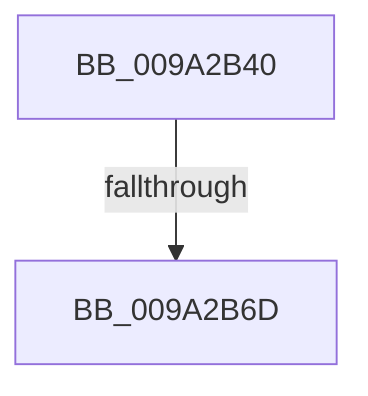

# PsReferenceEffectiveToken

- RVA: `0x009A2B40`–`0x009A2B7F` (길이 `63` bytes)
- VA: `0x00000001409A2B40`
- 실행 섹션: `PAGE`
- PDB 이름 있음: `예`; PDB Function 태그: `아니요`
- unwind 정보 RVA: `0x0009BE9C`
- 디코드: `17`개 명령, `63/63` bytes 표시
- 미해석 바이트: `0` (있으면 어셈블리에 `.byte`로 보존)

> 이 문서는 커널 이미지의 기계어와 PDB 기호를 분석해 생성했습니다. 4번과 5번은 함수 원형과 자료형을 바이너리 사용 방식에서 추정한 C 해석이며 원본 소스 복구 결과는 아닙니다.

## 1. Dependencies

- 직접 호출 지점: **0**; 고유 호출 대상: **0**
- 직접 호출자로 확인된 함수: **11**
- RIP 상대 이미지 참조: **0**

### Outgoing calls
- 직접 디코드된 call 명령이 없습니다.

### Direct callers
- [SepReferenceTokenByHandle](../../text/3E/SepReferenceTokenByHandle_function_003EDAD0.md) at `0x003EDB6E`
- [RtlpQueryLowBoxId](../../text/43/RtlpQueryLowBoxId_function_00438A50.md) at `0x00438A8D`
- [RtlpAllowsLowBoxAccess](../../text/43/RtlpAllowsLowBoxAccess_function_00438B9C.md) at `0x00438C43`
- [SeLogAccessFailure](../../text/44/SeLogAccessFailure_function_00448550.md) at `0x0044867B`
- [SepDesktopAppxSubProcessToken](../../text/45/SepDesktopAppxSubProcessToken_function_0045BD90.md) at `0x0045C12F`
- [SeSetLearningModeObjectInformation](../../text/4C/SeSetLearningModeObjectInformation_function_004C7098.md) at `0x004C70EF`
- [SeCaptureAtomTableCallout](../../text/4E/SeCaptureAtomTableCallout_function_004E9BD0.md) at `0x004E9C0F`
- [SepCreateAppContainerToken](../../text/4F/SepCreateAppContainerToken_function_004F43AC.md) at `0x004F44DF`
- [sub_006F1F12](../../text/6F/Unknown_function_006F1F12.md) at `0x006F1F39`
- [PsConvertToGuiThread](../A2/PsConvertToGuiThread_function_00A2F8B0.md) at `0x00A2F9A0`
- [SeSubProcessToken](../AA/SeSubProcessToken_function_00AAD570.md) at `0x00AAD6E2`

### Static image references
- 디코드된 RIP-relative 메모리 참조가 없습니다.

## 2. Other-region calls and transfers

- 다른 실행 섹션으로 향하는 call: **0**
- call이 아닌 외부 분기/꼬리 이동: **1**
  - `0x009A2B67` → [sub_009A2C5D](Unknown_function_009A2C5D.md) (`tail-transfer`)

## 3. Assembly (complete function range)

```asm
009A2B40  48 89 5C 24 20                  mov qword ptr [rsp + 0x20], rbx
009A2B45  55                              push rbp
009A2B46  56                              push rsi
009A2B47  57                              push rdi
009A2B48  41 56                           push r14
009A2B4A  41 57                           push r15
009A2B4C  48 83 EC 20                     sub rsp, 0x20
009A2B50  65 48 8B 34 25 88 01 00 00      mov rsi, qword ptr gs:[0x188]
009A2B59  4D 8B F1                        mov r14, r9
009A2B5C  4D 8B F8                        mov r15, r8
009A2B5F  8B EA                           mov ebp, edx
009A2B61  48 8B D9                        mov rbx, rcx
009A2B64  48 3B CE                        cmp rcx, rsi
009A2B67  0F 85 F0 00 00 00               jne 0x1409a2c5d
009A2B6D  48 8B B6 B8 00 00 00            mov rsi, qword ptr [rsi + 0xb8]
009A2B74  8B 81 A0 05 00 00               mov eax, dword ptr [rcx + 0x5a0]
009A2B7A  48 8B 7C 24 78                  mov rdi, qword ptr [rsp + 0x78]
```

## 4. C-style interpretation (structured pseudocode)

```c
__int64 __fastcall PsReferenceEffectiveToken(__int64 a1, int a2, __int64 a3, __int64 a4, __int64 a5, __int64 a6)
{
    __int64 v_rsp;
    unsigned __int64 v_stack_p20;

    v_stack_p20 = v_rbx;
    v_rsp = (v_rsp) - (32);
    return (unsigned int)(*(unsigned int *)(a1 + 1440));
}
```

## 5. (Beta) C Style

```c
int64_t PsReferenceEffectiveToken(int64_t Arg1, int32_t Arg2, int64_t Arg3, int64_t Arg4, uint64_t Arg5, int64_t Arg6)
{
    int64_t local_rsp;
    uint64_t v_stack_p20;

    v_stack_p20 = local_rbx;
    local_rsp = (local_rsp) - (32);
    return (uint32_t)(*(uint32_t *)(Arg1 + 0x5A0));
}
```

## 6. Execution-region graph

[열기: 2D/3D 그래프와 함수 탐색 컨트롤 패널](../../../control-panel.html?section=page&rva=0x009A2B40&view=graph)

- 2D 그래프는 위에서 아래로 흐르고, 3D 그래프는 빈 공간을 드래그해 회전합니다. Shift+드래그는 이동, 휠은 확대·축소, 함수 노드 선택은 대상 보고서 이동입니다.

### Static fallback


