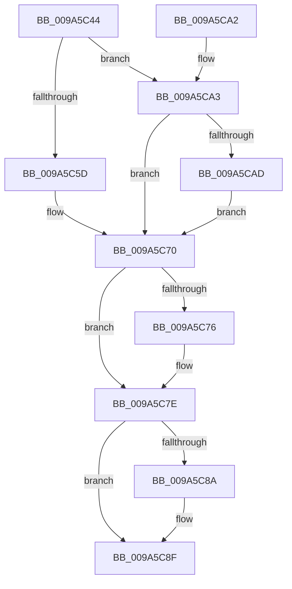

# RawCleanupVcb

- RVA: `0x009A5C44`–`0x009A5CC5` (길이 `129` bytes)
- VA: `0x00000001409A5C44`
- 실행 섹션: `PAGE`
- PDB 이름 있음: `예`; PDB Function 태그: `아니요`
- unwind 정보 RVA: `0x000687A0`
- 디코드: `35`개 명령, `129/129` bytes 표시
- 미해석 바이트: `0` (있으면 어셈블리에 `.byte`로 보존)

> 이 문서는 커널 이미지의 기계어와 PDB 기호를 분석해 생성했습니다. 4번과 5번은 함수 원형과 자료형을 바이너리 사용 방식에서 추정한 C 해석이며 원본 소스 복구 결과는 아닙니다.

## 1. Dependencies

- 직접 호출 지점: **4**; 고유 호출 대상: **3**
- 직접 호출자로 확인된 함수: **3**
- RIP 상대 이미지 참조: **0**

### Outgoing calls
- `0x009A5C5F` → [ExFreePoolWithTag](../../poolcode/B8/ExFreePoolWithTag_function_00B82870.md) (function, `0x00B82870`)
- `0x009A5C79` → [FsRtlTeardownPerStreamContexts](FsRtlTeardownPerStreamContexts_function_009A5CD0.md) (function, `0x009A5CD0`)
- `0x009A5C8A` → [ExFreeCacheAwareRundownProtection](../../text/48/ExFreeCacheAwareRundownProtection_function_0048FDD0.md) (function, `0x0048FDD0`)
- `0x009A5CB6` → [ExFreePoolWithTag](../../poolcode/B8/ExFreePoolWithTag_function_00B82870.md) (function, `0x00B82870`)

### Direct callers
- [RawInitiateDeleteVolume](../../text/48/RawInitiateDeleteVolume_function_0048FDFC.md) at `0x0048FF11`
- [RawCheckForDeleteVolume](../../text/4C/RawCheckForDeleteVolume_function_004C6FF4.md) at `0x004C705E`
- [RawMountVolume](RawMountVolume_function_009A4844.md) at `0x009A4A8E`

### Static image references
- 디코드된 RIP-relative 메모리 참조가 없습니다.

## 2. Other-region calls and transfers

- 다른 실행 섹션으로 향하는 call: **3**
  - `0x009A5C5F` → [ExFreePoolWithTag](../../poolcode/B8/ExFreePoolWithTag_function_00B82870.md) (`PAGE` → `POOLCODE`)
  - `0x009A5C8A` → [ExFreeCacheAwareRundownProtection](../../text/48/ExFreeCacheAwareRundownProtection_function_0048FDD0.md) (`PAGE` → `.text`)
  - `0x009A5CB6` → [ExFreePoolWithTag](../../poolcode/B8/ExFreePoolWithTag_function_00B82870.md) (`PAGE` → `POOLCODE`)
- 별도 외부 분기/꼬리 이동을 확인하지 못했습니다.

## 3. Assembly (complete function range)

```asm
009A5C44  48 89 5C 24 08                  mov qword ptr [rsp + 8], rbx
009A5C49  57                              push rdi
009A5C4A  48 83 EC 20                     sub rsp, 0x20
009A5C4E  48 8B D9                        mov rbx, rcx
009A5C51  48 8B 89 D0 00 00 00            mov rcx, qword ptr [rcx + 0xd0]
009A5C58  48 85 C9                        test rcx, rcx
009A5C5B  74 46                           je 0x1409a5ca3
009A5C5D  33 D2                           xor edx, edx
009A5C5F  E8 0C CC 1D 00                  call 0x140b82870
009A5C64  48 83 A3 D0 00 00 00 00         and qword ptr [rbx + 0xd0], 0
009A5C6C  48 8D 7B 78                     lea rdi, [rbx + 0x78]
009A5C70  8B 07                           mov eax, dword ptr [rdi]
009A5C72  A8 10                           test al, 0x10
009A5C74  74 08                           je 0x1409a5c7e
009A5C76  48 8B CB                        mov rcx, rbx
009A5C79  E8 52 00 00 00                  call 0x1409a5cd0
009A5C7E  48 8B 8B E8 00 00 00            mov rcx, qword ptr [rbx + 0xe8]
009A5C85  48 85 C9                        test rcx, rcx
009A5C88  74 05                           je 0x1409a5c8f
009A5C8A  E8 41 A1 AE FF                  call 0x14048fdd0
009A5C8F  48 83 A3 E8 00 00 00 00         and qword ptr [rbx + 0xe8], 0
009A5C97  48 8B 5C 24 30                  mov rbx, qword ptr [rsp + 0x30]
009A5C9C  48 83 C4 20                     add rsp, 0x20
009A5CA0  5F                              pop rdi
009A5CA1  C3                              ret
009A5CA2  CC                              int3
009A5CA3  48 8D 7B 78                     lea rdi, [rbx + 0x78]
009A5CA7  8B 07                           mov eax, dword ptr [rdi]
009A5CA9  A8 08                           test al, 8
009A5CAB  74 C3                           je 0x1409a5c70
009A5CAD  48 8B 8B C8 00 00 00            mov rcx, qword ptr [rbx + 0xc8]
009A5CB4  33 D2                           xor edx, edx
009A5CB6  E8 B5 CB 1D 00                  call 0x140b82870
009A5CBB  48 83 A3 C8 00 00 00 00         and qword ptr [rbx + 0xc8], 0
009A5CC3  EB AB                           jmp 0x1409a5c70
```

## 4. C-style interpretation (structured pseudocode)

```c
__int64 __fastcall RawCleanupVcb(__int64 a1, int a2)
{
    __int64 result;
    __int64 v_rsp;
    unsigned __int64 v_stack_p8;

    v_stack_p8 = v_rbx;
    v_rsp = (v_rsp) - (32);
    if (*(unsigned __int64 *)(a1 + 208) == 0) goto loc_009A5CA3;
    a2 = 0;
    result = ExFreePoolWithTag(*(unsigned __int64 *)(a1 + 208), a2, a3, a4);
loc_009A5C70:
    result = (unsigned int)(*(unsigned int *)(a1 + 120));
    if ((((unsigned __int8)((unsigned int)(*(unsigned int *)(a1 + 120)))) & (16)) != 0) {
        a1 = a1;
        result = FsRtlTeardownPerStreamContexts(a1, a2, a3, a4);
    }
    if (*(unsigned __int64 *)(a1 + 232) != 0) {
        result = ExFreeCacheAwareRundownProtection(*(unsigned __int64 *)(a1 + 232), a2, a3, a4);
    }
    v_rsp = (v_rsp) + (32);
    return result;
loc_009A5CA3:
    if ((((unsigned __int8)((unsigned int)(*(unsigned int *)(v_stack_p8 + 120)))) & (8)) == 0) goto loc_009A5C70;
    a2 = 0;
    result = ExFreePoolWithTag(*(unsigned __int64 *)(v_stack_p8 + 200), a2, a3, a4);
    goto loc_009A5C70;
}
```

## 5. (Beta) C Style

```c
int64_t RawCleanupVcb(void *Arg1, int32_t Arg2)
{
    uint8_t *arg1 = (uint8_t *)Arg1;

    int64_t result;
    int64_t local_rsp;
    uint64_t v_stack_p8;

    v_stack_p8 = local_rbx;
    local_rsp = (local_rsp) - (32);
    if (*(uint64_t *)(arg1 + 0xD0) == 0) goto loc_009A5CA3;
    Arg2 = 0;
    result = ExFreePoolWithTag(*(uint64_t *)(arg1 + 0xD0), Arg2, a3, a4);
loc_009A5C70:
    result = (uint32_t)(*(uint32_t *)(arg1 + 0x78));
    if ((((uint8_t)((uint32_t)(*(uint32_t *)(arg1 + 0x78)))) & (16)) != 0) {
        Arg1 = Arg1;
        result = FsRtlTeardownPerStreamContexts(Arg1, Arg2, a3, a4);
    }
    if (*(uint64_t *)(arg1 + 0xE8) != 0) {
        result = ExFreeCacheAwareRundownProtection(*(uint64_t *)(arg1 + 0xE8), Arg2, a3, a4);
    }
    local_rsp = (local_rsp) + (32);
    return result;
loc_009A5CA3:
    if ((((uint8_t)((uint32_t)(*(uint32_t *)(v_stack_p8 + 0x78)))) & (8)) == 0) goto loc_009A5C70;
    Arg2 = 0;
    result = ExFreePoolWithTag(*(uint64_t *)(v_stack_p8 + 0xC8), Arg2, a3, a4);
    goto loc_009A5C70;
}
```

### 관측된 메모리 오프셋

구조체 형식이 확인되지 않은 접근은 인자 기준의 오프셋으로만 기록했습니다.

| 기준 인자 | 오프셋 표현 | 폭 (bit) | 접근 |
|---|---:|---:|---|
| `Arg1` | `+ 0x0` | `32` | `R` |
| `Arg1` | `+ 0x78` | `64` | `R` |
| `Arg1` | `+ 0xC8` | `64` | `R` |
| `Arg1` | `+ 0xC8` | `64` | `R/W` |
| `Arg1` | `+ 0xD0` | `64` | `R` |
| `Arg1` | `+ 0xD0` | `64` | `R/W` |
| `Arg1` | `+ 0xE8` | `64` | `R` |
| `Arg1` | `+ 0xE8` | `64` | `R/W` |

## 6. Execution-region graph

[열기: 2D/3D 그래프와 함수 탐색 컨트롤 패널](../../../control-panel.html?section=page&rva=0x009A5C44&view=graph)

- 2D 그래프는 위에서 아래로 흐르고, 3D 그래프는 빈 공간을 드래그해 회전합니다. Shift+드래그는 이동, 휠은 확대·축소, 함수 노드 선택은 대상 보고서 이동입니다.

### Static fallback


