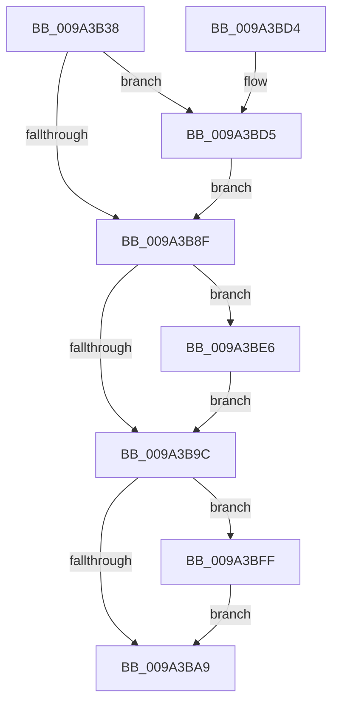

# RawCleanup

- RVA: `0x009A3B38`–`0x009A3C0F` (길이 `215` bytes)
- VA: `0x00000001409A3B38`
- 실행 섹션: `PAGE`
- PDB 이름 있음: `예`; PDB Function 태그: `아니요`
- unwind 정보 RVA: `0x00078F40`
- 디코드: `56`개 명령, `215/215` bytes 표시
- 미해석 바이트: `0` (있으면 어셈블리에 `.byte`로 보존)

> 이 문서는 커널 이미지의 기계어와 PDB 기호를 분석해 생성했습니다. 4번과 5번은 함수 원형과 자료형을 바이너리 사용 방식에서 추정한 C 해석이며 원본 소스 복구 결과는 아닙니다.

## 1. Dependencies

- 직접 호출 지점: **6**; 고유 호출 대상: **6**
- 직접 호출자로 확인된 함수: **1**
- RIP 상대 이미지 참조: **0**

### Outgoing calls
- `0x009A3B67` → [ExAcquireFastMutex](../../text/20/ExAcquireFastMutex_function_0020E5A0.md) (function, `0x0020E5A0`)
- `0x009A3B7D` → [IoRemoveLinkShareAccessEx](IoRemoveLinkShareAccessEx_function_009A3C40.md) (function, `0x009A3C40`)
- `0x009A3B9F` → [ExReleaseFastMutex](../../text/25/ExReleaseFastMutex_function_002519C0.md) (function, `0x002519C0`)
- `0x009A3BB2` → [IofCompleteRequest](../../text/29/IofCompleteRequest_function_0029B5C0.md) (function, `0x0029B5C0`)
- `0x009A3BF8` → [RawInitiateDeleteVolume](../../text/48/RawInitiateDeleteVolume_function_0048FDFC.md) (function, `0x0048FDFC`)
- `0x009A3C08` → [FsRtlNotifyVolumeEvent](../71/FsRtlNotifyVolumeEvent_function_00716EE0.md) (function, `0x00716EE0`)

### Direct callers
- [RawDispatch](RawDispatch_function_009A3920.md) at `0x009A398F`

### Static image references
- 디코드된 RIP-relative 메모리 참조가 없습니다.

## 2. Other-region calls and transfers

- 다른 실행 섹션으로 향하는 call: **4**
  - `0x009A3B67` → [ExAcquireFastMutex](../../text/20/ExAcquireFastMutex_function_0020E5A0.md) (`PAGE` → `.text`)
  - `0x009A3B9F` → [ExReleaseFastMutex](../../text/25/ExReleaseFastMutex_function_002519C0.md) (`PAGE` → `.text`)
  - `0x009A3BB2` → [IofCompleteRequest](../../text/29/IofCompleteRequest_function_0029B5C0.md) (`PAGE` → `.text`)
  - `0x009A3BF8` → [RawInitiateDeleteVolume](../../text/48/RawInitiateDeleteVolume_function_0048FDFC.md) (`PAGE` → `.text`)
- 별도 외부 분기/꼬리 이동을 확인하지 못했습니다.

## 3. Assembly (complete function range)

```asm
009A3B38  48 8B C4                        mov rax, rsp
009A3B3B  48 89 58 08                     mov qword ptr [rax + 8], rbx
009A3B3F  48 89 68 10                     mov qword ptr [rax + 0x10], rbp
009A3B43  48 89 70 18                     mov qword ptr [rax + 0x18], rsi
009A3B47  48 89 78 20                     mov qword ptr [rax + 0x20], rdi
009A3B4B  41 56                           push r14
009A3B4D  48 83 EC 20                     sub rsp, 0x20
009A3B51  4C 8D B1 F0 00 00 00            lea r14, [rcx + 0xf0]
009A3B58  48 8B D9                        mov rbx, rcx
009A3B5B  49 8B CE                        mov rcx, r14
009A3B5E  49 8B F8                        mov rdi, r8
009A3B61  48 8B F2                        mov rsi, rdx
009A3B64  40 32 ED                        xor bpl, bpl
009A3B67  E8 34 AA 86 FF                  call 0x14020e5a0
009A3B6C  48 8B 4F 30                     mov rcx, qword ptr [rdi + 0x30]
009A3B70  48 8D 93 84 00 00 00            lea rdx, [rbx + 0x84]
009A3B77  45 33 C9                        xor r9d, r9d
009A3B7A  45 33 C0                        xor r8d, r8d
009A3B7D  E8 BE 00 00 00                  call 0x1409a3c40
009A3B82  48 8B 83 E0 00 00 00            mov rax, qword ptr [rbx + 0xe0]
009A3B89  48 39 47 30                     cmp qword ptr [rdi + 0x30], rax
009A3B8D  74 46                           je 0x1409a3bd5
009A3B8F  48 8B 83 D8 00 00 00            mov rax, qword ptr [rbx + 0xd8]
009A3B96  48 39 47 30                     cmp qword ptr [rdi + 0x30], rax
009A3B9A  74 4A                           je 0x1409a3be6
009A3B9C  49 8B CE                        mov rcx, r14
009A3B9F  E8 1C DE 8A FF                  call 0x1402519c0
009A3BA4  40 84 ED                        test bpl, bpl
009A3BA7  75 56                           jne 0x1409a3bff
009A3BA9  83 66 30 00                     and dword ptr [rsi + 0x30], 0
009A3BAD  B2 01                           mov dl, 1
009A3BAF  48 8B CE                        mov rcx, rsi
009A3BB2  E8 09 7A 8F FF                  call 0x14029b5c0
009A3BB7  48 8B 5C 24 30                  mov rbx, qword ptr [rsp + 0x30]
009A3BBC  33 C0                           xor eax, eax
009A3BBE  48 8B 6C 24 38                  mov rbp, qword ptr [rsp + 0x38]
009A3BC3  48 8B 74 24 40                  mov rsi, qword ptr [rsp + 0x40]
009A3BC8  48 8B 7C 24 48                  mov rdi, qword ptr [rsp + 0x48]
009A3BCD  48 83 C4 20                     add rsp, 0x20
009A3BD1  41 5E                           pop r14
009A3BD3  C3                              ret
009A3BD4  CC                              int3
009A3BD5  83 63 78 FE                     and dword ptr [rbx + 0x78], 0xfffffffe
009A3BD9  40 B5 01                        mov bpl, 1
009A3BDC  48 83 A3 E0 00 00 00 00         and qword ptr [rbx + 0xe0], 0
009A3BE4  EB A9                           jmp 0x1409a3b8f
009A3BE6  48 83 A3 D8 00 00 00 00         and qword ptr [rbx + 0xd8], 0
009A3BEE  45 33 C0                        xor r8d, r8d
009A3BF1  48 8B CB                        mov rcx, rbx
009A3BF4  41 8D 50 01                     lea edx, [r8 + 1]
009A3BF8  E8 FF C1 AE FF                  call 0x14048fdfc
009A3BFD  EB 9D                           jmp 0x1409a3b9c
009A3BFF  48 8B 4F 30                     mov rcx, qword ptr [rdi + 0x30]
009A3C03  BA 05 00 00 00                  mov edx, 5
009A3C08  E8 D3 32 D7 FF                  call 0x140716ee0
009A3C0D  EB 9A                           jmp 0x1409a3ba9
```

## 4. C-style interpretation (structured pseudocode)

```c
__int64 __fastcall RawCleanup(__int64 a1, __int64 a2, __int64 a3, int a4)
{
    __int64 result;
    __int64 v_rbp;
    __int64 v_rsp;
    unsigned __int64 v_stack_p10;
    unsigned __int64 v_stack_p18;
    unsigned __int64 v_stack_p20;
    unsigned __int64 v_stack_p8;

    *(unsigned __int64 *)(v_rsp + 8) = v_rbx;
    *(unsigned __int64 *)(v_rsp + 16) = v_rbp;
    *(unsigned __int64 *)(v_rsp + 24) = v_rsi;
    *(unsigned __int64 *)(v_rsp + 32) = v_rdi;
    v_rsp = (v_rsp) - (32);
    v_rbp = 0;
    result = ExAcquireFastMutex(a1 + 240, a2, a3, a4);
    a4 = 0;
    a3 = 0;
    result = IoRemoveLinkShareAccessEx(*(unsigned __int64 *)(a3 + 48), a1 + 132, a3, a4);
    if ((*(unsigned __int64 *)(a3 + 48)) == (*(unsigned __int64 *)(a1 + 224))) goto loc_009A3BD5;
loc_009A3B8F:
    if ((*(unsigned __int64 *)(a3 + 48)) == (*(unsigned __int64 *)(a1 + 216))) goto loc_009A3BE6;
loc_009A3B9C:
    result = ExReleaseFastMutex(a1 + 240, a1 + 132, a3, a4);
    if (0 != 0) goto loc_009A3BFF;
loc_009A3BA9:
    result = IofCompleteRequest(a2, 1, a3, a4);
    result = 0;
    v_rsp = (v_rsp) + (32);
    return result;
loc_009A3BD5:
    goto loc_009A3B8F;
loc_009A3BE6:
    a3 = 0;
    result = RawInitiateDeleteVolume(v_stack_p8, a3 + 1, a3, a4);
    goto loc_009A3B9C;
loc_009A3BFF:
    result = FsRtlNotifyVolumeEvent(*(unsigned __int64 *)(v_stack_p20 + 48), 5, a3, a4);
    goto loc_009A3BA9;
}
```

## 5. (Beta) C Style

```c
int64_t RawCleanup(void *Arg1, void *Arg2, void *Arg3, int32_t Arg4)
{
    uint8_t *arg1 = (uint8_t *)Arg1;
    uint8_t *arg2 = (uint8_t *)Arg2;
    uint8_t *arg3 = (uint8_t *)Arg3;

    int64_t result;
    int64_t local_rbp;
    int64_t local_rsp;
    uint64_t v_stack_p10;
    uint64_t v_stack_p18;
    uint64_t v_stack_p20;
    uint64_t v_stack_p8;

    *(uint64_t *)(local_rsp + 0x8) = local_rbx;
    *(uint64_t *)(local_rsp + 0x10) = local_rbp;
    *(uint64_t *)(local_rsp + 0x18) = local_rsi;
    *(uint64_t *)(local_rsp + 0x20) = local_rdi;
    local_rsp = (local_rsp) - (32);
    local_rbp = 0;
    result = ExAcquireFastMutex(Arg1 + 240, Arg2, Arg3, Arg4);
    Arg4 = 0;
    Arg3 = 0;
    result = IoRemoveLinkShareAccessEx(*(uint64_t *)(arg3 + 0x30), Arg1 + 132, Arg3, Arg4);
    if ((*(uint64_t *)(arg3 + 0x30)) == (*(uint64_t *)(arg1 + 0xE0))) goto loc_009A3BD5;
loc_009A3B8F:
    if ((*(uint64_t *)(arg3 + 0x30)) == (*(uint64_t *)(arg1 + 0xD8))) goto loc_009A3BE6;
loc_009A3B9C:
    result = ExReleaseFastMutex(Arg1 + 240, Arg1 + 132, Arg3, Arg4);
    if (0 != 0) goto loc_009A3BFF;
loc_009A3BA9:
    result = IofCompleteRequest(Arg2, 1, Arg3, Arg4);
    result = 0;
    local_rsp = (local_rsp) + (32);
    return result;
loc_009A3BD5:
    goto loc_009A3B8F;
loc_009A3BE6:
    Arg3 = 0;
    result = RawInitiateDeleteVolume(v_stack_p8, Arg3 + 1, Arg3, Arg4);
    goto loc_009A3B9C;
loc_009A3BFF:
    result = FsRtlNotifyVolumeEvent(*(uint64_t *)(v_stack_p20 + 0x30), 5, Arg3, Arg4);
    goto loc_009A3BA9;
}
```

### 관측된 메모리 오프셋

구조체 형식이 확인되지 않은 접근은 인자 기준의 오프셋으로만 기록했습니다.

| 기준 인자 | 오프셋 표현 | 폭 (bit) | 접근 |
|---|---:|---:|---|
| `Arg1` | `+ 0x78` | `32` | `R/W` |
| `Arg1` | `+ 0x84` | `64` | `R` |
| `Arg1` | `+ 0xD8` | `64` | `R` |
| `Arg1` | `+ 0xD8` | `64` | `R/W` |
| `Arg1` | `+ 0xE0` | `64` | `R` |
| `Arg1` | `+ 0xE0` | `64` | `R/W` |
| `Arg1` | `+ 0xF0` | `64` | `R` |
| `Arg2` | `+ 0x30` | `32` | `R/W` |
| `Arg3` | `+ 0x30` | `64` | `R` |

## 6. Execution-region graph

[열기: 2D/3D 그래프와 함수 탐색 컨트롤 패널](../../../control-panel.html?section=page&rva=0x009A3B38&view=graph)

- 2D 그래프는 위에서 아래로 흐르고, 3D 그래프는 빈 공간을 드래그해 회전합니다. Shift+드래그는 이동, 휠은 확대·축소, 함수 노드 선택은 대상 보고서 이동입니다.

### Static fallback


