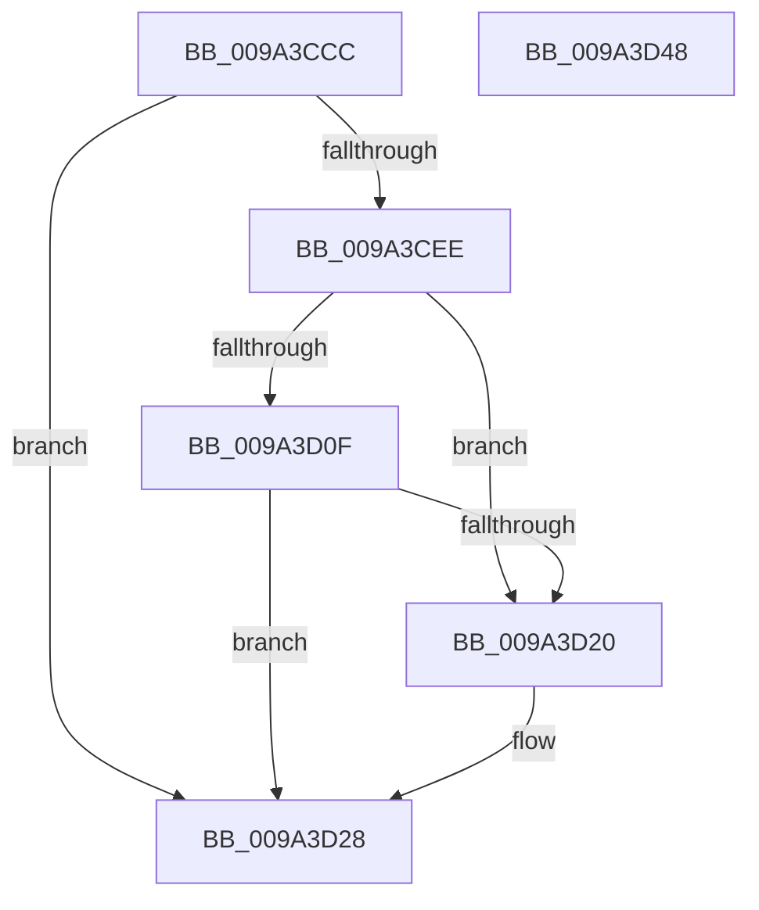

# RawClose

- RVA: `0x009A3CCC`–`0x009A3D49` (길이 `125` bytes)
- VA: `0x00000001409A3CCC`
- 실행 섹션: `PAGE`
- PDB 이름 있음: `예`; PDB Function 태그: `아니요`
- unwind 정보 RVA: `0x00060BC4`
- 디코드: `36`개 명령, `125/125` bytes 표시
- 미해석 바이트: `0` (있으면 어셈블리에 `.byte`로 보존)

> 이 문서는 커널 이미지의 기계어와 PDB 기호를 분석해 생성했습니다. 4번과 5번은 함수 원형과 자료형을 바이너리 사용 방식에서 추정한 C 해석이며 원본 소스 복구 결과는 아닙니다.

## 1. Dependencies

- 직접 호출 지점: **4**; 고유 호출 대상: **4**
- 직접 호출자로 확인된 함수: **1**
- RIP 상대 이미지 참조: **0**

### Outgoing calls
- `0x009A3CF8` → [ExAcquireFastMutex](../../text/20/ExAcquireFastMutex_function_0020E5A0.md) (function, `0x0020E5A0`)
- `0x009A3D17` → [RawInitiateDeleteVolume](../../text/48/RawInitiateDeleteVolume_function_0048FDFC.md) (function, `0x0048FDFC`)
- `0x009A3D23` → [ExReleaseFastMutex](../../text/25/ExReleaseFastMutex_function_002519C0.md) (function, `0x002519C0`)
- `0x009A3D31` → [IofCompleteRequest](../../text/29/IofCompleteRequest_function_0029B5C0.md) (function, `0x0029B5C0`)

### Direct callers
- [RawDispatch](RawDispatch_function_009A3920.md) at `0x009A3A61`

### Static image references
- 디코드된 RIP-relative 메모리 참조가 없습니다.

## 2. Other-region calls and transfers

- 다른 실행 섹션으로 향하는 call: **4**
  - `0x009A3CF8` → [ExAcquireFastMutex](../../text/20/ExAcquireFastMutex_function_0020E5A0.md) (`PAGE` → `.text`)
  - `0x009A3D17` → [RawInitiateDeleteVolume](../../text/48/RawInitiateDeleteVolume_function_0048FDFC.md) (`PAGE` → `.text`)
  - `0x009A3D23` → [ExReleaseFastMutex](../../text/25/ExReleaseFastMutex_function_002519C0.md) (`PAGE` → `.text`)
  - `0x009A3D31` → [IofCompleteRequest](../../text/29/IofCompleteRequest_function_0029B5C0.md) (`PAGE` → `.text`)
- 별도 외부 분기/꼬리 이동을 확인하지 못했습니다.

## 3. Assembly (complete function range)

```asm
009A3CCC  48 89 5C 24 08                  mov qword ptr [rsp + 8], rbx
009A3CD1  48 89 74 24 10                  mov qword ptr [rsp + 0x10], rsi
009A3CD6  57                              push rdi
009A3CD7  48 83 EC 20                     sub rsp, 0x20
009A3CDB  49 8B 40 30                     mov rax, qword ptr [r8 + 0x30]
009A3CDF  48 8B FA                        mov rdi, rdx
009A3CE2  48 8B D9                        mov rbx, rcx
009A3CE5  F7 40 50 00 01 00 00            test dword ptr [rax + 0x50], 0x100
009A3CEC  75 3A                           jne 0x1409a3d28
009A3CEE  48 8D B1 F0 00 00 00            lea rsi, [rcx + 0xf0]
009A3CF5  48 8B CE                        mov rcx, rsi
009A3CF8  E8 A3 A8 86 FF                  call 0x14020e5a0
009A3CFD  83 C9 FF                        or ecx, 0xffffffff
009A3D00  01 4B 7C                        add dword ptr [rbx + 0x7c], ecx
009A3D03  01 8B 80 00 00 00               add dword ptr [rbx + 0x80], ecx
009A3D09  83 7B 7C 00                     cmp dword ptr [rbx + 0x7c], 0
009A3D0D  75 11                           jne 0x1409a3d20
009A3D0F  45 33 C0                        xor r8d, r8d
009A3D12  33 D2                           xor edx, edx
009A3D14  48 8B CB                        mov rcx, rbx
009A3D17  E8 E0 C0 AE FF                  call 0x14048fdfc
009A3D1C  84 C0                           test al, al
009A3D1E  75 08                           jne 0x1409a3d28
009A3D20  48 8B CE                        mov rcx, rsi
009A3D23  E8 98 DC 8A FF                  call 0x1402519c0
009A3D28  83 67 30 00                     and dword ptr [rdi + 0x30], 0
009A3D2C  B2 01                           mov dl, 1
009A3D2E  48 8B CF                        mov rcx, rdi
009A3D31  E8 8A 78 8F FF                  call 0x14029b5c0
009A3D36  48 8B 5C 24 30                  mov rbx, qword ptr [rsp + 0x30]
009A3D3B  33 C0                           xor eax, eax
009A3D3D  48 8B 74 24 38                  mov rsi, qword ptr [rsp + 0x38]
009A3D42  48 83 C4 20                     add rsp, 0x20
009A3D46  5F                              pop rdi
009A3D47  C3                              ret
009A3D48  CC                              int3
```

## 4. C-style interpretation (structured pseudocode)

```c
__int64 __fastcall RawClose(__int64 a1, __int64 a2, __int64 a3)
{
    __int64 result;
    __int64 v_rsp;
    unsigned __int64 v_stack_p10;
    unsigned __int64 v_stack_p8;

    v_stack_p8 = v_rbx;
    v_stack_p10 = v_rsi;
    v_rsp = (v_rsp) - (32);
    if (((*(unsigned int *)(*(unsigned __int64 *)(a3 + 48) + 80)) & (256)) != 0) goto loc_009A3D28;
    result = ExAcquireFastMutex(a1 + 240, a2, a3, a4);
    a1 = (unsigned int)((a1 + 240) | (0xFFFFFFFFULL));
    if ((*(unsigned int *)(a1 + 124)) != 0) goto loc_009A3D20;
    a3 = 0;
    a2 = 0;
    result = RawInitiateDeleteVolume(a1, a2, a3, a4);
    if ((unsigned __int8)(result) == 0) {
        a1 = a1 + 240;
        result = ExReleaseFastMutex(a1, a2, a3, a4);
    }
    result = IofCompleteRequest(0, 1, a3, a4);
    result = 0;
    v_rsp = (v_rsp) + (32);
    return result;
}
```

## 5. (Beta) C Style

```c
int64_t RawClose(void *Arg1, void *Arg2, void *Arg3)
{
    uint8_t *arg1 = (uint8_t *)Arg1;
    uint8_t *arg2 = (uint8_t *)Arg2;
    uint8_t *arg3 = (uint8_t *)Arg3;

    int64_t result;
    int64_t local_rsp;
    uint64_t v_stack_p10;
    uint64_t v_stack_p8;

    v_stack_p8 = local_rbx;
    v_stack_p10 = local_rsi;
    local_rsp = (local_rsp) - (32);
    if (((*(uint32_t *)(*(uint64_t *)(arg3 + 0x30) + 0x50)) & (256)) != 0) goto loc_009A3D28;
    result = ExAcquireFastMutex(Arg1 + 240, Arg2, Arg3, a4);
    Arg1 = (uint32_t)((Arg1 + 240) | (0xFFFFFFFFULL));
    if ((*(uint32_t *)(arg1 + 0x7C)) != 0) goto loc_009A3D20;
    Arg3 = 0;
    Arg2 = 0;
    result = RawInitiateDeleteVolume(Arg1, Arg2, Arg3, a4);
    if ((uint8_t)(result) == 0) {
        Arg1 = Arg1 + 240;
        result = ExReleaseFastMutex(Arg1, Arg2, Arg3, a4);
    }
    result = IofCompleteRequest(0, 1, Arg3, a4);
    result = 0;
    local_rsp = (local_rsp) + (32);
    return result;
}
```

### 관측된 메모리 오프셋

구조체 형식이 확인되지 않은 접근은 인자 기준의 오프셋으로만 기록했습니다.

| 기준 인자 | 오프셋 표현 | 폭 (bit) | 접근 |
|---|---:|---:|---|
| `Arg1` | `+ 0x7C` | `32` | `R` |
| `Arg1` | `+ 0x7C` | `32` | `R/W` |
| `Arg1` | `+ 0x80` | `32` | `R/W` |
| `Arg1` | `+ 0xF0` | `64` | `R` |
| `Arg2` | `+ 0x30` | `32` | `R/W` |
| `Arg3` | `+ 0x30` | `64` | `R` |

## 6. Execution-region graph

[열기: 2D/3D 그래프와 함수 탐색 컨트롤 패널](../../../control-panel.html?section=page&rva=0x009A3CCC&view=graph)

- 2D 그래프는 위에서 아래로 흐르고, 3D 그래프는 빈 공간을 드래그해 회전합니다. Shift+드래그는 이동, 휠은 확대·축소, 함수 노드 선택은 대상 보고서 이동입니다.

### Static fallback


