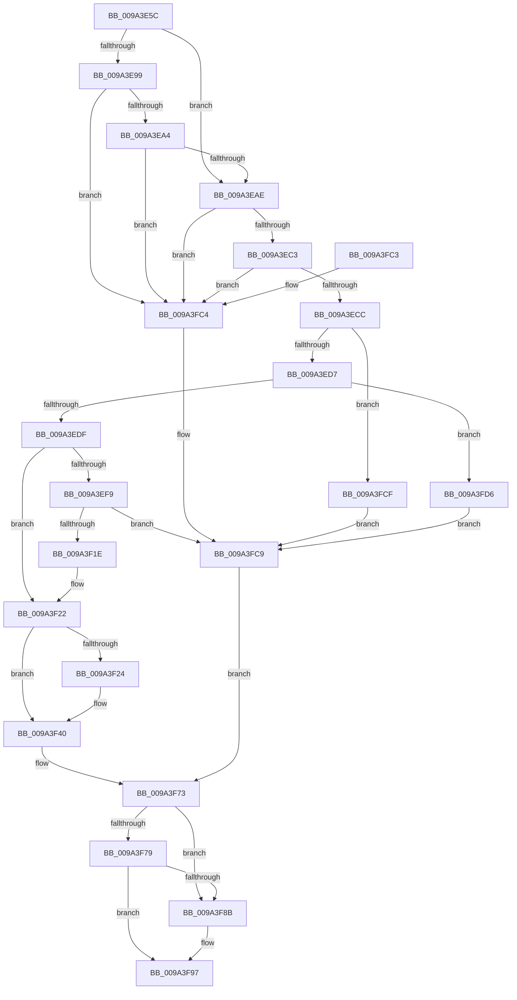

# RawCreate

- RVA: `0x009A3E5C`–`0x009A3FDD` (길이 `385` bytes)
- VA: `0x00000001409A3E5C`
- 실행 섹션: `PAGE`
- PDB 이름 있음: `예`; PDB Function 태그: `아니요`
- unwind 정보 RVA: `0x0009C43C`
- 디코드: `102`개 명령, `385/385` bytes 표시
- 미해석 바이트: `0` (있으면 어셈블리에 `.byte`로 보존)

> 이 문서는 커널 이미지의 기계어와 PDB 기호를 분석해 생성했습니다. 4번과 5번은 함수 원형과 자료형을 바이너리 사용 방식에서 추정한 C 해석이며 원본 소스 복구 결과는 아닙니다.

## 1. Dependencies

- 직접 호출 지점: **6**; 고유 호출 대상: **6**
- 직접 호출자로 확인된 함수: **1**
- RIP 상대 이미지 참조: **0**

### Outgoing calls
- `0x009A3E88` → [ExAcquireFastMutex](../../text/20/ExAcquireFastMutex_function_0020E5A0.md) (function, `0x0020E5A0`)
- `0x009A3F0F` → [IoCheckLinkShareAccess](IoCheckLinkShareAccess_function_009A4180.md) (function, `0x009A4180`)
- `0x009A3F3B` → [IoSetLinkShareAccess](IoSetLinkShareAccess_function_009A4010.md) (function, `0x009A4010`)
- `0x009A3F82` → [RawInitiateDeleteVolume](../../text/48/RawInitiateDeleteVolume_function_0048FDFC.md) (function, `0x0048FDFC`)
- `0x009A3F92` → [ExReleaseFastMutex](../../text/25/ExReleaseFastMutex_function_002519C0.md) (function, `0x002519C0`)
- `0x009A3F9F` → [IofCompleteRequest](../../text/29/IofCompleteRequest_function_0029B5C0.md) (function, `0x0029B5C0`)

### Direct callers
- [RawDispatch](RawDispatch_function_009A3920.md) at `0x009A3A74`

### Static image references
- 디코드된 RIP-relative 메모리 참조가 없습니다.

## 2. Other-region calls and transfers

- 다른 실행 섹션으로 향하는 call: **4**
  - `0x009A3E88` → [ExAcquireFastMutex](../../text/20/ExAcquireFastMutex_function_0020E5A0.md) (`PAGE` → `.text`)
  - `0x009A3F82` → [RawInitiateDeleteVolume](../../text/48/RawInitiateDeleteVolume_function_0048FDFC.md) (`PAGE` → `.text`)
  - `0x009A3F92` → [ExReleaseFastMutex](../../text/25/ExReleaseFastMutex_function_002519C0.md) (`PAGE` → `.text`)
  - `0x009A3F9F` → [IofCompleteRequest](../../text/29/IofCompleteRequest_function_0029B5C0.md) (`PAGE` → `.text`)
- 별도 외부 분기/꼬리 이동을 확인하지 못했습니다.

## 3. Assembly (complete function range)

```asm
009A3E5C  48 89 5C 24 08                  mov qword ptr [rsp + 8], rbx
009A3E61  48 89 6C 24 10                  mov qword ptr [rsp + 0x10], rbp
009A3E66  48 89 74 24 18                  mov qword ptr [rsp + 0x18], rsi
009A3E6B  57                              push rdi
009A3E6C  41 54                           push r12
009A3E6E  41 55                           push r13
009A3E70  41 56                           push r14
009A3E72  41 57                           push r15
009A3E74  48 83 EC 30                     sub rsp, 0x30
009A3E78  48 8B D9                        mov rbx, rcx
009A3E7B  49 8B E8                        mov rbp, r8
009A3E7E  48 81 C1 F0 00 00 00            add rcx, 0xf0
009A3E85  48 8B FA                        mov rdi, rdx
009A3E88  E8 13 A7 86 FF                  call 0x14020e5a0
009A3E8D  4C 8B 45 30                     mov r8, qword ptr [rbp + 0x30]
009A3E91  45 33 ED                        xor r13d, r13d
009A3E94  4D 85 C0                        test r8, r8
009A3E97  74 15                           je 0x1409a3eae
009A3E99  66 45 39 68 58                  cmp word ptr [r8 + 0x58], r13w
009A3E9E  0F 85 20 01 00 00               jne 0x1409a3fc4
009A3EA4  4D 39 68 40                     cmp qword ptr [r8 + 0x40], r13
009A3EA8  0F 85 16 01 00 00               jne 0x1409a3fc4
009A3EAE  8B 4D 10                        mov ecx, dword ptr [rbp + 0x10]
009A3EB1  8B C1                           mov eax, ecx
009A3EB3  25 00 00 00 FF                  and eax, 0xff000000
009A3EB8  3D 00 00 00 01                  cmp eax, 0x1000000
009A3EBD  0F 85 01 01 00 00               jne 0x1409a3fc4
009A3EC3  F6 C1 01                        test cl, 1
009A3EC6  0F 85 F8 00 00 00               jne 0x1409a3fc4
009A3ECC  8B 43 78                        mov eax, dword ptr [rbx + 0x78]
009A3ECF  A8 01                           test al, 1
009A3ED1  0F 85 F8 00 00 00               jne 0x1409a3fcf
009A3ED7  A8 02                           test al, 2
009A3ED9  0F 85 F7 00 00 00               jne 0x1409a3fd6
009A3EDF  4C 8D BB 84 00 00 00            lea r15, [rbx + 0x84]
009A3EE6  48 8B 45 08                     mov rax, qword ptr [rbp + 8]
009A3EEA  44 0F B7 65 1A                  movzx r12d, word ptr [rbp + 0x1a]
009A3EEF  44 8B 70 10                     mov r14d, dword ptr [rax + 0x10]
009A3EF3  44 39 6B 7C                     cmp dword ptr [rbx + 0x7c], r13d
009A3EF7  76 29                           jbe 0x1409a3f22
009A3EF9  C7 44 24 28 01 00 00 00         mov dword ptr [rsp + 0x28], 1
009A3F01  4D 8B CF                        mov r9, r15
009A3F04  41 8B D4                        mov edx, r12d
009A3F07  4C 89 6C 24 20                  mov qword ptr [rsp + 0x20], r13
009A3F0C  41 8B CE                        mov ecx, r14d
009A3F0F  E8 6C 02 00 00                  call 0x1409a4180
009A3F14  8B F0                           mov esi, eax
009A3F16  85 C0                           test eax, eax
009A3F18  0F 88 AB 00 00 00               js 0x1409a3fc9
009A3F1E  44 39 6B 7C                     cmp dword ptr [rbx + 0x7c], r13d
009A3F22  75 1C                           jne 0x1409a3f40
009A3F24  4C 8B 45 30                     mov r8, qword ptr [rbp + 0x30]
009A3F28  4D 8B CF                        mov r9, r15
009A3F2B  44 89 6C 24 28                  mov dword ptr [rsp + 0x28], r13d
009A3F30  41 8B D4                        mov edx, r12d
009A3F33  41 8B CE                        mov ecx, r14d
009A3F36  4C 89 6C 24 20                  mov qword ptr [rsp + 0x20], r13
009A3F3B  E8 D0 00 00 00                  call 0x1409a4010
009A3F40  FF 43 7C                        inc dword ptr [rbx + 0x7c]
009A3F43  41 8B F5                        mov esi, r13d
009A3F46  FF 83 80 00 00 00               inc dword ptr [rbx + 0x80]
009A3F4C  48 8B 83 C8 00 00 00            mov rax, qword ptr [rbx + 0xc8]
009A3F53  48 8B 4D 30                     mov rcx, qword ptr [rbp + 0x30]
009A3F57  48 89 41 10                     mov qword ptr [rcx + 0x10], rax
009A3F5B  48 C7 47 38 01 00 00 00         mov qword ptr [rdi + 0x38], 1
009A3F63  48 8B 45 30                     mov rax, qword ptr [rbp + 0x30]
009A3F67  83 48 50 08                     or dword ptr [rax + 0x50], 8
009A3F6B  48 8B 45 30                     mov rax, qword ptr [rbp + 0x30]
009A3F6F  48 89 58 18                     mov qword ptr [rax + 0x18], rbx
009A3F73  44 39 6B 7C                     cmp dword ptr [rbx + 0x7c], r13d
009A3F77  75 12                           jne 0x1409a3f8b
009A3F79  33 D2                           xor edx, edx
009A3F7B  48 8B CB                        mov rcx, rbx
009A3F7E  44 8D 42 01                     lea r8d, [rdx + 1]
009A3F82  E8 75 BE AE FF                  call 0x14048fdfc
009A3F87  84 C0                           test al, al
009A3F89  75 0C                           jne 0x1409a3f97
009A3F8B  48 8D 8B F0 00 00 00            lea rcx, [rbx + 0xf0]
009A3F92  E8 29 DA 8A FF                  call 0x1402519c0
009A3F97  B2 01                           mov dl, 1
009A3F99  89 77 30                        mov dword ptr [rdi + 0x30], esi
009A3F9C  48 8B CF                        mov rcx, rdi
009A3F9F  E8 1C 76 8F FF                  call 0x14029b5c0
009A3FA4  48 8B 5C 24 60                  mov rbx, qword ptr [rsp + 0x60]
009A3FA9  8B C6                           mov eax, esi
009A3FAB  48 8B 74 24 70                  mov rsi, qword ptr [rsp + 0x70]
009A3FB0  48 8B 6C 24 68                  mov rbp, qword ptr [rsp + 0x68]
009A3FB5  48 83 C4 30                     add rsp, 0x30
009A3FB9  41 5F                           pop r15
009A3FBB  41 5E                           pop r14
009A3FBD  41 5D                           pop r13
009A3FBF  41 5C                           pop r12
009A3FC1  5F                              pop rdi
009A3FC2  C3                              ret
009A3FC3  CC                              int3
009A3FC4  BE 0D 00 00 C0                  mov esi, 0xc000000d
009A3FC9  4C 89 6F 38                     mov qword ptr [rdi + 0x38], r13
009A3FCD  EB A4                           jmp 0x1409a3f73
009A3FCF  BE 22 00 00 C0                  mov esi, 0xc0000022
009A3FD4  EB F3                           jmp 0x1409a3fc9
009A3FD6  BE 6E 02 00 C0                  mov esi, 0xc000026e
009A3FDB  EB EC                           jmp 0x1409a3fc9
```

## 4. C-style interpretation (structured pseudocode)

```c
__int64 __fastcall RawCreate(__int64 a1, __int64 a2, __int64 a3)
{
    __int64 result;
    __int64 v_r13;
    __int64 v_rsp;
    unsigned int v_stack_m30;
    unsigned __int64 v_stack_m38;
    unsigned __int64 v_stack_p10;
    unsigned __int64 v_stack_p18;
    unsigned __int64 v_stack_p8;

    v_stack_p8 = v_rbx;
    v_stack_p10 = v_rbp;
    v_stack_p18 = v_rsi;
    v_rsp = (v_rsp) - (48);
    a1 = (a1) + (240);
    result = ExAcquireFastMutex(a1, a2, a3, a4);
    v_r13 = 0;
    if (*(unsigned __int64 *)(a3 + 48) == 0) goto loc_009A3EAE;
    if ((*(unsigned __int16 *)(*(unsigned __int64 *)(a3 + 48) + 88)) != 0) goto loc_009A3FC4;
    if ((*(unsigned __int64 *)(*(unsigned __int64 *)(a3 + 48) + 64)) != 0) goto loc_009A3FC4;
loc_009A3EAE:
    result = (unsigned int)(((unsigned int)((unsigned int)((unsigned int)(*(unsigned int *)(a3 + 16))))) & (0xFF000000ULL));
    if (((unsigned int)(result)) != 0x1000000ULL) goto loc_009A3FC4;
    if ((((unsigned __int8)((unsigned int)(*(unsigned int *)(a3 + 16)))) & (1)) != 0) goto loc_009A3FC4;
    if ((((unsigned __int8)((unsigned int)(*(unsigned int *)(a1 + 120)))) & (1)) != 0) goto loc_009A3FCF;
    if ((((unsigned __int8)((unsigned int)(*(unsigned int *)(a1 + 120)))) & (2)) != 0) goto loc_009A3FD6;
    if ((*(unsigned int *)(a1 + 124)) <= 0) goto loc_009A3F22;
    v_stack_m30 = 1;
    v_stack_m38 = 0;
    result = IoCheckLinkShareAccess((unsigned int)((unsigned int)((unsigned int)(*(unsigned int *)(*(unsigned __int64 *)(a3 + 8) + 16)))), (unsigned int)((unsigned int)(*(unsigned __int16 *)(a3 + 26))), *(unsigned __int64 *)(a3 + 48), a1 + 132);
    if (sign_flag) goto loc_009A3FC9;
loc_009A3F22:
    if ((*(unsigned int *)(a1 + 124)) == 0) {
        a3 = *(unsigned __int64 *)(a3 + 48);
        a4 = a1 + 132;
        v_stack_m30 = 0;
        a2 = (unsigned int)(*(unsigned __int16 *)(a3 + 26));
        a1 = (unsigned int)((unsigned int)(*(unsigned int *)(*(unsigned __int64 *)(a3 + 8) + 16)));
        v_stack_m38 = 0;
        result = IoSetLinkShareAccess(a1, a2, a3, a4);
    }
    *(unsigned __int64 *)(*(unsigned __int64 *)(a3 + 48) + 16) = *(unsigned __int64 *)(a1 + 200);
    *(unsigned __int64 *)(a2 + 56) = 1;
    *(unsigned __int64 *)(*(unsigned __int64 *)(a3 + 48) + 24) = a1;
loc_009A3F73:
    if ((*(unsigned int *)(a1 + 124)) != 0) goto loc_009A3F8B;
    a2 = 0;
    result = RawInitiateDeleteVolume(a1, a2, a2 + 1, a4);
    if ((unsigned __int8)(result) == 0) {
        a1 = a1 + 240;
        result = ExReleaseFastMutex(a1, a2, a2 + 1, a4);
    }
    *(unsigned int *)(a2 + 48) = 0;
    result = IofCompleteRequest(0, 1, a2 + 1, a4);
    v_rsp = (v_rsp) + (48);
    return 0;
loc_009A3FC4:
loc_009A3FC9:
    *(unsigned __int64 *)(a2 + 56) = 0;
    goto loc_009A3F73;
loc_009A3FCF:
    goto loc_009A3FC9;
loc_009A3FD6:
    goto loc_009A3FC9;
}
```

## 5. (Beta) C Style

```c
int64_t RawCreate(void *Arg1, void *Arg2, void *Arg3)
{
    uint8_t *arg1 = (uint8_t *)Arg1;
    uint8_t *arg2 = (uint8_t *)Arg2;
    uint8_t *arg3 = (uint8_t *)Arg3;

    int64_t result;
    int64_t local_r13;
    int64_t local_rsp;
    uint32_t v_stack_m30;
    uint64_t v_stack_m38;
    uint64_t v_stack_p10;
    uint64_t v_stack_p18;
    uint64_t v_stack_p8;

    v_stack_p8 = local_rbx;
    v_stack_p10 = local_rbp;
    v_stack_p18 = local_rsi;
    local_rsp = (local_rsp) - (48);
    Arg1 = (Arg1) + (240);
    result = ExAcquireFastMutex(Arg1, Arg2, Arg3, a4);
    local_r13 = 0;
    if (*(uint64_t *)(arg3 + 0x30) == 0) goto loc_009A3EAE;
    if ((*(uint16_t *)(*(uint64_t *)(arg3 + 0x30) + 0x58)) != 0) goto loc_009A3FC4;
    if ((*(uint64_t *)(*(uint64_t *)(arg3 + 0x30) + 0x40)) != 0) goto loc_009A3FC4;
loc_009A3EAE:
    result = (uint32_t)(((uint32_t)((uint32_t)((uint32_t)(*(uint32_t *)(arg3 + 0x10))))) & (0xFF000000ULL));
    if (((uint32_t)(result)) != 0x1000000ULL) goto loc_009A3FC4;
    if ((((uint8_t)((uint32_t)(*(uint32_t *)(arg3 + 0x10)))) & (1)) != 0) goto loc_009A3FC4;
    if ((((uint8_t)((uint32_t)(*(uint32_t *)(arg1 + 0x78)))) & (1)) != 0) goto loc_009A3FCF;
    if ((((uint8_t)((uint32_t)(*(uint32_t *)(arg1 + 0x78)))) & (2)) != 0) goto loc_009A3FD6;
    if ((*(uint32_t *)(arg1 + 0x7C)) <= 0) goto loc_009A3F22;
    v_stack_m30 = 1;
    v_stack_m38 = 0;
    result = IoCheckLinkShareAccess((uint32_t)((uint32_t)((uint32_t)(*(uint32_t *)(*(uint64_t *)(arg3 + 0x8) + 0x10)))), (uint32_t)((uint32_t)(*(uint16_t *)(arg3 + 0x1A))), *(uint64_t *)(arg3 + 0x30), Arg1 + 132);
    if (sign_flag) goto loc_009A3FC9;
loc_009A3F22:
    if ((*(uint32_t *)(arg1 + 0x7C)) == 0) {
        Arg3 = *(uint64_t *)(arg3 + 0x30);
        a4 = Arg1 + 132;
        v_stack_m30 = 0;
        Arg2 = (uint32_t)(*(uint16_t *)(arg3 + 0x1A));
        Arg1 = (uint32_t)((uint32_t)(*(uint32_t *)(*(uint64_t *)(arg3 + 0x8) + 0x10)));
        v_stack_m38 = 0;
        result = IoSetLinkShareAccess(Arg1, Arg2, Arg3, a4);
    }
    *(uint64_t *)(*(uint64_t *)(arg3 + 0x30) + 0x10) = *(uint64_t *)(arg1 + 0xC8);
    *(uint64_t *)(arg2 + 0x38) = 1;
    *(void **)(*(uint64_t *)(arg3 + 0x30) + 0x18) = Arg1;
loc_009A3F73:
    if ((*(uint32_t *)(arg1 + 0x7C)) != 0) goto loc_009A3F8B;
    Arg2 = 0;
    result = RawInitiateDeleteVolume(Arg1, Arg2, Arg2 + 1, a4);
    if ((uint8_t)(result) == 0) {
        Arg1 = Arg1 + 240;
        result = ExReleaseFastMutex(Arg1, Arg2, Arg2 + 1, a4);
    }
    *(uint32_t *)(arg2 + 0x30) = 0;
    result = IofCompleteRequest(0, 1, Arg2 + 1, a4);
    local_rsp = (local_rsp) + (48);
    return 0;
loc_009A3FC4:
loc_009A3FC9:
    *(uint64_t *)(arg2 + 0x38) = 0;
    goto loc_009A3F73;
loc_009A3FCF:
    goto loc_009A3FC9;
loc_009A3FD6:
    goto loc_009A3FC9;
}
```

### 관측된 메모리 오프셋

구조체 형식이 확인되지 않은 접근은 인자 기준의 오프셋으로만 기록했습니다.

| 기준 인자 | 오프셋 표현 | 폭 (bit) | 접근 |
|---|---:|---:|---|
| `Arg1` | `+ 0x78` | `32` | `R` |
| `Arg1` | `+ 0x7C` | `32` | `R` |
| `Arg1` | `+ 0x7C` | `32` | `R/W` |
| `Arg1` | `+ 0x80` | `32` | `R/W` |
| `Arg1` | `+ 0x84` | `64` | `R` |
| `Arg1` | `+ 0xC8` | `64` | `R` |
| `Arg1` | `+ 0xF0` | `64` | `R` |
| `Arg2` | `+ 0x30` | `32` | `W` |
| `Arg2` | `+ 0x38` | `64` | `W` |
| `Arg3` | `+ 0x8` | `64` | `R` |
| `Arg3` | `+ 0x10` | `32` | `R` |
| `Arg3` | `+ 0x1A` | `16` | `R` |
| `Arg3` | `+ 0x30` | `64` | `R` |

## 6. Execution-region graph

[열기: 2D/3D 그래프와 함수 탐색 컨트롤 패널](../../../control-panel.html?section=page&rva=0x009A3E5C&view=graph)

- 2D 그래프는 위에서 아래로 흐르고, 3D 그래프는 빈 공간을 드래그해 회전합니다. Shift+드래그는 이동, 휠은 확대·축소, 함수 노드 선택은 대상 보고서 이동입니다.

### Static fallback


