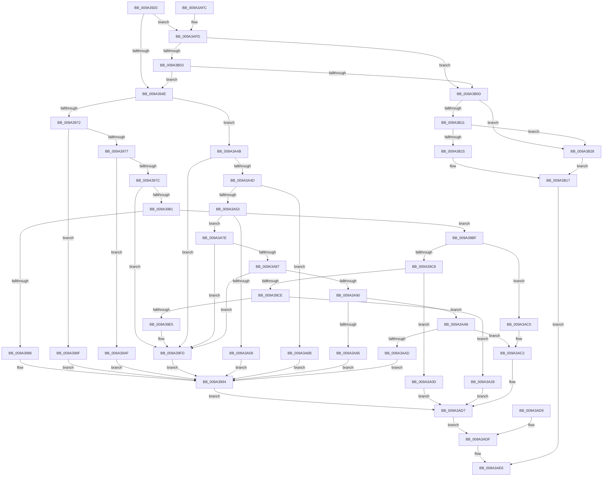

# RawDispatch

- RVA: `0x009A3920`–`0x009A3B2F` (길이 `527` bytes)
- VA: `0x00000001409A3920`
- 실행 섹션: `PAGE`
- PDB 이름 있음: `예`; PDB Function 태그: `아니요`
- unwind 정보 RVA: `0x0009C3D8`
- 디코드: `149`개 명령, `527/527` bytes 표시
- 미해석 바이트: `0` (있으면 어셈블리에 `.byte`로 보존)

> 이 문서는 커널 이미지의 기계어와 PDB 기호를 분석해 생성했습니다. 4번과 5번은 함수 원형과 자료형을 바이너리 사용 방식에서 추정한 C 해석이며 원본 소스 복구 결과는 아닙니다.

## 1. Dependencies

- 직접 호출 지점: **16**; 고유 호출 대상: **13**
- 직접 호출자로 확인된 함수: **0**
- RIP 상대 이미지 참조: **0**

### Outgoing calls
- `0x009A398F` → [RawCleanup](RawCleanup_function_009A3B38.md) (function, `0x009A3B38`)
- `0x009A39A8` → [RawQueryVolumeInformation](RawQueryVolumeInformation_function_009A4414.md) (function, `0x009A4414`)
- `0x009A39B8` → [RawFileSystemControl](RawFileSystemControl_function_009A4588.md) (function, `0x009A4588`)
- `0x009A39D8` → [ExAcquireFastMutex](../../text/20/ExAcquireFastMutex_function_0020E5A0.md) (function, `0x0020E5A0`)
- `0x009A39F8` → [ExReleaseFastMutex](../../text/25/ExReleaseFastMutex_function_002519C0.md) (function, `0x002519C0`)
- `0x009A3A06` → [RawReadWriteDeviceControl](RawReadWriteDeviceControl_function_009A3D50.md) (function, `0x009A3D50`)
- `0x009A3A1E` → [IofCompleteRequest](../../text/29/IofCompleteRequest_function_0029B5C0.md) (function, `0x0029B5C0`)
- `0x009A3A39` → [IofCompleteRequest](../../text/29/IofCompleteRequest_function_0029B5C0.md) (function, `0x0029B5C0`)
- `0x009A3A41` → [ExReleaseFastMutex](../../text/25/ExReleaseFastMutex_function_002519C0.md) (function, `0x002519C0`)
- `0x009A3A61` → [RawClose](RawClose_function_009A3CCC.md) (function, `0x009A3CCC`)
- `0x009A3A74` → [RawCreate](RawCreate_function_009A3E5C.md) (function, `0x009A3E5C`)
- `0x009A3A9E` → [RawQueryInformation](RawQueryInformation_function_009A361C.md) (function, `0x009A361C`)
- `0x009A3AB6` → [RawSetInformation](../78/RawSetInformation_function_0078A2A8.md) (function, `0x0078A2A8`)
- `0x009A3AD2` → [KeBugCheckEx](../../text/4F/KeBugCheckEx_function_004FD660.md) (function, `0x004FD660`)
- `0x009A3ADF` → [KeLeaveCriticalRegion](../../text/25/KeLeaveCriticalRegion_function_0025D8B0.md) (function, `0x0025D8B0`)
- `0x009A3B1F` → [IofCompleteRequest](../../text/29/IofCompleteRequest_function_0029B5C0.md) (function, `0x0029B5C0`)

### Direct callers
- 이 함수 시작 RVA로 연결되는 직접 call은 확인되지 않았습니다. 간접 호출은 완전히 역산할 수 없습니다.

### Static image references
- 디코드된 RIP-relative 메모리 참조가 없습니다.

## 2. Other-region calls and transfers

- 다른 실행 섹션으로 향하는 call: **8**
  - `0x009A39D8` → [ExAcquireFastMutex](../../text/20/ExAcquireFastMutex_function_0020E5A0.md) (`PAGE` → `.text`)
  - `0x009A39F8` → [ExReleaseFastMutex](../../text/25/ExReleaseFastMutex_function_002519C0.md) (`PAGE` → `.text`)
  - `0x009A3A1E` → [IofCompleteRequest](../../text/29/IofCompleteRequest_function_0029B5C0.md) (`PAGE` → `.text`)
  - `0x009A3A39` → [IofCompleteRequest](../../text/29/IofCompleteRequest_function_0029B5C0.md) (`PAGE` → `.text`)
  - `0x009A3A41` → [ExReleaseFastMutex](../../text/25/ExReleaseFastMutex_function_002519C0.md) (`PAGE` → `.text`)
  - `0x009A3AD2` → [KeBugCheckEx](../../text/4F/KeBugCheckEx_function_004FD660.md) (`PAGE` → `.text`)
  - `0x009A3ADF` → [KeLeaveCriticalRegion](../../text/25/KeLeaveCriticalRegion_function_0025D8B0.md) (`PAGE` → `.text`)
  - `0x009A3B1F` → [IofCompleteRequest](../../text/29/IofCompleteRequest_function_0029B5C0.md) (`PAGE` → `.text`)
- 별도 외부 분기/꼬리 이동을 확인하지 못했습니다.

## 3. Assembly (complete function range)

```asm
009A3920  48 89 5C 24 08                  mov qword ptr [rsp + 8], rbx
009A3925  48 89 74 24 10                  mov qword ptr [rsp + 0x10], rsi
009A392A  48 89 7C 24 18                  mov qword ptr [rsp + 0x18], rdi
009A392F  41 56                           push r14
009A3931  48 83 EC 40                     sub rsp, 0x40
009A3935  48 8B FA                        mov rdi, rdx
009A3938  48 8B 9A B8 00 00 00            mov rbx, qword ptr [rdx + 0xb8]
009A393F  B8 50 01 00 00                  mov eax, 0x150
009A3944  66 39 41 02                     cmp word ptr [rcx + 2], ax
009A3948  0F 84 AF 01 00 00               je 0x1409a3afd
009A394E  65 48 8B 04 25 88 01 00 00      mov rax, qword ptr gs:[0x188]
009A3957  66 FF 88 E4 01 00 00            dec word ptr [rax + 0x1e4]
009A395E  90                              nop
009A395F  4C 8D B1 50 01 00 00            lea r14, [rcx + 0x150]
009A3966  0F B6 13                        movzx edx, byte ptr [rbx]
009A3969  83 FA 09                        cmp edx, 9
009A396C  0F 86 D9 00 00 00               jbe 0x1409a3a4b
009A3972  83 EA 0A                        sub edx, 0xa
009A3975  74 28                           je 0x1409a399f
009A3977  83 EA 03                        sub edx, 3
009A397A  74 33                           je 0x1409a39af
009A397C  83 EA 01                        sub edx, 1
009A397F  74 7C                           je 0x1409a39fd
009A3981  83 EA 04                        sub edx, 4
009A3984  75 39                           jne 0x1409a39bf
009A3986  4C 8B C3                        mov r8, rbx
009A3989  48 8B D7                        mov rdx, rdi
009A398C  49 8B CE                        mov rcx, r14
009A398F  E8 A4 01 00 00                  call 0x1409a3b38
009A3994  89 44 24 30                     mov dword ptr [rsp + 0x30], eax
009A3998  8B D8                           mov ebx, eax
009A399A  E9 38 01 00 00                  jmp 0x1409a3ad7
009A399F  4C 8B C3                        mov r8, rbx
009A39A2  48 8B D7                        mov rdx, rdi
009A39A5  49 8B CE                        mov rcx, r14
009A39A8  E8 67 0A 00 00                  call 0x1409a4414
009A39AD  EB E5                           jmp 0x1409a3994
009A39AF  4C 8B C3                        mov r8, rbx
009A39B2  48 8B D7                        mov rdx, rdi
009A39B5  49 8B CE                        mov rcx, r14
009A39B8  E8 CB 0B 00 00                  call 0x1409a4588
009A39BD  EB D5                           jmp 0x1409a3994
009A39BF  83 FA 09                        cmp edx, 9
009A39C2  0F 85 F8 00 00 00               jne 0x1409a3ac0
009A39C8  80 7B 01 01                     cmp byte ptr [rbx + 1], 1
009A39CC  74 3F                           je 0x1409a3a0d
009A39CE  49 8D B6 F0 00 00 00            lea rsi, [r14 + 0xf0]
009A39D5  48 8B CE                        mov rcx, rsi
009A39D8  E8 C3 AB 86 FF                  call 0x14020e5a0
009A39DD  41 8B 46 78                     mov eax, dword ptr [r14 + 0x78]
009A39E1  A8 02                           test al, 2
009A39E3  75 43                           jne 0x1409a3a28
009A39E5  41 8B 86 80 00 00 00            mov eax, dword ptr [r14 + 0x80]
009A39EC  FF C0                           inc eax
009A39EE  41 89 86 80 00 00 00            mov dword ptr [r14 + 0x80], eax
009A39F5  48 8B CE                        mov rcx, rsi
009A39F8  E8 C3 DF 8A FF                  call 0x1402519c0
009A39FD  4C 8B C3                        mov r8, rbx
009A3A00  48 8B D7                        mov rdx, rdi
009A3A03  49 8B CE                        mov rcx, r14
009A3A06  E8 45 03 00 00                  call 0x1409a3d50
009A3A0B  EB 87                           jmp 0x1409a3994
009A3A0D  BB 11 00 00 80                  mov ebx, 0x80000011
009A3A12  89 5C 24 30                     mov dword ptr [rsp + 0x30], ebx
009A3A16  89 5F 30                        mov dword ptr [rdi + 0x30], ebx
009A3A19  B2 01                           mov dl, 1
009A3A1B  48 8B CF                        mov rcx, rdi
009A3A1E  E8 9D 7B 8F FF                  call 0x14029b5c0
009A3A23  E9 AF 00 00 00                  jmp 0x1409a3ad7
009A3A28  BB 6E 02 00 C0                  mov ebx, 0xc000026e
009A3A2D  89 5C 24 30                     mov dword ptr [rsp + 0x30], ebx
009A3A31  89 5F 30                        mov dword ptr [rdi + 0x30], ebx
009A3A34  B2 01                           mov dl, 1
009A3A36  48 8B CF                        mov rcx, rdi
009A3A39  E8 82 7B 8F FF                  call 0x14029b5c0
009A3A3E  48 8B CE                        mov rcx, rsi
009A3A41  E8 7A DF 8A FF                  call 0x1402519c0
009A3A46  E9 8C 00 00 00                  jmp 0x1409a3ad7
009A3A4B  74 B0                           je 0x1409a39fd
009A3A4D  33 F6                           xor esi, esi
009A3A4F  85 D2                           test edx, edx
009A3A51  74 18                           je 0x1409a3a6b
009A3A53  83 EA 02                        sub edx, 2
009A3A56  75 26                           jne 0x1409a3a7e
009A3A58  4C 8B C3                        mov r8, rbx
009A3A5B  48 8B D7                        mov rdx, rdi
009A3A5E  49 8B CE                        mov rcx, r14
009A3A61  E8 66 02 00 00                  call 0x1409a3ccc
009A3A66  E9 29 FF FF FF                  jmp 0x1409a3994
009A3A6B  4C 8B C3                        mov r8, rbx
009A3A6E  48 8B D7                        mov rdx, rdi
009A3A71  49 8B CE                        mov rcx, r14
009A3A74  E8 E3 03 00 00                  call 0x1409a3e5c
009A3A79  E9 16 FF FF FF                  jmp 0x1409a3994
009A3A7E  83 EA 01                        sub edx, 1
009A3A81  0F 84 76 FF FF FF               je 0x1409a39fd
009A3A87  83 EA 01                        sub edx, 1
009A3A8A  0F 84 6D FF FF FF               je 0x1409a39fd
009A3A90  83 EA 01                        sub edx, 1
009A3A93  75 13                           jne 0x1409a3aa8
009A3A95  4C 8B C3                        mov r8, rbx
009A3A98  48 8B D7                        mov rdx, rdi
009A3A9B  49 8B CE                        mov rcx, r14
009A3A9E  E8 79 FB FF FF                  call 0x1409a361c
009A3AA3  E9 EC FE FF FF                  jmp 0x1409a3994
009A3AA8  83 FA 01                        cmp edx, 1
009A3AAB  75 15                           jne 0x1409a3ac2
009A3AAD  4C 8B C3                        mov r8, rbx
009A3AB0  48 8B D7                        mov rdx, rdi
009A3AB3  49 8B CE                        mov rcx, r14
009A3AB6  E8 ED 67 DE FF                  call 0x14078a2a8
009A3ABB  E9 D4 FE FF FF                  jmp 0x1409a3994
009A3AC0  33 F6                           xor esi, esi
009A3AC2  48 89 74 24 20                  mov qword ptr [rsp + 0x20], rsi
009A3AC7  45 33 C9                        xor r9d, r9d
009A3ACA  45 33 C0                        xor r8d, r8d
009A3ACD  33 D2                           xor edx, edx
009A3ACF  8D 4A 22                        lea ecx, [rdx + 0x22]
009A3AD2  E8 89 9B B5 FF                  call 0x1404fd660
009A3AD7  EB 06                           jmp 0x1409a3adf
009A3AD9  8B D8                           mov ebx, eax
009A3ADB  89 44 24 30                     mov dword ptr [rsp + 0x30], eax
009A3ADF  E8 CC 9D 8B FF                  call 0x14025d8b0
009A3AE4  8B C3                           mov eax, ebx
009A3AE6  48 8B 5C 24 50                  mov rbx, qword ptr [rsp + 0x50]
009A3AEB  48 8B 74 24 58                  mov rsi, qword ptr [rsp + 0x58]
009A3AF0  48 8B 7C 24 60                  mov rdi, qword ptr [rsp + 0x60]
009A3AF5  48 83 C4 40                     add rsp, 0x40
009A3AF9  41 5E                           pop r14
009A3AFB  C3                              ret
009A3AFC  CC                              int3
009A3AFD  8A 03                           mov al, byte ptr [rbx]
009A3AFF  3C 0D                           cmp al, 0xd
009A3B01  75 0A                           jne 0x1409a3b0d
009A3B03  80 7B 01 01                     cmp byte ptr [rbx + 1], 1
009A3B07  0F 84 41 FE FF FF               je 0x1409a394e
009A3B0D  A8 ED                           test al, 0xed
009A3B0F  75 17                           jne 0x1409a3b28
009A3B11  3C 10                           cmp al, 0x10
009A3B13  74 13                           je 0x1409a3b28
009A3B15  33 F6                           xor esi, esi
009A3B17  89 72 30                        mov dword ptr [rdx + 0x30], esi
009A3B1A  B2 01                           mov dl, 1
009A3B1C  48 8B CF                        mov rcx, rdi
009A3B1F  E8 9C 7A 8F FF                  call 0x14029b5c0
009A3B24  8B C6                           mov eax, esi
009A3B26  EB BE                           jmp 0x1409a3ae6
009A3B28  BE 10 00 00 C0                  mov esi, 0xc0000010
009A3B2D  EB E8                           jmp 0x1409a3b17
```

## 4. C-style interpretation (structured pseudocode)

```c
__int64 __fastcall RawDispatch(__int64 a1, __int64 a2, __int64 a3, int a4)
{
    __int64 result;
    __int64 v_rsi;
    __int64 v_rsp;
    unsigned int v_stack_m18;
    unsigned __int64 v_stack_m28;
    unsigned __int64 v_stack_p10;
    unsigned __int64 v_stack_p18;
    unsigned __int64 v_stack_p8;

    v_stack_p8 = v_rbx;
    v_stack_p10 = v_rsi;
    v_stack_p18 = v_rdi;
    v_rsp = (v_rsp) - (64);
    if ((*(unsigned __int16 *)(a1 + 2)) == 336) goto loc_009A3AFD;
loc_009A394E:
    if (((unsigned int)(*(unsigned __int8 *)(*(unsigned __int64 *)(a2 + 184)))) <= 9) goto loc_009A3A4B;
    a2 = (unsigned int)((*(unsigned __int8 *)(*(unsigned __int64 *)(a2 + 184))) - (10));
    if (condition_is_equal) goto loc_009A399F;
    a2 = (unsigned int)((a2) - (3));
    if (condition_is_equal) goto loc_009A39AF;
    a2 = (unsigned int)((a2) - (1));
    if (condition_is_equal) goto loc_009A39FD;
    a2 = (unsigned int)((a2) - (4));
    if (condition_is_not_equal) goto loc_009A39BF;
    result = RawCleanup(a1 + 336, a2, *(unsigned __int64 *)(a2 + 184), a4);
loc_009A3994:
    v_stack_m18 = (unsigned int)(result);
    goto loc_009A3AD7;
loc_009A399F:
    result = RawQueryVolumeInformation(a1 + 336, a2, (unsigned int)((unsigned int)(result)), a4);
    goto loc_009A3994;
loc_009A39AF:
    result = RawFileSystemControl(a1 + 336, a2, (unsigned int)((unsigned int)(result)), a4);
    goto loc_009A3994;
loc_009A39BF:
    if (((unsigned int)(a2)) != 9) goto loc_009A3AC0;
    if ((*(unsigned __int8 *)((unsigned int)((unsigned int)(result)) + 1)) == 1) goto loc_009A3A0D;
    result = ExAcquireFastMutex(a1 + 336 + 240, a2, (unsigned int)((unsigned int)(result)), a4);
    if ((((unsigned __int8)((unsigned int)(*(unsigned int *)(a1 + 336 + 120)))) & (2)) != 0) goto loc_009A3A28;
    result = (unsigned int)(((unsigned int)(*(unsigned int *)(a1 + 336 + 128))) + 1);
    *(unsigned int *)(a1 + 336 + 128) = (unsigned int)(result);
    result = ExReleaseFastMutex(a1 + 336 + 240, a2, (unsigned int)((unsigned int)(result)), a4);
loc_009A39FD:
    result = RawReadWriteDeviceControl(a1 + 336, a2, (unsigned int)((unsigned int)(result)), a4);
    goto loc_009A3994;
loc_009A3A0D:
    v_stack_m18 = (unsigned int)((unsigned int)(0x80000011ULL));
    *(unsigned int *)(a2 + 48) = (unsigned int)((unsigned int)(0x80000011ULL));
    result = IofCompleteRequest(a2, 1, (unsigned int)((unsigned int)(result)), a4);
    goto loc_009A3AD7;
loc_009A3A28:
    v_stack_m18 = (unsigned int)((unsigned int)(0xC000026EULL));
    *(unsigned int *)(a2 + 48) = (unsigned int)((unsigned int)(0xC000026EULL));
    result = IofCompleteRequest(a2, 1, (unsigned int)((unsigned int)(result)), a4);
    result = ExReleaseFastMutex(a1 + 336 + 240, 1, (unsigned int)((unsigned int)(result)), a4);
    goto loc_009A3AD7;
loc_009A3A4B:
    if ((((unsigned __int8)((unsigned int)(*(unsigned int *)(a1 + 336 + 120)))) & (2)) == 0) goto loc_009A39FD;
    v_rsi = 0;
    if (1 == 0) goto loc_009A3A6B;
    a2 = (unsigned int)((1) - (2));
    if (condition_is_not_equal) goto loc_009A3A7E;
    result = RawClose(a1 + 336, a2, (unsigned int)(0xC000026EULL), a4);
    goto loc_009A3994;
loc_009A3A6B:
    result = RawCreate(a1 + 336, a2, (unsigned int)(0xC000026EULL), a4);
    goto loc_009A3994;
loc_009A3A7E:
    a2 = (unsigned int)((a2) - (1));
    if (condition_is_equal) goto loc_009A39FD;
    a2 = (unsigned int)((a2) - (1));
    if (condition_is_equal) goto loc_009A39FD;
    a2 = (unsigned int)((a2) - (1));
    if (condition_is_not_equal) goto loc_009A3AA8;
    result = RawQueryInformation(a1 + 336, a2, (unsigned int)(0xC000026EULL), a4);
    goto loc_009A3994;
loc_009A3AA8:
    if (((unsigned int)(a2)) != 1) goto loc_009A3AC2;
    result = RawSetInformation(a1 + 336, a2, (unsigned int)(0xC000026EULL), a4);
    goto loc_009A3994;
loc_009A3AC0:
    v_rsi = 0;
loc_009A3AC2:
    v_stack_m28 = 0;
    a4 = 0;
    a3 = 0;
    a2 = 0;
    result = KeBugCheckEx(a2 + 34, a2, a3, a4);
loc_009A3AD7:
    goto loc_009A3ADF;
loc_009A3ADF:
    result = KeLeaveCriticalRegion(a2 + 34, a2, a3, a4);
loc_009A3AE6:
    v_rsp = (v_rsp) + (64);
    return (unsigned int)((unsigned int)((unsigned int)(0xC000026EULL)));
loc_009A3AFD:
    if (((unsigned __int8)(*(unsigned __int8 *)(v_stack_p8))) != 13) goto loc_009A3B0D;
    if ((*(unsigned __int8 *)(v_stack_p8 + 1)) == 1) goto loc_009A394E;
loc_009A3B0D:
    if ((((unsigned __int8)(*(unsigned __int8 *)(v_stack_p8))) & (237)) != 0) goto loc_009A3B28;
    if (((unsigned __int8)(*(unsigned __int8 *)(v_stack_p8))) == 16) goto loc_009A3B28;
    v_rsi = 0;
loc_009A3B17:
    *(unsigned int *)(a2 + 48) = 0;
    result = IofCompleteRequest(v_stack_p18, 1, a3, a4);
    goto loc_009A3AE6;
loc_009A3B28:
    goto loc_009A3B17;
}
```

## 5. (Beta) C Style

```c
int64_t RawDispatch(void *Arg1, void *Arg2, int64_t Arg3, int32_t Arg4)
{
    uint8_t *arg1 = (uint8_t *)Arg1;
    uint8_t *arg2 = (uint8_t *)Arg2;

    int64_t result;
    int64_t local_rsi;
    int64_t local_rsp;
    uint32_t v_stack_m18;
    uint64_t v_stack_m28;
    uint64_t v_stack_p10;
    uint64_t v_stack_p18;
    uint64_t v_stack_p8;

    v_stack_p8 = local_rbx;
    v_stack_p10 = local_rsi;
    v_stack_p18 = local_rdi;
    local_rsp = (local_rsp) - (64);
    if ((*(uint16_t *)(arg1 + 0x2)) == 336) goto loc_009A3AFD;
loc_009A394E:
    if (((uint32_t)(*(uint8_t *)(*(uint64_t *)(arg2 + 0xB8)))) <= 9) goto loc_009A3A4B;
    Arg2 = (uint32_t)((*(uint8_t *)(*(uint64_t *)(arg2 + 0xB8))) - (10));
    if (condition_is_equal) goto loc_009A399F;
    Arg2 = (uint32_t)((Arg2) - (3));
    if (condition_is_equal) goto loc_009A39AF;
    Arg2 = (uint32_t)((Arg2) - (1));
    if (condition_is_equal) goto loc_009A39FD;
    Arg2 = (uint32_t)((Arg2) - (4));
    if (condition_is_not_equal) goto loc_009A39BF;
    result = RawCleanup(Arg1 + 336, Arg2, *(uint64_t *)(arg2 + 0xB8), Arg4);
loc_009A3994:
    v_stack_m18 = (uint32_t)(result);
    goto loc_009A3AD7;
loc_009A399F:
    result = RawQueryVolumeInformation(Arg1 + 336, Arg2, (uint32_t)((uint32_t)(result)), Arg4);
    goto loc_009A3994;
loc_009A39AF:
    result = RawFileSystemControl(Arg1 + 336, Arg2, (uint32_t)((uint32_t)(result)), Arg4);
    goto loc_009A3994;
loc_009A39BF:
    if (((uint32_t)(Arg2)) != 9) goto loc_009A3AC0;
    if ((*(uint8_t *)((uint32_t)((uint32_t)(result)) + 0x1)) == 1) goto loc_009A3A0D;
    result = ExAcquireFastMutex(Arg1 + 336 + 240, Arg2, (uint32_t)((uint32_t)(result)), Arg4);
    if ((((uint8_t)((uint32_t)(*(uint32_t *)(arg1 + 0x150 + 0x78)))) & (2)) != 0) goto loc_009A3A28;
    result = (uint32_t)(((uint32_t)(*(uint32_t *)(arg1 + 0x150 + 0x80))) + 1);
    *(uint32_t *)(arg1 + 0x150 + 0x80) = (uint32_t)(result);
    result = ExReleaseFastMutex(Arg1 + 336 + 240, Arg2, (uint32_t)((uint32_t)(result)), Arg4);
loc_009A39FD:
    result = RawReadWriteDeviceControl(Arg1 + 336, Arg2, (uint32_t)((uint32_t)(result)), Arg4);
    goto loc_009A3994;
loc_009A3A0D:
    v_stack_m18 = (uint32_t)((uint32_t)(0x80000011ULL));
    *(uint32_t *)(arg2 + 0x30) = (uint32_t)((uint32_t)(0x80000011ULL));
    result = IofCompleteRequest(Arg2, 1, (uint32_t)((uint32_t)(result)), Arg4);
    goto loc_009A3AD7;
loc_009A3A28:
    v_stack_m18 = (uint32_t)((uint32_t)(0xC000026EULL));
    *(uint32_t *)(arg2 + 0x30) = (uint32_t)((uint32_t)(0xC000026EULL));
    result = IofCompleteRequest(Arg2, 1, (uint32_t)((uint32_t)(result)), Arg4);
    result = ExReleaseFastMutex(Arg1 + 336 + 240, 1, (uint32_t)((uint32_t)(result)), Arg4);
    goto loc_009A3AD7;
loc_009A3A4B:
    if ((((uint8_t)((uint32_t)(*(uint32_t *)(arg1 + 0x150 + 0x78)))) & (2)) == 0) goto loc_009A39FD;
    local_rsi = 0;
    if (1 == 0) goto loc_009A3A6B;
    Arg2 = (uint32_t)((1) - (2));
    if (condition_is_not_equal) goto loc_009A3A7E;
    result = RawClose(Arg1 + 336, Arg2, (uint32_t)(0xC000026EULL), Arg4);
    goto loc_009A3994;
loc_009A3A6B:
    result = RawCreate(Arg1 + 336, Arg2, (uint32_t)(0xC000026EULL), Arg4);
    goto loc_009A3994;
loc_009A3A7E:
    Arg2 = (uint32_t)((Arg2) - (1));
    if (condition_is_equal) goto loc_009A39FD;
    Arg2 = (uint32_t)((Arg2) - (1));
    if (condition_is_equal) goto loc_009A39FD;
    Arg2 = (uint32_t)((Arg2) - (1));
    if (condition_is_not_equal) goto loc_009A3AA8;
    result = RawQueryInformation(Arg1 + 336, Arg2, (uint32_t)(0xC000026EULL), Arg4);
    goto loc_009A3994;
loc_009A3AA8:
    if (((uint32_t)(Arg2)) != 1) goto loc_009A3AC2;
    result = RawSetInformation(Arg1 + 336, Arg2, (uint32_t)(0xC000026EULL), Arg4);
    goto loc_009A3994;
loc_009A3AC0:
    local_rsi = 0;
loc_009A3AC2:
    v_stack_m28 = 0;
    Arg4 = 0;
    Arg3 = 0;
    Arg2 = 0;
    result = KeBugCheckEx(Arg2 + 34, Arg2, Arg3, Arg4);
loc_009A3AD7:
    goto loc_009A3ADF;
loc_009A3ADF:
    result = KeLeaveCriticalRegion(Arg2 + 34, Arg2, Arg3, Arg4);
loc_009A3AE6:
    local_rsp = (local_rsp) + (64);
    return (uint32_t)((uint32_t)((uint32_t)(0xC000026EULL)));
loc_009A3AFD:
    if (((uint8_t)(*(uint8_t *)(v_stack_p8))) != 13) goto loc_009A3B0D;
    if ((*(uint8_t *)(v_stack_p8 + 0x1)) == 1) goto loc_009A394E;
loc_009A3B0D:
    if ((((uint8_t)(*(uint8_t *)(v_stack_p8))) & (237)) != 0) goto loc_009A3B28;
    if (((uint8_t)(*(uint8_t *)(v_stack_p8))) == 16) goto loc_009A3B28;
    local_rsi = 0;
loc_009A3B17:
    *(uint32_t *)(arg2 + 0x30) = 0;
    result = IofCompleteRequest(v_stack_p18, 1, Arg3, Arg4);
    goto loc_009A3AE6;
loc_009A3B28:
    goto loc_009A3B17;
}
```

### 관측된 메모리 오프셋

구조체 형식이 확인되지 않은 접근은 인자 기준의 오프셋으로만 기록했습니다.

| 기준 인자 | 오프셋 표현 | 폭 (bit) | 접근 |
|---|---:|---:|---|
| `Arg1` | `+ 0x2` | `16` | `R` |
| `Arg1` | `+ 0x78` | `32` | `R` |
| `Arg1` | `+ 0x80` | `32` | `R` |
| `Arg1` | `+ 0x80` | `32` | `W` |
| `Arg1` | `+ 0xF0` | `64` | `R` |
| `Arg1` | `+ 0x150` | `64` | `R` |
| `Arg2` | `+ 0x30` | `32` | `W` |
| `Arg2` | `+ 0xB8` | `64` | `R` |

## 6. Execution-region graph

[열기: 2D/3D 그래프와 함수 탐색 컨트롤 패널](../../../control-panel.html?section=page&rva=0x009A3920&view=graph)

- 2D 그래프는 위에서 아래로 흐르고, 3D 그래프는 빈 공간을 드래그해 회전합니다. Shift+드래그는 이동, 휠은 확대·축소, 함수 노드 선택은 대상 보고서 이동입니다.

### Static fallback


