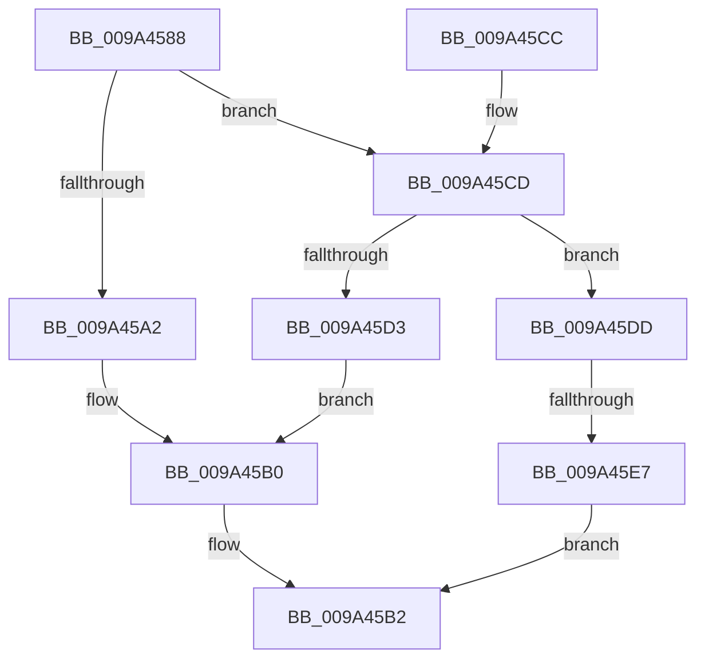

# RawFileSystemControl

- RVA: `0x009A4588`–`0x009A45EE` (길이 `102` bytes)
- VA: `0x00000001409A4588`
- 실행 섹션: `PAGE`
- PDB 이름 있음: `예`; PDB Function 태그: `예`
- unwind 정보 RVA: `0x00088DA0`
- 디코드: `32`개 명령, `102/102` bytes 표시
- 미해석 바이트: `0` (있으면 어셈블리에 `.byte`로 보존)

> 이 문서는 커널 이미지의 기계어와 PDB 기호를 분석해 생성했습니다. 4번과 5번은 함수 원형과 자료형을 바이너리 사용 방식에서 추정한 C 해석이며 원본 소스 복구 결과는 아닙니다.

## 1. Dependencies

- 직접 호출 지점: **3**; 고유 호출 대상: **3**
- 직접 호출자로 확인된 함수: **1**
- RIP 상대 이미지 참조: **0**

### Outgoing calls
- `0x009A45AB` → [RawUserFsCtrl](RawUserFsCtrl_function_009A45F4.md) (function, `0x009A45F4`)
- `0x009A45BA` → [IofCompleteRequest](../../text/29/IofCompleteRequest_function_0029B5C0.md) (function, `0x0029B5C0`)
- `0x009A45D6` → [RawMountVolume](RawMountVolume_function_009A4844.md) (function, `0x009A4844`)

### Direct callers
- [RawDispatch](RawDispatch_function_009A3920.md) at `0x009A39B8`

### Static image references
- 디코드된 RIP-relative 메모리 참조가 없습니다.

## 2. Other-region calls and transfers

- 다른 실행 섹션으로 향하는 call: **1**
  - `0x009A45BA` → [IofCompleteRequest](../../text/29/IofCompleteRequest_function_0029B5C0.md) (`PAGE` → `.text`)
- call이 아닌 외부 분기/꼬리 이동: **1**
  - `0x009A45E1` → [sub_00B2D562](../B2/Unknown_function_00B2D562.md) (`tail-transfer`)

## 3. Assembly (complete function range)

```asm
009A4588  48 89 5C 24 08                  mov qword ptr [rsp + 8], rbx
009A458D  57                              push rdi
009A458E  48 83 EC 20                     sub rsp, 0x20
009A4592  45 0F B6 48 01                  movzx r9d, byte ptr [r8 + 1]
009A4597  4D 8B D0                        mov r10, r8
009A459A  48 8B FA                        mov rdi, rdx
009A459D  45 85 C9                        test r9d, r9d
009A45A0  75 2B                           jne 0x1409a45cd
009A45A2  4C 8B C1                        mov r8, rcx
009A45A5  49 8B D2                        mov rdx, r10
009A45A8  48 8B CF                        mov rcx, rdi
009A45AB  E8 44 00 00 00                  call 0x1409a45f4
009A45B0  8B D8                           mov ebx, eax
009A45B2  B2 01                           mov dl, 1
009A45B4  89 5F 30                        mov dword ptr [rdi + 0x30], ebx
009A45B7  48 8B CF                        mov rcx, rdi
009A45BA  E8 01 70 8F FF                  call 0x14029b5c0
009A45BF  8B C3                           mov eax, ebx
009A45C1  48 8B 5C 24 30                  mov rbx, qword ptr [rsp + 0x30]
009A45C6  48 83 C4 20                     add rsp, 0x20
009A45CA  5F                              pop rdi
009A45CB  C3                              ret
009A45CC  CC                              int3
009A45CD  41 83 E9 01                     sub r9d, 1
009A45D1  75 0A                           jne 0x1409a45dd
009A45D3  49 8B CA                        mov rcx, r10
009A45D6  E8 69 02 00 00                  call 0x1409a4844
009A45DB  EB D3                           jmp 0x1409a45b0
009A45DD  41 83 F9 01                     cmp r9d, 1
009A45E1  0F 84 7B 8F 18 00               je 0x140b2d562
009A45E7  BB 10 00 00 C0                  mov ebx, 0xc0000010
009A45EC  EB C4                           jmp 0x1409a45b2
```

## 4. C-style interpretation (structured pseudocode)

```c
__int64 __fastcall RawFileSystemControl(__int64 a1, __int64 a2, __int64 a3)
{
    __int64 result;
    __int64 v_rsp;
    unsigned __int64 v_stack_p8;

    v_stack_p8 = v_rbx;
    v_rsp = (v_rsp) - (32);
    if ((unsigned int)(*(unsigned __int8 *)(a3 + 1)) != 0) goto loc_009A45CD;
    result = RawUserFsCtrl(a2, a3, a1, *(unsigned __int8 *)(a3 + 1));
loc_009A45B0:
loc_009A45B2:
    *(unsigned int *)(a2 + 48) = (unsigned int)((unsigned int)((unsigned int)(result)));
    result = IofCompleteRequest(a2, 1, a1, *(unsigned __int8 *)(a3 + 1));
    v_rsp = (v_rsp) + (32);
    return (unsigned int)((unsigned int)((unsigned int)((unsigned int)(result))));
loc_009A45CD:
    a4 = (unsigned int)((*(unsigned __int8 *)(a3 + 1)) - (1));
    if (condition_is_not_equal) goto loc_009A45DD;
    result = RawMountVolume(a3, 1, a1, a4);
    goto loc_009A45B0;
loc_009A45DD:
    goto loc_009A45B2;
}
```

## 5. (Beta) C Style

```c
int64_t RawFileSystemControl(int64_t Arg1, void *Arg2, void *Arg3)
{
    uint8_t *arg2 = (uint8_t *)Arg2;
    uint8_t *arg3 = (uint8_t *)Arg3;

    int64_t result;
    int64_t local_rsp;
    uint64_t v_stack_p8;

    v_stack_p8 = local_rbx;
    local_rsp = (local_rsp) - (32);
    if ((uint32_t)(*(uint8_t *)(arg3 + 0x1)) != 0) goto loc_009A45CD;
    result = RawUserFsCtrl(Arg2, Arg3, Arg1, *(uint8_t *)(arg3 + 0x1));
loc_009A45B0:
loc_009A45B2:
    *(uint32_t *)(arg2 + 0x30) = (uint32_t)((uint32_t)((uint32_t)(result)));
    result = IofCompleteRequest(Arg2, 1, Arg1, *(uint8_t *)(arg3 + 0x1));
    local_rsp = (local_rsp) + (32);
    return (uint32_t)((uint32_t)((uint32_t)((uint32_t)(result))));
loc_009A45CD:
    a4 = (uint32_t)((*(uint8_t *)(arg3 + 0x1)) - (1));
    if (condition_is_not_equal) goto loc_009A45DD;
    result = RawMountVolume(Arg3, 1, Arg1, a4);
    goto loc_009A45B0;
loc_009A45DD:
    goto loc_009A45B2;
}
```

### 관측된 메모리 오프셋

구조체 형식이 확인되지 않은 접근은 인자 기준의 오프셋으로만 기록했습니다.

| 기준 인자 | 오프셋 표현 | 폭 (bit) | 접근 |
|---|---:|---:|---|
| `Arg2` | `+ 0x30` | `32` | `W` |
| `Arg3` | `+ 0x1` | `8` | `R` |

## 6. Execution-region graph

[열기: 2D/3D 그래프와 함수 탐색 컨트롤 패널](../../../control-panel.html?section=page&rva=0x009A4588&view=graph)

- 2D 그래프는 위에서 아래로 흐르고, 3D 그래프는 빈 공간을 드래그해 회전합니다. Shift+드래그는 이동, 휠은 확대·축소, 함수 노드 선택은 대상 보고서 이동입니다.

### Static fallback


