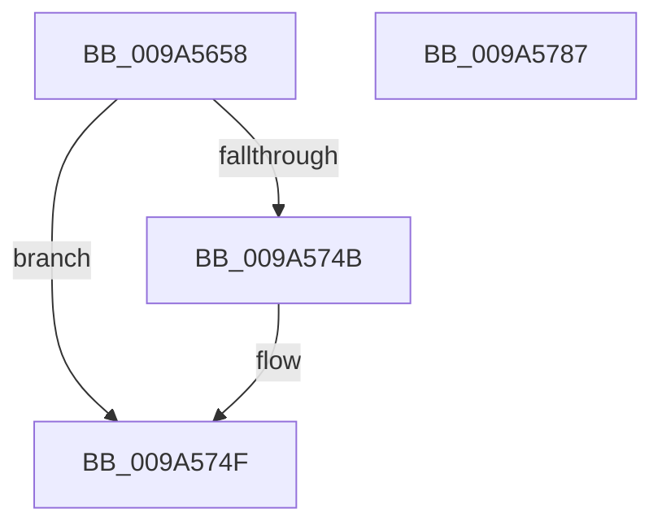

# RawInitializeVcb

- RVA: `0x009A5658`–`0x009A5788` (길이 `304` bytes)
- VA: `0x00000001409A5658`
- 실행 섹션: `PAGE`
- PDB 이름 있음: `예`; PDB Function 태그: `아니요`
- unwind 정보 RVA: `0x0005C954`
- 디코드: `75`개 명령, `304/304` bytes 표시
- 미해석 바이트: `0` (있으면 어셈블리에 `.byte`로 보존)

> 이 문서는 커널 이미지의 기계어와 PDB 기호를 분석해 생성했습니다. 4번과 5번은 함수 원형과 자료형을 바이너리 사용 방식에서 추정한 C 해석이며 원본 소스 복구 결과는 아닙니다.

## 1. Dependencies

- 직접 호출 지점: **5**; 고유 호출 대상: **4**
- 직접 호출자로 확인된 함수: **1**
- RIP 상대 이미지 참조: **0**

### Outgoing calls
- `0x009A567D` → [memset](../../text/6C/memset_function_006C6C40.md) (function, `0x006C6C40`)
- `0x009A56A8` → [ExAllocatePoolWithTag](../../poolcode/B8/ExAllocatePoolWithTag_function_00B82010.md) (function, `0x00B82010`)
- `0x009A56BE` → [ExAllocateCacheAwareRundownProtection](ExAllocateCacheAwareRundownProtection_function_009A5790.md) (function, `0x009A5790`)
- `0x009A5704` → [KeInitializeEvent](../../text/40/KeInitializeEvent_function_0040DD10.md) (function, `0x0040DD10`)
- `0x009A5724` → [KeInitializeEvent](../../text/40/KeInitializeEvent_function_0040DD10.md) (function, `0x0040DD10`)

### Direct callers
- [RawMountVolume](RawMountVolume_function_009A4844.md) at `0x009A490F`

### Static image references
- 디코드된 RIP-relative 메모리 참조가 없습니다.

## 2. Other-region calls and transfers

- 다른 실행 섹션으로 향하는 call: **4**
  - `0x009A567D` → [memset](../../text/6C/memset_function_006C6C40.md) (`PAGE` → `.text`)
  - `0x009A56A8` → [ExAllocatePoolWithTag](../../poolcode/B8/ExAllocatePoolWithTag_function_00B82010.md) (`PAGE` → `POOLCODE`)
  - `0x009A5704` → [KeInitializeEvent](../../text/40/KeInitializeEvent_function_0040DD10.md) (`PAGE` → `.text`)
  - `0x009A5724` → [KeInitializeEvent](../../text/40/KeInitializeEvent_function_0040DD10.md) (`PAGE` → `.text`)
- 별도 외부 분기/꼬리 이동을 확인하지 못했습니다.

## 3. Assembly (complete function range)

```asm
009A5658  48 89 5C 24 08                  mov qword ptr [rsp + 8], rbx
009A565D  48 89 6C 24 10                  mov qword ptr [rsp + 0x10], rbp
009A5662  48 89 74 24 18                  mov qword ptr [rsp + 0x18], rsi
009A5667  57                              push rdi
009A5668  48 83 EC 20                     sub rsp, 0x20
009A566C  49 8B F8                        mov rdi, r8
009A566F  48 8B DA                        mov rbx, rdx
009A5672  33 D2                           xor edx, edx
009A5674  41 B8 60 01 00 00               mov r8d, 0x160
009A567A  48 8B F1                        mov rsi, rcx
009A567D  E8 BE 15 D2 FF                  call 0x1406c6c40
009A5682  48 89 BE C8 00 00 00            mov qword ptr [rsi + 0xc8], rdi
009A5689  B9 00 06 00 00                  mov ecx, 0x600
009A568E  BF 52 61 77 20                  mov edi, 0x20776152
009A5693  C7 06 00 06 60 01               mov dword ptr [rsi], 0x1600600
009A5699  44 8B C7                        mov r8d, edi
009A569C  48 89 9E C0 00 00 00            mov qword ptr [rsi + 0xc0], rbx
009A56A3  BA 60 00 00 00                  mov edx, 0x60
009A56A8  E8 63 C9 1D 00                  call 0x140b82010
009A56AD  8B D7                           mov edx, edi
009A56AF  48 89 86 D0 00 00 00            mov qword ptr [rsi + 0xd0], rax
009A56B6  B9 00 02 00 00                  mov ecx, 0x200
009A56BB  48 8B D8                        mov rbx, rax
009A56BE  E8 CD 00 00 00                  call 0x1409a5790
009A56C3  48 F7 DB                        neg rbx
009A56C6  48 89 86 E8 00 00 00            mov qword ptr [rsi + 0xe8], rax
009A56CD  B9 9A 00 00 C0                  mov ecx, 0xc000009a
009A56D2  BD 01 00 00 00                  mov ebp, 1
009A56D7  1B DB                           sbb ebx, ebx
009A56D9  89 AE F0 00 00 00               mov dword ptr [rsi + 0xf0], ebp
009A56DF  F7 D3                           not ebx
009A56E1  8B D5                           mov edx, ebp
009A56E3  23 D9                           and ebx, ecx
009A56E5  48 85 C0                        test rax, rax
009A56E8  0F 44 D9                        cmove ebx, ecx
009A56EB  48 83 A6 F8 00 00 00 00         and qword ptr [rsi + 0xf8], 0
009A56F3  83 A6 00 01 00 00 00            and dword ptr [rsi + 0x100], 0
009A56FA  48 8D 8E 08 01 00 00            lea rcx, [rsi + 0x108]
009A5701  45 33 C0                        xor r8d, r8d
009A5704  E8 07 86 A6 FF                  call 0x14040dd10
009A5709  48 8D BE 28 01 00 00            lea rdi, [rsi + 0x128]
009A5710  45 33 C0                        xor r8d, r8d
009A5713  48 83 67 08 00                  and qword ptr [rdi + 8], 0
009A5718  48 8D 4F 18                     lea rcx, [rdi + 0x18]
009A571C  83 67 10 00                     and dword ptr [rdi + 0x10], 0
009A5720  8B D5                           mov edx, ebp
009A5722  89 2F                           mov dword ptr [rdi], ebp
009A5724  E8 E7 85 A6 FF                  call 0x14040dd10
009A5729  8A 46 07                        mov al, byte ptr [rsi + 7]
009A572C  80 4E 04 40                     or byte ptr [rsi + 4], 0x40
009A5730  24 0F                           and al, 0xf
009A5732  80 4E 06 02                     or byte ptr [rsi + 6], 2
009A5736  0C 50                           or al, 0x50
009A5738  88 46 07                        mov byte ptr [rsi + 7], al
009A573B  48 8D 46 38                     lea rax, [rsi + 0x38]
009A573F  48 89 40 08                     mov qword ptr [rax + 8], rax
009A5743  48 89 00                        mov qword ptr [rax], rax
009A5746  48 85 FF                        test rdi, rdi
009A5749  74 04                           je 0x1409a574f
009A574B  48 89 7E 30                     mov qword ptr [rsi + 0x30], rdi
009A574F  48 83 66 48 00                  and qword ptr [rsi + 0x48], 0
009A5754  8B C3                           mov eax, ebx
009A5756  48 83 66 50 00                  and qword ptr [rsi + 0x50], 0
009A575B  48 83 66 58 00                  and qword ptr [rsi + 0x58], 0
009A5760  48 83 66 60 00                  and qword ptr [rsi + 0x60], 0
009A5765  83 66 68 00                     and dword ptr [rsi + 0x68], 0
009A5769  48 83 66 70 00                  and qword ptr [rsi + 0x70], 0
009A576E  83 4E 78 10                     or dword ptr [rsi + 0x78], 0x10
009A5772  48 8B 74 24 40                  mov rsi, qword ptr [rsp + 0x40]
009A5777  48 8B 5C 24 30                  mov rbx, qword ptr [rsp + 0x30]
009A577C  48 8B 6C 24 38                  mov rbp, qword ptr [rsp + 0x38]
009A5781  48 83 C4 20                     add rsp, 0x20
009A5785  5F                              pop rdi
009A5786  C3                              ret
009A5787  CC                              int3
```

## 4. C-style interpretation (structured pseudocode)

```c
__int64 __fastcall RawInitializeVcb(__int64 a1, __int64 a2, __int64 a3)
{
    __int64 result;
    __int64 v_rbx;
    __int64 v_rsp;
    unsigned __int64 v_stack_p10;
    unsigned __int64 v_stack_p18;
    unsigned __int64 v_stack_p8;

    v_stack_p8 = v_rbx;
    v_stack_p10 = v_rbp;
    v_stack_p18 = v_rsi;
    v_rsp = (v_rsp) - (32);
    a2 = 0;
    result = memset(a1, a2, 352, a4);
    *(unsigned __int64 *)(a1 + 200) = a3;
    *(unsigned int *)(a1) = 0x1600600ULL;
    *(unsigned __int64 *)(a1 + 192) = 0;
    result = ExAllocatePoolWithTag((unsigned int)(0x600ULL), 96, (unsigned int)((unsigned int)((unsigned int)(0x20776152ULL))), a4);
    *(unsigned __int64 *)(a1 + 208) = result;
    result = ExAllocateCacheAwareRundownProtection(512, (unsigned int)((unsigned int)((unsigned int)(0x20776152ULL))), (unsigned int)((unsigned int)((unsigned int)(0x20776152ULL))), a4);
    v_rbx = -(result);
    *(unsigned __int64 *)(a1 + 232) = result;
    *(unsigned int *)(a1 + 240) = 1;
    v_rbx = (unsigned int)(~(v_rbx));
    v_rbx = (unsigned int)((v_rbx) & ((unsigned int)((unsigned int)(0xC000009AULL))));
    if (result == 0) { v_rbx = (unsigned int)((unsigned int)(0xC000009AULL)); }
    a3 = 0;
    result = KeInitializeEvent(a1 + 264, 1, a3, a4);
    a3 = 0;
    *(unsigned int *)(a1 + 296) = 1;
    result = KeInitializeEvent(a1 + 296 + 24, 1, a3, a4);
    result = (unsigned __int8)((*(unsigned __int8 *)(a1 + 7)) & (15));
    result = (unsigned __int8)((result) | (80));
    *(unsigned __int8 *)(a1 + 7) = (unsigned __int8)(result);
    *(unsigned __int64 *)(a1 + 56 + 8) = a1 + 56;
    *(unsigned __int64 *)(a1 + 56) = a1 + 56;
    if (a1 + 296 != 0) {
        *(unsigned __int64 *)(a1 + 48) = a1 + 296;
    }
    v_rsp = (v_rsp) + (32);
    return (unsigned int)((unsigned int)(v_rbx));
}
```

## 5. (Beta) C Style

```c
int64_t RawInitializeVcb(void *Arg1, int64_t Arg2, int64_t Arg3)
{
    uint8_t *arg1 = (uint8_t *)Arg1;

    int64_t result;
    int64_t local_rbx;
    int64_t local_rsp;
    uint64_t v_stack_p10;
    uint64_t v_stack_p18;
    uint64_t v_stack_p8;

    v_stack_p8 = local_rbx;
    v_stack_p10 = local_rbp;
    v_stack_p18 = local_rsi;
    local_rsp = (local_rsp) - (32);
    Arg2 = 0;
    result = memset(Arg1, Arg2, 352, a4);
    *(uint64_t *)(arg1 + 0xC8) = Arg3;
    *(uint32_t *)(arg1) = 0x1600600ULL;
    *(uint64_t *)(arg1 + 0xC0) = 0;
    result = ExAllocatePoolWithTag((uint32_t)(0x600ULL), 96, (uint32_t)((uint32_t)((uint32_t)(0x20776152ULL))), a4);
    *(uint64_t *)(arg1 + 0xD0) = result;
    result = ExAllocateCacheAwareRundownProtection(512, (uint32_t)((uint32_t)((uint32_t)(0x20776152ULL))), (uint32_t)((uint32_t)((uint32_t)(0x20776152ULL))), a4);
    local_rbx = -(result);
    *(uint64_t *)(arg1 + 0xE8) = result;
    *(uint32_t *)(arg1 + 0xF0) = 1;
    local_rbx = (uint32_t)(~(local_rbx));
    local_rbx = (uint32_t)((local_rbx) & ((uint32_t)((uint32_t)(0xC000009AULL))));
    if (result == 0) { local_rbx = (uint32_t)((uint32_t)(0xC000009AULL)); }
    Arg3 = 0;
    result = KeInitializeEvent(Arg1 + 264, 1, Arg3, a4);
    Arg3 = 0;
    *(uint32_t *)(arg1 + 0x128) = 1;
    result = KeInitializeEvent(Arg1 + 296 + 24, 1, Arg3, a4);
    result = (uint8_t)((*(uint8_t *)(arg1 + 0x7)) & (15));
    result = (uint8_t)((result) | (80));
    *(uint8_t *)(arg1 + 0x7) = (uint8_t)(result);
    *(void **)(arg1 + 0x38 + 0x8) = Arg1 + 56;
    *(void **)(arg1 + 0x38) = Arg1 + 56;
    if (Arg1 + 296 != 0) {
        *(void **)(arg1 + 0x30) = Arg1 + 296;
    }
    local_rsp = (local_rsp) + (32);
    return (uint32_t)((uint32_t)(local_rbx));
}
```

### 관측된 메모리 오프셋

구조체 형식이 확인되지 않은 접근은 인자 기준의 오프셋으로만 기록했습니다.

| 기준 인자 | 오프셋 표현 | 폭 (bit) | 접근 |
|---|---:|---:|---|
| `Arg1` | `+ 0x0` | `32` | `W` |
| `Arg1` | `+ 0x0` | `64` | `W` |
| `Arg1` | `+ 0x4` | `8` | `R/W` |
| `Arg1` | `+ 0x6` | `8` | `R/W` |
| `Arg1` | `+ 0x7` | `8` | `R` |
| `Arg1` | `+ 0x7` | `8` | `W` |
| `Arg1` | `+ 0x8` | `64` | `R/W` |
| `Arg1` | `+ 0x8` | `64` | `W` |
| `Arg1` | `+ 0x10` | `32` | `R/W` |
| `Arg1` | `+ 0x18` | `64` | `R` |
| `Arg1` | `+ 0x30` | `64` | `W` |
| `Arg1` | `+ 0x38` | `64` | `R` |
| `Arg1` | `+ 0x48` | `64` | `R/W` |
| `Arg1` | `+ 0x50` | `64` | `R/W` |
| `Arg1` | `+ 0x58` | `64` | `R/W` |
| `Arg1` | `+ 0x60` | `64` | `R/W` |
| `Arg1` | `+ 0x68` | `32` | `R/W` |
| `Arg1` | `+ 0x70` | `64` | `R/W` |
| `Arg1` | `+ 0x78` | `32` | `R/W` |
| `Arg1` | `+ 0xC0` | `64` | `W` |
| `Arg1` | `+ 0xC8` | `64` | `W` |
| `Arg1` | `+ 0xD0` | `64` | `W` |
| `Arg1` | `+ 0xE8` | `64` | `W` |
| `Arg1` | `+ 0xF0` | `32` | `W` |
| `Arg1` | `+ 0xF8` | `64` | `R/W` |
| `Arg1` | `+ 0x100` | `32` | `R/W` |
| `Arg1` | `+ 0x108` | `64` | `R` |
| `Arg1` | `+ 0x128` | `64` | `R` |

## 6. Execution-region graph

[열기: 2D/3D 그래프와 함수 탐색 컨트롤 패널](../../../control-panel.html?section=page&rva=0x009A5658&view=graph)

- 2D 그래프는 위에서 아래로 흐르고, 3D 그래프는 빈 공간을 드래그해 회전합니다. Shift+드래그는 이동, 휠은 확대·축소, 함수 노드 선택은 대상 보고서 이동입니다.

### Static fallback


