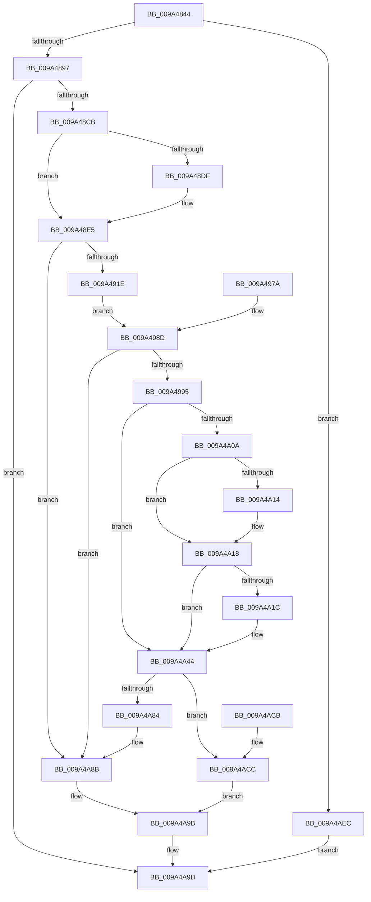

# RawMountVolume

- RVA: `0x009A4844`–`0x009A4AF3` (길이 `687` bytes)
- VA: `0x00000001409A4844`
- 실행 섹션: `PAGE`
- PDB 이름 있음: `예`; PDB Function 태그: `아니요`
- unwind 정보 RVA: `0x0009C548`
- 디코드: `151`개 명령, `687/687` bytes 표시
- 미해석 바이트: `0` (있으면 어셈블리에 `.byte`로 보존)

> 이 문서는 커널 이미지의 기계어와 PDB 기호를 분석해 생성했습니다. 4번과 5번은 함수 원형과 자료형을 바이너리 사용 방식에서 추정한 C 해석이며 원본 소스 복구 결과는 아닙니다.

## 1. Dependencies

- 직접 호출 지점: **13**; 고유 호출 대상: **12**
- 직접 호출자로 확인된 함수: **1**
- RIP 상대 이미지 참조: **7**

### Outgoing calls
- `0x009A487B` → [RawScanDeletedList](RawScanDeletedList_function_009A55F0.md) (function, `0x009A55F0`)
- `0x009A48BE` → [IoCreateDevice](IoCreateDevice_function_009A4B00.md) (function, `0x009A4B00`)
- `0x009A490F` → [RawInitializeVcb](RawInitializeVcb_function_009A5658.md) (function, `0x009A5658`)
- `0x009A496B` → [IoCreateStreamFileObjectLite](IoCreateStreamFileObjectLite_function_009A58B0.md) (function, `0x009A58B0`)
- `0x009A4A01` → [PnpGetRelatedTargetDevice](../../text/27/PnpGetRelatedTargetDevice_function_00271F54.md) (function, `0x00271F54`)
- `0x009A4A37` → [IoReportTargetDeviceChangeAsynchronous](../../text/47/IoReportTargetDeviceChangeAsynchronous_function_00475DA0.md) (function, `0x00475DA0`)
- `0x009A4A3F` → [ObfDereferenceObject](../../text/2F/ObfDereferenceObject_function_002F9350.md) (function, `0x002F9350`)
- `0x009A4A47` → [ObfDereferenceObject](../../text/2F/ObfDereferenceObject_function_002F9350.md) (function, `0x002F9350`)
- `0x009A4A64` → [ExAcquireFastMutex](../../text/20/ExAcquireFastMutex_function_0020E5A0.md) (function, `0x0020E5A0`)
- `0x009A4A8E` → [RawCleanupVcb](RawCleanupVcb_function_009A5C44.md) (function, `0x009A5C44`)
- `0x009A4A96` → [IoDeleteDevice](../../text/26/IoDeleteDevice_function_0026FE90.md) (function, `0x0026FE90`)
- `0x009A4AA8` → [_security_check_cookie](../../text/6A/_security_check_cookie_function_006AC640.md) (function, `0x006AC640`)
- `0x009A4AE5` → [ExReleaseFastMutex](../../text/25/ExReleaseFastMutex_function_002519C0.md) (function, `0x002519C0`)

### Direct callers
- [RawFileSystemControl](RawFileSystemControl_function_009A4588.md) at `0x009A45D6`

### Static image references
- `0x009A4860` → RVA `0x00E0A740` (`.data`; read)
- `0x009A49D4` → RVA `0x00B050F0` (` ?? ::NNGAKEGL::`string'`; read)
- `0x009A49E2` → RVA `0x00B050F4` (`PAGE`; read)
- `0x009A4A1C` → RVA `0x000135D8` (`.rdata`; read)
- `0x009A4A5D` → RVA `0x00F05CC0` (`.data`; read)
- `0x009A4A70` → RVA `0x00F05D00` (`.data`; read)
- `0x009A4AD7` → RVA `0x00F05D00` (`.data`; write)

## 2. Other-region calls and transfers

- 다른 실행 섹션으로 향하는 call: **8**
  - `0x009A4A01` → [PnpGetRelatedTargetDevice](../../text/27/PnpGetRelatedTargetDevice_function_00271F54.md) (`PAGE` → `.text`)
  - `0x009A4A37` → [IoReportTargetDeviceChangeAsynchronous](../../text/47/IoReportTargetDeviceChangeAsynchronous_function_00475DA0.md) (`PAGE` → `.text`)
  - `0x009A4A3F` → [ObfDereferenceObject](../../text/2F/ObfDereferenceObject_function_002F9350.md) (`PAGE` → `.text`)
  - `0x009A4A47` → [ObfDereferenceObject](../../text/2F/ObfDereferenceObject_function_002F9350.md) (`PAGE` → `.text`)
  - `0x009A4A64` → [ExAcquireFastMutex](../../text/20/ExAcquireFastMutex_function_0020E5A0.md) (`PAGE` → `.text`)
  - `0x009A4A96` → [IoDeleteDevice](../../text/26/IoDeleteDevice_function_0026FE90.md) (`PAGE` → `.text`)
  - `0x009A4AA8` → [_security_check_cookie](../../text/6A/_security_check_cookie_function_006AC640.md) (`PAGE` → `.text`)
  - `0x009A4AE5` → [ExReleaseFastMutex](../../text/25/ExReleaseFastMutex_function_002519C0.md) (`PAGE` → `.text`)
- 별도 외부 분기/꼬리 이동을 확인하지 못했습니다.

## 3. Assembly (complete function range)

```asm
009A4844  4C 8B DC                        mov r11, rsp
009A4847  49 89 5B 10                     mov qword ptr [r11 + 0x10], rbx
009A484B  49 89 73 18                     mov qword ptr [r11 + 0x18], rsi
009A484F  49 89 7B 20                     mov qword ptr [r11 + 0x20], rdi
009A4853  41 54                           push r12
009A4855  41 56                           push r14
009A4857  41 57                           push r15
009A4859  48 81 EC A0 00 00 00            sub rsp, 0xa0
009A4860  48 8B 05 D9 5E 46 00            mov rax, qword ptr [rip + 0x465ed9]
009A4867  48 33 C4                        xor rax, rsp
009A486A  48 89 84 24 98 00 00 00         mov qword ptr [rsp + 0x98], rax
009A4872  48 8B F1                        mov rsi, rcx
009A4875  33 FF                           xor edi, edi
009A4877  49 89 7B 88                     mov qword ptr [r11 - 0x78], rdi
009A487B  E8 70 0D 00 00                  call 0x1409a55f0
009A4880  4C 8B 7E 10                     mov r15, qword ptr [rsi + 0x10]
009A4884  B8 00 10 00 00                  mov eax, 0x1000
009A4889  66 41 39 87 30 01 00 00         cmp word ptr [r15 + 0x130], ax
009A4891  0F 87 55 02 00 00               ja 0x1409a4aec
009A4897  48 8B 4E 28                     mov rcx, qword ptr [rsi + 0x28]
009A489B  48 8D 44 24 40                  lea rax, [rsp + 0x40]
009A48A0  48 89 44 24 30                  mov qword ptr [rsp + 0x30], rax
009A48A5  40 88 7C 24 28                  mov byte ptr [rsp + 0x28], dil
009A48AA  89 7C 24 20                     mov dword ptr [rsp + 0x20], edi
009A48AE  44 8D 4F 08                     lea r9d, [rdi + 8]
009A48B2  45 33 C0                        xor r8d, r8d
009A48B5  BA 60 01 00 00                  mov edx, 0x160
009A48BA  48 8B 49 08                     mov rcx, qword ptr [rcx + 8]
009A48BE  E8 3D 02 00 00                  call 0x1409a4b00
009A48C3  85 C0                           test eax, eax
009A48C5  0F 88 D2 01 00 00               js 0x1409a4a9d
009A48CB  48 8B 5C 24 40                  mov rbx, qword ptr [rsp + 0x40]
009A48D0  41 8B 87 98 00 00 00            mov eax, dword ptr [r15 + 0x98]
009A48D7  3B 83 98 00 00 00               cmp eax, dword ptr [rbx + 0x98]
009A48DD  76 06                           jbe 0x1409a48e5
009A48DF  89 83 98 00 00 00               mov dword ptr [rbx + 0x98], eax
009A48E5  41 0F B7 87 30 01 00 00         movzx eax, word ptr [r15 + 0x130]
009A48ED  66 89 83 30 01 00 00            mov word ptr [rbx + 0x130], ax
009A48F4  83 4B 30 10                     or dword ptr [rbx + 0x30], 0x10
009A48F8  4C 8D B3 50 01 00 00            lea r14, [rbx + 0x150]
009A48FF  4C 89 74 24 50                  mov qword ptr [rsp + 0x50], r14
009A4904  4C 8B 46 08                     mov r8, qword ptr [rsi + 8]
009A4908  48 8B 56 10                     mov rdx, qword ptr [rsi + 0x10]
009A490C  49 8B CE                        mov rcx, r14
009A490F  E8 44 0D 00 00                  call 0x1409a5658
009A4914  8B F0                           mov esi, eax
009A4916  85 C0                           test eax, eax
009A4918  0F 88 6D 01 00 00               js 0x1409a4a8b
009A491E  48 8B 83 18 02 00 00            mov rax, qword ptr [rbx + 0x218]
009A4925  48 89 58 08                     mov qword ptr [rax + 8], rbx
009A4929  48 8B 83 18 02 00 00            mov rax, qword ptr [rbx + 0x218]
009A4930  83 48 18 FF                     or dword ptr [rax + 0x18], 0xffffffff
009A4934  48 8B 83 18 02 00 00            mov rax, qword ptr [rbx + 0x218]
009A493B  66 89 78 06                     mov word ptr [rax + 6], di
009A493F  0F BA 73 30 07                  btr dword ptr [rbx + 0x30], 7
009A4944  41 8A 47 4C                     mov al, byte ptr [r15 + 0x4c]
009A4948  04 01                           add al, 1
009A494A  88 43 4C                        mov byte ptr [rbx + 0x4c], al
009A494D  48 89 7C 24 48                  mov qword ptr [rsp + 0x48], rdi
009A4952  0F 57 C0                        xorps xmm0, xmm0
009A4955  F3 0F 7F 44 24 5C               movdqu xmmword ptr [rsp + 0x5c], xmm0
009A495B  89 7C 24 6C                     mov dword ptr [rsp + 0x6c], edi
009A495F  89 BC 24 92 00 00 00            mov dword ptr [rsp + 0x92], edi
009A4966  48 8B D3                        mov rdx, rbx
009A4969  33 C9                           xor ecx, ecx
009A496B  E8 40 0F 00 00                  call 0x1409a58b0
009A4970  4C 8B F8                        mov r15, rax
009A4973  48 89 44 24 48                  mov qword ptr [rsp + 0x48], rax
009A4978  EB 13                           jmp 0x1409a498d
009A497A  8B F0                           mov esi, eax
009A497C  33 FF                           xor edi, edi
009A497E  48 8B 5C 24 40                  mov rbx, qword ptr [rsp + 0x40]
009A4983  4C 8B 7C 24 48                  mov r15, qword ptr [rsp + 0x48]
009A4988  4C 8B 74 24 50                  mov r14, qword ptr [rsp + 0x50]
009A498D  85 F6                           test esi, esi
009A498F  0F 88 F6 00 00 00               js 0x1409a4a8b
009A4995  83 83 CC 01 00 00 02            add dword ptr [rbx + 0x1cc], 2
009A499C  83 83 D0 01 00 00 02            add dword ptr [rbx + 0x1d0], 2
009A49A3  C7 44 24 58 01 00 3E 00         mov dword ptr [rsp + 0x58], 0x3e0001
009A49AB  48 89 7C 24 70                  mov qword ptr [rsp + 0x70], rdi
009A49B0  83 4C 24 78 FF                  or dword ptr [rsp + 0x78], 0xffffffff
009A49B5  48 C7 44 24 7C 01 00 00 00      mov qword ptr [rsp + 0x7c], 1
009A49BE  C7 84 24 84 00 00 00 06 00 00 00  mov dword ptr [rsp + 0x84], 6
009A49C9  C7 84 24 88 00 00 00 10 00 00 00  mov dword ptr [rsp + 0x88], 0x10
009A49D4  48 8B 05 15 07 16 00            mov rax, qword ptr [rip + 0x160715]
009A49DB  89 84 24 8C 00 00 00            mov dword ptr [rsp + 0x8c], eax
009A49E2  0F B7 05 0B 07 16 00            movzx eax, word ptr [rip + 0x16070b]
009A49E9  66 89 84 24 90 00 00 00         mov word ptr [rsp + 0x90], ax
009A49F1  4C 8B F7                        mov r14, rdi
009A49F4  48 89 7C 24 40                  mov qword ptr [rsp + 0x40], rdi
009A49F9  48 8D 54 24 40                  lea rdx, [rsp + 0x40]
009A49FE  49 8B CF                        mov rcx, r15
009A4A01  E8 4E D5 8C FF                  call 0x140271f54
009A4A06  85 C0                           test eax, eax
009A4A08  78 3A                           js 0x1409a4a44
009A4A0A  48 8B 4C 24 40                  mov rcx, qword ptr [rsp + 0x40]
009A4A0F  48 85 C9                        test rcx, rcx
009A4A12  74 04                           je 0x1409a4a18
009A4A14  4C 8B 71 20                     mov r14, qword ptr [rcx + 0x20]
009A4A18  85 C0                           test eax, eax
009A4A1A  78 28                           js 0x1409a4a44
009A4A1C  0F 10 05 B5 EB 66 FF            movups xmm0, xmmword ptr [rip - 0x99144b]
009A4A23  F3 0F 7F 44 24 5C               movdqu xmmword ptr [rsp + 0x5c], xmm0
009A4A29  45 33 C9                        xor r9d, r9d
009A4A2C  45 33 C0                        xor r8d, r8d
009A4A2F  48 8D 54 24 58                  lea rdx, [rsp + 0x58]
009A4A34  49 8B CE                        mov rcx, r14
009A4A37  E8 64 13 AD FF                  call 0x140475da0
009A4A3C  49 8B CE                        mov rcx, r14
009A4A3F  E8 0C 49 95 FF                  call 0x1402f9350
009A4A44  49 8B CF                        mov rcx, r15
009A4A47  E8 04 49 95 FF                  call 0x1402f9350
009A4A4C  B8 FE FF FF FF                  mov eax, 0xfffffffe
009A4A51  01 83 CC 01 00 00               add dword ptr [rbx + 0x1cc], eax
009A4A57  01 83 D0 01 00 00               add dword ptr [rbx + 0x1d0], eax
009A4A5D  48 8D 0D 5C 12 56 00            lea rcx, [rip + 0x56125c]
009A4A64  E8 37 9B 86 FF                  call 0x14020e5a0
009A4A69  48 81 C3 00 02 00 00            add rbx, 0x200
009A4A70  48 8B 05 89 12 56 00            mov rax, qword ptr [rip + 0x561289]
009A4A77  48 8D 0D 82 12 56 00            lea rcx, [rip + 0x561282]
009A4A7E  48 39 48 08                     cmp qword ptr [rax + 8], rcx
009A4A82  74 48                           je 0x1409a4acc
009A4A84  B9 03 00 00 00                  mov ecx, 3
009A4A89  CD 29                           int 0x29
009A4A8B  49 8B CE                        mov rcx, r14
009A4A8E  E8 B1 11 00 00                  call 0x1409a5c44
009A4A93  48 8B CB                        mov rcx, rbx
009A4A96  E8 F5 B3 8C FF                  call 0x14026fe90
009A4A9B  8B C6                           mov eax, esi
009A4A9D  48 8B 8C 24 98 00 00 00         mov rcx, qword ptr [rsp + 0x98]
009A4AA5  48 33 CC                        xor rcx, rsp
009A4AA8  E8 93 7B D0 FF                  call 0x1406ac640
009A4AAD  4C 8D 9C 24 A0 00 00 00         lea r11, [rsp + 0xa0]
009A4AB5  49 8B 5B 28                     mov rbx, qword ptr [r11 + 0x28]
009A4AB9  49 8B 73 30                     mov rsi, qword ptr [r11 + 0x30]
009A4ABD  49 8B 7B 38                     mov rdi, qword ptr [r11 + 0x38]
009A4AC1  49 8B E3                        mov rsp, r11
009A4AC4  41 5F                           pop r15
009A4AC6  41 5E                           pop r14
009A4AC8  41 5C                           pop r12
009A4ACA  C3                              ret
009A4ACB  CC                              int3
009A4ACC  48 89 03                        mov qword ptr [rbx], rax
009A4ACF  48 89 4B 08                     mov qword ptr [rbx + 8], rcx
009A4AD3  48 89 58 08                     mov qword ptr [rax + 8], rbx
009A4AD7  48 89 1D 22 12 56 00            mov qword ptr [rip + 0x561222], rbx
009A4ADE  48 8D 0D DB 11 56 00            lea rcx, [rip + 0x5611db]
009A4AE5  E8 D6 CE 8A FF                  call 0x1402519c0
009A4AEA  EB AF                           jmp 0x1409a4a9b
009A4AEC  B8 4F 01 00 C0                  mov eax, 0xc000014f
009A4AF1  EB AA                           jmp 0x1409a4a9d
```

## 4. C-style interpretation (structured pseudocode)

```c
__int64 __fastcall RawMountVolume(__int64 a1, __int64 a2, int a3)
{
    __int64 result;
    __int64 v_r14;
    __int64 v_rbx;
    __int64 v_rdi;
    __int64 v_rsp;
    unsigned __int64 v_stack_m18;
    unsigned __int64 v_stack_m20;
    unsigned int v_stack_m26;
    unsigned __int16 v_stack_m28;
    unsigned int v_stack_m2C;
    unsigned int v_stack_m30;
    unsigned int v_stack_m34;
    unsigned __int64 v_stack_m3C;
    unsigned int v_stack_m40;
    unsigned __int64 v_stack_m48;
    unsigned int v_stack_m4C;
    unsigned __int64 v_stack_m5C;
    unsigned int v_stack_m60;
    unsigned __int64 v_stack_m68;
    unsigned __int64 v_stack_m70;
    unsigned __int64 v_stack_m78;
    unsigned __int64 v_stack_m88;
    unsigned __int8 v_stack_m90;
    unsigned int v_stack_m98;

    *(unsigned __int64 *)(v_rsp + 16) = v_rbx;
    *(unsigned __int64 *)(v_rsp + 24) = v_rsi;
    *(unsigned __int64 *)(v_rsp + 32) = v_rdi;
    v_rsp = (v_rsp) - (160);
    result = (*(unsigned __int64 *)(v_rip + 4611801)) ^ (v_rsp);
    v_stack_m20 = result;
    v_rdi = 0;
    *(unsigned __int64 *)(v_rsp - 120) = 0;
    result = RawScanDeletedList(a1, a2, a3, a4);
    if ((*(unsigned __int16 *)(*(unsigned __int64 *)(a1 + 16) + 304)) > ((unsigned __int16)((unsigned int)(0x1000ULL)))) goto loc_009A4AEC;
    v_stack_m88 = v_stack_m78;
    v_stack_m90 = 0;
    v_stack_m98 = 0;
    a3 = 0;
    result = IoCreateDevice(*(unsigned __int64 *)(*(unsigned __int64 *)(a1 + 40) + 8), 352, a3, v_rdi + 8);
    if (sign_flag) goto loc_009A4A9D;
    if (((unsigned int)((unsigned int)(*(unsigned int *)(*(unsigned __int64 *)(a1 + 16) + 152)))) >= = (*(unsigned int *)(v_stack_m78 + 152))) {
        *(unsigned int *)(v_stack_m78 + 152) = (unsigned int)((unsigned int)(*(unsigned int *)(*(unsigned __int64 *)(a1 + 16) + 152)));
    }
    *(unsigned __int16 *)(v_stack_m78 + 304) = (unsigned __int16)(*(unsigned __int16 *)(*(unsigned __int64 *)(a1 + 16) + 304));
    v_stack_m68 = v_stack_m78 + 336;
    result = RawInitializeVcb(v_stack_m78 + 336, *(unsigned __int64 *)(a1 + 16), *(unsigned __int64 *)(a1 + 8), v_rdi + 8);
    if (sign_flag) goto loc_009A4A8B;
    *(unsigned __int64 *)(*(unsigned __int64 *)(v_stack_m78 + 536) + 8) = v_stack_m78;
    *(unsigned __int16 *)(*(unsigned __int64 *)(v_stack_m78 + 536) + 6) = 0;
    result = (unsigned __int8)((*(unsigned __int8 *)(*(unsigned __int64 *)(a1 + 16) + 76)) + (1));
    *(unsigned __int8 *)(v_stack_m78 + 76) = (unsigned __int8)(result);
    v_stack_m70 = 0;
    v_stack_m5C = v_xmm0;
    v_stack_m4C = 0;
    v_stack_m26 = 0;
    a1 = 0;
    result = IoCreateStreamFileObjectLite(a1, v_stack_m78, *(unsigned __int64 *)(a1 + 8), v_rdi + 8);
    v_stack_m70 = result;
    goto loc_009A498D;
loc_009A498D:
    if (sign_flag) goto loc_009A4A8B;
    v_stack_m60 = 0x3E0001ULL;
    v_stack_m48 = 0;
    v_stack_m3C = 1;
    v_stack_m34 = 6;
    v_stack_m30 = 16;
    v_stack_m2C = (unsigned int)(*(unsigned __int64 *)(v_rip + 1443605));
    v_stack_m28 = (unsigned __int16)(*(unsigned __int16 *)(v_rip + 1443595));
    v_stack_m78 = 0;
    result = PnpGetRelatedTargetDevice(result, v_stack_m78, *(unsigned __int64 *)(a1 + 8), v_rdi + 8);
    if (sign_flag) goto loc_009A4A44;
    v_r14 = 0;
    if (v_stack_m78 != 0) {
        v_r14 = *(unsigned __int64 *)(v_stack_m78 + 32);
    }
    if (!(sign_flag)) {
        v_stack_m5C = v_xmm0;
        a4 = 0;
        a3 = 0;
        a2 = v_stack_m60;
        a1 = v_r14;
        result = IoReportTargetDeviceChangeAsynchronous(a1, a2, a3, a4);
        a1 = v_r14;
        result = ObfDereferenceObject(a1, a2, a3, a4);
    }
    result = ObfDereferenceObject(result, a2, a3, a4);
    result = ExAcquireFastMutex(v_rip + 5640796, a2, a3, a4);
    v_rbx = (v_stack_m78) + (512);
    if ((*(unsigned __int64 *)(*(unsigned __int64 *)(v_rip + 5640841) + 8)) == (v_rip + 5640834)) goto loc_009A4ACC;
loc_009A4A8B:
    result = RawCleanupVcb(v_r14, a2, a3, a4);
    result = IoDeleteDevice(v_rbx, a2, a3, a4);
loc_009A4A9B:
loc_009A4A9D:
    a1 = (v_stack_m20) ^ (v_rsp);
    result = _security_check_cookie(a1, a2, a3, a4);
    return result;
loc_009A4ACC:
    *(unsigned __int64 *)(*(unsigned __int64 *)(v_stack_m18 + 40)) = result;
    *(unsigned __int64 *)(*(unsigned __int64 *)(v_stack_m18 + 40) + 8) = a1;
    *(unsigned __int64 *)(result + 8) = *(unsigned __int64 *)(v_stack_m18 + 40);
    *(unsigned __int64 *)(v_rip + 5640738) = *(unsigned __int64 *)(v_stack_m18 + 40);
    result = ExReleaseFastMutex(v_rip + 5640667, a2, a3, a4);
    goto loc_009A4A9B;
loc_009A4AEC:
    goto loc_009A4A9D;
}
```

## 5. (Beta) C Style

```c
int64_t RawMountVolume(void *Arg1, int64_t Arg2, int32_t Arg3)
{
    uint8_t *arg1 = (uint8_t *)Arg1;

    int64_t result;
    int64_t local_r14;
    int64_t local_rbx;
    int64_t local_rdi;
    int64_t local_rsp;
    uint64_t v_stack_m18;
    uint64_t v_stack_m20;
    uint32_t v_stack_m26;
    uint16_t v_stack_m28;
    uint32_t v_stack_m2C;
    uint32_t v_stack_m30;
    uint32_t v_stack_m34;
    uint64_t v_stack_m3C;
    uint32_t v_stack_m40;
    uint64_t v_stack_m48;
    uint32_t v_stack_m4C;
    uint64_t v_stack_m5C;
    uint32_t v_stack_m60;
    uint64_t v_stack_m68;
    uint64_t v_stack_m70;
    uint64_t v_stack_m78;
    uint64_t v_stack_m88;
    uint8_t v_stack_m90;
    uint32_t v_stack_m98;

    *(uint64_t *)(local_rsp + 0x10) = local_rbx;
    *(uint64_t *)(local_rsp + 0x18) = local_rsi;
    *(uint64_t *)(local_rsp + 0x20) = local_rdi;
    local_rsp = (local_rsp) - (160);
    result = (*(uint64_t *)(v_rip + 0x465ED9)) ^ (local_rsp);
    v_stack_m20 = result;
    local_rdi = 0;
    *(uint64_t *)(local_rsp - 0x78) = 0;
    result = RawScanDeletedList(Arg1, Arg2, Arg3, a4);
    if ((*(uint16_t *)(*(uint64_t *)(arg1 + 0x10) + 0x130)) > ((uint16_t)((uint32_t)(0x1000ULL)))) goto loc_009A4AEC;
    v_stack_m88 = v_stack_m78;
    v_stack_m90 = 0;
    v_stack_m98 = 0;
    Arg3 = 0;
    result = IoCreateDevice(*(uint64_t *)(*(uint64_t *)(arg1 + 0x28) + 0x8), 352, Arg3, local_rdi + 8);
    if (sign_flag) goto loc_009A4A9D;
    if (((uint32_t)((uint32_t)(*(uint32_t *)(*(uint64_t *)(arg1 + 0x10) + 0x98)))) >= = (*(uint32_t *)(v_stack_m78 + 0x98))) {
        *(uint32_t *)(v_stack_m78 + 0x98) = (uint32_t)((uint32_t)(*(uint32_t *)(*(uint64_t *)(arg1 + 0x10) + 0x98)));
    }
    *(uint16_t *)(v_stack_m78 + 0x130) = (uint16_t)(*(uint16_t *)(*(uint64_t *)(arg1 + 0x10) + 0x130));
    v_stack_m68 = v_stack_m78 + 336;
    result = RawInitializeVcb(v_stack_m78 + 336, *(uint64_t *)(arg1 + 0x10), *(uint64_t *)(arg1 + 0x8), local_rdi + 8);
    if (sign_flag) goto loc_009A4A8B;
    *(uint64_t *)(*(uint64_t *)(v_stack_m78 + 0x218) + 0x8) = v_stack_m78;
    *(uint16_t *)(*(uint64_t *)(v_stack_m78 + 0x218) + 0x6) = 0;
    result = (uint8_t)((*(uint8_t *)(*(uint64_t *)(arg1 + 0x10) + 0x4C)) + (1));
    *(uint8_t *)(v_stack_m78 + 0x4C) = (uint8_t)(result);
    v_stack_m70 = 0;
    v_stack_m5C = v_xmm0;
    v_stack_m4C = 0;
    v_stack_m26 = 0;
    Arg1 = 0;
    result = IoCreateStreamFileObjectLite(Arg1, v_stack_m78, *(uint64_t *)(arg1 + 0x8), local_rdi + 8);
    v_stack_m70 = result;
    goto loc_009A498D;
loc_009A498D:
    if (sign_flag) goto loc_009A4A8B;
    v_stack_m60 = 0x3E0001ULL;
    v_stack_m48 = 0;
    v_stack_m3C = 1;
    v_stack_m34 = 6;
    v_stack_m30 = 16;
    v_stack_m2C = (uint32_t)(*(uint64_t *)(v_rip + 0x160715));
    v_stack_m28 = (uint16_t)(*(uint16_t *)(v_rip + 0x16070B));
    v_stack_m78 = 0;
    result = PnpGetRelatedTargetDevice(result, v_stack_m78, *(uint64_t *)(arg1 + 0x8), local_rdi + 8);
    if (sign_flag) goto loc_009A4A44;
    local_r14 = 0;
    if (v_stack_m78 != 0) {
        local_r14 = *(uint64_t *)(v_stack_m78 + 0x20);
    }
    if (!(sign_flag)) {
        v_stack_m5C = v_xmm0;
        a4 = 0;
        Arg3 = 0;
        Arg2 = v_stack_m60;
        Arg1 = local_r14;
        result = IoReportTargetDeviceChangeAsynchronous(Arg1, Arg2, Arg3, a4);
        Arg1 = local_r14;
        result = ObfDereferenceObject(Arg1, Arg2, Arg3, a4);
    }
    result = ObfDereferenceObject(result, Arg2, Arg3, a4);
    result = ExAcquireFastMutex(v_rip + 5640796, Arg2, Arg3, a4);
    local_rbx = (v_stack_m78) + (512);
    if ((*(uint64_t *)(*(uint64_t *)(v_rip + 0x561289) + 0x8)) == (v_rip + 5640834)) goto loc_009A4ACC;
loc_009A4A8B:
    result = RawCleanupVcb(local_r14, Arg2, Arg3, a4);
    result = IoDeleteDevice(local_rbx, Arg2, Arg3, a4);
loc_009A4A9B:
loc_009A4A9D:
    Arg1 = (v_stack_m20) ^ (local_rsp);
    result = _security_check_cookie(Arg1, Arg2, Arg3, a4);
    return result;
loc_009A4ACC:
    *(uint64_t *)(*(uint64_t *)(v_stack_m18 + 0x28)) = result;
    *(void **)(*(uint64_t *)(v_stack_m18 + 0x28) + 0x8) = Arg1;
    *(uint64_t *)(result + 0x8) = *(uint64_t *)(v_stack_m18 + 0x28);
    *(uint64_t *)(v_rip + 0x561222) = *(uint64_t *)(v_stack_m18 + 0x28);
    result = ExReleaseFastMutex(v_rip + 5640667, Arg2, Arg3, a4);
    goto loc_009A4A9B;
loc_009A4AEC:
    goto loc_009A4A9D;
}
```

### 관측된 메모리 오프셋

구조체 형식이 확인되지 않은 접근은 인자 기준의 오프셋으로만 기록했습니다.

| 기준 인자 | 오프셋 표현 | 폭 (bit) | 접근 |
|---|---:|---:|---|
| `Arg1` | `+ 0x8` | `64` | `R` |
| `Arg1` | `+ 0x10` | `64` | `R` |
| `Arg1` | `+ 0x28` | `64` | `R` |

## 6. Execution-region graph

[열기: 2D/3D 그래프와 함수 탐색 컨트롤 패널](../../../control-panel.html?section=page&rva=0x009A4844&view=graph)

- 2D 그래프는 위에서 아래로 흐르고, 3D 그래프는 빈 공간을 드래그해 회전합니다. Shift+드래그는 이동, 휠은 확대·축소, 함수 노드 선택은 대상 보고서 이동입니다.

### Static fallback


