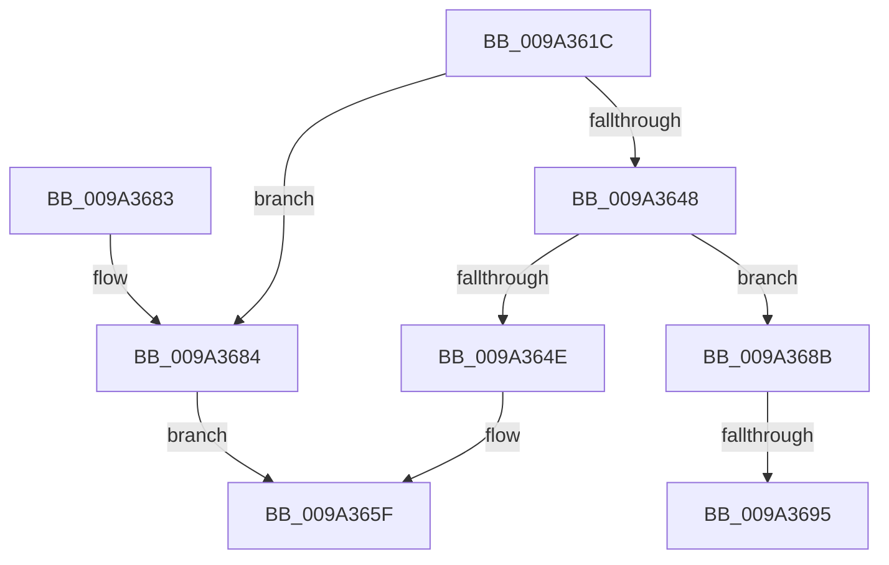

# RawQueryInformation

- RVA: `0x009A361C`–`0x009A369F` (길이 `131` bytes)
- VA: `0x00000001409A361C`
- 실행 섹션: `PAGE`
- PDB 이름 있음: `예`; PDB Function 태그: `예`
- unwind 정보 RVA: `0x0009C38C`
- 디코드: `37`개 명령, `131/131` bytes 표시
- 미해석 바이트: `0` (있으면 어셈블리에 `.byte`로 보존)

> 이 문서는 커널 이미지의 기계어와 PDB 기호를 분석해 생성했습니다. 4번과 5번은 함수 원형과 자료형을 바이너리 사용 방식에서 추정한 C 해석이며 원본 소스 복구 결과는 아닙니다.

## 1. Dependencies

- 직접 호출 지점: **3**; 고유 호출 대상: **3**
- 직접 호출자로 확인된 함수: **1**
- RIP 상대 이미지 참조: **0**

### Outgoing calls
- `0x009A363D` → [RawBeginOperation](../../text/41/RawBeginOperation_function_00411F10.md) (function, `0x00411F10`)
- `0x009A365A` → [RawEndOperation](../../text/48/RawEndOperation_function_0048E70C.md) (function, `0x0048E70C`)
- `0x009A3667` → [IofCompleteRequest](../../text/29/IofCompleteRequest_function_0029B5C0.md) (function, `0x0029B5C0`)

### Direct callers
- [RawDispatch](RawDispatch_function_009A3920.md) at `0x009A3A9E`

### Static image references
- 디코드된 RIP-relative 메모리 참조가 없습니다.

## 2. Other-region calls and transfers

- 다른 실행 섹션으로 향하는 call: **3**
  - `0x009A363D` → [RawBeginOperation](../../text/41/RawBeginOperation_function_00411F10.md) (`PAGE` → `.text`)
  - `0x009A365A` → [RawEndOperation](../../text/48/RawEndOperation_function_0048E70C.md) (`PAGE` → `.text`)
  - `0x009A3667` → [IofCompleteRequest](../../text/29/IofCompleteRequest_function_0029B5C0.md) (`PAGE` → `.text`)
- call이 아닌 외부 분기/꼬리 이동: **2**
  - `0x009A368F` → [sub_00B2D4F6](../B2/Unknown_function_00B2D4F6.md) (`tail-transfer`)
  - `0x009A369A` → [sub_00B2D4F6 + 0x1A](../B2/Unknown_function_00B2D4F6.md) (`tail-transfer`)

## 3. Assembly (complete function range)

```asm
009A361C  48 89 5C 24 08                  mov qword ptr [rsp + 8], rbx
009A3621  48 89 6C 24 10                  mov qword ptr [rsp + 0x10], rbp
009A3626  48 89 74 24 18                  mov qword ptr [rsp + 0x18], rsi
009A362B  57                              push rdi
009A362C  48 83 EC 20                     sub rsp, 0x20
009A3630  48 8B F2                        mov rsi, rdx
009A3633  49 8B F8                        mov rdi, r8
009A3636  49 8B 50 30                     mov rdx, qword ptr [r8 + 0x30]
009A363A  48 8B E9                        mov rbp, rcx
009A363D  E8 CE E8 A6 FF                  call 0x140411f10
009A3642  33 D2                           xor edx, edx
009A3644  84 C0                           test al, al
009A3646  74 3C                           je 0x1409a3684
009A3648  83 7F 10 0E                     cmp dword ptr [rdi + 0x10], 0xe
009A364C  74 3D                           je 0x1409a368b
009A364E  BB 10 00 00 C0                  mov ebx, 0xc0000010
009A3653  48 8B 57 30                     mov rdx, qword ptr [rdi + 0x30]
009A3657  48 8B CD                        mov rcx, rbp
009A365A  E8 AD B0 AE FF                  call 0x14048e70c
009A365F  B2 01                           mov dl, 1
009A3661  89 5E 30                        mov dword ptr [rsi + 0x30], ebx
009A3664  48 8B CE                        mov rcx, rsi
009A3667  E8 54 7F 8F FF                  call 0x14029b5c0
009A366C  48 8B 6C 24 38                  mov rbp, qword ptr [rsp + 0x38]
009A3671  8B C3                           mov eax, ebx
009A3673  48 8B 5C 24 30                  mov rbx, qword ptr [rsp + 0x30]
009A3678  48 8B 74 24 40                  mov rsi, qword ptr [rsp + 0x40]
009A367D  48 83 C4 20                     add rsp, 0x20
009A3681  5F                              pop rdi
009A3682  C3                              ret
009A3683  CC                              int3
009A3684  BB 6E 02 00 C0                  mov ebx, 0xc000026e
009A3689  EB D4                           jmp 0x1409a365f
009A368B  83 7F 08 08                     cmp dword ptr [rdi + 8], 8
009A368F  0F 83 61 9E 18 00               jae 0x140b2d4f6
009A3695  BB 05 00 00 80                  mov ebx, 0x80000005
009A369A  E9 71 9E 18 00                  jmp 0x140b2d510
```

## 4. C-style interpretation (structured pseudocode)

```c
__int64 __fastcall RawQueryInformation(__int64 a1, __int64 a2, __int64 a3)
{
    __int64 result;
    __int64 v_rsp;
    unsigned __int64 v_stack_p10;
    unsigned __int64 v_stack_p18;
    unsigned __int64 v_stack_p8;

    v_stack_p8 = v_rbx;
    v_stack_p10 = v_rbp;
    v_stack_p18 = v_rsi;
    v_rsp = (v_rsp) - (32);
    result = RawBeginOperation(a1, *(unsigned __int64 *)(a3 + 48), a3, a4);
    a2 = 0;
    if ((unsigned __int8)(result) == 0) goto loc_009A3684;
    if ((*(unsigned int *)(a3 + 16)) == 14) goto loc_009A368B;
    result = RawEndOperation(a1, *(unsigned __int64 *)(a3 + 48), a3, a4);
loc_009A365F:
    *(unsigned int *)(a2 + 48) = (unsigned int)((unsigned int)(0xC0000010ULL));
    result = IofCompleteRequest(0, 1, a3, a4);
    v_rsp = (v_rsp) + (32);
    return (unsigned int)((unsigned int)((unsigned int)(0xC0000010ULL)));
loc_009A3684:
    goto loc_009A365F;
loc_009A368B:
}
```

## 5. (Beta) C Style

```c
int64_t RawQueryInformation(int64_t Arg1, void *Arg2, void *Arg3)
{
    uint8_t *arg2 = (uint8_t *)Arg2;
    uint8_t *arg3 = (uint8_t *)Arg3;

    int64_t result;
    int64_t local_rsp;
    uint64_t v_stack_p10;
    uint64_t v_stack_p18;
    uint64_t v_stack_p8;

    v_stack_p8 = local_rbx;
    v_stack_p10 = local_rbp;
    v_stack_p18 = local_rsi;
    local_rsp = (local_rsp) - (32);
    result = RawBeginOperation(Arg1, *(uint64_t *)(arg3 + 0x30), Arg3, a4);
    Arg2 = 0;
    if ((uint8_t)(result) == 0) goto loc_009A3684;
    if ((*(uint32_t *)(arg3 + 0x10)) == 14) goto loc_009A368B;
    result = RawEndOperation(Arg1, *(uint64_t *)(arg3 + 0x30), Arg3, a4);
loc_009A365F:
    *(uint32_t *)(arg2 + 0x30) = (uint32_t)((uint32_t)(0xC0000010ULL));
    result = IofCompleteRequest(0, 1, Arg3, a4);
    local_rsp = (local_rsp) + (32);
    return (uint32_t)((uint32_t)((uint32_t)(0xC0000010ULL)));
loc_009A3684:
    goto loc_009A365F;
loc_009A368B:
}
```

### 관측된 메모리 오프셋

구조체 형식이 확인되지 않은 접근은 인자 기준의 오프셋으로만 기록했습니다.

| 기준 인자 | 오프셋 표현 | 폭 (bit) | 접근 |
|---|---:|---:|---|
| `Arg2` | `+ 0x30` | `32` | `W` |
| `Arg3` | `+ 0x8` | `32` | `R` |
| `Arg3` | `+ 0x10` | `32` | `R` |
| `Arg3` | `+ 0x30` | `64` | `R` |

## 6. Execution-region graph

[열기: 2D/3D 그래프와 함수 탐색 컨트롤 패널](../../../control-panel.html?section=page&rva=0x009A361C&view=graph)

- 2D 그래프는 위에서 아래로 흐르고, 3D 그래프는 빈 공간을 드래그해 회전합니다. Shift+드래그는 이동, 휠은 확대·축소, 함수 노드 선택은 대상 보고서 이동입니다.

### Static fallback


