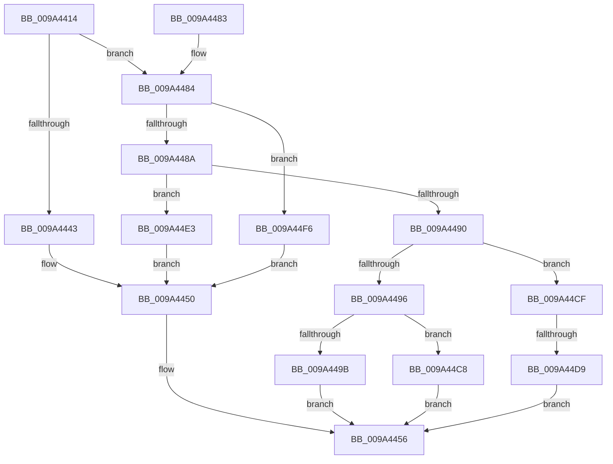

# RawQueryVolumeInformation

- RVA: `0x009A4414`–`0x009A4509` (길이 `245` bytes)
- VA: `0x00000001409A4414`
- 실행 섹션: `PAGE`
- PDB 이름 있음: `예`; PDB Function 태그: `예`
- unwind 정보 RVA: `0x0009C4F4`
- 디코드: `66`개 명령, `245/245` bytes 표시
- 미해석 바이트: `0` (있으면 어셈블리에 `.byte`로 보존)

> 이 문서는 커널 이미지의 기계어와 PDB 기호를 분석해 생성했습니다. 4번과 5번은 함수 원형과 자료형을 바이너리 사용 방식에서 추정한 C 해석이며 원본 소스 복구 결과는 아닙니다.

## 1. Dependencies

- 직접 호출 지점: **4**; 고유 호출 대상: **4**
- 직접 호출자로 확인된 함수: **1**
- RIP 상대 이미지 참조: **2**

### Outgoing calls
- `0x009A444B` → [RawQueryFsVolumeInfo](RawQueryFsVolumeInfo_function_009A4510.md) (function, `0x009A4510`)
- `0x009A4467` → [IofCompleteRequest](../../text/29/IofCompleteRequest_function_0029B5C0.md) (function, `0x0029B5C0`)
- `0x009A44EC` → [RawQueryFsDeviceInfo](../78/RawQueryFsDeviceInfo_function_0078A224.md) (function, `0x0078A224`)
- `0x009A44FF` → [RawQueryFsSizeInfo](../AA/RawQueryFsSizeInfo_function_00AA1DC8.md) (function, `0x00AA1DC8`)

### Direct callers
- [RawDispatch](RawDispatch_function_009A3920.md) at `0x009A39A8`

### Static image references
- `0x009A44AF` → RVA `0x00B050F0` (` ?? ::NNGAKEGL::`string'`; read)
- `0x009A44BA` → RVA `0x00B050F4` (`PAGE`; read)

## 2. Other-region calls and transfers

- 다른 실행 섹션으로 향하는 call: **1**
  - `0x009A4467` → [IofCompleteRequest](../../text/29/IofCompleteRequest_function_0029B5C0.md) (`PAGE` → `.text`)
- call이 아닌 외부 분기/꼬리 이동: **1**
  - `0x009A44D3` → [sub_00B2D53C](../B2/Unknown_function_00B2D53C.md) (`tail-transfer`)

## 3. Assembly (complete function range)

```asm
009A4414  48 8B C4                        mov rax, rsp
009A4417  48 89 58 08                     mov qword ptr [rax + 8], rbx
009A441B  48 89 68 18                     mov qword ptr [rax + 0x18], rbp
009A441F  48 89 70 20                     mov qword ptr [rax + 0x20], rsi
009A4423  57                              push rdi
009A4424  48 83 EC 20                     sub rsp, 0x20
009A4428  41 8B 78 08                     mov edi, dword ptr [r8 + 8]
009A442C  49 8B F0                        mov rsi, r8
009A442F  4C 8B 42 18                     mov r8, qword ptr [rdx + 0x18]
009A4433  48 8B EA                        mov rbp, rdx
009A4436  89 78 10                        mov dword ptr [rax + 0x10], edi
009A4439  44 8B 4E 10                     mov r9d, dword ptr [rsi + 0x10]
009A443D  41 83 E9 01                     sub r9d, 1
009A4441  75 41                           jne 0x1409a4484
009A4443  48 8B 56 30                     mov rdx, qword ptr [rsi + 0x30]
009A4447  4C 8D 48 10                     lea r9, [rax + 0x10]
009A444B  E8 C0 00 00 00                  call 0x1409a4510
009A4450  8B 7C 24 38                     mov edi, dword ptr [rsp + 0x38]
009A4454  8B D8                           mov ebx, eax
009A4456  8B 46 08                        mov eax, dword ptr [rsi + 8]
009A4459  B2 01                           mov dl, 1
009A445B  2B C7                           sub eax, edi
009A445D  89 5D 30                        mov dword ptr [rbp + 0x30], ebx
009A4460  48 8B CD                        mov rcx, rbp
009A4463  48 89 45 38                     mov qword ptr [rbp + 0x38], rax
009A4467  E8 54 71 8F FF                  call 0x14029b5c0
009A446C  48 8B 6C 24 40                  mov rbp, qword ptr [rsp + 0x40]
009A4471  8B C3                           mov eax, ebx
009A4473  48 8B 5C 24 30                  mov rbx, qword ptr [rsp + 0x30]
009A4478  48 8B 74 24 48                  mov rsi, qword ptr [rsp + 0x48]
009A447D  48 83 C4 20                     add rsp, 0x20
009A4481  5F                              pop rdi
009A4482  C3                              ret
009A4483  CC                              int3
009A4484  41 83 E9 02                     sub r9d, 2
009A4488  74 6C                           je 0x1409a44f6
009A448A  41 83 E9 01                     sub r9d, 1
009A448E  74 53                           je 0x1409a44e3
009A4490  41 83 E9 01                     sub r9d, 1
009A4494  75 39                           jne 0x1409a44cf
009A4496  83 FF 12                        cmp edi, 0x12
009A4499  72 2D                           jb 0x1409a44c8
009A449B  45 21 08                        and dword ptr [r8], r9d
009A449E  83 C7 EE                        add edi, -0x12
009A44A1  45 21 48 04                     and dword ptr [r8 + 4], r9d
009A44A5  41 C7 40 08 06 00 00 00         mov dword ptr [r8 + 8], 6
009A44AD  33 DB                           xor ebx, ebx
009A44AF  48 8B 05 3A 0C 16 00            mov rax, qword ptr [rip + 0x160c3a]
009A44B6  41 89 40 0C                     mov dword ptr [r8 + 0xc], eax
009A44BA  0F B7 05 33 0C 16 00            movzx eax, word ptr [rip + 0x160c33]
009A44C1  66 41 89 40 10                  mov word ptr [r8 + 0x10], ax
009A44C6  EB 8E                           jmp 0x1409a4456
009A44C8  BB 05 00 00 80                  mov ebx, 0x80000005
009A44CD  EB 87                           jmp 0x1409a4456
009A44CF  41 83 F9 06                     cmp r9d, 6
009A44D3  0F 84 63 90 18 00               je 0x140b2d53c
009A44D9  BB 0D 00 00 C0                  mov ebx, 0xc000000d
009A44DE  E9 73 FF FF FF                  jmp 0x1409a4456
009A44E3  48 8B 56 30                     mov rdx, qword ptr [rsi + 0x30]
009A44E7  4C 8D 4C 24 38                  lea r9, [rsp + 0x38]
009A44EC  E8 33 5D DE FF                  call 0x14078a224
009A44F1  E9 5A FF FF FF                  jmp 0x1409a4450
009A44F6  48 8B 56 30                     mov rdx, qword ptr [rsi + 0x30]
009A44FA  4C 8D 4C 24 38                  lea r9, [rsp + 0x38]
009A44FF  E8 C4 D8 0F 00                  call 0x140aa1dc8
009A4504  E9 47 FF FF FF                  jmp 0x1409a4450
```

## 4. C-style interpretation (structured pseudocode)

```c
__int64 __fastcall RawQueryVolumeInformation(__int64 a1, __int64 a2, __int64 a3)
{
    __int64 result;
    __int64 v_rbx;
    __int64 v_rdi;
    __int64 v_rsp;
    unsigned int v_stack_p10;
    unsigned __int64 v_stack_p18;
    unsigned __int64 v_stack_p20;
    unsigned __int64 v_stack_p38;
    unsigned __int64 v_stack_p8;

    *(unsigned __int64 *)(v_rsp + 8) = v_rbx;
    *(unsigned __int64 *)(v_rsp + 24) = v_rbp;
    *(unsigned __int64 *)(v_rsp + 32) = v_rsi;
    v_rsp = (v_rsp) - (32);
    *(unsigned int *)(v_rsp + 16) = (unsigned int)((unsigned int)(*(unsigned int *)(a3 + 8)));
    a4 = (unsigned int)(((unsigned int)(*(unsigned int *)(a3 + 16))) - (1));
    if (condition_is_not_equal) goto loc_009A4484;
    result = RawQueryFsVolumeInfo(a1, *(unsigned __int64 *)(a3 + 48), *(unsigned __int64 *)(a2 + 24), v_rsp + 16);
loc_009A4450:
loc_009A4456:
    result = (unsigned int)(((unsigned int)(*(unsigned int *)(a3 + 8))) - ((unsigned int)((unsigned int)(v_stack_p10))));
    *(unsigned int *)(a2 + 48) = (unsigned int)((unsigned int)((unsigned int)(result)));
    *(unsigned __int64 *)(a2 + 56) = result;
    result = IofCompleteRequest(a2, 1, *(unsigned __int64 *)(a2 + 24), v_rsp + 16);
    v_rsp = (v_rsp) + (32);
    return (unsigned int)((unsigned int)((unsigned int)((unsigned int)(result))));
loc_009A4484:
    a4 = (unsigned int)((v_rsp + 16) - (2));
    if (condition_is_equal) goto loc_009A44F6;
    a4 = (unsigned int)((a4) - (1));
    if (condition_is_equal) goto loc_009A44E3;
    a4 = (unsigned int)((a4) - (1));
    if (condition_is_not_equal) goto loc_009A44CF;
    if (((unsigned int)((unsigned int)(v_stack_p10))) < 18) goto loc_009A44C8;
    v_rdi = (unsigned int)(((unsigned int)(v_stack_p10)) + (-18));
    *(unsigned int *)(*(unsigned __int64 *)(a2 + 24) + 8) = 6;
    v_rbx = 0;
    *(unsigned int *)(*(unsigned __int64 *)(a2 + 24) + 12) = (unsigned int)(*(unsigned __int64 *)(v_rip + 1444922));
    *(unsigned __int16 *)(*(unsigned __int64 *)(a2 + 24) + 16) = (unsigned __int16)(*(unsigned __int16 *)(v_rip + 1444915));
    goto loc_009A4456;
loc_009A44C8:
    goto loc_009A4456;
loc_009A44CF:
    goto loc_009A4456;
loc_009A44E3:
    result = RawQueryFsDeviceInfo(a2, *(unsigned __int64 *)(v_stack_p20 + 48), *(unsigned __int64 *)(a2 + 24), v_stack_p38);
    goto loc_009A4450;
loc_009A44F6:
    result = RawQueryFsSizeInfo(a2, *(unsigned __int64 *)(v_stack_p20 + 48), *(unsigned __int64 *)(a2 + 24), v_stack_p38);
    goto loc_009A4450;
}
```

## 5. (Beta) C Style

```c
int64_t RawQueryVolumeInformation(int64_t Arg1, void *Arg2, void *Arg3)
{
    uint8_t *arg2 = (uint8_t *)Arg2;
    uint8_t *arg3 = (uint8_t *)Arg3;

    int64_t result;
    int64_t local_rbx;
    int64_t local_rdi;
    int64_t local_rsp;
    uint32_t v_stack_p10;
    uint64_t v_stack_p18;
    uint64_t v_stack_p20;
    uint64_t v_stack_p38;
    uint64_t v_stack_p8;

    *(uint64_t *)(local_rsp + 0x8) = local_rbx;
    *(uint64_t *)(local_rsp + 0x18) = local_rbp;
    *(uint64_t *)(local_rsp + 0x20) = local_rsi;
    local_rsp = (local_rsp) - (32);
    *(uint32_t *)(local_rsp + 0x10) = (uint32_t)((uint32_t)(*(uint32_t *)(arg3 + 0x8)));
    a4 = (uint32_t)(((uint32_t)(*(uint32_t *)(arg3 + 0x10))) - (1));
    if (condition_is_not_equal) goto loc_009A4484;
    result = RawQueryFsVolumeInfo(Arg1, *(uint64_t *)(arg3 + 0x30), *(uint64_t *)(arg2 + 0x18), local_rsp + 16);
loc_009A4450:
loc_009A4456:
    result = (uint32_t)(((uint32_t)(*(uint32_t *)(arg3 + 0x8))) - ((uint32_t)((uint32_t)(v_stack_p10))));
    *(uint32_t *)(arg2 + 0x30) = (uint32_t)((uint32_t)((uint32_t)(result)));
    *(uint64_t *)(arg2 + 0x38) = result;
    result = IofCompleteRequest(Arg2, 1, *(uint64_t *)(arg2 + 0x18), local_rsp + 16);
    local_rsp = (local_rsp) + (32);
    return (uint32_t)((uint32_t)((uint32_t)((uint32_t)(result))));
loc_009A4484:
    a4 = (uint32_t)((local_rsp + 16) - (2));
    if (condition_is_equal) goto loc_009A44F6;
    a4 = (uint32_t)((a4) - (1));
    if (condition_is_equal) goto loc_009A44E3;
    a4 = (uint32_t)((a4) - (1));
    if (condition_is_not_equal) goto loc_009A44CF;
    if (((uint32_t)((uint32_t)(v_stack_p10))) < 18) goto loc_009A44C8;
    local_rdi = (uint32_t)(((uint32_t)(v_stack_p10)) + (-18));
    *(uint32_t *)(*(uint64_t *)(arg2 + 0x18) + 0x8) = 6;
    local_rbx = 0;
    *(uint32_t *)(*(uint64_t *)(arg2 + 0x18) + 0xC) = (uint32_t)(*(uint64_t *)(v_rip + 0x160C3A));
    *(uint16_t *)(*(uint64_t *)(arg2 + 0x18) + 0x10) = (uint16_t)(*(uint16_t *)(v_rip + 0x160C33));
    goto loc_009A4456;
loc_009A44C8:
    goto loc_009A4456;
loc_009A44CF:
    goto loc_009A4456;
loc_009A44E3:
    result = RawQueryFsDeviceInfo(Arg2, *(uint64_t *)(v_stack_p20 + 0x30), *(uint64_t *)(arg2 + 0x18), v_stack_p38);
    goto loc_009A4450;
loc_009A44F6:
    result = RawQueryFsSizeInfo(Arg2, *(uint64_t *)(v_stack_p20 + 0x30), *(uint64_t *)(arg2 + 0x18), v_stack_p38);
    goto loc_009A4450;
}
```

### 관측된 메모리 오프셋

구조체 형식이 확인되지 않은 접근은 인자 기준의 오프셋으로만 기록했습니다.

| 기준 인자 | 오프셋 표현 | 폭 (bit) | 접근 |
|---|---:|---:|---|
| `Arg2` | `+ 0x18` | `64` | `R` |
| `Arg2` | `+ 0x30` | `32` | `W` |
| `Arg2` | `+ 0x38` | `64` | `W` |
| `Arg3` | `+ 0x8` | `32` | `R` |
| `Arg3` | `+ 0x10` | `32` | `R` |
| `Arg3` | `+ 0x30` | `64` | `R` |

## 6. Execution-region graph

[열기: 2D/3D 그래프와 함수 탐색 컨트롤 패널](../../../control-panel.html?section=page&rva=0x009A4414&view=graph)

- 2D 그래프는 위에서 아래로 흐르고, 3D 그래프는 빈 공간을 드래그해 회전합니다. Shift+드래그는 이동, 휠은 확대·축소, 함수 노드 선택은 대상 보고서 이동입니다.

### Static fallback


