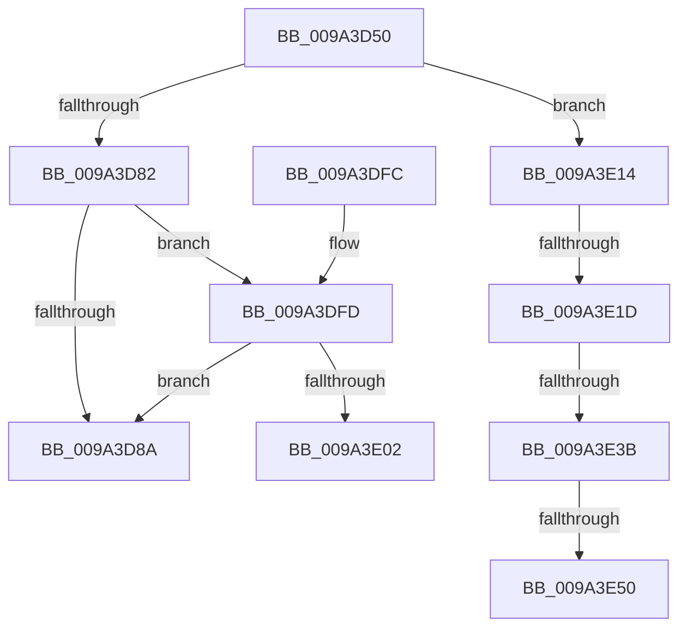

# RawReadWriteDeviceControl

- RVA: `0x009A3D50`–`0x009A3E55` (길이 `261` bytes)
- VA: `0x00000001409A3D50`
- 실행 섹션: `PAGE`
- PDB 이름 있음: `예`; PDB Function 태그: `예`
- unwind 정보 RVA: `0x0009C414`
- 디코드: `66`개 명령, `261/261` bytes 표시
- 미해석 바이트: `0` (있으면 어셈블리에 `.byte`로 보존)

> 이 문서는 커널 이미지의 기계어와 PDB 기호를 분석해 생성했습니다. 4번과 5번은 함수 원형과 자료형을 바이너리 사용 방식에서 추정한 C 해석이며 원본 소스 복구 결과는 아닙니다.

## 1. Dependencies

- 직접 호출 지점: **5**; 고유 호출 대상: **5**
- 직접 호출자로 확인된 함수: **1**
- RIP 상대 이미지 참조: **1**

### Outgoing calls
- `0x009A3D71` → [RawBeginOperation](../../text/41/RawBeginOperation_function_00411F10.md) (function, `0x00411F10`)
- `0x009A3DE2` → [IofCallDriver](../../text/29/IofCallDriver_function_0029B4B0.md) (function, `0x0029B4B0`)
- `0x009A3E09` → [RawEndOperation](../../text/48/RawEndOperation_function_0048E70C.md) (function, `0x0048E70C`)
- `0x009A3E27` → [ExAcquireFastMutex](../../text/20/ExAcquireFastMutex_function_0020E5A0.md) (function, `0x0020E5A0`)
- `0x009A3E43` → [RawInitiateDeleteVolume](../../text/48/RawInitiateDeleteVolume_function_0048FDFC.md) (function, `0x0048FDFC`)

### Direct callers
- [RawDispatch](RawDispatch_function_009A3920.md) at `0x009A3A06`

### Static image references
- `0x009A3D91` → RVA `0x0048E660` (`RawCompletionRoutine`; read)

## 2. Other-region calls and transfers

- 다른 실행 섹션으로 향하는 call: **5**
  - `0x009A3D71` → [RawBeginOperation](../../text/41/RawBeginOperation_function_00411F10.md) (`PAGE` → `.text`)
  - `0x009A3DE2` → [IofCallDriver](../../text/29/IofCallDriver_function_0029B4B0.md) (`PAGE` → `.text`)
  - `0x009A3E09` → [RawEndOperation](../../text/48/RawEndOperation_function_0048E70C.md) (`PAGE` → `.text`)
  - `0x009A3E27` → [ExAcquireFastMutex](../../text/20/ExAcquireFastMutex_function_0020E5A0.md) (`PAGE` → `.text`)
  - `0x009A3E43` → [RawInitiateDeleteVolume](../../text/48/RawInitiateDeleteVolume_function_0048FDFC.md) (`PAGE` → `.text`)
- call이 아닌 외부 분기/꼬리 이동: **5**
  - `0x009A3E0F` → [sub_00B2D51A + 0xD](../B2/Unknown_function_00B2D51A.md) (`tail-transfer`)
  - `0x009A3E17` → [sub_00B2D51A + 0x8](../B2/Unknown_function_00B2D51A.md) (`tail-transfer`)
  - `0x009A3E35` → [sub_00B2D51A](../B2/Unknown_function_00B2D51A.md) (`tail-transfer`)
  - `0x009A3E4A` → [sub_00B2D51A](../B2/Unknown_function_00B2D51A.md) (`tail-transfer`)
  - `0x009A3E50` → [sub_00B2D51A + 0x8](../B2/Unknown_function_00B2D51A.md) (`tail-transfer`)

## 3. Assembly (complete function range)

```asm
009A3D50  48 89 5C 24 08                  mov qword ptr [rsp + 8], rbx
009A3D55  48 89 6C 24 10                  mov qword ptr [rsp + 0x10], rbp
009A3D5A  48 89 74 24 18                  mov qword ptr [rsp + 0x18], rsi
009A3D5F  57                              push rdi
009A3D60  48 83 EC 20                     sub rsp, 0x20
009A3D64  48 8B EA                        mov rbp, rdx
009A3D67  49 8B F0                        mov rsi, r8
009A3D6A  49 8B 50 30                     mov rdx, qword ptr [r8 + 0x30]
009A3D6E  48 8B F9                        mov rdi, rcx
009A3D71  E8 9A E1 A6 FF                  call 0x140411f10
009A3D76  8A 0E                           mov cl, byte ptr [rsi]
009A3D78  33 DB                           xor ebx, ebx
009A3D7A  84 C0                           test al, al
009A3D7C  0F 84 92 00 00 00               je 0x1409a3e14
009A3D82  80 E9 03                        sub cl, 3
009A3D85  80 F9 01                        cmp cl, 1
009A3D88  76 73                           jbe 0x1409a3dfd
009A3D8A  48 8B 85 B8 00 00 00            mov rax, qword ptr [rbp + 0xb8]
009A3D91  48 8D 0D C8 A8 AE FF            lea rcx, [rip - 0x515738]
009A3D98  0F 10 06                        movups xmm0, xmmword ptr [rsi]
009A3D9B  48 8B D5                        mov rdx, rbp
009A3D9E  0F 11 40 B8                     movups xmmword ptr [rax - 0x48], xmm0
009A3DA2  0F 10 4E 10                     movups xmm1, xmmword ptr [rsi + 0x10]
009A3DA6  0F 11 48 C8                     movups xmmword ptr [rax - 0x38], xmm1
009A3DAA  0F 10 46 20                     movups xmm0, xmmword ptr [rsi + 0x20]
009A3DAE  0F 11 40 D8                     movups xmmword ptr [rax - 0x28], xmm0
009A3DB2  0F 10 4E 30                     movups xmm1, xmmword ptr [rsi + 0x30]
009A3DB6  0F 11 48 E8                     movups xmmword ptr [rax - 0x18], xmm1
009A3DBA  F2 0F 10 46 40                  movsd xmm0, qword ptr [rsi + 0x40]
009A3DBF  F2 0F 11 40 F8                  movsd qword ptr [rax - 8], xmm0
009A3DC4  80 48 BA 02                     or byte ptr [rax - 0x46], 2
009A3DC8  48 8B 85 B8 00 00 00            mov rax, qword ptr [rbp + 0xb8]
009A3DCF  48 89 48 F0                     mov qword ptr [rax - 0x10], rcx
009A3DD3  48 89 78 F8                     mov qword ptr [rax - 8], rdi
009A3DD7  C6 40 BB E0                     mov byte ptr [rax - 0x45], 0xe0
009A3DDB  48 8B 8F C0 00 00 00            mov rcx, qword ptr [rdi + 0xc0]
009A3DE2  E8 C9 76 8F FF                  call 0x14029b4b0
009A3DE7  48 8B 5C 24 30                  mov rbx, qword ptr [rsp + 0x30]
009A3DEC  48 8B 6C 24 38                  mov rbp, qword ptr [rsp + 0x38]
009A3DF1  48 8B 74 24 40                  mov rsi, qword ptr [rsp + 0x40]
009A3DF6  48 83 C4 20                     add rsp, 0x20
009A3DFA  5F                              pop rdi
009A3DFB  C3                              ret
009A3DFC  CC                              int3
009A3DFD  39 5E 08                        cmp dword ptr [rsi + 8], ebx
009A3E00  75 88                           jne 0x1409a3d8a
009A3E02  48 8B 56 30                     mov rdx, qword ptr [rsi + 0x30]
009A3E06  48 8B CF                        mov rcx, rdi
009A3E09  E8 FE A8 AE FF                  call 0x14048e70c
009A3E0E  90                              nop
009A3E0F  E9 13 97 18 00                  jmp 0x140b2d527
009A3E14  80 F9 1B                        cmp cl, 0x1b
009A3E17  0F 85 05 97 18 00               jne 0x140b2d522
009A3E1D  48 8D B7 F0 00 00 00            lea rsi, [rdi + 0xf0]
009A3E24  48 8B CE                        mov rcx, rsi
009A3E27  E8 74 A7 86 FF                  call 0x14020e5a0
009A3E2C  FF 8F 80 00 00 00               dec dword ptr [rdi + 0x80]
009A3E32  39 5F 7C                        cmp dword ptr [rdi + 0x7c], ebx
009A3E35  0F 85 DF 96 18 00               jne 0x140b2d51a
009A3E3B  45 33 C0                        xor r8d, r8d
009A3E3E  33 D2                           xor edx, edx
009A3E40  48 8B CF                        mov rcx, rdi
009A3E43  E8 B4 BF AE FF                  call 0x14048fdfc
009A3E48  84 C0                           test al, al
009A3E4A  0F 84 CA 96 18 00               je 0x140b2d51a
009A3E50  E9 CD 96 18 00                  jmp 0x140b2d522
```

## 4. C-style interpretation (structured pseudocode)

```c
__int64 __fastcall RawReadWriteDeviceControl(__int64 a1, __int64 a2, __int64 a3)
{
    __int64 result;
    __int64 v_rbx;
    __int64 v_rsp;
    unsigned __int64 v_stack_p10;
    unsigned __int64 v_stack_p18;
    unsigned __int64 v_stack_p8;

    v_stack_p8 = v_rbx;
    v_stack_p10 = v_rbp;
    v_stack_p18 = v_rsi;
    v_rsp = (v_rsp) - (32);
    result = RawBeginOperation(a1, *(unsigned __int64 *)(a3 + 48), a3, a4);
    v_rbx = 0;
    if ((unsigned __int8)(result) == 0) goto loc_009A3E14;
    a1 = (unsigned __int8)((*(unsigned __int8 *)(a3)) - (3));
    if (((unsigned __int8)(a1)) <= 1) goto loc_009A3DFD;
loc_009A3D8A:
    *(unsigned __int64 *)(*(unsigned __int64 *)(a2 + 184) - 72) = v_xmm0;
    *(unsigned __int64 *)(*(unsigned __int64 *)(a2 + 184) - 56) = v_xmm1;
    *(unsigned __int64 *)(*(unsigned __int64 *)(a2 + 184) - 40) = v_xmm0;
    *(unsigned __int64 *)(*(unsigned __int64 *)(a2 + 184) - 24) = v_xmm1;
    *(unsigned __int64 *)(*(unsigned __int64 *)(a2 + 184) - 8) = v_xmm0;
    *(unsigned __int64 *)(*(unsigned __int64 *)(a2 + 184) - 16) = v_rip - 5330744;
    *(unsigned __int64 *)(*(unsigned __int64 *)(a2 + 184) - 8) = a1;
    *(unsigned __int8 *)(*(unsigned __int64 *)(a2 + 184) - 69) = 224;
    result = IofCallDriver(*(unsigned __int64 *)(a1 + 192), a2, a3, a4);
    v_rsp = (v_rsp) + (32);
    return result;
loc_009A3DFD:
    if ((*(unsigned int *)(v_stack_p18 + 8)) != ((unsigned int)(v_stack_p8))) goto loc_009A3D8A;
    result = RawEndOperation(a1, *(unsigned __int64 *)(v_stack_p18 + 48), a3, a4);
loc_009A3E14:
    result = ExAcquireFastMutex(a1 + 240, *(unsigned __int64 *)(v_stack_p18 + 48), a3, a4);
    a3 = 0;
    a2 = 0;
    result = RawInitiateDeleteVolume(a1, a2, a3, a4);
}
```

## 5. (Beta) C Style

```c
int64_t RawReadWriteDeviceControl(void *Arg1, void *Arg2, void *Arg3)
{
    uint8_t *arg1 = (uint8_t *)Arg1;
    uint8_t *arg2 = (uint8_t *)Arg2;
    uint8_t *arg3 = (uint8_t *)Arg3;

    int64_t result;
    int64_t local_rbx;
    int64_t local_rsp;
    uint64_t v_stack_p10;
    uint64_t v_stack_p18;
    uint64_t v_stack_p8;

    v_stack_p8 = local_rbx;
    v_stack_p10 = local_rbp;
    v_stack_p18 = local_rsi;
    local_rsp = (local_rsp) - (32);
    result = RawBeginOperation(Arg1, *(uint64_t *)(arg3 + 0x30), Arg3, a4);
    local_rbx = 0;
    if ((uint8_t)(result) == 0) goto loc_009A3E14;
    Arg1 = (uint8_t)((*(uint8_t *)(arg3)) - (3));
    if (((uint8_t)(Arg1)) <= 1) goto loc_009A3DFD;
loc_009A3D8A:
    *(uint64_t *)(*(uint64_t *)(arg2 + 0xB8) - 0x48) = v_xmm0;
    *(uint64_t *)(*(uint64_t *)(arg2 + 0xB8) - 0x38) = v_xmm1;
    *(uint64_t *)(*(uint64_t *)(arg2 + 0xB8) - 0x28) = v_xmm0;
    *(uint64_t *)(*(uint64_t *)(arg2 + 0xB8) - 0x18) = v_xmm1;
    *(uint64_t *)(*(uint64_t *)(arg2 + 0xB8) - 0x8) = v_xmm0;
    *(uint64_t *)(*(uint64_t *)(arg2 + 0xB8) - 0x10) = v_rip - 5330744;
    *(void **)(*(uint64_t *)(arg2 + 0xB8) - 0x8) = Arg1;
    *(uint8_t *)(*(uint64_t *)(arg2 + 0xB8) - 0x45) = 224;
    result = IofCallDriver(*(uint64_t *)(arg1 + 0xC0), Arg2, Arg3, a4);
    local_rsp = (local_rsp) + (32);
    return result;
loc_009A3DFD:
    if ((*(uint32_t *)(v_stack_p18 + 0x8)) != ((uint32_t)(v_stack_p8))) goto loc_009A3D8A;
    result = RawEndOperation(Arg1, *(uint64_t *)(v_stack_p18 + 0x30), Arg3, a4);
loc_009A3E14:
    result = ExAcquireFastMutex(Arg1 + 240, *(uint64_t *)(v_stack_p18 + 0x30), Arg3, a4);
    Arg3 = 0;
    Arg2 = 0;
    result = RawInitiateDeleteVolume(Arg1, Arg2, Arg3, a4);
}
```

### 관측된 메모리 오프셋

구조체 형식이 확인되지 않은 접근은 인자 기준의 오프셋으로만 기록했습니다.

| 기준 인자 | 오프셋 표현 | 폭 (bit) | 접근 |
|---|---:|---:|---|
| `Arg1` | `+ 0x7C` | `32` | `R` |
| `Arg1` | `+ 0x80` | `32` | `R/W` |
| `Arg1` | `+ 0xC0` | `64` | `R` |
| `Arg1` | `+ 0xF0` | `64` | `R` |
| `Arg2` | `+ 0xB8` | `64` | `R` |
| `Arg3` | `+ 0x0` | `8` | `R` |
| `Arg3` | `+ 0x0` | `128` | `R` |
| `Arg3` | `+ 0x8` | `32` | `R` |
| `Arg3` | `+ 0x10` | `128` | `R` |
| `Arg3` | `+ 0x20` | `128` | `R` |
| `Arg3` | `+ 0x30` | `64` | `R` |
| `Arg3` | `+ 0x30` | `128` | `R` |
| `Arg3` | `+ 0x40` | `64` | `R` |

## 6. Execution-region graph

[열기: 2D/3D 그래프와 함수 탐색 컨트롤 패널](../../../control-panel.html?section=page&rva=0x009A3D50&view=graph)

- 2D 그래프는 위에서 아래로 흐르고, 3D 그래프는 빈 공간을 드래그해 회전합니다. Shift+드래그는 이동, 휠은 확대·축소, 함수 노드 선택은 대상 보고서 이동입니다.

### Static fallback


