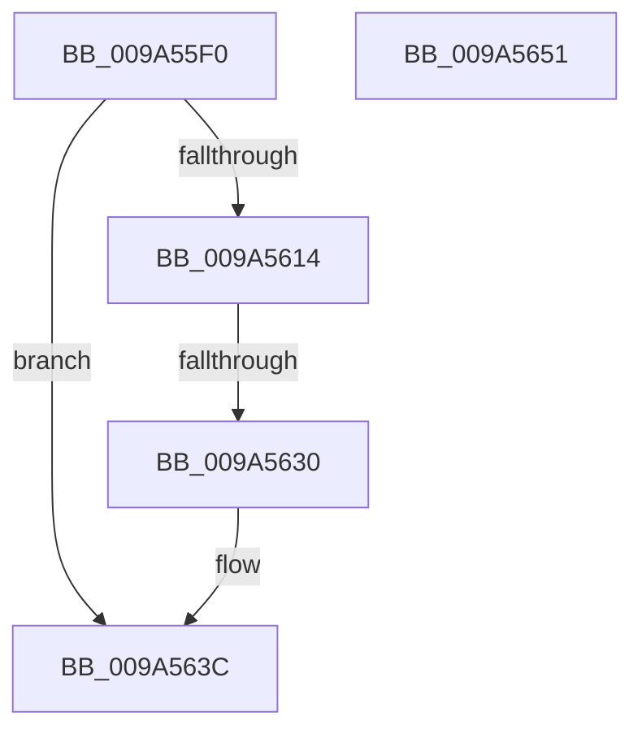

# RawScanDeletedList

- RVA: `0x009A55F0`–`0x009A5652` (길이 `98` bytes)
- VA: `0x00000001409A55F0`
- 실행 섹션: `PAGE`
- PDB 이름 있음: `예`; PDB Function 태그: `예`
- unwind 정보 RVA: `0x0005C954`
- 디코드: `22`개 명령, `98/98` bytes 표시
- 미해석 바이트: `0` (있으면 어셈블리에 `.byte`로 보존)

> 이 문서는 커널 이미지의 기계어와 PDB 기호를 분석해 생성했습니다. 4번과 5번은 함수 원형과 자료형을 바이너리 사용 방식에서 추정한 C 해석이며 원본 소스 복구 결과는 아닙니다.

## 1. Dependencies

- 직접 호출 지점: **2**; 고유 호출 대상: **2**
- 직접 호출자로 확인된 함수: **2**
- RIP 상대 이미지 참조: **2**

### Outgoing calls
- `0x009A561B` → [ExAcquireFastMutex](../../text/20/ExAcquireFastMutex_function_0020E5A0.md) (function, `0x0020E5A0`)
- `0x009A5637` → [ExReleaseFastMutex](../../text/25/ExReleaseFastMutex_function_002519C0.md) (function, `0x002519C0`)

### Direct callers
- [RawShutdown](../78/RawShutdown_function_0078A0A0.md) at `0x0078A0A9`
- [RawMountVolume](RawMountVolume_function_009A4844.md) at `0x009A487B`

### Static image references
- `0x009A5604` → RVA `0x00F05CA0` (`.data`; read)
- `0x009A5614` → RVA `0x00F05CC0` (`.data`; read)

## 2. Other-region calls and transfers

- 다른 실행 섹션으로 향하는 call: **2**
  - `0x009A561B` → [ExAcquireFastMutex](../../text/20/ExAcquireFastMutex_function_0020E5A0.md) (`PAGE` → `.text`)
  - `0x009A5637` → [ExReleaseFastMutex](../../text/25/ExReleaseFastMutex_function_002519C0.md) (`PAGE` → `.text`)
- call이 아닌 외부 분기/꼬리 이동: **1**
  - `0x009A562A` → [sub_00B2D5A6](../B2/Unknown_function_00B2D5A6.md) (`tail-transfer`)

## 3. Assembly (complete function range)

```asm
009A55F0  48 89 5C 24 08                  mov qword ptr [rsp + 8], rbx
009A55F5  48 89 6C 24 10                  mov qword ptr [rsp + 0x10], rbp
009A55FA  48 89 74 24 18                  mov qword ptr [rsp + 0x18], rsi
009A55FF  57                              push rdi
009A5600  48 83 EC 20                     sub rsp, 0x20
009A5604  48 8D 2D 95 06 56 00            lea rbp, [rip + 0x560695]
009A560B  48 39 2D 8E 06 56 00            cmp qword ptr [rip + 0x56068e], rbp
009A5612  74 28                           je 0x1409a563c
009A5614  48 8D 0D A5 06 56 00            lea rcx, [rip + 0x5606a5]
009A561B  E8 80 8F 86 FF                  call 0x14020e5a0
009A5620  48 8B 1D 79 06 56 00            mov rbx, qword ptr [rip + 0x560679]
009A5627  48 3B DD                        cmp rbx, rbp
009A562A  0F 85 76 7F 18 00               jne 0x140b2d5a6
009A5630  48 8D 0D 89 06 56 00            lea rcx, [rip + 0x560689]
009A5637  E8 84 C3 8A FF                  call 0x1402519c0
009A563C  48 8B 5C 24 30                  mov rbx, qword ptr [rsp + 0x30]
009A5641  48 8B 6C 24 38                  mov rbp, qword ptr [rsp + 0x38]
009A5646  48 8B 74 24 40                  mov rsi, qword ptr [rsp + 0x40]
009A564B  48 83 C4 20                     add rsp, 0x20
009A564F  5F                              pop rdi
009A5650  C3                              ret
009A5651  CC                              int3
```

## 4. C-style interpretation (structured pseudocode)

```c
__int64 __fastcall RawScanDeletedList(void)
{
    __int64 result;
    __int64 v_rsp;
    unsigned __int64 v_stack_p10;
    unsigned __int64 v_stack_p18;
    unsigned __int64 v_stack_p8;

    v_stack_p8 = v_rbx;
    v_stack_p10 = v_rbp;
    v_stack_p18 = v_rsi;
    v_rsp = (v_rsp) - (32);
    if ((*(unsigned __int64 *)(v_rip + 5637774)) == (v_rip + 5637781)) goto loc_009A563C;
    result = ExAcquireFastMutex(v_rip + 5637797, a2, a3, a4);
    result = ExReleaseFastMutex(v_rip + 5637769, a2, a3, a4);
loc_009A563C:
    v_rsp = (v_rsp) + (32);
    return result;
}
```

## 5. (Beta) C Style

```c
void RawScanDeletedList(void)
{
    int64_t result;
    int64_t local_rsp;
    uint64_t v_stack_p10;
    uint64_t v_stack_p18;
    uint64_t v_stack_p8;

    v_stack_p8 = local_rbx;
    v_stack_p10 = local_rbp;
    v_stack_p18 = local_rsi;
    local_rsp = (local_rsp) - (32);
    if ((*(uint64_t *)(v_rip + 0x56068E)) == (v_rip + 5637781)) goto loc_009A563C;
    result = ExAcquireFastMutex(v_rip + 5637797, a2, a3, a4);
    result = ExReleaseFastMutex(v_rip + 5637769, a2, a3, a4);
loc_009A563C:
    local_rsp = (local_rsp) + (32);
    return result;
}
```

## 6. Execution-region graph

[열기: 2D/3D 그래프와 함수 탐색 컨트롤 패널](../../../control-panel.html?section=page&rva=0x009A55F0&view=graph)

- 2D 그래프는 위에서 아래로 흐르고, 3D 그래프는 빈 공간을 드래그해 회전합니다. Shift+드래그는 이동, 휠은 확대·축소, 함수 노드 선택은 대상 보고서 이동입니다.

### Static fallback


