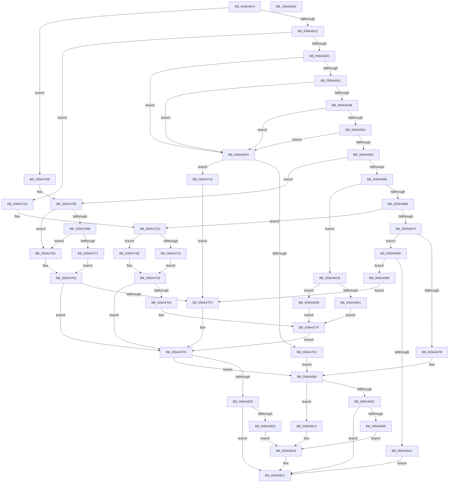

# RawUserFsCtrl

- RVA: `0x009A45F4`–`0x009A483B` (길이 `583` bytes)
- VA: `0x00000001409A45F4`
- 실행 섹션: `PAGE`
- PDB 이름 있음: `예`; PDB Function 태그: `아니요`
- unwind 정보 RVA: `0x0009C52C`
- 디코드: `157`개 명령, `583/583` bytes 표시
- 미해석 바이트: `0` (있으면 어셈블리에 `.byte`로 보존)

> 이 문서는 커널 이미지의 기계어와 PDB 기호를 분석해 생성했습니다. 4번과 5번은 함수 원형과 자료형을 바이너리 사용 방식에서 추정한 C 해석이며 원본 소스 복구 결과는 아닙니다.

## 1. Dependencies

- 직접 호출 지점: **16**; 고유 호출 대상: **7**
- 직접 호출자로 확인된 함수: **1**
- RIP 상대 이미지 참조: **0**

### Outgoing calls
- `0x009A46A3` → [RawBeginOperation](../../text/41/RawBeginOperation_function_00411F10.md) (function, `0x00411F10`)
- `0x009A46BF` → [RawQueryFileSystemInformation](../78/RawQueryFileSystemInformation_function_0078A350.md) (function, `0x0078A350`)
- `0x009A46D5` → [ExAcquireFastMutex](../../text/20/ExAcquireFastMutex_function_0020E5A0.md) (function, `0x0020E5A0`)
- `0x009A4703` → [RawBeginOperation](../../text/41/RawBeginOperation_function_00411F10.md) (function, `0x00411F10`)
- `0x009A4728` → [FsRtlNotifyVolumeEvent](../71/FsRtlNotifyVolumeEvent_function_00716EE0.md) (function, `0x00716EE0`)
- `0x009A4737` → [ExAcquireFastMutex](../../text/20/ExAcquireFastMutex_function_0020E5A0.md) (function, `0x0020E5A0`)
- `0x009A4756` → [ExReleaseFastMutex](../../text/25/ExReleaseFastMutex_function_002519C0.md) (function, `0x002519C0`)
- `0x009A476B` → [ExWaitForRundownProtectionReleaseCacheAware](../../text/46/ExWaitForRundownProtectionReleaseCacheAware_function_004643A0.md) (function, `0x004643A0`)
- `0x009A4773` → [ExAcquireFastMutex](../../text/20/ExAcquireFastMutex_function_0020E5A0.md) (function, `0x0020E5A0`)
- `0x009A4782` → [ExReleaseFastMutex](../../text/25/ExReleaseFastMutex_function_002519C0.md) (function, `0x002519C0`)
- `0x009A4791` → [FsRtlNotifyVolumeEvent](../71/FsRtlNotifyVolumeEvent_function_00716EE0.md) (function, `0x00716EE0`)
- `0x009A479C` → [RawBeginOperation](../../text/41/RawBeginOperation_function_00411F10.md) (function, `0x00411F10`)
- `0x009A47AE` → [ExAcquireFastMutex](../../text/20/ExAcquireFastMutex_function_0020E5A0.md) (function, `0x0020E5A0`)
- `0x009A47E8` → [ExReleaseFastMutex](../../text/25/ExReleaseFastMutex_function_002519C0.md) (function, `0x002519C0`)
- `0x009A47F8` → [RawEndOperation](../../text/48/RawEndOperation_function_0048E70C.md) (function, `0x0048E70C`)
- `0x009A481C` → [FsRtlNotifyVolumeEvent](../71/FsRtlNotifyVolumeEvent_function_00716EE0.md) (function, `0x00716EE0`)

### Direct callers
- [RawFileSystemControl](RawFileSystemControl_function_009A4588.md) at `0x009A45AB`

### Static image references
- 디코드된 RIP-relative 메모리 참조가 없습니다.

## 2. Other-region calls and transfers

- 다른 실행 섹션으로 향하는 call: **12**
  - `0x009A46A3` → [RawBeginOperation](../../text/41/RawBeginOperation_function_00411F10.md) (`PAGE` → `.text`)
  - `0x009A46D5` → [ExAcquireFastMutex](../../text/20/ExAcquireFastMutex_function_0020E5A0.md) (`PAGE` → `.text`)
  - `0x009A4703` → [RawBeginOperation](../../text/41/RawBeginOperation_function_00411F10.md) (`PAGE` → `.text`)
  - `0x009A4737` → [ExAcquireFastMutex](../../text/20/ExAcquireFastMutex_function_0020E5A0.md) (`PAGE` → `.text`)
  - `0x009A4756` → [ExReleaseFastMutex](../../text/25/ExReleaseFastMutex_function_002519C0.md) (`PAGE` → `.text`)
  - `0x009A476B` → [ExWaitForRundownProtectionReleaseCacheAware](../../text/46/ExWaitForRundownProtectionReleaseCacheAware_function_004643A0.md) (`PAGE` → `.text`)
  - `0x009A4773` → [ExAcquireFastMutex](../../text/20/ExAcquireFastMutex_function_0020E5A0.md) (`PAGE` → `.text`)
  - `0x009A4782` → [ExReleaseFastMutex](../../text/25/ExReleaseFastMutex_function_002519C0.md) (`PAGE` → `.text`)
  - `0x009A479C` → [RawBeginOperation](../../text/41/RawBeginOperation_function_00411F10.md) (`PAGE` → `.text`)
  - `0x009A47AE` → [ExAcquireFastMutex](../../text/20/ExAcquireFastMutex_function_0020E5A0.md) (`PAGE` → `.text`)
  - `0x009A47E8` → [ExReleaseFastMutex](../../text/25/ExReleaseFastMutex_function_002519C0.md) (`PAGE` → `.text`)
  - `0x009A47F8` → [RawEndOperation](../../text/48/RawEndOperation_function_0048E70C.md) (`PAGE` → `.text`)
- 별도 외부 분기/꼬리 이동을 확인하지 못했습니다.

## 3. Assembly (complete function range)

```asm
009A45F4  48 89 5C 24 08                  mov qword ptr [rsp + 8], rbx
009A45F9  48 89 6C 24 18                  mov qword ptr [rsp + 0x18], rbp
009A45FE  56                              push rsi
009A45FF  57                              push rdi
009A4600  41 54                           push r12
009A4602  41 56                           push r14
009A4604  41 57                           push r15
009A4606  48 83 EC 20                     sub rsp, 0x20
009A460A  8B 6A 18                        mov ebp, dword ptr [rdx + 0x18]
009A460D  33 DB                           xor ebx, ebx
009A460F  48 8B 72 30                     mov rsi, qword ptr [rdx + 0x30]
009A4613  8B C5                           mov eax, ebp
009A4615  45 32 FF                        xor r15b, r15b
009A4618  49 8B F8                        mov rdi, r8
009A461B  4C 8B F2                        mov r14, rdx
009A461E  4C 8B E1                        mov r12, rcx
009A4621  2D 18 00 09 00                  sub eax, 0x90018
009A4626  0F 84 5D 01 00 00               je 0x1409a4789
009A462C  83 F8 08                        cmp eax, 8
009A462F  0F 84 EB 00 00 00               je 0x1409a4720
009A4635  8B C5                           mov eax, ebp
009A4637  2D 00 00 09 00                  sub eax, 0x90000
009A463C  0F 84 BB 00 00 00               je 0x1409a46fd
009A4642  83 E8 04                        sub eax, 4
009A4645  0F 84 B2 00 00 00               je 0x1409a46fd
009A464B  83 E8 08                        sub eax, 8
009A464E  0F 84 A9 00 00 00               je 0x1409a46fd
009A4654  83 E8 08                        sub eax, 8
009A4657  0F 84 A0 00 00 00               je 0x1409a46fd
009A465D  83 E8 04                        sub eax, 4
009A4660  0F 84 30 01 00 00               je 0x1409a4796
009A4666  83 E8 04                        sub eax, 4
009A4669  74 60                           je 0x1409a46cb
009A466B  83 E8 04                        sub eax, 4
009A466E  0F 84 B9 00 00 00               je 0x1409a472d
009A4674  3D 2C 02 00 00                  cmp eax, 0x22c
009A4679  74 22                           je 0x1409a469d
009A467B  BB 0D 00 00 C0                  mov ebx, 0xc000000d
009A4680  81 ED 18 00 09 00               sub ebp, 0x90018
009A4686  0F 84 88 01 00 00               je 0x1409a4814
009A468C  83 FD 08                        cmp ebp, 8
009A468F  0F 85 8C 01 00 00               jne 0x1409a4821
009A4695  8D 55 FA                        lea edx, [rbp - 6]
009A4698  E9 7C 01 00 00                  jmp 0x1409a4819
009A469D  48 8B D6                        mov rdx, rsi
009A46A0  48 8B CF                        mov rcx, rdi
009A46A3  E8 68 D8 A6 FF                  call 0x140411f10
009A46A8  84 C0                           test al, al
009A46AA  75 0A                           jne 0x1409a46b6
009A46AC  BB 6E 02 00 C0                  mov ebx, 0xc000026e
009A46B1  E9 6B 01 00 00                  jmp 0x1409a4821
009A46B6  4C 8B C7                        mov r8, rdi
009A46B9  49 8B D6                        mov rdx, r14
009A46BC  49 8B CC                        mov rcx, r12
009A46BF  E8 8C 5C DE FF                  call 0x14078a350
009A46C4  8B D8                           mov ebx, eax
009A46C6  E9 27 01 00 00                  jmp 0x1409a47f2
009A46CB  4D 8D B0 F0 00 00 00            lea r14, [r8 + 0xf0]
009A46D2  49 8B CE                        mov rcx, r14
009A46D5  E8 C6 9E 86 FF                  call 0x14020e5a0
009A46DA  8B 47 78                        mov eax, dword ptr [rdi + 0x78]
009A46DD  A8 01                           test al, 1
009A46DF  75 0A                           jne 0x1409a46eb
009A46E1  BB 2A 00 00 C0                  mov ebx, 0xc000002a
009A46E6  E9 94 00 00 00                  jmp 0x1409a477f
009A46EB  83 E0 FE                        and eax, 0xfffffffe
009A46EE  48 21 9F E0 00 00 00            and qword ptr [rdi + 0xe0], rbx
009A46F5  89 47 78                        mov dword ptr [rdi + 0x78], eax
009A46F8  E9 82 00 00 00                  jmp 0x1409a477f
009A46FD  48 8B D6                        mov rdx, rsi
009A4700  48 8B CF                        mov rcx, rdi
009A4703  E8 08 D8 A6 FF                  call 0x140411f10
009A4708  84 C0                           test al, al
009A470A  75 0A                           jne 0x1409a4716
009A470C  BB 6E 02 00 C0                  mov ebx, 0xc000026e
009A4711  E9 6A FF FF FF                  jmp 0x1409a4680
009A4716  BB 02 00 00 C0                  mov ebx, 0xc0000002
009A471B  E9 D2 00 00 00                  jmp 0x1409a47f2
009A4720  BA 01 00 00 00                  mov edx, 1
009A4725  48 8B CE                        mov rcx, rsi
009A4728  E8 B3 27 D7 FF                  call 0x140716ee0
009A472D  4C 8D B7 F0 00 00 00            lea r14, [rdi + 0xf0]
009A4734  49 8B CE                        mov rcx, r14
009A4737  E8 64 9E 86 FF                  call 0x14020e5a0
009A473C  8B 47 78                        mov eax, dword ptr [rdi + 0x78]
009A473F  A8 02                           test al, 2
009A4741  75 0B                           jne 0x1409a474e
009A4743  83 C8 02                        or eax, 2
009A4746  41 B7 01                        mov r15b, 1
009A4749  89 47 78                        mov dword ptr [rdi + 0x78], eax
009A474C  EB 05                           jmp 0x1409a4753
009A474E  BB 6E 02 00 C0                  mov ebx, 0xc000026e
009A4753  49 8B CE                        mov rcx, r14
009A4756  E8 65 D2 8A FF                  call 0x1402519c0
009A475B  45 84 FF                        test r15b, r15b
009A475E  0F 84 99 00 00 00               je 0x1409a47fd
009A4764  48 8B 8F E8 00 00 00            mov rcx, qword ptr [rdi + 0xe8]
009A476B  E8 30 FC AB FF                  call 0x1404643a0
009A4770  49 8B CE                        mov rcx, r14
009A4773  E8 28 9E 86 FF                  call 0x14020e5a0
009A4778  48 89 B7 D8 00 00 00            mov qword ptr [rdi + 0xd8], rsi
009A477F  49 8B CE                        mov rcx, r14
009A4782  E8 39 D2 8A FF                  call 0x1402519c0
009A4787  EB 74                           jmp 0x1409a47fd
009A4789  BA 03 00 00 00                  mov edx, 3
009A478E  48 8B CE                        mov rcx, rsi
009A4791  E8 4A 27 D7 FF                  call 0x140716ee0
009A4796  48 8B D6                        mov rdx, rsi
009A4799  48 8B CF                        mov rcx, rdi
009A479C  E8 6F D7 A6 FF                  call 0x140411f10
009A47A1  4C 8D BF F0 00 00 00            lea r15, [rdi + 0xf0]
009A47A8  44 8A F0                        mov r14b, al
009A47AB  49 8B CF                        mov rcx, r15
009A47AE  E8 ED 9D 86 FF                  call 0x14020e5a0
009A47B3  8B 4F 78                        mov ecx, dword ptr [rdi + 0x78]
009A47B6  F6 C1 01                        test cl, 1
009A47B9  75 25                           jne 0x1409a47e0
009A47BB  83 7F 7C 01                     cmp dword ptr [rdi + 0x7c], 1
009A47BF  75 1F                           jne 0x1409a47e0
009A47C1  83 C9 01                        or ecx, 1
009A47C4  48 89 B7 E0 00 00 00            mov qword ptr [rdi + 0xe0], rsi
009A47CB  89 4F 78                        mov dword ptr [rdi + 0x78], ecx
009A47CE  41 8A C6                        mov al, r14b
009A47D1  F6 D8                           neg al
009A47D3  BB 6E 02 00 C0                  mov ebx, 0xc000026e
009A47D8  1B C9                           sbb ecx, ecx
009A47DA  F7 D1                           not ecx
009A47DC  23 D9                           and ebx, ecx
009A47DE  EB 05                           jmp 0x1409a47e5
009A47E0  BB 22 00 00 C0                  mov ebx, 0xc0000022
009A47E5  49 8B CF                        mov rcx, r15
009A47E8  E8 D3 D1 8A FF                  call 0x1402519c0
009A47ED  45 84 F6                        test r14b, r14b
009A47F0  74 0B                           je 0x1409a47fd
009A47F2  48 8B D6                        mov rdx, rsi
009A47F5  48 8B CF                        mov rcx, rdi
009A47F8  E8 0F 9F AE FF                  call 0x14048e70c
009A47FD  85 DB                           test ebx, ebx
009A47FF  0F 88 7B FE FF FF               js 0x1409a4680
009A4805  81 FD 1C 00 09 00               cmp ebp, 0x9001c
009A480B  75 14                           jne 0x1409a4821
009A480D  BA 05 00 00 00                  mov edx, 5
009A4812  EB 05                           jmp 0x1409a4819
009A4814  BA 04 00 00 00                  mov edx, 4
009A4819  48 8B CE                        mov rcx, rsi
009A481C  E8 BF 26 D7 FF                  call 0x140716ee0
009A4821  48 8B 6C 24 60                  mov rbp, qword ptr [rsp + 0x60]
009A4826  8B C3                           mov eax, ebx
009A4828  48 8B 5C 24 50                  mov rbx, qword ptr [rsp + 0x50]
009A482D  48 83 C4 20                     add rsp, 0x20
009A4831  41 5F                           pop r15
009A4833  41 5E                           pop r14
009A4835  41 5C                           pop r12
009A4837  5F                              pop rdi
009A4838  5E                              pop rsi
009A4839  C3                              ret
009A483A  CC                              int3
```

## 4. C-style interpretation (structured pseudocode)

```c
__int64 __fastcall RawUserFsCtrl(__int64 a1, __int64 a2, __int64 a3)
{
    __int64 result;
    __int64 v_r15;
    __int64 v_rbp;
    __int64 v_rbx;
    __int64 v_rsp;
    unsigned __int64 v_stack_p18;
    unsigned __int64 v_stack_p8;

    v_stack_p8 = v_rbx;
    v_stack_p18 = v_rbp;
    v_rsp = (v_rsp) - (32);
    v_rbx = 0;
    v_r15 = 0;
    result = (unsigned int)(((unsigned int)((unsigned int)((unsigned int)(*(unsigned int *)(a2 + 24))))) - (0x90018ULL));
    if (condition_is_equal) goto loc_009A4789;
    if (((unsigned int)(result)) == 8) goto loc_009A4720;
    result = (unsigned int)(((unsigned int)((unsigned int)((unsigned int)(*(unsigned int *)(a2 + 24))))) - (0x90000ULL));
    if (condition_is_equal) goto loc_009A46FD;
    result = (unsigned int)((result) - (4));
    if (condition_is_equal) goto loc_009A46FD;
    result = (unsigned int)((result) - (8));
    if (condition_is_equal) goto loc_009A46FD;
    result = (unsigned int)((result) - (8));
    if (condition_is_equal) goto loc_009A46FD;
    result = (unsigned int)((result) - (4));
    if (condition_is_equal) goto loc_009A4796;
    result = (unsigned int)((result) - (4));
    if (condition_is_equal) goto loc_009A46CB;
    result = (unsigned int)((result) - (4));
    if (condition_is_equal) goto loc_009A472D;
    if (((unsigned int)(result)) == 556) goto loc_009A469D;
loc_009A4680:
    v_rbp = (unsigned int)(((unsigned int)(*(unsigned int *)(a2 + 24))) - (0x90018ULL));
    if (condition_is_equal) goto loc_009A4814;
    if (((unsigned int)(v_rbp)) != 8) goto loc_009A4821;
    goto loc_009A4819;
loc_009A469D:
    result = RawBeginOperation(a3, *(unsigned __int64 *)(a2 + 48), a3, a4);
    if ((unsigned __int8)(result) != 0) goto loc_009A46B6;
    goto loc_009A4821;
loc_009A46B6:
    result = RawQueryFileSystemInformation(a1, a2, a3, a4);
    goto loc_009A47F2;
loc_009A46CB:
    result = ExAcquireFastMutex(a3 + 240, a2, a3, a4);
    if ((((unsigned __int8)((unsigned int)(*(unsigned int *)(a3 + 120)))) & (1)) != 0) goto loc_009A46EB;
    goto loc_009A477F;
loc_009A46EB:
    result = (unsigned int)(((unsigned int)(*(unsigned int *)(a3 + 120))) & (0xFFFFFFFEULL));
    *(unsigned int *)(a3 + 120) = (unsigned int)(result);
    goto loc_009A477F;
loc_009A46FD:
    result = RawBeginOperation(a3, *(unsigned __int64 *)(a2 + 48), a3, a4);
    if ((unsigned __int8)(result) != 0) goto loc_009A4716;
    goto loc_009A4680;
loc_009A4716:
    goto loc_009A47F2;
loc_009A4720:
    result = FsRtlNotifyVolumeEvent(*(unsigned __int64 *)(a2 + 48), 1, a3, a4);
loc_009A472D:
    result = ExAcquireFastMutex(a3 + 240, 1, a3, a4);
    if ((((unsigned __int8)((unsigned int)(*(unsigned int *)(a3 + 120)))) & (2)) != 0) goto loc_009A474E;
    result = (unsigned int)(((unsigned int)(*(unsigned int *)(a3 + 120))) | (2));
    *(unsigned int *)(a3 + 120) = (unsigned int)(result);
    goto loc_009A4753;
loc_009A474E:
loc_009A4753:
    result = ExReleaseFastMutex(a3 + 240, 1, a3, a4);
    if (1 == 0) goto loc_009A47FD;
    result = ExWaitForRundownProtectionReleaseCacheAware(*(unsigned __int64 *)(a3 + 232), 1, a3, a4);
    result = ExAcquireFastMutex(a3 + 240, 1, a3, a4);
    *(unsigned __int64 *)(a3 + 216) = *(unsigned __int64 *)(a2 + 48);
loc_009A477F:
    result = ExReleaseFastMutex(a3 + 240, 1, a3, a4);
    goto loc_009A47FD;
loc_009A4789:
    result = FsRtlNotifyVolumeEvent(*(unsigned __int64 *)(a2 + 48), 3, a3, a4);
loc_009A4796:
    result = RawBeginOperation(a3, *(unsigned __int64 *)(a2 + 48), a3, a4);
    result = ExAcquireFastMutex(a3 + 240, *(unsigned __int64 *)(a2 + 48), a3, a4);
    if ((((unsigned __int8)((unsigned int)(*(unsigned int *)(a3 + 120)))) & (1)) != 0) goto loc_009A47E0;
    if ((*(unsigned int *)(a3 + 124)) != 1) goto loc_009A47E0;
    a1 = (unsigned int)(((unsigned int)(*(unsigned int *)(a3 + 120))) | (1));
    *(unsigned __int64 *)(a3 + 224) = *(unsigned __int64 *)(a2 + 48);
    *(unsigned int *)(a3 + 120) = (unsigned int)(a1);
    result = (unsigned __int8)(-((unsigned __int8)((unsigned __int8)(result))));
    a1 = (unsigned int)(~(a1));
    v_rbx = (unsigned int)(((unsigned int)(0xC000026EULL)) & ((unsigned int)(a1)));
    goto loc_009A47E5;
loc_009A47E0:
loc_009A47E5:
    result = ExReleaseFastMutex(a3 + 240, *(unsigned __int64 *)(a2 + 48), a3, a4);
    if ((unsigned __int8)((unsigned __int8)(result)) != 0) {
        a2 = *(unsigned __int64 *)(a2 + 48);
        a1 = a3;
        result = RawEndOperation(a1, a2, a3, a4);
    }
    if (sign_flag) goto loc_009A4680;
    if (((unsigned int)(v_rbp)) != 0x9001CULL) goto loc_009A4821;
    goto loc_009A4819;
loc_009A4814:
loc_009A4819:
    result = FsRtlNotifyVolumeEvent(*(unsigned __int64 *)(a2 + 48), 4, a3, a4);
loc_009A4821:
    v_rsp = (v_rsp) + (32);
    return (unsigned int)((unsigned int)((unsigned int)(0xC0000022ULL)));
}
```

## 5. (Beta) C Style

```c
int64_t RawUserFsCtrl(int64_t Arg1, void *Arg2, void *Arg3)
{
    uint8_t *arg2 = (uint8_t *)Arg2;
    uint8_t *arg3 = (uint8_t *)Arg3;

    int64_t result;
    int64_t local_r15;
    int64_t local_rbp;
    int64_t local_rbx;
    int64_t local_rsp;
    uint64_t v_stack_p18;
    uint64_t v_stack_p8;

    v_stack_p8 = local_rbx;
    v_stack_p18 = local_rbp;
    local_rsp = (local_rsp) - (32);
    local_rbx = 0;
    local_r15 = 0;
    result = (uint32_t)(((uint32_t)((uint32_t)((uint32_t)(*(uint32_t *)(arg2 + 0x18))))) - (0x90018ULL));
    if (condition_is_equal) goto loc_009A4789;
    if (((uint32_t)(result)) == 8) goto loc_009A4720;
    result = (uint32_t)(((uint32_t)((uint32_t)((uint32_t)(*(uint32_t *)(arg2 + 0x18))))) - (0x90000ULL));
    if (condition_is_equal) goto loc_009A46FD;
    result = (uint32_t)((result) - (4));
    if (condition_is_equal) goto loc_009A46FD;
    result = (uint32_t)((result) - (8));
    if (condition_is_equal) goto loc_009A46FD;
    result = (uint32_t)((result) - (8));
    if (condition_is_equal) goto loc_009A46FD;
    result = (uint32_t)((result) - (4));
    if (condition_is_equal) goto loc_009A4796;
    result = (uint32_t)((result) - (4));
    if (condition_is_equal) goto loc_009A46CB;
    result = (uint32_t)((result) - (4));
    if (condition_is_equal) goto loc_009A472D;
    if (((uint32_t)(result)) == 556) goto loc_009A469D;
loc_009A4680:
    local_rbp = (uint32_t)(((uint32_t)(*(uint32_t *)(arg2 + 0x18))) - (0x90018ULL));
    if (condition_is_equal) goto loc_009A4814;
    if (((uint32_t)(local_rbp)) != 8) goto loc_009A4821;
    goto loc_009A4819;
loc_009A469D:
    result = RawBeginOperation(Arg3, *(uint64_t *)(arg2 + 0x30), Arg3, a4);
    if ((uint8_t)(result) != 0) goto loc_009A46B6;
    goto loc_009A4821;
loc_009A46B6:
    result = RawQueryFileSystemInformation(Arg1, Arg2, Arg3, a4);
    goto loc_009A47F2;
loc_009A46CB:
    result = ExAcquireFastMutex(Arg3 + 240, Arg2, Arg3, a4);
    if ((((uint8_t)((uint32_t)(*(uint32_t *)(arg3 + 0x78)))) & (1)) != 0) goto loc_009A46EB;
    goto loc_009A477F;
loc_009A46EB:
    result = (uint32_t)(((uint32_t)(*(uint32_t *)(arg3 + 0x78))) & (0xFFFFFFFEULL));
    *(uint32_t *)(arg3 + 0x78) = (uint32_t)(result);
    goto loc_009A477F;
loc_009A46FD:
    result = RawBeginOperation(Arg3, *(uint64_t *)(arg2 + 0x30), Arg3, a4);
    if ((uint8_t)(result) != 0) goto loc_009A4716;
    goto loc_009A4680;
loc_009A4716:
    goto loc_009A47F2;
loc_009A4720:
    result = FsRtlNotifyVolumeEvent(*(uint64_t *)(arg2 + 0x30), 1, Arg3, a4);
loc_009A472D:
    result = ExAcquireFastMutex(Arg3 + 240, 1, Arg3, a4);
    if ((((uint8_t)((uint32_t)(*(uint32_t *)(arg3 + 0x78)))) & (2)) != 0) goto loc_009A474E;
    result = (uint32_t)(((uint32_t)(*(uint32_t *)(arg3 + 0x78))) | (2));
    *(uint32_t *)(arg3 + 0x78) = (uint32_t)(result);
    goto loc_009A4753;
loc_009A474E:
loc_009A4753:
    result = ExReleaseFastMutex(Arg3 + 240, 1, Arg3, a4);
    if (1 == 0) goto loc_009A47FD;
    result = ExWaitForRundownProtectionReleaseCacheAware(*(uint64_t *)(arg3 + 0xE8), 1, Arg3, a4);
    result = ExAcquireFastMutex(Arg3 + 240, 1, Arg3, a4);
    *(uint64_t *)(arg3 + 0xD8) = *(uint64_t *)(arg2 + 0x30);
loc_009A477F:
    result = ExReleaseFastMutex(Arg3 + 240, 1, Arg3, a4);
    goto loc_009A47FD;
loc_009A4789:
    result = FsRtlNotifyVolumeEvent(*(uint64_t *)(arg2 + 0x30), 3, Arg3, a4);
loc_009A4796:
    result = RawBeginOperation(Arg3, *(uint64_t *)(arg2 + 0x30), Arg3, a4);
    result = ExAcquireFastMutex(Arg3 + 240, *(uint64_t *)(arg2 + 0x30), Arg3, a4);
    if ((((uint8_t)((uint32_t)(*(uint32_t *)(arg3 + 0x78)))) & (1)) != 0) goto loc_009A47E0;
    if ((*(uint32_t *)(arg3 + 0x7C)) != 1) goto loc_009A47E0;
    Arg1 = (uint32_t)(((uint32_t)(*(uint32_t *)(arg3 + 0x78))) | (1));
    *(uint64_t *)(arg3 + 0xE0) = *(uint64_t *)(arg2 + 0x30);
    *(uint32_t *)(arg3 + 0x78) = (uint32_t)(Arg1);
    result = (uint8_t)(-((uint8_t)((uint8_t)(result))));
    Arg1 = (uint32_t)(~(Arg1));
    local_rbx = (uint32_t)(((uint32_t)(0xC000026EULL)) & ((uint32_t)(Arg1)));
    goto loc_009A47E5;
loc_009A47E0:
loc_009A47E5:
    result = ExReleaseFastMutex(Arg3 + 240, *(uint64_t *)(arg2 + 0x30), Arg3, a4);
    if ((uint8_t)((uint8_t)(result)) != 0) {
        Arg2 = *(uint64_t *)(arg2 + 0x30);
        Arg1 = Arg3;
        result = RawEndOperation(Arg1, Arg2, Arg3, a4);
    }
    if (sign_flag) goto loc_009A4680;
    if (((uint32_t)(local_rbp)) != 0x9001CULL) goto loc_009A4821;
    goto loc_009A4819;
loc_009A4814:
loc_009A4819:
    result = FsRtlNotifyVolumeEvent(*(uint64_t *)(arg2 + 0x30), 4, Arg3, a4);
loc_009A4821:
    local_rsp = (local_rsp) + (32);
    return (uint32_t)((uint32_t)((uint32_t)(0xC0000022ULL)));
}
```

### 관측된 메모리 오프셋

구조체 형식이 확인되지 않은 접근은 인자 기준의 오프셋으로만 기록했습니다.

| 기준 인자 | 오프셋 표현 | 폭 (bit) | 접근 |
|---|---:|---:|---|
| `Arg2` | `+ 0x18` | `32` | `R` |
| `Arg2` | `+ 0x30` | `64` | `R` |
| `Arg3` | `+ 0x78` | `32` | `R` |
| `Arg3` | `+ 0x78` | `32` | `W` |
| `Arg3` | `+ 0x7C` | `32` | `R` |
| `Arg3` | `+ 0xD8` | `64` | `W` |
| `Arg3` | `+ 0xE0` | `64` | `R/W` |
| `Arg3` | `+ 0xE0` | `64` | `W` |
| `Arg3` | `+ 0xE8` | `64` | `R` |
| `Arg3` | `+ 0xF0` | `64` | `R` |

## 6. Execution-region graph

[열기: 2D/3D 그래프와 함수 탐색 컨트롤 패널](../../../control-panel.html?section=page&rva=0x009A45F4&view=graph)

- 2D 그래프는 위에서 아래로 흐르고, 3D 그래프는 빈 공간을 드래그해 회전합니다. Shift+드래그는 이동, 휠은 확대·축소, 함수 노드 선택은 대상 보고서 이동입니다.

### Static fallback


