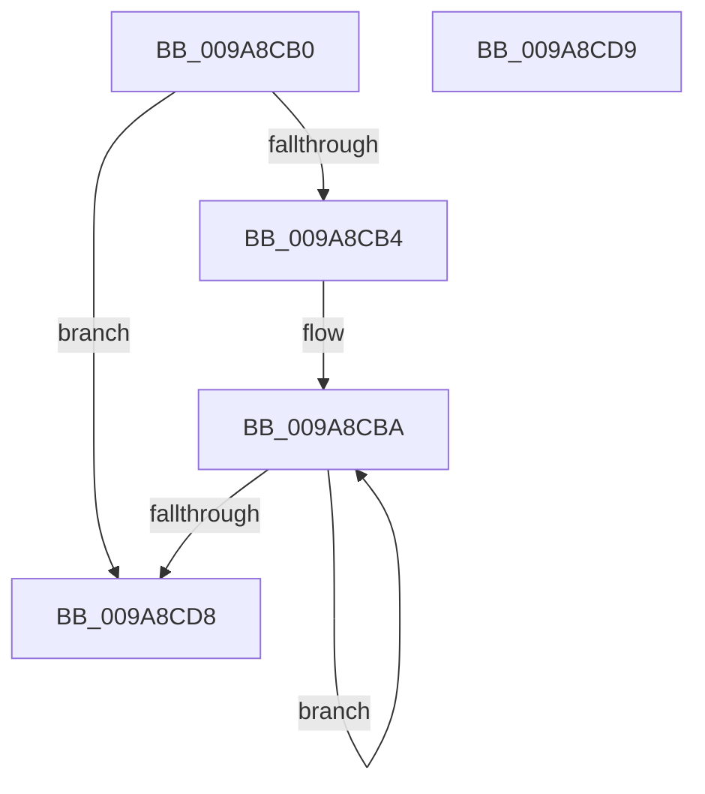

# RtlCopyLuidAndAttributesArray

- RVA: `0x009A8CB0`–`0x009A8CDA` (길이 `42` bytes)
- VA: `0x00000001409A8CB0`
- 실행 섹션: `PAGE`
- PDB 이름 있음: `예`; PDB Function 태그: `아니요`
- unwind 정보 RVA: `0x000DB714`
- 디코드: `13`개 명령, `42/42` bytes 표시
- 미해석 바이트: `0` (있으면 어셈블리에 `.byte`로 보존)

> 이 문서는 커널 이미지의 기계어와 PDB 기호를 분석해 생성했습니다. 4번과 5번은 함수 원형과 자료형을 바이너리 사용 방식에서 추정한 C 해석이며 원본 소스 복구 결과는 아닙니다.

## 1. Dependencies

- 직접 호출 지점: **0**; 고유 호출 대상: **0**
- 직접 호출자로 확인된 함수: **1**
- RIP 상대 이미지 참조: **0**

### Outgoing calls
- 직접 디코드된 call 명령이 없습니다.

### Direct callers
- [CmpBuildAdminInformation](CmpBuildAdminInformation_function_009A8884.md) at `0x009A8AD4`

### Static image references
- 디코드된 RIP-relative 메모리 참조가 없습니다.

## 2. Other-region calls and transfers

- 다른 실행 섹션으로 향하는 call: **0**
- 별도 외부 분기/꼬리 이동을 확인하지 못했습니다.

## 3. Assembly (complete function range)

```asm
009A8CB0  85 C9                           test ecx, ecx
009A8CB2  74 24                           je 0x1409a8cd8
009A8CB4  49 2B D0                        sub rdx, r8
009A8CB7  44 8B C9                        mov r9d, ecx
009A8CBA  F2 42 0F 10 04 02               movsd xmm0, qword ptr [rdx + r8]
009A8CC0  F2 41 0F 11 00                  movsd qword ptr [r8], xmm0
009A8CC5  42 8B 44 02 08                  mov eax, dword ptr [rdx + r8 + 8]
009A8CCA  41 89 40 08                     mov dword ptr [r8 + 8], eax
009A8CCE  4D 8D 40 0C                     lea r8, [r8 + 0xc]
009A8CD2  49 83 E9 01                     sub r9, 1
009A8CD6  75 E2                           jne 0x1409a8cba
009A8CD8  C3                              ret
009A8CD9  CC                              int3
```

## 4. C-style interpretation (structured pseudocode)

```c
__int64 __fastcall RtlCopyLuidAndAttributesArray(int a1, __int64 a2, __int64 a3)
{
    if (a1 == 0) goto loc_009A8CD8;
    a2 = (a2) - (a3);
loc_009A8CBA:
    *(unsigned __int64 *)(a3) = v_xmm0;
    *(unsigned int *)(a3 + 8) = (unsigned int)((unsigned int)(*(unsigned int *)(a2 + a3 * 1 + 8)));
    a4 = ((unsigned int)(a1)) - (1);
    if (condition_is_not_equal) goto loc_009A8CBA;
loc_009A8CD8:
    return (unsigned int)(*(unsigned int *)(a2 + a3 * 1 + 8));
}
```

## 5. (Beta) C Style

```c
int64_t RtlCopyLuidAndAttributesArray(int32_t Arg1, void *Arg2, void *Arg3)
{
    uint8_t *arg2 = (uint8_t *)Arg2;
    uint8_t *arg3 = (uint8_t *)Arg3;

    if (Arg1 == 0) goto loc_009A8CD8;
    Arg2 = (Arg2) - (Arg3);
loc_009A8CBA:
    *(uint64_t *)(arg3) = v_xmm0;
    *(uint32_t *)(arg3 + 0x8) = (uint32_t)((uint32_t)(*(uint32_t *)(arg2 + arg3 * 1 + 0x8)));
    a4 = ((uint32_t)(Arg1)) - (1);
    if (condition_is_not_equal) goto loc_009A8CBA;
loc_009A8CD8:
    return (uint32_t)(*(uint32_t *)(arg2 + arg3 * 1 + 0x8));
}
```

### 관측된 메모리 오프셋

구조체 형식이 확인되지 않은 접근은 인자 기준의 오프셋으로만 기록했습니다.

| 기준 인자 | 오프셋 표현 | 폭 (bit) | 접근 |
|---|---:|---:|---|
| `Arg2` | `+ 0x0 + r8*1` | `64` | `R` |
| `Arg2` | `+ 0x8 + r8*1` | `32` | `R` |
| `Arg3` | `+ 0x0` | `64` | `W` |
| `Arg3` | `+ 0x8` | `32` | `W` |
| `Arg3` | `+ 0xC` | `64` | `R` |

## 6. Execution-region graph

[열기: 2D/3D 그래프와 함수 탐색 컨트롤 패널](../../../control-panel.html?section=page&rva=0x009A8CB0&view=graph)

- 2D 그래프는 위에서 아래로 흐르고, 3D 그래프는 빈 공간을 드래그해 회전합니다. Shift+드래그는 이동, 휠은 확대·축소, 함수 노드 선택은 대상 보고서 이동입니다.

### Static fallback


