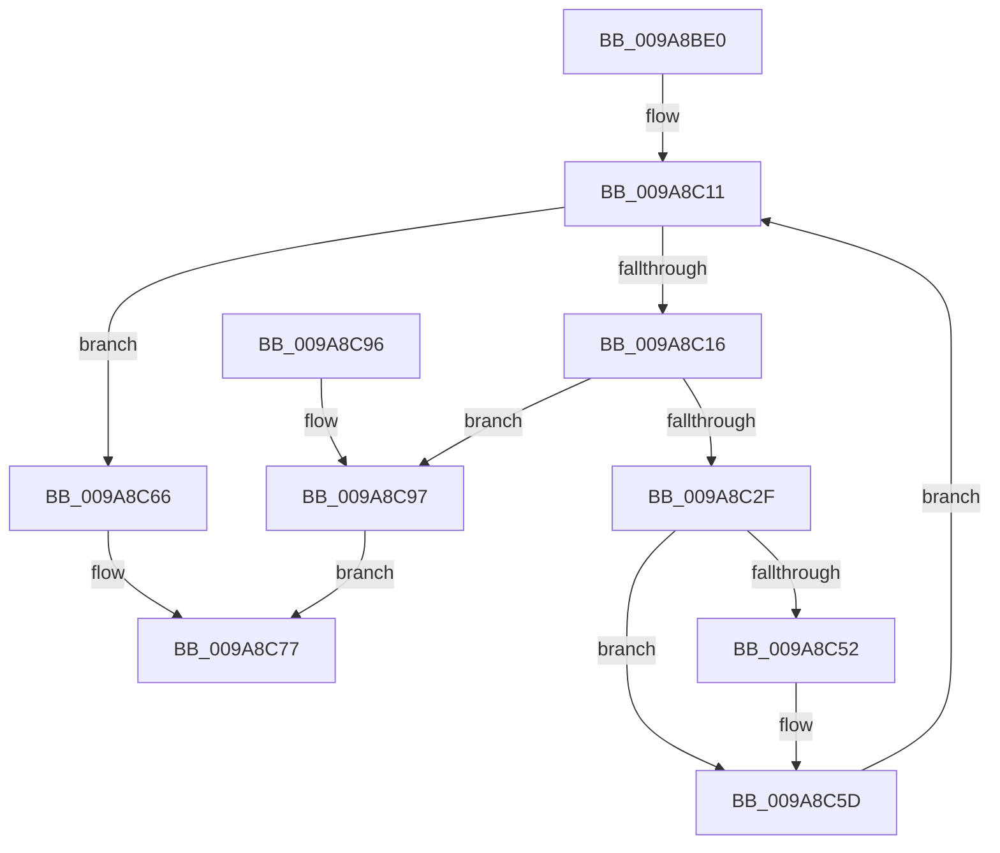

# RtlCopySidAndAttributesArray

- RVA: `0x009A8BE0`–`0x009A8C9E` (길이 `190` bytes)
- VA: `0x00000001409A8BE0`
- 실행 섹션: `PAGE`
- PDB 이름 있음: `예`; PDB Function 태그: `아니요`
- unwind 정보 RVA: `0x0009D028`
- 디코드: `56`개 명령, `190/190` bytes 표시
- 미해석 바이트: `0` (있으면 어셈블리에 `.byte`로 보존)

> 이 문서는 커널 이미지의 기계어와 PDB 기호를 분석해 생성했습니다. 4번과 5번은 함수 원형과 자료형을 바이너리 사용 방식에서 추정한 C 해석이며 원본 소스 복구 결과는 아닙니다.

## 1. Dependencies

- 직접 호출 지점: **1**; 고유 호출 대상: **1**
- 직접 호출자로 확인된 함수: **6**
- RIP 상대 이미지 참조: **0**

### Outgoing calls
- `0x009A8C58` → [memcpy](../../text/6C/memcpy_function_006C6840.md) (function, `0x006C6840`)

### Direct callers
- [SepCreateTokenEx](../../text/4E/SepCreateTokenEx_function_004E9CD0.md) at `0x004EA687`
- [SepCreateTokenEx](../../text/4E/SepCreateTokenEx_function_004E9CD0.md) at `0x004EA6B8`
- [SeQueryInformationToken](../8B/SeQueryInformationToken_function_008B5090.md) at `0x008B5368`
- [SeQueryInformationToken](../8B/SeQueryInformationToken_function_008B5090.md) at `0x008B541A`
- [SeQueryInformationToken](../8B/SeQueryInformationToken_function_008B5090.md) at `0x008B5A6E`
- [SeQueryInformationToken](../8B/SeQueryInformationToken_function_008B5090.md) at `0x008B5AAD`
- [SeQueryInformationToken](../8B/SeQueryInformationToken_function_008B5090.md) at `0x008B5EAA`
- [SepCopyTokenLoggingInformation](SepCopyTokenLoggingInformation_function_009A8618.md) at `0x009A86EE`
- [SepCopyTokenLoggingInformation](SepCopyTokenLoggingInformation_function_009A8618.md) at `0x009A876E`
- [CmpBuildAdminInformation](CmpBuildAdminInformation_function_009A8884.md) at `0x009A8A3D`
- [CmpBuildAdminInformation](CmpBuildAdminInformation_function_009A8884.md) at `0x009A8BBA`
- [SepFilterToken](../9C/SepFilterToken_function_009C6B80.md) at `0x009C72F2`
- [SepFilterToken](../9C/SepFilterToken_function_009C6B80.md) at `0x009C7377`
- [NtQueryInformationToken](../AE/NtQueryInformationToken_function_00AECDD0.md) at `0x00AED359`
- [NtQueryInformationToken](../AE/NtQueryInformationToken_function_00AECDD0.md) at `0x00AED49B`
- [NtQueryInformationToken](../AE/NtQueryInformationToken_function_00AECDD0.md) at `0x00AEDA87`
- [NtQueryInformationToken](../AE/NtQueryInformationToken_function_00AECDD0.md) at `0x00AEE419`
- [NtQueryInformationToken](../AE/NtQueryInformationToken_function_00AECDD0.md) at `0x00AEE45E`
- [NtQueryInformationToken](../AE/NtQueryInformationToken_function_00AECDD0.md) at `0x00AEEF52`
- [NtQueryInformationToken](../AE/NtQueryInformationToken_function_00AECDD0.md) at `0x00AEF102`
- [NtQueryInformationToken](../AE/NtQueryInformationToken_function_00AECDD0.md) at `0x00AEF2A4`
- [NtQueryInformationToken](../AE/NtQueryInformationToken_function_00AECDD0.md) at `0x00AEF757`

### Static image references
- 디코드된 RIP-relative 메모리 참조가 없습니다.

## 2. Other-region calls and transfers

- 다른 실행 섹션으로 향하는 call: **1**
  - `0x009A8C58` → [memcpy](../../text/6C/memcpy_function_006C6840.md) (`PAGE` → `.text`)
- 별도 외부 분기/꼬리 이동을 확인하지 못했습니다.

## 3. Assembly (complete function range)

```asm
009A8BE0  48 89 5C 24 10                  mov qword ptr [rsp + 0x10], rbx
009A8BE5  48 89 6C 24 18                  mov qword ptr [rsp + 0x18], rbp
009A8BEA  48 89 7C 24 20                  mov qword ptr [rsp + 0x20], rdi
009A8BEF  41 54                           push r12
009A8BF1  41 56                           push r14
009A8BF3  41 57                           push r15
009A8BF5  48 83 EC 20                     sub rsp, 0x20
009A8BF9  48 8B 7C 24 60                  mov rdi, qword ptr [rsp + 0x60]
009A8BFE  4D 8B F9                        mov r15, r9
009A8C01  41 8B E8                        mov ebp, r8d
009A8C04  48 89 74 24 40                  mov qword ptr [rsp + 0x40], rsi
009A8C09  4C 8B E2                        mov r12, rdx
009A8C0C  44 8B F1                        mov r14d, ecx
009A8C0F  33 DB                           xor ebx, ebx
009A8C11  41 3B DE                        cmp ebx, r14d
009A8C14  73 50                           jae 0x1409a8c66
009A8C16  44 8B D3                        mov r10d, ebx
009A8C19  4D 03 D2                        add r10, r10
009A8C1C  4B 8B 04 D4                     mov rax, qword ptr [r12 + r10*8]
009A8C20  0F B6 48 01                     movzx ecx, byte ptr [rax + 1]
009A8C24  8D 34 8D 08 00 00 00            lea esi, [rcx*4 + 8]
009A8C2B  3B F5                           cmp esi, ebp
009A8C2D  77 68                           ja 0x1409a8c97
009A8C2F  4B 89 3C D7                     mov qword ptr [r15 + r10*8], rdi
009A8C33  2B EE                           sub ebp, esi
009A8C35  43 8B 44 D4 08                  mov eax, dword ptr [r12 + r10*8 + 8]
009A8C3A  43 89 44 D7 08                  mov dword ptr [r15 + r10*8 + 8], eax
009A8C3F  4B 8B 14 D4                     mov rdx, qword ptr [r12 + r10*8]
009A8C43  0F B6 42 01                     movzx eax, byte ptr [rdx + 1]
009A8C47  8D 04 85 08 00 00 00            lea eax, [rax*4 + 8]
009A8C4E  3B C6                           cmp eax, esi
009A8C50  77 0B                           ja 0x1409a8c5d
009A8C52  44 8B C0                        mov r8d, eax
009A8C55  48 8B CF                        mov rcx, rdi
009A8C58  E8 E3 DB D1 FF                  call 0x1406c6840
009A8C5D  8B C6                           mov eax, esi
009A8C5F  48 03 F8                        add rdi, rax
009A8C62  FF C3                           inc ebx
009A8C64  EB AB                           jmp 0x1409a8c11
009A8C66  48 8B 44 24 68                  mov rax, qword ptr [rsp + 0x68]
009A8C6B  48 89 38                        mov qword ptr [rax], rdi
009A8C6E  48 8B 44 24 70                  mov rax, qword ptr [rsp + 0x70]
009A8C73  89 28                           mov dword ptr [rax], ebp
009A8C75  33 C0                           xor eax, eax
009A8C77  48 8B 74 24 40                  mov rsi, qword ptr [rsp + 0x40]
009A8C7C  48 8B 5C 24 48                  mov rbx, qword ptr [rsp + 0x48]
009A8C81  48 8B 6C 24 50                  mov rbp, qword ptr [rsp + 0x50]
009A8C86  48 8B 7C 24 58                  mov rdi, qword ptr [rsp + 0x58]
009A8C8B  48 83 C4 20                     add rsp, 0x20
009A8C8F  41 5F                           pop r15
009A8C91  41 5E                           pop r14
009A8C93  41 5C                           pop r12
009A8C95  C3                              ret
009A8C96  CC                              int3
009A8C97  B8 23 00 00 C0                  mov eax, 0xc0000023
009A8C9C  EB D9                           jmp 0x1409a8c77
```

## 4. C-style interpretation (structured pseudocode)

```c
__int64 __fastcall RtlCopySidAndAttributesArray(int a1, __int64 a2, int a3, __int64 a4, __int64 a5, __int64 a6, __int64 a7)
{
    __int64 result;
    __int64 v_r10;
    __int64 v_rbp;
    __int64 v_rbx;
    __int64 v_rdi;
    __int64 v_rsp;
    unsigned __int64 v_stack_p10;
    unsigned __int64 v_stack_p18;
    unsigned __int64 v_stack_p20;
    unsigned __int64 v_stack_p8;

    v_stack_p10 = v_rbx;
    v_stack_p18 = v_rbp;
    v_stack_p20 = v_rdi;
    v_rsp = (v_rsp) - (32);
    v_stack_p8 = v_rsi;
    v_rbx = 0;
loc_009A8C11:
    if (0 >= ((unsigned int)((unsigned int)(a1)))) goto loc_009A8C66;
    v_r10 = (0) + (0);
    if (((unsigned int)(*(unsigned __int8 *)(*(unsigned __int64 *)(a2 + v_r10 * 8) + 1) * 4 + 8)) > ((unsigned int)((unsigned int)(a3)))) goto loc_009A8C97;
    *(unsigned __int64 *)(a4 + v_r10 * 8) = a5;
    v_rbp = (unsigned int)(((unsigned int)(a3)) - ((unsigned int)(*(unsigned __int8 *)(*(unsigned __int64 *)(a2 + v_r10 * 8) + 1) * 4 + 8)));
    *(unsigned int *)(a4 + v_r10 * 8 + 8) = (unsigned int)((unsigned int)(*(unsigned int *)(a2 + v_r10 * 8 + 8)));
    result = *(unsigned __int8 *)(*(unsigned __int64 *)(a2 + v_r10 * 8) + 1) * 4 + 8;
    if (((unsigned int)(*(unsigned __int8 *)(*(unsigned __int64 *)(a2 + v_r10 * 8) + 1) * 4 + 8)) <= ((unsigned int)(*(unsigned __int8 *)(*(unsigned __int64 *)(a2 + v_r10 * 8) + 1) * 4 + 8))) {
        a3 = (unsigned int)(*(unsigned __int8 *)(*(unsigned __int64 *)(a2 + v_r10 * 8) + 1) * 4 + 8);
        a1 = a5;
        result = memcpy(a1, *(unsigned __int64 *)(a2 + v_r10 * 8), a3, a4);
    }
    v_rdi = (a5) + ((unsigned int)((unsigned int)(*(unsigned __int8 *)(*(unsigned __int64 *)(a2 + v_r10 * 8) + 1) * 4 + 8)));
    v_rbx = (unsigned int)((v_rbx) + 1);
    goto loc_009A8C11;
loc_009A8C66:
    *(unsigned __int64 *)(a6) = v_rdi;
    *(unsigned int *)(a7) = (unsigned int)(v_rbp);
    result = 0;
loc_009A8C77:
    v_rsp = (v_rsp) + (32);
    return result;
loc_009A8C97:
    goto loc_009A8C77;
}
```

## 5. (Beta) C Style

```c
int64_t RtlCopySidAndAttributesArray(int32_t Arg1, void *Arg2, int32_t Arg3, void *Arg4, int64_t Arg5, void *Arg6, void *Arg7)
{
    uint8_t *arg2 = (uint8_t *)Arg2;
    uint8_t *arg4 = (uint8_t *)Arg4;
    uint8_t *arg6 = (uint8_t *)Arg6;
    uint8_t *arg7 = (uint8_t *)Arg7;

    int64_t result;
    int64_t local_r10;
    int64_t local_rbp;
    int64_t local_rbx;
    int64_t local_rdi;
    int64_t local_rsp;
    uint64_t v_stack_p10;
    uint64_t v_stack_p18;
    uint64_t v_stack_p20;
    uint64_t v_stack_p8;

    v_stack_p10 = local_rbx;
    v_stack_p18 = local_rbp;
    v_stack_p20 = local_rdi;
    local_rsp = (local_rsp) - (32);
    v_stack_p8 = local_rsi;
    local_rbx = 0;
loc_009A8C11:
    if (0 >= ((uint32_t)((uint32_t)(Arg1)))) goto loc_009A8C66;
    local_r10 = (0) + (0);
    if (((uint32_t)(*(uint8_t *)(*(uint64_t *)(arg2 + local_r10 * 8) + 0x1) * 4 + 8)) > ((uint32_t)((uint32_t)(Arg3)))) goto loc_009A8C97;
    *(uint64_t *)(arg4 + local_r10 * 8) = Arg5;
    local_rbp = (uint32_t)(((uint32_t)(Arg3)) - ((uint32_t)(*(uint8_t *)(*(uint64_t *)(arg2 + local_r10 * 8) + 0x1) * 4 + 8)));
    *(uint32_t *)(arg4 + local_r10 * 8 + 0x8) = (uint32_t)((uint32_t)(*(uint32_t *)(arg2 + local_r10 * 8 + 0x8)));
    result = *(uint8_t *)(*(uint64_t *)(arg2 + local_r10 * 8) + 0x1) * 4 + 8;
    if (((uint32_t)(*(uint8_t *)(*(uint64_t *)(arg2 + local_r10 * 8) + 0x1) * 4 + 8)) <= ((uint32_t)(*(uint8_t *)(*(uint64_t *)(arg2 + local_r10 * 8) + 0x1) * 4 + 8))) {
        Arg3 = (uint32_t)(*(uint8_t *)(*(uint64_t *)(arg2 + local_r10 * 8) + 0x1) * 4 + 8);
        Arg1 = Arg5;
        result = memcpy(Arg1, *(uint64_t *)(arg2 + local_r10 * 8), Arg3, Arg4);
    }
    local_rdi = (Arg5) + ((uint32_t)((uint32_t)(*(uint8_t *)(*(uint64_t *)(arg2 + local_r10 * 8) + 0x1) * 4 + 8)));
    local_rbx = (uint32_t)((local_rbx) + 1);
    goto loc_009A8C11;
loc_009A8C66:
    *(uint64_t *)(arg6) = local_rdi;
    *(uint32_t *)(arg7) = (uint32_t)(local_rbp);
    result = 0;
loc_009A8C77:
    local_rsp = (local_rsp) + (32);
    return result;
loc_009A8C97:
    goto loc_009A8C77;
}
```

### 관측된 메모리 오프셋

구조체 형식이 확인되지 않은 접근은 인자 기준의 오프셋으로만 기록했습니다.

| 기준 인자 | 오프셋 표현 | 폭 (bit) | 접근 |
|---|---:|---:|---|
| `Arg2` | `+ 0x0 + r10*8` | `64` | `R` |
| `Arg2` | `+ 0x8 + r10*8` | `32` | `R` |
| `Arg4` | `+ 0x0 + r10*8` | `64` | `W` |
| `Arg4` | `+ 0x8 + r10*8` | `32` | `W` |
| `Arg6` | `+ 0x0` | `64` | `W` |
| `Arg7` | `+ 0x0` | `32` | `W` |

## 6. Execution-region graph

[열기: 2D/3D 그래프와 함수 탐색 컨트롤 패널](../../../control-panel.html?section=page&rva=0x009A8BE0&view=graph)

- 2D 그래프는 위에서 아래로 흐르고, 3D 그래프는 빈 공간을 드래그해 회전합니다. Shift+드래그는 이동, 휠은 확대·축소, 함수 노드 선택은 대상 보고서 이동입니다.

### Static fallback


