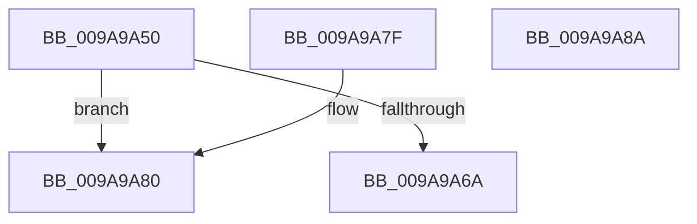

# RtlCopySid

- RVA: `0x009A9A50`–`0x009A9A8B` (길이 `59` bytes)
- VA: `0x00000001409A9A50`
- 실행 섹션: `PAGE`
- PDB 이름 있음: `예`; PDB Function 태그: `아니요`
- unwind 정보 RVA: `0x000767E0`
- 디코드: `19`개 명령, `59/59` bytes 표시
- 미해석 바이트: `0` (있으면 어셈블리에 `.byte`로 보존)

> 이 문서는 커널 이미지의 기계어와 PDB 기호를 분석해 생성했습니다. 4번과 5번은 함수 원형과 자료형을 바이너리 사용 방식에서 추정한 C 해석이며 원본 소스 복구 결과는 아닙니다.

## 1. Dependencies

- 직접 호출 지점: **1**; 고유 호출 대상: **1**
- 직접 호출자로 확인된 함수: **33**
- RIP 상대 이미지 참조: **0**

### Outgoing calls
- `0x009A9A73` → [memcpy](../../text/6C/memcpy_function_006C6840.md) (function, `0x006C6840`)

### Direct callers
- [SeConvertStringSidToSid](../../text/4C/SeConvertStringSidToSid_function_004C6710.md) at `0x004C6819`
- [SepCreateTokenEx](../../text/4E/SepCreateTokenEx_function_004E9CD0.md) at `0x004EA72F`
- [SepGetSidValuesDump](../../text/60/SepGetSidValuesDump_function_0060930C.md) at `0x0060937C`
- [SeSetTokenTamperProtection](../../text/60/SeSetTokenTamperProtection_function_00609644.md) at `0x00609793`
- [SepCopyAntiTamperDebugPolicy](../../text/60/SepCopyAntiTamperDebugPolicy_function_0060A924.md) at `0x0060A9F3`
- [SepGetAntiTamperEntry](../../text/60/SepGetAntiTamperEntry_function_0060AEE4.md) at `0x0060AFA4`
- [RtlAddAccessFilterAce](../78/RtlAddAccessFilterAce_function_0078D210.md) at `0x0078D39F`
- [RtlAddMandatoryAccessAllowedAce](../78/RtlAddMandatoryAccessAllowedAce_function_0078D530.md) at `0x0078D617`
- [RtlAddMandatoryAppAccessAllowedAce](../78/RtlAddMandatoryAppAccessAllowedAce_function_0078D670.md) at `0x0078D769`
- [RtlAddMandatoryAppAccessAllowedAce](../78/RtlAddMandatoryAppAccessAllowedAce_function_0078D670.md) at `0x0078D788`
- [RtlAddResourceAttributeAce](../78/RtlAddResourceAttributeAce_function_0078D7F0.md) at `0x0078DAC4`
- [RtlpAddKnownObjectAce](../78/RtlpAddKnownObjectAce_function_0078DBB4.md) at `0x0078DD14`
- [SepCreateSidValuesBlock](../7A/SepCreateSidValuesBlock_function_007A0C84.md) at `0x007A0D9B`
- [SepInsertOrReferenceSharedSidEntries](../7A/SepInsertOrReferenceSharedSidEntries_function_007A32A8.md) at `0x007A33AD`
- [SddlAddAccessFilterAce](../7A/SddlAddAccessFilterAce_function_007A4D58.md) at `0x007A4F18`
- [SddlAddProcessTrustLabelAce](../7A/SddlAddProcessTrustLabelAce_function_007A4F94.md) at `0x007A50A4`
- [SddlAddScopedPolicyIDAce](../7A/SddlAddScopedPolicyIDAce_function_007A50F4.md) at `0x007A5204`
- [sub_00892023](../89/Unknown_function_00892023.md) at `0x00892055`
- [SeQueryInformationToken](../8B/SeQueryInformationToken_function_008B5090.md) at `0x008B5194`
- [SeQueryInformationToken](../8B/SeQueryInformationToken_function_008B5090.md) at `0x008B5CF0`
- [SeQueryInformationToken](../8B/SeQueryInformationToken_function_008B5090.md) at `0x008B6106`
- [SepAppendAceToTokenObjectAcl](../8B/SepAppendAceToTokenObjectAcl_function_008B6430.md) at `0x008B6A63`
- [SepCreateImpersonationTokenDacl](../8B/SepCreateImpersonationTokenDacl_function_008B8140.md) at `0x008B847D`
- [SepCreateImpersonationTokenDacl](../8B/SepCreateImpersonationTokenDacl_function_008B8140.md) at `0x008B86DC`
- [SepCreateImpersonationTokenDacl](../8B/SepCreateImpersonationTokenDacl_function_008B8140.md) at `0x008B870F`
- [SepCreateImpersonationTokenDacl](../8B/SepCreateImpersonationTokenDacl_function_008B8140.md) at `0x008B8742`
- [SepCreateImpersonationTokenDacl](../8B/SepCreateImpersonationTokenDacl_function_008B8140.md) at `0x008B8775`
- [SepCreateImpersonationTokenDacl](../8B/SepCreateImpersonationTokenDacl_function_008B8140.md) at `0x008B87A8`
- [RtlAddAccessAllowedAceEx](../92/RtlAddAccessAllowedAceEx_function_009279D0.md) at `0x00927AF1`
- [LocalGetAclForString](../92/LocalGetAclForString_function_00927F30.md) at `0x00928857`
- [LocalGetAclForString](../92/LocalGetAclForString_function_00927F30.md) at `0x009289DA`
- [SeAuditProcessCreation](../94/SeAuditProcessCreation_function_00947624.md) at `0x00947752`
- [SepAllocateAndInitializeCachedHandleEntry](SepAllocateAndInitializeCachedHandleEntry_function_009A97B0.md) at `0x009A9841`
- [SddlAddMandatoryAce](SddlAddMandatoryAce_function_009A98AC.md) at `0x009A99CC`
- [SepAdjustGroups](../9C/SepAdjustGroups_function_009C63A8.md) at `0x009C65F5`
- [SepGetLowBoxNumberEntry](../A6/SepGetLowBoxNumberEntry_function_00A65040.md) at `0x00A650EE`
- [MiLoadHotPatchForUserSid](../AB/MiLoadHotPatchForUserSid_function_00AB4F08.md) at `0x00AB5108`
- [MiQueryLoadedPatches](../AB/MiQueryLoadedPatches_function_00ABE538.md) at `0x00ABE6CF`
- [PspAssignProcessQuotaBlock](../AE/PspAssignProcessQuotaBlock_function_00AE3124.md) at `0x00AE32D3`
- [NtQueryInformationToken](../AE/NtQueryInformationToken_function_00AECDD0.md) at `0x00AECFCD`
- [NtQueryInformationToken](../AE/NtQueryInformationToken_function_00AECDD0.md) at `0x00AED0E5`
- [NtQueryInformationToken](../AE/NtQueryInformationToken_function_00AECDD0.md) at `0x00AEF45A`
- [NtQueryInformationToken](../AE/NtQueryInformationToken_function_00AECDD0.md) at `0x00AEFD63`
- [NtQueryInformationToken](../AE/NtQueryInformationToken_function_00AECDD0.md) at `0x00AF00C0`
- [NtQueryInformationToken](../AE/NtQueryInformationToken_function_00AECDD0.md) at `0x00AF01F9`
- [NtQueryInformationToken](../AE/NtQueryInformationToken_function_00AECDD0.md) at `0x00AF032F`
- [sub_00B22C34](../B2/Unknown_function_00B22C34.md) at `0x00B22D67`
- [sub_00B2F480](../B2/Unknown_function_00B2F480.md) at `0x00B2F4D2`

### Static image references
- 디코드된 RIP-relative 메모리 참조가 없습니다.

## 2. Other-region calls and transfers

- 다른 실행 섹션으로 향하는 call: **1**
  - `0x009A9A73` → [memcpy](../../text/6C/memcpy_function_006C6840.md) (`PAGE` → `.text`)
- 별도 외부 분기/꼬리 이동을 확인하지 못했습니다.

## 3. Assembly (complete function range)

```asm
009A9A50  48 83 EC 28                     sub rsp, 0x28
009A9A54  41 0F B6 40 01                  movzx eax, byte ptr [r8 + 1]
009A9A59  4D 8B C8                        mov r9, r8
009A9A5C  4C 8B D2                        mov r10, rdx
009A9A5F  8D 04 85 08 00 00 00            lea eax, [rax*4 + 8]
009A9A66  3B C1                           cmp eax, ecx
009A9A68  77 16                           ja 0x1409a9a80
009A9A6A  44 8B C0                        mov r8d, eax
009A9A6D  49 8B D1                        mov rdx, r9
009A9A70  49 8B CA                        mov rcx, r10
009A9A73  E8 C8 CD D1 FF                  call 0x1406c6840
009A9A78  33 C0                           xor eax, eax
009A9A7A  48 83 C4 28                     add rsp, 0x28
009A9A7E  C3                              ret
009A9A7F  CC                              int3
009A9A80  B8 23 00 00 C0                  mov eax, 0xc0000023
009A9A85  48 83 C4 28                     add rsp, 0x28
009A9A89  C3                              ret
009A9A8A  CC                              int3
```

## 4. C-style interpretation (structured pseudocode)

```c
__int64 __fastcall RtlCopySid(int a1, __int64 a2, __int64 a3)
{
    __int64 result;
    __int64 v_rsp;

    v_rsp = (v_rsp) - (40);
    if (((unsigned int)(*(unsigned __int8 *)(a3 + 1) * 4 + 8)) > a1) goto loc_009A9A80;
    result = memcpy(a2, a3, (unsigned int)((unsigned int)(*(unsigned __int8 *)(a3 + 1) * 4 + 8)), a3);
    result = 0;
    v_rsp = (v_rsp) + (40);
    return result;
loc_009A9A80:
    v_rsp = (v_rsp) + (40);
    return (unsigned int)(0xC0000023ULL);
}
```

## 5. (Beta) C Style

```c
int64_t RtlCopySid(int32_t Arg1, int64_t Arg2, void *Arg3)
{
    uint8_t *arg3 = (uint8_t *)Arg3;

    int64_t result;
    int64_t local_rsp;

    local_rsp = (local_rsp) - (40);
    if (((uint32_t)(*(uint8_t *)(arg3 + 0x1) * 4 + 8)) > Arg1) goto loc_009A9A80;
    result = memcpy(Arg2, Arg3, (uint32_t)((uint32_t)(*(uint8_t *)(arg3 + 0x1) * 4 + 8)), Arg3);
    result = 0;
    local_rsp = (local_rsp) + (40);
    return result;
loc_009A9A80:
    local_rsp = (local_rsp) + (40);
    return (uint32_t)(0xC0000023ULL);
}
```

### 관측된 메모리 오프셋

구조체 형식이 확인되지 않은 접근은 인자 기준의 오프셋으로만 기록했습니다.

| 기준 인자 | 오프셋 표현 | 폭 (bit) | 접근 |
|---|---:|---:|---|
| `Arg3` | `+ 0x1` | `8` | `R` |

## 6. Execution-region graph

[열기: 2D/3D 그래프와 함수 탐색 컨트롤 패널](../../../control-panel.html?section=page&rva=0x009A9A50&view=graph)

- 2D 그래프는 위에서 아래로 흐르고, 3D 그래프는 빈 공간을 드래그해 회전합니다. Shift+드래그는 이동, 휠은 확대·축소, 함수 노드 선택은 대상 보고서 이동입니다.

### Static fallback


