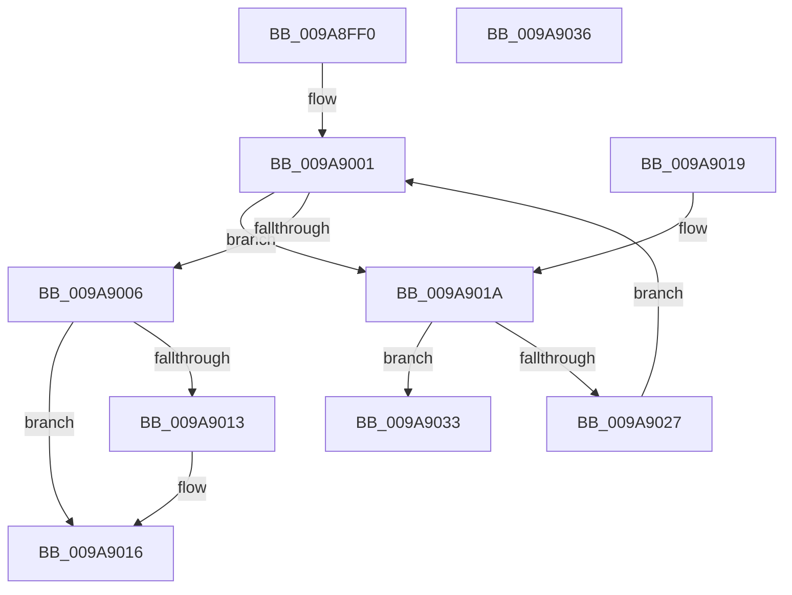

# RtlFirstFreeAce

- RVA: `0x009A8FF0`–`0x009A9037` (길이 `71` bytes)
- VA: `0x00000001409A8FF0`
- 실행 섹션: `PAGE`
- PDB 이름 있음: `예`; PDB Function 태그: `아니요`
- unwind 정보 RVA: `0x000DB714`
- 디코드: `26`개 명령, `71/71` bytes 표시
- 미해석 바이트: `0` (있으면 어셈블리에 `.byte`로 보존)

> 이 문서는 커널 이미지의 기계어와 PDB 기호를 분석해 생성했습니다. 4번과 5번은 함수 원형과 자료형을 바이너리 사용 방식에서 추정한 C 해석이며 원본 소스 복구 결과는 아닙니다.

## 1. Dependencies

- 직접 호출 지점: **0**; 고유 호출 대상: **0**
- 직접 호출자로 확인된 함수: **8**
- RIP 상대 이미지 참조: **0**

### Outgoing calls
- 직접 디코드된 call 명령이 없습니다.

### Direct callers
- [RtlAddAccessFilterAce](../78/RtlAddAccessFilterAce_function_0078D210.md) at `0x0078D32A`
- [RtlAddMandatoryAccessAllowedAce](../78/RtlAddMandatoryAccessAllowedAce_function_0078D530.md) at `0x0078D5C3`
- [RtlAddMandatoryAppAccessAllowedAce](../78/RtlAddMandatoryAppAccessAllowedAce_function_0078D670.md) at `0x0078D709`
- [RtlAddResourceAttributeAce](../78/RtlAddResourceAttributeAce_function_0078D7F0.md) at `0x0078D9FA`
- [RtlpAddKnownObjectAce](../78/RtlpAddKnownObjectAce_function_0078DBB4.md) at `0x0078DC64`
- [SddlAddAccessFilterAce](../7A/SddlAddAccessFilterAce_function_007A4D58.md) at `0x007A4EA1`
- [SddlAddProcessTrustLabelAce](../7A/SddlAddProcessTrustLabelAce_function_007A4F94.md) at `0x007A5053`
- [SddlAddScopedPolicyIDAce](../7A/SddlAddScopedPolicyIDAce_function_007A50F4.md) at `0x007A51B3`

### Static image references
- 디코드된 RIP-relative 메모리 참조가 없습니다.

## 2. Other-region calls and transfers

- 다른 실행 섹션으로 향하는 call: **0**
- 별도 외부 분기/꼬리 이동을 확인하지 못했습니다.

## 3. Assembly (complete function range)

```asm
009A8FF0  33 C0                           xor eax, eax
009A8FF2  4C 8D 41 08                     lea r8, [rcx + 8]
009A8FF6  48 89 02                        mov qword ptr [rdx], rax
009A8FF9  4C 8B C9                        mov r9, rcx
009A8FFC  44 0F B7 51 04                  movzx r10d, word ptr [rcx + 4]
009A9001  41 3B C2                        cmp eax, r10d
009A9004  72 14                           jb 0x1409a901a
009A9006  41 0F B7 41 02                  movzx eax, word ptr [r9 + 2]
009A900B  49 03 C1                        add rax, r9
009A900E  4C 3B C0                        cmp r8, rax
009A9011  77 03                           ja 0x1409a9016
009A9013  4C 89 02                        mov qword ptr [rdx], r8
009A9016  B0 01                           mov al, 1
009A9018  C3                              ret
009A9019  CC                              int3
009A901A  41 0F B7 49 02                  movzx ecx, word ptr [r9 + 2]
009A901F  49 03 C9                        add rcx, r9
009A9022  4C 3B C1                        cmp r8, rcx
009A9025  73 0C                           jae 0x1409a9033
009A9027  41 0F B7 48 02                  movzx ecx, word ptr [r8 + 2]
009A902C  FF C0                           inc eax
009A902E  4C 03 C1                        add r8, rcx
009A9031  EB CE                           jmp 0x1409a9001
009A9033  32 C0                           xor al, al
009A9035  C3                              ret
009A9036  CC                              int3
```

## 4. C-style interpretation (structured pseudocode)

```c
__int64 __fastcall RtlFirstFreeAce(__int64 a1, __int64 a2)
{
    __int64 result;

    result = 0;
    *(unsigned __int64 *)(a2) = 0;
loc_009A9001:
    if (0 < ((unsigned int)(*(unsigned __int16 *)(a1 + 4)))) goto loc_009A901A;
    result = (*(unsigned __int16 *)(a1 + 2)) + (a1);
    if ((a1 + 8) <= result) {
        *(unsigned __int64 *)(a2) = a1 + 8;
    }
    return 1;
loc_009A901A:
    a1 = (*(unsigned __int16 *)(a1 + 2)) + (a1);
    if ((a1 + 8) >= a1) goto loc_009A9033;
    result = (unsigned int)((1) + 1);
    a3 = (a1 + 8) + (*(unsigned __int16 *)(a1 + 8 + 2));
    goto loc_009A9001;
loc_009A9033:
    result = 0;
    return result;
}
```

## 5. (Beta) C Style

```c
int64_t RtlFirstFreeAce(void *Arg1, void *Arg2)
{
    uint8_t *arg1 = (uint8_t *)Arg1;
    uint8_t *arg2 = (uint8_t *)Arg2;

    int64_t result;

    result = 0;
    *(uint64_t *)(arg2) = 0;
loc_009A9001:
    if (0 < ((uint32_t)(*(uint16_t *)(arg1 + 0x4)))) goto loc_009A901A;
    result = (*(uint16_t *)(arg1 + 0x2)) + (Arg1);
    if ((Arg1 + 8) <= result) {
        *(void **)(arg2) = Arg1 + 8;
    }
    return 1;
loc_009A901A:
    Arg1 = (*(uint16_t *)(arg1 + 0x2)) + (Arg1);
    if ((Arg1 + 8) >= Arg1) goto loc_009A9033;
    result = (uint32_t)((1) + 1);
    a3 = (Arg1 + 8) + (*(uint16_t *)(arg1 + 0x8 + 0x2));
    goto loc_009A9001;
loc_009A9033:
    result = 0;
    return result;
}
```

### 관측된 메모리 오프셋

구조체 형식이 확인되지 않은 접근은 인자 기준의 오프셋으로만 기록했습니다.

| 기준 인자 | 오프셋 표현 | 폭 (bit) | 접근 |
|---|---:|---:|---|
| `Arg1` | `+ 0x2` | `16` | `R` |
| `Arg1` | `+ 0x4` | `16` | `R` |
| `Arg1` | `+ 0x8` | `64` | `R` |
| `Arg2` | `+ 0x0` | `64` | `W` |

## 6. Execution-region graph

[열기: 2D/3D 그래프와 함수 탐색 컨트롤 패널](../../../control-panel.html?section=page&rva=0x009A8FF0&view=graph)

- 2D 그래프는 위에서 아래로 흐르고, 3D 그래프는 빈 공간을 드래그해 회전합니다. Shift+드래그는 이동, 휠은 확대·축소, 함수 노드 선택은 대상 보고서 이동입니다.

### Static fallback


