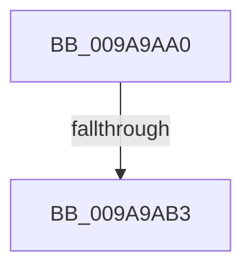

# RtlpApplyAclToObject

- RVA: `0x009A9AA0`–`0x009A9AC1` (길이 `33` bytes)
- VA: `0x00000001409A9AA0`
- 실행 섹션: `PAGE`
- PDB 이름 있음: `예`; PDB Function 태그: `아니요`
- unwind 정보 RVA: `0x0009D728`
- 디코드: `9`개 명령, `33/33` bytes 표시
- 미해석 바이트: `0` (있으면 어셈블리에 `.byte`로 보존)

> 이 문서는 커널 이미지의 기계어와 PDB 기호를 분석해 생성했습니다. 4번과 5번은 함수 원형과 자료형을 바이너리 사용 방식에서 추정한 C 해석이며 원본 소스 복구 결과는 아닙니다.

## 1. Dependencies

- 직접 호출 지점: **0**; 고유 호출 대상: **0**
- 직접 호출자로 확인된 함수: **1**
- RIP 상대 이미지 참조: **0**

### Outgoing calls
- 직접 디코드된 call 명령이 없습니다.

### Direct callers
- [ExpWnfSpecializeSecurityDescriptor](../8B/ExpWnfSpecializeSecurityDescriptor_function_008BE68C.md) at `0x008BE6D3`
- [ExpWnfSpecializeSecurityDescriptor](../8B/ExpWnfSpecializeSecurityDescriptor_function_008BE68C.md) at `0x008BE71E`

### Static image references
- 디코드된 RIP-relative 메모리 참조가 없습니다.

## 2. Other-region calls and transfers

- 다른 실행 섹션으로 향하는 call: **0**
- call이 아닌 외부 분기/꼬리 이동: **2**
  - `0x009A9AAD` → [sub_009A9B38](Unknown_function_009A9B38.md) (`tail-transfer`)
  - `0x009A9ABF` → [sub_009A9B38](Unknown_function_009A9B38.md) (`tail-transfer`)

## 3. Assembly (complete function range)

```asm
009A9AA0  48 83 EC 08                     sub rsp, 8
009A9AA4  4C 8B DA                        mov r11, rdx
009A9AA7  4C 8B D1                        mov r10, rcx
009A9AAA  48 85 C9                        test rcx, rcx
009A9AAD  0F 84 85 00 00 00               je 0x1409a9b38
009A9AB3  45 33 C0                        xor r8d, r8d
009A9AB6  48 8D 41 08                     lea rax, [rcx + 8]
009A9ABA  66 44 3B 41 04                  cmp r8w, word ptr [rcx + 4]
009A9ABF  73 77                           jae 0x1409a9b38
```

## 4. C-style interpretation (structured pseudocode)

```c
__int64 __fastcall RtlpApplyAclToObject(__int64 a1, __int64 a2, int a3)
{
    __int64 v_rsp;

    v_rsp = (v_rsp) - (8);
    a3 = 0;
}
```

## 5. (Beta) C Style

```c
int64_t RtlpApplyAclToObject(int64_t Arg1, int64_t Arg2, int32_t Arg3)
{
    int64_t local_rsp;

    local_rsp = (local_rsp) - (8);
    Arg3 = 0;
}
```

## 6. Execution-region graph

[열기: 2D/3D 그래프와 함수 탐색 컨트롤 패널](../../../control-panel.html?section=page&rva=0x009A9AA0&view=graph)

- 2D 그래프는 위에서 아래로 흐르고, 3D 그래프는 빈 공간을 드래그해 회전합니다. Shift+드래그는 이동, 휠은 확대·축소, 함수 노드 선택은 대상 보고서 이동입니다.

### Static fallback


