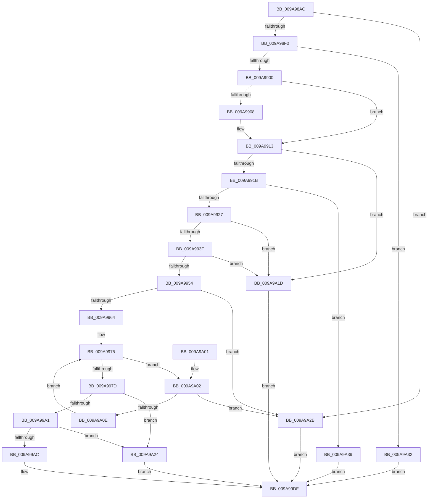

# SddlAddMandatoryAce

- RVA: `0x009A98AC`–`0x009A9A40` (길이 `404` bytes)
- VA: `0x00000001409A98AC`
- 실행 섹션: `PAGE`
- PDB 이름 있음: `예`; PDB Function 태그: `아니요`
- unwind 정보 RVA: `0x0009D660`
- 디코드: `112`개 명령, `404/404` bytes 표시
- 미해석 바이트: `0` (있으면 어셈블리에 `.byte`로 보존)

> 이 문서는 커널 이미지의 기계어와 PDB 기호를 분석해 생성했습니다. 4번과 5번은 함수 원형과 자료형을 바이너리 사용 방식에서 추정한 C 해석이며 원본 소스 복구 결과는 아닙니다.

## 1. Dependencies

- 직접 호출 지점: **6**; 고유 호출 대상: **5**
- 직접 호출자로 확인된 함수: **1**
- RIP 상대 이미지 참조: **1**

### Outgoing calls
- `0x009A98F3` → [RtlValidSid](../92/RtlValidSid_function_00929710.md) (function, `0x00929710`)
- `0x009A9957` → [RtlValidAcl](../92/RtlValidAcl_function_0092A7A0.md) (function, `0x0092A7A0`)
- `0x009A998F` → [RtlLengthSid](../../text/45/RtlLengthSid_function_0045D270.md) (function, `0x0045D270`)
- `0x009A99BE` → [RtlLengthSid](../../text/45/RtlLengthSid_function_0045D270.md) (function, `0x0045D270`)
- `0x009A99CC` → [RtlCopySid](RtlCopySid_function_009A9A50.md) (function, `0x009A9A50`)
- `0x009A99E7` → [_security_check_cookie](../../text/6A/_security_check_cookie_function_006AC640.md) (function, `0x006AC640`)

### Direct callers
- [LocalGetAclForString](../92/LocalGetAclForString_function_00927F30.md) at `0x009287CE`

### Static image references
- `0x009A98C0` → RVA `0x00E0A740` (`.data`; read)

## 2. Other-region calls and transfers

- 다른 실행 섹션으로 향하는 call: **3**
  - `0x009A998F` → [RtlLengthSid](../../text/45/RtlLengthSid_function_0045D270.md) (`PAGE` → `.text`)
  - `0x009A99BE` → [RtlLengthSid](../../text/45/RtlLengthSid_function_0045D270.md) (`PAGE` → `.text`)
  - `0x009A99E7` → [_security_check_cookie](../../text/6A/_security_check_cookie_function_006AC640.md) (`PAGE` → `.text`)
- 별도 외부 분기/꼬리 이동을 확인하지 못했습니다.

## 3. Assembly (complete function range)

```asm
009A98AC  48 89 5C 24 10                  mov qword ptr [rsp + 0x10], rbx
009A98B1  55                              push rbp
009A98B2  56                              push rsi
009A98B3  57                              push rdi
009A98B4  41 54                           push r12
009A98B6  41 55                           push r13
009A98B8  41 56                           push r14
009A98BA  41 57                           push r15
009A98BC  48 83 EC 30                     sub rsp, 0x30
009A98C0  48 8B 05 79 0E 46 00            mov rax, qword ptr [rip + 0x460e79]
009A98C7  48 33 C4                        xor rax, rsp
009A98CA  48 89 44 24 28                  mov qword ptr [rsp + 0x28], rax
009A98CF  45 33 ED                        xor r13d, r13d
009A98D2  66 C7 44 24 24 00 10            mov word ptr [rsp + 0x24], 0x1000
009A98D9  44 89 6C 24 20                  mov dword ptr [rsp + 0x20], r13d
009A98DE  49 8B F1                        mov rsi, r9
009A98E1  45 8B E0                        mov r12d, r8d
009A98E4  48 8B F9                        mov rdi, rcx
009A98E7  48 85 C9                        test rcx, rcx
009A98EA  0F 84 3B 01 00 00               je 0x1409a9a2b
009A98F0  49 8B C9                        mov rcx, r9
009A98F3  E8 18 FE F7 FF                  call 0x140929710
009A98F8  84 C0                           test al, al
009A98FA  0F 84 32 01 00 00               je 0x1409a9a32
009A9900  8B 4E 02                        mov ecx, dword ptr [rsi + 2]
009A9903  41 2B CD                        sub ecx, r13d
009A9906  75 0B                           jne 0x1409a9913
009A9908  0F B7 4E 06                     movzx ecx, word ptr [rsi + 6]
009A990C  0F B7 44 24 24                  movzx eax, word ptr [rsp + 0x24]
009A9911  2B C8                           sub ecx, eax
009A9913  85 C9                           test ecx, ecx
009A9915  0F 85 02 01 00 00               jne 0x1409a9a1d
009A991B  0F B6 0F                        movzx ecx, byte ptr [rdi]
009A991E  80 F9 04                        cmp cl, 4
009A9921  0F 87 12 01 00 00               ja 0x1409a9a39
009A9927  BD 02 00 00 00                  mov ebp, 2
009A992C  40 3A CD                        cmp cl, bpl
009A992F  0F 47 E9                        cmova ebp, ecx
009A9932  41 F7 C4 E0 FF FF FF            test r12d, 0xffffffe0
009A9939  0F 85 DE 00 00 00               jne 0x1409a9a1d
009A993F  44 8B B4 24 98 00 00 00         mov r14d, dword ptr [rsp + 0x98]
009A9947  41 F7 C6 F8 FF FF FF            test r14d, 0xfffffff8
009A994E  0F 85 C9 00 00 00               jne 0x1409a9a1d
009A9954  48 8B CF                        mov rcx, rdi
009A9957  E8 44 0E F8 FF                  call 0x14092a7a0
009A995C  84 C0                           test al, al
009A995E  0F 84 C7 00 00 00               je 0x1409a9a2b
009A9964  0F B7 57 04                     movzx edx, word ptr [rdi + 4]
009A9968  48 8D 5F 08                     lea rbx, [rdi + 8]
009A996C  41 8B CD                        mov ecx, r13d
009A996F  41 B8 01 00 00 00               mov r8d, 1
009A9975  3B CA                           cmp ecx, edx
009A9977  0F 82 85 00 00 00               jb 0x1409a9a02
009A997D  44 0F B7 7F 02                  movzx r15d, word ptr [rdi + 2]
009A9982  48 8B CE                        mov rcx, rsi
009A9985  4C 03 FF                        add r15, rdi
009A9988  49 3B DF                        cmp rbx, r15
009A998B  49 0F 47 DD                     cmova rbx, r13
009A998F  E8 DC 38 AB FF                  call 0x14045d270
009A9994  66 83 C0 08                     add ax, 8
009A9998  48 85 DB                        test rbx, rbx
009A999B  0F 84 83 00 00 00               je 0x1409a9a24
009A99A1  0F B7 C8                        movzx ecx, ax
009A99A4  48 03 CB                        add rcx, rbx
009A99A7  49 3B CF                        cmp rcx, r15
009A99AA  77 78                           ja 0x1409a9a24
009A99AC  48 8B CE                        mov rcx, rsi
009A99AF  44 88 63 01                     mov byte ptr [rbx + 1], r12b
009A99B3  C6 03 11                        mov byte ptr [rbx], 0x11
009A99B6  66 89 43 02                     mov word ptr [rbx + 2], ax
009A99BA  44 89 73 04                     mov dword ptr [rbx + 4], r14d
009A99BE  E8 AD 38 AB FF                  call 0x14045d270
009A99C3  8B C8                           mov ecx, eax
009A99C5  48 8D 53 08                     lea rdx, [rbx + 8]
009A99C9  4C 8B C6                        mov r8, rsi
009A99CC  E8 7F 00 00 00                  call 0x1409a9a50
009A99D1  B8 01 00 00 00                  mov eax, 1
009A99D6  40 88 2F                        mov byte ptr [rdi], bpl
009A99D9  66 01 47 04                     add word ptr [rdi + 4], ax
009A99DD  33 C0                           xor eax, eax
009A99DF  48 8B 4C 24 28                  mov rcx, qword ptr [rsp + 0x28]
009A99E4  48 33 CC                        xor rcx, rsp
009A99E7  E8 54 2C D0 FF                  call 0x1406ac640
009A99EC  48 8B 5C 24 78                  mov rbx, qword ptr [rsp + 0x78]
009A99F1  48 83 C4 30                     add rsp, 0x30
009A99F5  41 5F                           pop r15
009A99F7  41 5E                           pop r14
009A99F9  41 5D                           pop r13
009A99FB  41 5C                           pop r12
009A99FD  5F                              pop rdi
009A99FE  5E                              pop rsi
009A99FF  5D                              pop rbp
009A9A00  C3                              ret
009A9A01  CC                              int3
009A9A02  0F B7 47 02                     movzx eax, word ptr [rdi + 2]
009A9A06  48 03 C7                        add rax, rdi
009A9A09  48 3B D8                        cmp rbx, rax
009A9A0C  73 1D                           jae 0x1409a9a2b
009A9A0E  0F B7 43 02                     movzx eax, word ptr [rbx + 2]
009A9A12  41 03 C8                        add ecx, r8d
009A9A15  48 03 D8                        add rbx, rax
009A9A18  E9 58 FF FF FF                  jmp 0x1409a9975
009A9A1D  B8 0D 00 00 C0                  mov eax, 0xc000000d
009A9A22  EB BB                           jmp 0x1409a99df
009A9A24  B8 99 00 00 C0                  mov eax, 0xc0000099
009A9A29  EB B4                           jmp 0x1409a99df
009A9A2B  B8 77 00 00 C0                  mov eax, 0xc0000077
009A9A30  EB AD                           jmp 0x1409a99df
009A9A32  B8 78 00 00 C0                  mov eax, 0xc0000078
009A9A37  EB A6                           jmp 0x1409a99df
009A9A39  B8 59 00 00 C0                  mov eax, 0xc0000059
009A9A3E  EB 9F                           jmp 0x1409a99df
```

## 4. C-style interpretation (structured pseudocode)

```c
__int64 __fastcall SddlAddMandatoryAce(__int64 a1, __int64 a2, int a3, __int64 a4, __int64 a5, unsigned int a6)
{
    __int64 result;
    __int64 v_r13;
    __int64 v_r15;
    __int64 v_rbp;
    __int64 v_rbx;
    __int64 v_rsp;
    unsigned __int64 v_stack_m40;
    unsigned __int16 v_stack_m44;
    unsigned int v_stack_m48;
    unsigned __int64 v_stack_p10;

    v_stack_p10 = v_rbx;
    v_rsp = (v_rsp) - (48);
    result = (*(unsigned __int64 *)(v_rip + 4591225)) ^ (v_rsp);
    v_stack_m40 = result;
    v_r13 = 0;
    v_stack_m44 = 0x1000ULL;
    v_stack_m48 = 0;
    if (a1 == 0) goto loc_009A9A2B;
    result = RtlValidSid(a4, a2, a3, a4);
    if ((unsigned __int8)(result) == 0) goto loc_009A9A32;
    a1 = (unsigned int)(((unsigned int)(*(unsigned int *)(a4 + 2))) - (0));
    if (!(condition_is_not_equal)) {
        a1 = *(unsigned __int16 *)(a4 + 6);
        result = v_stack_m44;
        a1 = (unsigned int)((a1) - ((unsigned int)(result)));
    }
    if ((unsigned int)(a1) != 0) goto loc_009A9A1D;
    if (((unsigned __int8)(*(unsigned __int8 *)(a1))) > 4) goto loc_009A9A39;
    v_rbp = 2;
    if (((unsigned __int8)(*(unsigned __int8 *)(a1))) > 2) { v_rbp = (unsigned int)(*(unsigned __int8 *)(a1)); }
    if ((((unsigned int)((unsigned int)(a3))) & (0xFFFFFFE0ULL)) != 0) goto loc_009A9A1D;
    if ((((unsigned int)((unsigned int)(a6))) & (0xFFFFFFF8ULL)) != 0) goto loc_009A9A1D;
    result = RtlValidAcl(a1, a2, a3, a4);
    if ((unsigned __int8)(result) == 0) goto loc_009A9A2B;
loc_009A9975:
    if (0 < ((unsigned int)(*(unsigned __int16 *)(a1 + 4)))) goto loc_009A9A02;
    v_r15 = (*(unsigned __int16 *)(a1 + 2)) + (a1);
    v_rbx = a1 + 8;
    if ((a1 + 8) > v_r15) { v_rbx = 0; }
    result = RtlLengthSid(a4, *(unsigned __int16 *)(a1 + 4), 1, a4);
    result = (unsigned __int16)((result) + (8));
    if (v_rbx == 0) goto loc_009A9A24;
    a1 = ((unsigned __int16)(result)) + (v_rbx);
    if (a1 > v_r15) goto loc_009A9A24;
    *(unsigned __int8 *)(v_rbx + 1) = (unsigned __int8)((unsigned int)(a3));
    *(unsigned __int8 *)(v_rbx) = 17;
    *(unsigned __int16 *)(v_rbx + 2) = (unsigned __int16)(result);
    *(unsigned int *)(v_rbx + 4) = (unsigned int)((unsigned int)(a6));
    result = RtlLengthSid(a4, *(unsigned __int16 *)(a1 + 4), 1, a4);
    result = RtlCopySid((unsigned int)((unsigned int)(result)), v_rbx + 8, a4, a4);
    *(unsigned __int8 *)(a1) = (unsigned __int8)(v_rbp);
    result = 0;
loc_009A99DF:
    a1 = (v_stack_m40) ^ (v_rsp);
    result = _security_check_cookie(a1, v_rbx + 8, a4, a4);
    v_rsp = (v_rsp) + (48);
    return result;
loc_009A9A02:
    result = (*(unsigned __int16 *)(a1 + 2)) + (a1);
    if (v_stack_p10 >= result) goto loc_009A9A2B;
    a1 = (unsigned int)((a1) + ((unsigned int)(a4)));
    v_rbx = (v_stack_p10) + (*(unsigned __int16 *)(v_stack_p10 + 2));
    goto loc_009A9975;
loc_009A9A1D:
    goto loc_009A99DF;
loc_009A9A24:
    goto loc_009A99DF;
loc_009A9A2B:
    goto loc_009A99DF;
loc_009A9A32:
    goto loc_009A99DF;
loc_009A9A39:
    goto loc_009A99DF;
}
```

## 5. (Beta) C Style

```c
int64_t SddlAddMandatoryAce(void *Arg1, int64_t Arg2, int32_t Arg3, void *Arg4, uint64_t Arg5, uint32_t Arg6)
{
    uint8_t *arg1 = (uint8_t *)Arg1;
    uint8_t *arg4 = (uint8_t *)Arg4;

    int64_t result;
    int64_t local_r13;
    int64_t local_r15;
    int64_t local_rbp;
    int64_t local_rbx;
    int64_t local_rsp;
    uint64_t v_stack_m40;
    uint16_t v_stack_m44;
    uint32_t v_stack_m48;
    uint64_t v_stack_p10;

    v_stack_p10 = local_rbx;
    local_rsp = (local_rsp) - (48);
    result = (*(uint64_t *)(v_rip + 0x460E79)) ^ (local_rsp);
    v_stack_m40 = result;
    local_r13 = 0;
    v_stack_m44 = 0x1000ULL;
    v_stack_m48 = 0;
    if (Arg1 == NULL) goto loc_009A9A2B;
    result = RtlValidSid(Arg4, Arg2, Arg3, Arg4);
    if ((uint8_t)(result) == 0) goto loc_009A9A32;
    Arg1 = (uint32_t)(((uint32_t)(*(uint32_t *)(arg4 + 0x2))) - (0));
    if (!(condition_is_not_equal)) {
        Arg1 = *(uint16_t *)(arg4 + 0x6);
        result = v_stack_m44;
        Arg1 = (uint32_t)((Arg1) - ((uint32_t)(result)));
    }
    if ((uint32_t)(Arg1) != 0) goto loc_009A9A1D;
    if (((uint8_t)(*(uint8_t *)(arg1))) > 4) goto loc_009A9A39;
    local_rbp = 2;
    if (((uint8_t)(*(uint8_t *)(arg1))) > 2) { local_rbp = (uint32_t)(*(uint8_t *)(arg1)); }
    if ((((uint32_t)((uint32_t)(Arg3))) & (0xFFFFFFE0ULL)) != 0) goto loc_009A9A1D;
    if ((((uint32_t)((uint32_t)(Arg6))) & (0xFFFFFFF8ULL)) != 0) goto loc_009A9A1D;
    result = RtlValidAcl(Arg1, Arg2, Arg3, Arg4);
    if ((uint8_t)(result) == 0) goto loc_009A9A2B;
loc_009A9975:
    if (0 < ((uint32_t)(*(uint16_t *)(arg1 + 0x4)))) goto loc_009A9A02;
    local_r15 = (*(uint16_t *)(arg1 + 0x2)) + (Arg1);
    local_rbx = Arg1 + 8;
    if ((Arg1 + 8) > local_r15) { local_rbx = 0; }
    result = RtlLengthSid(Arg4, *(uint16_t *)(arg1 + 0x4), 1, Arg4);
    result = (uint16_t)((result) + (8));
    if (local_rbx == 0) goto loc_009A9A24;
    Arg1 = ((uint16_t)(result)) + (local_rbx);
    if (Arg1 > local_r15) goto loc_009A9A24;
    *(uint8_t *)(local_rbx + 0x1) = (uint8_t)((uint32_t)(Arg3));
    *(uint8_t *)(local_rbx) = 17;
    *(uint16_t *)(local_rbx + 0x2) = (uint16_t)(result);
    *(uint32_t *)(local_rbx + 0x4) = (uint32_t)((uint32_t)(Arg6));
    result = RtlLengthSid(Arg4, *(uint16_t *)(arg1 + 0x4), 1, Arg4);
    result = RtlCopySid((uint32_t)((uint32_t)(result)), local_rbx + 8, Arg4, Arg4);
    *(uint8_t *)(arg1) = (uint8_t)(local_rbp);
    result = 0;
loc_009A99DF:
    Arg1 = (v_stack_m40) ^ (local_rsp);
    result = _security_check_cookie(Arg1, local_rbx + 8, Arg4, Arg4);
    local_rsp = (local_rsp) + (48);
    return result;
loc_009A9A02:
    result = (*(uint16_t *)(arg1 + 0x2)) + (Arg1);
    if (v_stack_p10 >= result) goto loc_009A9A2B;
    Arg1 = (uint32_t)((Arg1) + ((uint32_t)(Arg4)));
    local_rbx = (v_stack_p10) + (*(uint16_t *)(v_stack_p10 + 0x2));
    goto loc_009A9975;
loc_009A9A1D:
    goto loc_009A99DF;
loc_009A9A24:
    goto loc_009A99DF;
loc_009A9A2B:
    goto loc_009A99DF;
loc_009A9A32:
    goto loc_009A99DF;
loc_009A9A39:
    goto loc_009A99DF;
}
```

### 관측된 메모리 오프셋

구조체 형식이 확인되지 않은 접근은 인자 기준의 오프셋으로만 기록했습니다.

| 기준 인자 | 오프셋 표현 | 폭 (bit) | 접근 |
|---|---:|---:|---|
| `Arg1` | `+ 0x0` | `8` | `R` |
| `Arg1` | `+ 0x0` | `8` | `W` |
| `Arg1` | `+ 0x2` | `16` | `R` |
| `Arg1` | `+ 0x4` | `16` | `R` |
| `Arg1` | `+ 0x4` | `16` | `R/W` |
| `Arg1` | `+ 0x8` | `64` | `R` |
| `Arg4` | `+ 0x2` | `32` | `R` |
| `Arg4` | `+ 0x6` | `16` | `R` |

## 6. Execution-region graph

[열기: 2D/3D 그래프와 함수 탐색 컨트롤 패널](../../../control-panel.html?section=page&rva=0x009A98AC&view=graph)

- 2D 그래프는 위에서 아래로 흐르고, 3D 그래프는 빈 공간을 드래그해 회전합니다. Shift+드래그는 이동, 휠은 확대·축소, 함수 노드 선택은 대상 보고서 이동입니다.

### Static fallback


