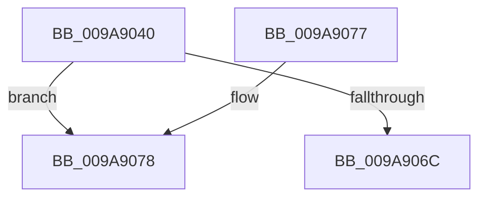

# SeAdjustAccessStateForAccessConstraints

- RVA: `0x009A9040`–`0x009A907B` (길이 `59` bytes)
- VA: `0x00000001409A9040`
- 실행 섹션: `PAGE`
- PDB 이름 있음: `예`; PDB Function 태그: `아니요`
- unwind 정보 RVA: `0x0009D2A4`
- 디코드: `26`개 명령, `59/59` bytes 표시
- 미해석 바이트: `0` (있으면 어셈블리에 `.byte`로 보존)

> 이 문서는 커널 이미지의 기계어와 PDB 기호를 분석해 생성했습니다. 4번과 5번은 함수 원형과 자료형을 바이너리 사용 방식에서 추정한 C 해석이며 원본 소스 복구 결과는 아닙니다.

## 1. Dependencies

- 직접 호출 지점: **0**; 고유 호출 대상: **0**
- 직접 호출자로 확인된 함수: **0**
- RIP 상대 이미지 참조: **0**

### Outgoing calls
- 직접 디코드된 call 명령이 없습니다.

### Direct callers
- 이 함수 시작 RVA로 연결되는 직접 call은 확인되지 않았습니다. 간접 호출은 완전히 역산할 수 없습니다.

### Static image references
- 디코드된 RIP-relative 메모리 참조가 없습니다.

## 2. Other-region calls and transfers

- 다른 실행 섹션으로 향하는 call: **0**
- 별도 외부 분기/꼬리 이동을 확인하지 못했습니다.

## 3. Assembly (complete function range)

```asm
009A9040  48 8B C4                        mov rax, rsp
009A9043  53                              push rbx
009A9044  55                              push rbp
009A9045  56                              push rsi
009A9046  57                              push rdi
009A9047  41 56                           push r14
009A9049  48 83 EC 40                     sub rsp, 0x40
009A904D  33 DB                           xor ebx, ebx
009A904F  C6 40 18 00                     mov byte ptr [rax + 0x18], 0
009A9053  48 89 58 20                     mov qword ptr [rax + 0x20], rbx
009A9057  BE FF FF FF FF                  mov esi, 0xffffffff
009A905C  41 8B 40 0C                     mov eax, dword ptr [r8 + 0xc]
009A9060  49 8B F8                        mov rdi, r8
009A9063  4C 8B F2                        mov r14, rdx
009A9066  8B EE                           mov ebp, esi
009A9068  A8 06                           test al, 6
009A906A  75 0C                           jne 0x1409a9078
009A906C  48 83 C4 40                     add rsp, 0x40
009A9070  41 5E                           pop r14
009A9072  5F                              pop rdi
009A9073  5E                              pop rsi
009A9074  5D                              pop rbp
009A9075  5B                              pop rbx
009A9076  C3                              ret
009A9077  CC                              int3
009A9078  8B 41 44                        mov eax, dword ptr [rcx + 0x44]
```

## 4. C-style interpretation (structured pseudocode)

```c
__int64 __fastcall SeAdjustAccessStateForAccessConstraints(__int64 a1, __int64 a2, __int64 a3)
{
    __int64 v_rbx;
    __int64 v_rsp;

    v_rsp = (v_rsp) - (64);
    v_rbx = 0;
    *(unsigned __int8 *)(v_rsp + 24) = 0;
    *(unsigned __int64 *)(v_rsp + 32) = 0;
    if ((((unsigned __int8)((unsigned int)(*(unsigned int *)(a3 + 12)))) & (6)) != 0) goto loc_009A9078;
    v_rsp = (v_rsp) + (64);
    return (unsigned int)(*(unsigned int *)(a3 + 12));
loc_009A9078:
    return (unsigned int)(*(unsigned int *)(a1 + 68));
}
```

## 5. (Beta) C Style

```c
int64_t SeAdjustAccessStateForAccessConstraints(void *Arg1, int64_t Arg2, void *Arg3)
{
    uint8_t *arg1 = (uint8_t *)Arg1;
    uint8_t *arg3 = (uint8_t *)Arg3;

    int64_t local_rbx;
    int64_t local_rsp;

    local_rsp = (local_rsp) - (64);
    local_rbx = 0;
    *(uint8_t *)(local_rsp + 0x18) = 0;
    *(uint64_t *)(local_rsp + 0x20) = 0;
    if ((((uint8_t)((uint32_t)(*(uint32_t *)(arg3 + 0xC)))) & (6)) != 0) goto loc_009A9078;
    local_rsp = (local_rsp) + (64);
    return (uint32_t)(*(uint32_t *)(arg3 + 0xC));
loc_009A9078:
    return (uint32_t)(*(uint32_t *)(arg1 + 0x44));
}
```

### 관측된 메모리 오프셋

구조체 형식이 확인되지 않은 접근은 인자 기준의 오프셋으로만 기록했습니다.

| 기준 인자 | 오프셋 표현 | 폭 (bit) | 접근 |
|---|---:|---:|---|
| `Arg1` | `+ 0x44` | `32` | `R` |
| `Arg3` | `+ 0xC` | `32` | `R` |

## 6. Execution-region graph

[열기: 2D/3D 그래프와 함수 탐색 컨트롤 패널](../../../control-panel.html?section=page&rva=0x009A9040&view=graph)

- 2D 그래프는 위에서 아래로 흐르고, 3D 그래프는 빈 공간을 드래그해 회전합니다. Shift+드래그는 이동, 휠은 확대·축소, 함수 노드 선택은 대상 보고서 이동입니다.

### Static fallback


