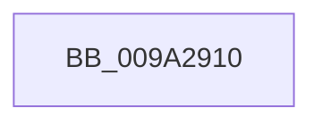

# SepAdtAuditThisEventByCategoryWithContext

- RVA: `0x009A2910`–`0x009A2945` (길이 `53` bytes)
- VA: `0x00000001409A2910`
- 실행 섹션: `PAGE`
- PDB 이름 있음: `예`; PDB Function 태그: `예`
- unwind 정보 RVA: `0x0009B760`
- 디코드: `17`개 명령, `53/53` bytes 표시
- 미해석 바이트: `0` (있으면 어셈블리에 `.byte`로 보존)

> 이 문서는 커널 이미지의 기계어와 PDB 기호를 분석해 생성했습니다. 4번과 5번은 함수 원형과 자료형을 바이너리 사용 방식에서 추정한 C 해석이며 원본 소스 복구 결과는 아닙니다.

## 1. Dependencies

- 직접 호출 지점: **0**; 고유 호출 대상: **0**
- 직접 호출자로 확인된 함수: **3**
- RIP 상대 이미지 참조: **1**

### Outgoing calls
- 직접 디코드된 call 명령이 없습니다.

### Direct callers
- [SeAuditingAnyFileEventsWithContextEx](../../text/42/SeAuditingAnyFileEventsWithContextEx_function_0042A800.md) at `0x0042A84E`
- [SeAuditingFileEventsWithContextEx](../../text/49/SeAuditingFileEventsWithContextEx_function_00493440.md) at `0x004934D0`
- [sub_00870B96](../87/Unknown_function_00870B96.md) at `0x00870BAC`

### Static image references
- `0x009A2921` → RVA `0x00000000` (`image boundary/outside`; read)

## 2. Other-region calls and transfers

- 다른 실행 섹션으로 향하는 call: **0**
- call이 아닌 외부 분기/꼬리 이동: **1**
  - `0x009A2943` → [sub_009A2974](Unknown_function_009A2974.md) (`tail-transfer`)

## 3. Assembly (complete function range)

```asm
009A2910  40 55                           push rbp
009A2912  56                              push rsi
009A2913  57                              push rdi
009A2914  41 55                           push r13
009A2916  41 56                           push r14
009A2918  48 83 EC 40                     sub rsp, 0x40
009A291C  0F 57 C0                        xorps xmm0, xmm0
009A291F  8B F1                           mov esi, ecx
009A2921  4C 8D 2D D8 D6 65 FF            lea r13, [rip - 0x9a2928]
009A2928  8B E9                           mov ebp, ecx
009A292A  4D 8B F0                        mov r14, r8
009A292D  8B FA                           mov edi, edx
009A292F  0F 11 44 24 20                  movups xmmword ptr [rsp + 0x20], xmm0
009A2934  41 8B 84 B5 60 4B F0 00         mov eax, dword ptr [r13 + rsi*4 + 0xf04b60]
009A293C  0F 11 44 24 30                  movups xmmword ptr [rsp + 0x30], xmm0
009A2941  85 C0                           test eax, eax
009A2943  74 2F                           je 0x1409a2974
```

## 4. C-style interpretation (structured pseudocode)

```c
__int64 __fastcall SepAdtAuditThisEventByCategoryWithContext(int a1, int a2, __int64 a3)
{
    __int64 v_rsp;
    unsigned __int64 v_stack_m38;
    unsigned __int64 v_stack_m48;

    v_rsp = (v_rsp) - (64);
    v_stack_m48 = v_xmm0;
    v_stack_m38 = v_xmm0;
}
```

## 5. (Beta) C Style

```c
int64_t SepAdtAuditThisEventByCategoryWithContext(int32_t Arg1, int32_t Arg2, int64_t Arg3)
{
    int64_t local_rsp;
    uint64_t v_stack_m38;
    uint64_t v_stack_m48;

    local_rsp = (local_rsp) - (64);
    v_stack_m48 = v_xmm0;
    v_stack_m38 = v_xmm0;
}
```

## 6. Execution-region graph

[열기: 2D/3D 그래프와 함수 탐색 컨트롤 패널](../../../control-panel.html?section=page&rva=0x009A2910&view=graph)

- 2D 그래프는 위에서 아래로 흐르고, 3D 그래프는 빈 공간을 드래그해 회전합니다. Shift+드래그는 이동, 휠은 확대·축소, 함수 노드 선택은 대상 보고서 이동입니다.

### Static fallback


