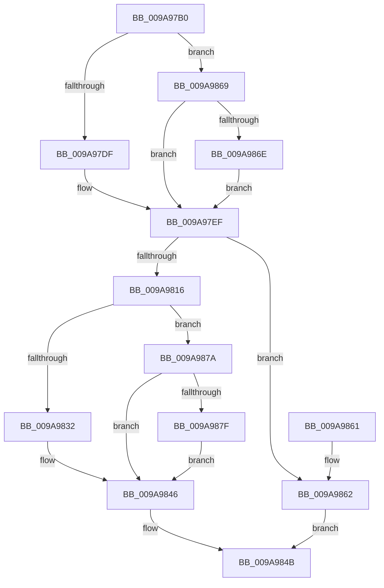

# SepAllocateAndInitializeCachedHandleEntry

- RVA: `0x009A97B0`–`0x009A98A4` (길이 `244` bytes)
- VA: `0x00000001409A97B0`
- 실행 섹션: `PAGE`
- PDB 이름 있음: `예`; PDB Function 태그: `아니요`
- unwind 정보 RVA: `0x0009D648`
- 디코드: `66`개 명령, `244/244` bytes 표시
- 미해석 바이트: `0` (있으면 어셈블리에 `.byte`로 보존)

> 이 문서는 커널 이미지의 기계어와 PDB 기호를 분석해 생성했습니다. 4번과 5번은 함수 원형과 자료형을 바이너리 사용 방식에서 추정한 C 해석이며 원본 소스 복구 결과는 아닙니다.

## 1. Dependencies

- 직접 호출 지점: **3**; 고유 호출 대상: **3**
- 직접 호출자로 확인된 함수: **1**
- RIP 상대 이미지 참조: **0**

### Outgoing calls
- `0x009A9809` → [ExAllocatePool2](../../poolcode/B8/ExAllocatePool2_function_00B820F0.md) (function, `0x00B820F0`)
- `0x009A9841` → [RtlCopySid](RtlCopySid_function_009A9A50.md) (function, `0x009A9A50`)
- `0x009A989D` → [RtlCopyUnicodeString](../../text/3F/RtlCopyUnicodeString_function_003FEF30.md) (function, `0x003FEF30`)

### Direct callers
- [SepGetCachedHandlesEntry](SepGetCachedHandlesEntry_function_009A95C0.md) at `0x009A964E`

### Static image references
- 디코드된 RIP-relative 메모리 참조가 없습니다.

## 2. Other-region calls and transfers

- 다른 실행 섹션으로 향하는 call: **2**
  - `0x009A9809` → [ExAllocatePool2](../../poolcode/B8/ExAllocatePool2_function_00B820F0.md) (`PAGE` → `POOLCODE`)
  - `0x009A989D` → [RtlCopyUnicodeString](../../text/3F/RtlCopyUnicodeString_function_003FEF30.md) (`PAGE` → `.text`)
- 별도 외부 분기/꼬리 이동을 확인하지 못했습니다.

## 3. Assembly (complete function range)

```asm
009A97B0  48 89 5C 24 08                  mov qword ptr [rsp + 8], rbx
009A97B5  48 89 74 24 10                  mov qword ptr [rsp + 0x10], rsi
009A97BA  48 89 7C 24 18                  mov qword ptr [rsp + 0x18], rdi
009A97BF  41 56                           push r14
009A97C1  48 83 EC 20                     sub rsp, 0x20
009A97C5  48 83 22 00                     and qword ptr [rdx], 0
009A97C9  48 8B F9                        mov rdi, rcx
009A97CC  8B 09                           mov ecx, dword ptr [rcx]
009A97CE  4C 8B F2                        mov r14, rdx
009A97D1  41 B8 48 00 00 00               mov r8d, 0x48
009A97D7  85 C9                           test ecx, ecx
009A97D9  0F 85 8A 00 00 00               jne 0x1409a9869
009A97DF  48 8B 47 08                     mov rax, qword ptr [rdi + 8]
009A97E3  0F B6 48 01                     movzx ecx, byte ptr [rax + 1]
009A97E7  4C 8D 04 8D 50 00 00 00         lea r8, [rcx*4 + 0x50]
009A97EF  49 8D 70 03                     lea rsi, [r8 + 3]
009A97F3  B8 FC FF FF FF                  mov eax, 0xfffffffc
009A97F8  48 23 F0                        and rsi, rax
009A97FB  41 B8 53 65 4C 73               mov r8d, 0x734c6553
009A9801  48 8B D6                        mov rdx, rsi
009A9804  B9 00 01 00 00                  mov ecx, 0x100
009A9809  E8 E2 88 1D 00                  call 0x140b820f0
009A980E  48 8B D8                        mov rbx, rax
009A9811  48 85 C0                        test rax, rax
009A9814  74 4C                           je 0x1409a9862
009A9816  48 83 60 40 00                  and qword ptr [rax + 0x40], 0
009A981B  83 60 38 00                     and dword ptr [rax + 0x38], 0
009A981F  48 C7 40 18 01 00 00 00         mov qword ptr [rax + 0x18], 1
009A9827  8B 07                           mov eax, dword ptr [rdi]
009A9829  89 43 20                        mov dword ptr [rbx + 0x20], eax
009A982C  8B 0F                           mov ecx, dword ptr [rdi]
009A982E  85 C9                           test ecx, ecx
009A9830  75 48                           jne 0x1409a987a
009A9832  48 8D 53 48                     lea rdx, [rbx + 0x48]
009A9836  48 89 53 28                     mov qword ptr [rbx + 0x28], rdx
009A983A  8D 4E B8                        lea ecx, [rsi - 0x48]
009A983D  4C 8B 47 08                     mov r8, qword ptr [rdi + 8]
009A9841  E8 0A 02 00 00                  call 0x1409a9a50
009A9846  49 89 1E                        mov qword ptr [r14], rbx
009A9849  33 C0                           xor eax, eax
009A984B  48 8B 5C 24 30                  mov rbx, qword ptr [rsp + 0x30]
009A9850  48 8B 74 24 38                  mov rsi, qword ptr [rsp + 0x38]
009A9855  48 8B 7C 24 40                  mov rdi, qword ptr [rsp + 0x40]
009A985A  48 83 C4 20                     add rsp, 0x20
009A985E  41 5E                           pop r14
009A9860  C3                              ret
009A9861  CC                              int3
009A9862  B8 9A 00 00 C0                  mov eax, 0xc000009a
009A9867  EB E2                           jmp 0x1409a984b
009A9869  83 F9 01                        cmp ecx, 1
009A986C  75 81                           jne 0x1409a97ef
009A986E  0F B7 47 0A                     movzx eax, word ptr [rdi + 0xa]
009A9872  4C 03 C0                        add r8, rax
009A9875  E9 75 FF FF FF                  jmp 0x1409a97ef
009A987A  83 F9 01                        cmp ecx, 1
009A987D  75 C7                           jne 0x1409a9846
009A987F  48 8D 57 08                     lea rdx, [rdi + 8]
009A9883  0F B7 02                        movzx eax, word ptr [rdx]
009A9886  48 8D 4B 28                     lea rcx, [rbx + 0x28]
009A988A  66 89 01                        mov word ptr [rcx], ax
009A988D  0F B7 47 0A                     movzx eax, word ptr [rdi + 0xa]
009A9891  66 89 43 2A                     mov word ptr [rbx + 0x2a], ax
009A9895  48 8D 43 48                     lea rax, [rbx + 0x48]
009A9899  48 89 43 30                     mov qword ptr [rbx + 0x30], rax
009A989D  E8 8E 56 A5 FF                  call 0x1403fef30
009A98A2  EB A2                           jmp 0x1409a9846
```

## 4. C-style interpretation (structured pseudocode)

```c
__int64 __fastcall SepAllocateAndInitializeCachedHandleEntry(__int64 a1, __int64 a2)
{
    __int64 result;
    __int64 v_rsi;
    __int64 v_rsp;
    unsigned __int64 v_stack_p10;
    unsigned __int64 v_stack_p18;
    unsigned __int64 v_stack_p8;

    v_stack_p8 = v_rbx;
    v_stack_p10 = v_rsi;
    v_stack_p18 = v_rdi;
    v_rsp = (v_rsp) - (32);
    if ((unsigned int)((unsigned int)(*(unsigned int *)(a1))) != 0) goto loc_009A9869;
loc_009A97EF:
    v_rsi = (*(unsigned __int8 *)(*(unsigned __int64 *)(a1 + 8) + 1) * 4 + 80 + 3) & ((unsigned int)(0xFFFFFFFCULL));
    result = ExAllocatePool2(256, v_rsi, (unsigned int)(0x734C6553ULL), a4);
    if (result == 0) goto loc_009A9862;
    *(unsigned __int64 *)(result + 24) = 1;
    *(unsigned int *)(result + 32) = (unsigned int)((unsigned int)(*(unsigned int *)(a1)));
    if ((unsigned int)((unsigned int)(*(unsigned int *)(a1))) != 0) goto loc_009A987A;
    *(unsigned __int64 *)(result + 40) = result + 72;
    result = RtlCopySid(v_rsi - 72, result + 72, *(unsigned __int64 *)(a1 + 8), a4);
loc_009A9846:
    *(unsigned __int64 *)(a2) = result;
    result = 0;
loc_009A984B:
    v_rsp = (v_rsp) + (32);
    return result;
loc_009A9862:
    goto loc_009A984B;
loc_009A9869:
    if (((unsigned int)(v_rsi - 72)) != 1) goto loc_009A97EF;
    a3 = (*(unsigned __int64 *)(a1 + 8)) + (*(unsigned __int16 *)(v_stack_p18 + 10));
    goto loc_009A97EF;
loc_009A987A:
    if (((unsigned int)(v_rsi - 72)) != 1) goto loc_009A9846;
    *(unsigned __int16 *)(v_stack_p8 + 40) = (unsigned __int16)(*(unsigned __int16 *)(v_stack_p18 + 8));
    *(unsigned __int16 *)(v_stack_p8 + 42) = (unsigned __int16)(*(unsigned __int16 *)(v_stack_p18 + 10));
    *(unsigned __int64 *)(v_stack_p8 + 48) = v_stack_p8 + 72;
    result = RtlCopyUnicodeString(v_stack_p8 + 40, v_stack_p18 + 8, a3, a4);
    goto loc_009A9846;
}
```

## 5. (Beta) C Style

```c
int64_t SepAllocateAndInitializeCachedHandleEntry(void *Arg1, void *Arg2)
{
    uint8_t *arg1 = (uint8_t *)Arg1;
    uint8_t *arg2 = (uint8_t *)Arg2;

    int64_t result;
    int64_t local_rsi;
    int64_t local_rsp;
    uint64_t v_stack_p10;
    uint64_t v_stack_p18;
    uint64_t v_stack_p8;

    v_stack_p8 = local_rbx;
    v_stack_p10 = local_rsi;
    v_stack_p18 = local_rdi;
    local_rsp = (local_rsp) - (32);
    if ((uint32_t)((uint32_t)(*(uint32_t *)(arg1))) != 0) goto loc_009A9869;
loc_009A97EF:
    local_rsi = (*(uint8_t *)(*(uint64_t *)(arg1 + 0x8) + 0x1) * 4 + 80 + 3) & ((uint32_t)(0xFFFFFFFCULL));
    result = ExAllocatePool2(256, local_rsi, (uint32_t)(0x734C6553ULL), a4);
    if (result == 0) goto loc_009A9862;
    *(uint64_t *)(result + 0x18) = 1;
    *(uint32_t *)(result + 0x20) = (uint32_t)((uint32_t)(*(uint32_t *)(arg1)));
    if ((uint32_t)((uint32_t)(*(uint32_t *)(arg1))) != 0) goto loc_009A987A;
    *(uint64_t *)(result + 0x28) = result + 72;
    result = RtlCopySid(local_rsi - 72, result + 72, *(uint64_t *)(arg1 + 0x8), a4);
loc_009A9846:
    *(uint64_t *)(arg2) = result;
    result = 0;
loc_009A984B:
    local_rsp = (local_rsp) + (32);
    return result;
loc_009A9862:
    goto loc_009A984B;
loc_009A9869:
    if (((uint32_t)(local_rsi - 72)) != 1) goto loc_009A97EF;
    a3 = (*(uint64_t *)(arg1 + 0x8)) + (*(uint16_t *)(v_stack_p18 + 0xA));
    goto loc_009A97EF;
loc_009A987A:
    if (((uint32_t)(local_rsi - 72)) != 1) goto loc_009A9846;
    *(uint16_t *)(v_stack_p8 + 0x28) = (uint16_t)(*(uint16_t *)(v_stack_p18 + 0x8));
    *(uint16_t *)(v_stack_p8 + 0x2A) = (uint16_t)(*(uint16_t *)(v_stack_p18 + 0xA));
    *(uint64_t *)(v_stack_p8 + 0x30) = v_stack_p8 + 72;
    result = RtlCopyUnicodeString(v_stack_p8 + 40, v_stack_p18 + 8, a3, a4);
    goto loc_009A9846;
}
```

### 관측된 메모리 오프셋

구조체 형식이 확인되지 않은 접근은 인자 기준의 오프셋으로만 기록했습니다.

| 기준 인자 | 오프셋 표현 | 폭 (bit) | 접근 |
|---|---:|---:|---|
| `Arg1` | `+ 0x0` | `16` | `R` |
| `Arg1` | `+ 0x0` | `32` | `R` |
| `Arg1` | `+ 0x8` | `64` | `R` |
| `Arg1` | `+ 0xA` | `16` | `R` |
| `Arg2` | `+ 0x0` | `64` | `R/W` |
| `Arg2` | `+ 0x0` | `64` | `W` |

## 6. Execution-region graph

[열기: 2D/3D 그래프와 함수 탐색 컨트롤 패널](../../../control-panel.html?section=page&rva=0x009A97B0&view=graph)

- 2D 그래프는 위에서 아래로 흐르고, 3D 그래프는 빈 공간을 드래그해 회전합니다. Shift+드래그는 이동, 휠은 확대·축소, 함수 노드 선택은 대상 보고서 이동입니다.

### Static fallback


