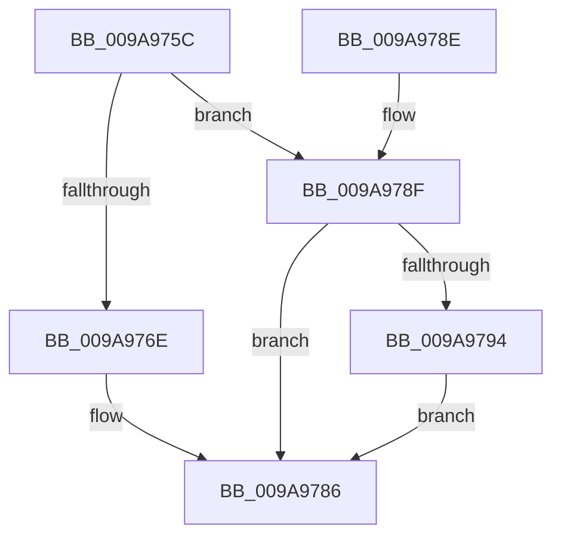

# SepComputeCachedHandlesEntrySignature

- RVA: `0x009A975C`–`0x009A97A9` (길이 `77` bytes)
- VA: `0x00000001409A975C`
- 실행 섹션: `PAGE`
- PDB 이름 있음: `예`; PDB Function 태그: `아니요`
- unwind 정보 RVA: `0x0009D63C`
- 디코드: `24`개 명령, `77/77` bytes 표시
- 미해석 바이트: `0` (있으면 어셈블리에 `.byte`로 보존)

> 이 문서는 커널 이미지의 기계어와 PDB 기호를 분석해 생성했습니다. 4번과 5번은 함수 원형과 자료형을 바이너리 사용 방식에서 추정한 C 해석이며 원본 소스 복구 결과는 아닙니다.

## 1. Dependencies

- 직접 호출 지점: **1**; 고유 호출 대상: **1**
- 직접 호출자로 확인된 함수: **1**
- RIP 상대 이미지 참조: **0**

### Outgoing calls
- `0x009A979D` → [RtlHashUnicodeString](../97/RtlHashUnicodeString_function_0097A780.md) (function, `0x0097A780`)

### Direct callers
- [SepGetCachedHandlesEntry](SepGetCachedHandlesEntry_function_009A95C0.md) at `0x009A95EC`

### Static image references
- 디코드된 RIP-relative 메모리 참조가 없습니다.

## 2. Other-region calls and transfers

- 다른 실행 섹션으로 향하는 call: **0**
- 별도 외부 분기/꼬리 이동을 확인하지 못했습니다.

## 3. Assembly (complete function range)

```asm
009A975C  48 83 EC 28                     sub rsp, 0x28
009A9760  8B 11                           mov edx, dword ptr [rcx]
009A9762  45 33 C0                        xor r8d, r8d
009A9765  44 89 44 24 30                  mov dword ptr [rsp + 0x30], r8d
009A976A  85 D2                           test edx, edx
009A976C  75 21                           jne 0x1409a978f
009A976E  48 8B 49 08                     mov rcx, qword ptr [rcx + 8]
009A9772  0F B6 41 01                     movzx eax, byte ptr [rcx + 1]
009A9776  FF C8                           dec eax
009A9778  8B 54 81 08                     mov edx, dword ptr [rcx + rax*4 + 8]
009A977C  85 D2                           test edx, edx
009A977E  4C 8D 42 01                     lea r8, [rdx + 1]
009A9782  4C 0F 45 C2                     cmovne r8, rdx
009A9786  49 8B C0                        mov rax, r8
009A9789  48 83 C4 28                     add rsp, 0x28
009A978D  C3                              ret
009A978E  CC                              int3
009A978F  83 FA 01                        cmp edx, 1
009A9792  75 F2                           jne 0x1409a9786
009A9794  48 83 C1 08                     add rcx, 8
009A9798  4C 8D 4C 24 30                  lea r9, [rsp + 0x30]
009A979D  E8 DE 0F FD FF                  call 0x14097a780
009A97A2  44 8B 44 24 30                  mov r8d, dword ptr [rsp + 0x30]
009A97A7  EB DD                           jmp 0x1409a9786
```

## 4. C-style interpretation (structured pseudocode)

```c
__int64 __fastcall SepComputeCachedHandlesEntrySignature(__int64 a1, __int64 a2, int a3)
{
    __int64 result;
    __int64 v_rsp;
    unsigned __int64 v_stack_p30;
    unsigned int v_stack_p8;

    v_rsp = (v_rsp) - (40);
    a3 = 0;
    v_stack_p8 = 0;
    if ((unsigned int)((unsigned int)(*(unsigned int *)(a1))) != 0) goto loc_009A978F;
    result = (unsigned int)((*(unsigned __int8 *)(*(unsigned __int64 *)(a1 + 8) + 1)) - 1);
    a3 = (unsigned int)(*(unsigned int *)(*(unsigned __int64 *)(a1 + 8) + result * 4 + 8)) + 1;
    if ((unsigned int)((unsigned int)(*(unsigned int *)(*(unsigned __int64 *)(a1 + 8) + result * 4 + 8))) != 0) { a3 = (unsigned int)(*(unsigned int *)(*(unsigned __int64 *)(a1 + 8) + result * 4 + 8)); }
loc_009A9786:
    v_rsp = (v_rsp) + (40);
    return a3;
loc_009A978F:
    if (((unsigned int)((unsigned int)(*(unsigned int *)(*(unsigned __int64 *)(a1 + 8) + result * 4 + 8)))) != 1) goto loc_009A9786;
    a1 = (*(unsigned __int64 *)(a1 + 8)) + (8);
    result = RtlHashUnicodeString(a1, (unsigned int)(*(unsigned int *)(*(unsigned __int64 *)(a1 + 8) + result * 4 + 8)), a3, v_stack_p30);
    goto loc_009A9786;
}
```

## 5. (Beta) C Style

```c
int64_t SepComputeCachedHandlesEntrySignature(void *Arg1, int64_t Arg2, int32_t Arg3)
{
    uint8_t *arg1 = (uint8_t *)Arg1;

    int64_t result;
    int64_t local_rsp;
    uint64_t v_stack_p30;
    uint32_t v_stack_p8;

    local_rsp = (local_rsp) - (40);
    Arg3 = 0;
    v_stack_p8 = 0;
    if ((uint32_t)((uint32_t)(*(uint32_t *)(arg1))) != 0) goto loc_009A978F;
    result = (uint32_t)((*(uint8_t *)(*(uint64_t *)(arg1 + 0x8) + 0x1)) - 1);
    Arg3 = (uint32_t)(*(uint32_t *)(*(uint64_t *)(arg1 + 0x8) + result * 4 + 0x8)) + 1;
    if ((uint32_t)((uint32_t)(*(uint32_t *)(*(uint64_t *)(arg1 + 0x8) + result * 4 + 0x8))) != 0) { Arg3 = (uint32_t)(*(uint32_t *)(*(uint64_t *)(arg1 + 0x8) + result * 4 + 0x8)); }
loc_009A9786:
    local_rsp = (local_rsp) + (40);
    return Arg3;
loc_009A978F:
    if (((uint32_t)((uint32_t)(*(uint32_t *)(*(uint64_t *)(arg1 + 0x8) + result * 4 + 0x8)))) != 1) goto loc_009A9786;
    Arg1 = (*(uint64_t *)(arg1 + 0x8)) + (8);
    result = RtlHashUnicodeString(Arg1, (uint32_t)(*(uint32_t *)(*(uint64_t *)(arg1 + 0x8) + result * 4 + 0x8)), Arg3, v_stack_p30);
    goto loc_009A9786;
}
```

### 관측된 메모리 오프셋

구조체 형식이 확인되지 않은 접근은 인자 기준의 오프셋으로만 기록했습니다.

| 기준 인자 | 오프셋 표현 | 폭 (bit) | 접근 |
|---|---:|---:|---|
| `Arg1` | `+ 0x0` | `32` | `R` |
| `Arg1` | `+ 0x8` | `64` | `R` |

## 6. Execution-region graph

[열기: 2D/3D 그래프와 함수 탐색 컨트롤 패널](../../../control-panel.html?section=page&rva=0x009A975C&view=graph)

- 2D 그래프는 위에서 아래로 흐르고, 3D 그래프는 빈 공간을 드래그해 회전합니다. Shift+드래그는 이동, 휠은 확대·축소, 함수 노드 선택은 대상 보고서 이동입니다.

### Static fallback


