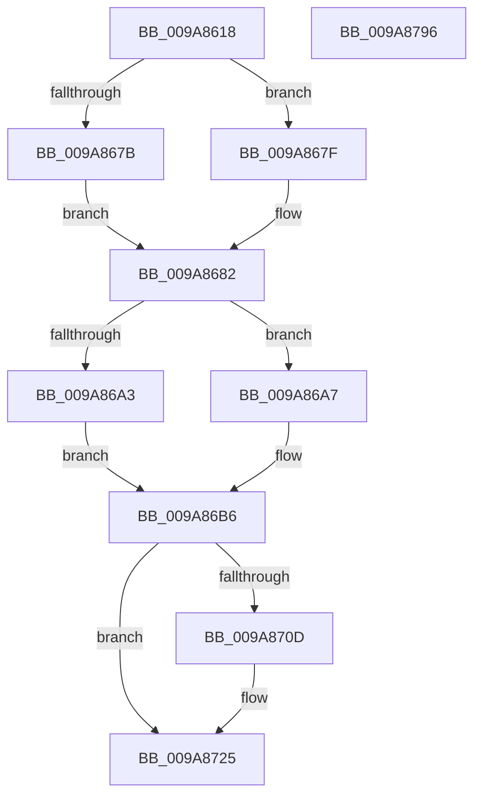

# SepCopyTokenLoggingInformation

- RVA: `0x009A8618`–`0x009A8797` (길이 `383` bytes)
- VA: `0x00000001409A8618`
- 실행 섹션: `PAGE`
- PDB 이름 있음: `예`; PDB Function 태그: `아니요`
- unwind 정보 RVA: `0x0009CFCC`
- 디코드: `97`개 명령, `383/383` bytes 표시
- 미해석 바이트: `0` (있으면 어셈블리에 `.byte`로 보존)

> 이 문서는 커널 이미지의 기계어와 PDB 기호를 분석해 생성했습니다. 4번과 5번은 함수 원형과 자료형을 바이너리 사용 방식에서 추정한 C 해석이며 원본 소스 복구 결과는 아닙니다.

## 1. Dependencies

- 직접 호출 지점: **8**; 고유 호출 대상: **7**
- 직접 호출자로 확인된 함수: **1**
- RIP 상대 이미지 참조: **0**

### Outgoing calls
- `0x009A8643` → [SepGetTokenElevation](../../text/44/SepGetTokenElevation_function_0044F3C8.md) (function, `0x0044F3C8`)
- `0x009A864E` → [SepGetTokenElevationType](../../text/47/SepGetTokenElevationType_function_0047B1C4.md) (function, `0x0047B1C4`)
- `0x009A868D` → [SepCopyTokenIntegrity](../../text/41/SepCopyTokenIntegrity_function_00419D10.md) (function, `0x00419D10`)
- `0x009A8697` → [RtlSubAuthorityCountSid](../../text/46/RtlSubAuthorityCountSid_function_00468F10.md) (function, `0x00468F10`)
- `0x009A86AF` → [RtlSubAuthoritySid](../../text/45/RtlSubAuthoritySid_function_00456D10.md) (function, `0x00456D10`)
- `0x009A86EE` → [RtlCopySidAndAttributesArray](RtlCopySidAndAttributesArray_function_009A8BE0.md) (function, `0x009A8BE0`)
- `0x009A8720` → [memcpy](../../text/6C/memcpy_function_006C6840.md) (function, `0x006C6840`)
- `0x009A876E` → [RtlCopySidAndAttributesArray](RtlCopySidAndAttributesArray_function_009A8BE0.md) (function, `0x009A8BE0`)

### Direct callers
- [SeQueryInformationToken](../8B/SeQueryInformationToken_function_008B5090.md) at `0x008B6305`

### Static image references
- 디코드된 RIP-relative 메모리 참조가 없습니다.

## 2. Other-region calls and transfers

- 다른 실행 섹션으로 향하는 call: **6**
  - `0x009A8643` → [SepGetTokenElevation](../../text/44/SepGetTokenElevation_function_0044F3C8.md) (`PAGE` → `.text`)
  - `0x009A864E` → [SepGetTokenElevationType](../../text/47/SepGetTokenElevationType_function_0047B1C4.md) (`PAGE` → `.text`)
  - `0x009A868D` → [SepCopyTokenIntegrity](../../text/41/SepCopyTokenIntegrity_function_00419D10.md) (`PAGE` → `.text`)
  - `0x009A8697` → [RtlSubAuthorityCountSid](../../text/46/RtlSubAuthorityCountSid_function_00468F10.md) (`PAGE` → `.text`)
  - `0x009A86AF` → [RtlSubAuthoritySid](../../text/45/RtlSubAuthoritySid_function_00456D10.md) (`PAGE` → `.text`)
  - `0x009A8720` → [memcpy](../../text/6C/memcpy_function_006C6840.md) (`PAGE` → `.text`)
- 별도 외부 분기/꼬리 이동을 확인하지 못했습니다.

## 3. Assembly (complete function range)

```asm
009A8618  48 89 5C 24 10                  mov qword ptr [rsp + 0x10], rbx
009A861D  48 89 6C 24 18                  mov qword ptr [rsp + 0x18], rbp
009A8622  56                              push rsi
009A8623  57                              push rdi
009A8624  41 56                           push r14
009A8626  48 83 EC 50                     sub rsp, 0x50
009A862A  8B 81 C0 00 00 00               mov eax, dword ptr [rcx + 0xc0]
009A8630  0F 57 C0                        xorps xmm0, xmm0
009A8633  0F 11 44 24 40                  movups xmmword ptr [rsp + 0x40], xmm0
009A8638  45 8B F1                        mov r14d, r9d
009A863B  89 02                           mov dword ptr [rdx], eax
009A863D  48 8B F2                        mov rsi, rdx
009A8640  48 8B E9                        mov rbp, rcx
009A8643  E8 80 6D AA FF                  call 0x14044f3c8
009A8648  48 8B CD                        mov rcx, rbp
009A864B  89 46 04                        mov dword ptr [rsi + 4], eax
009A864E  E8 71 2B AD FF                  call 0x14047b1c4
009A8653  89 46 08                        mov dword ptr [rsi + 8], eax
009A8656  33 DB                           xor ebx, ebx
009A8658  8B 85 C4 00 00 00               mov eax, dword ptr [rbp + 0xc4]
009A865E  89 46 0C                        mov dword ptr [rsi + 0xc], eax
009A8661  48 8B 45 18                     mov rax, qword ptr [rbp + 0x18]
009A8665  48 89 46 38                     mov qword ptr [rsi + 0x38], rax
009A8669  8B 45 78                        mov eax, dword ptr [rbp + 0x78]
009A866C  89 46 30                        mov dword ptr [rsi + 0x30], eax
009A866F  48 8B 85 38 04 00 00            mov rax, qword ptr [rbp + 0x438]
009A8676  48 85 C0                        test rax, rax
009A8679  75 04                           jne 0x1409a867f
009A867B  8B C3                           mov eax, ebx
009A867D  EB 03                           jmp 0x1409a8682
009A867F  8B 40 28                        mov eax, dword ptr [rax + 0x28]
009A8682  48 8D 54 24 40                  lea rdx, [rsp + 0x40]
009A8687  89 46 34                        mov dword ptr [rsi + 0x34], eax
009A868A  48 8B CD                        mov rcx, rbp
009A868D  E8 7E 16 A7 FF                  call 0x140419d10
009A8692  48 8B 4C 24 40                  mov rcx, qword ptr [rsp + 0x40]
009A8697  E8 74 08 AC FF                  call 0x140468f10
009A869C  0F B6 08                        movzx ecx, byte ptr [rax]
009A869F  84 C9                           test cl, cl
009A86A1  75 04                           jne 0x1409a86a7
009A86A3  8B C3                           mov eax, ebx
009A86A5  EB 0F                           jmp 0x1409a86b6
009A86A7  8D 51 FF                        lea edx, [rcx - 1]
009A86AA  48 8B 4C 24 40                  mov rcx, qword ptr [rsp + 0x40]
009A86AF  E8 5C E6 AA FF                  call 0x140456d10
009A86B4  8B 00                           mov eax, dword ptr [rax]
009A86B6  44 8B 84 24 A0 00 00 00         mov r8d, dword ptr [rsp + 0xa0]
009A86BE  48 8D 7E 50                     lea rdi, [rsi + 0x50]
009A86C2  89 46 10                        mov dword ptr [rsi + 0x10], eax
009A86C5  4C 8D 4E 18                     lea r9, [rsi + 0x18]
009A86C9  48 8B 95 98 00 00 00            mov rdx, qword ptr [rbp + 0x98]
009A86D0  48 8D 44 24 70                  lea rax, [rsp + 0x70]
009A86D5  48 89 44 24 30                  mov qword ptr [rsp + 0x30], rax
009A86DA  B9 01 00 00 00                  mov ecx, 1
009A86DF  48 8D 44 24 70                  lea rax, [rsp + 0x70]
009A86E4  48 89 44 24 28                  mov qword ptr [rsp + 0x28], rax
009A86E9  48 89 7C 24 20                  mov qword ptr [rsp + 0x20], rdi
009A86EE  E8 ED 04 00 00                  call 0x1409a8be0
009A86F3  8B 84 24 A0 00 00 00            mov eax, dword ptr [rsp + 0xa0]
009A86FA  48 8B 95 50 04 00 00            mov rdx, qword ptr [rbp + 0x450]
009A8701  48 03 F8                        add rdi, rax
009A8704  39 9C 24 98 00 00 00            cmp dword ptr [rsp + 0x98], ebx
009A870B  76 18                           jbe 0x1409a8725
009A870D  44 0F B6 42 01                  movzx r8d, byte ptr [rdx + 1]
009A8712  48 8B CF                        mov rcx, rdi
009A8715  48 8B DF                        mov rbx, rdi
009A8718  4E 8D 04 85 08 00 00 00         lea r8, [r8*4 + 8]
009A8720  E8 1B E1 D1 FF                  call 0x1406c6840
009A8725  8B 84 24 98 00 00 00            mov eax, dword ptr [rsp + 0x98]
009A872C  48 8D 4C 24 70                  lea rcx, [rsp + 0x70]
009A8731  48 89 4C 24 30                  mov qword ptr [rsp + 0x30], rcx
009A8736  48 03 F8                        add rdi, rax
009A8739  8B 84 24 90 00 00 00            mov eax, dword ptr [rsp + 0x90]
009A8740  48 8D 4C 24 70                  lea rcx, [rsp + 0x70]
009A8745  48 89 4C 24 28                  mov qword ptr [rsp + 0x28], rcx
009A874A  45 8B C6                        mov r8d, r14d
009A874D  44 2B 84 24 90 00 00 00         sub r8d, dword ptr [rsp + 0x90]
009A8755  48 03 C7                        add rax, rdi
009A8758  48 89 5E 28                     mov qword ptr [rsi + 0x28], rbx
009A875C  4C 8B CF                        mov r9, rdi
009A875F  8B 4D 7C                        mov ecx, dword ptr [rbp + 0x7c]
009A8762  48 8B 95 98 00 00 00            mov rdx, qword ptr [rbp + 0x98]
009A8769  48 89 44 24 20                  mov qword ptr [rsp + 0x20], rax
009A876E  E8 6D 04 00 00                  call 0x1409a8be0
009A8773  8B 45 7C                        mov eax, dword ptr [rbp + 0x7c]
009A8776  4C 8D 5C 24 50                  lea r11, [rsp + 0x50]
009A877B  49 8B 5B 28                     mov rbx, qword ptr [r11 + 0x28]
009A877F  49 8B 6B 30                     mov rbp, qword ptr [r11 + 0x30]
009A8783  89 46 40                        mov dword ptr [rsi + 0x40], eax
009A8786  44 89 76 44                     mov dword ptr [rsi + 0x44], r14d
009A878A  48 89 7E 48                     mov qword ptr [rsi + 0x48], rdi
009A878E  49 8B E3                        mov rsp, r11
009A8791  41 5E                           pop r14
009A8793  5F                              pop rdi
009A8794  5E                              pop rsi
009A8795  C3                              ret
009A8796  CC                              int3
```

## 4. C-style interpretation (structured pseudocode)

```c
__int64 __fastcall SepCopyTokenLoggingInformation(__int64 a1, __int64 a2, __int64 a3, int a4, unsigned int a5, unsigned int a6, unsigned int a7)
{
    __int64 result;
    __int64 v_rbx;
    __int64 v_rdi;
    __int64 v_rsp;
    unsigned __int64 v_stack_m18;
    unsigned __int64 v_stack_m28;
    unsigned __int64 v_stack_m38;
    unsigned __int64 v_stack_m40;
    unsigned __int64 v_stack_m48;
    unsigned __int64 v_stack_p10;
    unsigned __int64 v_stack_p18;
    unsigned __int64 v_stack_p8;

    v_stack_p10 = v_rbx;
    v_stack_p18 = v_rbp;
    v_rsp = (v_rsp) - (80);
    v_stack_m28 = v_xmm0;
    *(unsigned int *)(a2) = (unsigned int)((unsigned int)(*(unsigned int *)(a1 + 192)));
    result = SepGetTokenElevation(a1, a2, a3, a4);
    *(unsigned int *)(a2 + 4) = (unsigned int)(result);
    result = SepGetTokenElevationType(a1, a2, a3, a4);
    *(unsigned int *)(a2 + 8) = (unsigned int)(result);
    v_rbx = 0;
    *(unsigned int *)(a2 + 12) = (unsigned int)((unsigned int)(*(unsigned int *)(a1 + 196)));
    *(unsigned __int64 *)(a2 + 56) = *(unsigned __int64 *)(a1 + 24);
    *(unsigned int *)(a2 + 48) = (unsigned int)((unsigned int)(*(unsigned int *)(a1 + 120)));
    if (*(unsigned __int64 *)(a1 + 1080) != 0) goto loc_009A867F;
    goto loc_009A8682;
loc_009A867F:
loc_009A8682:
    *(unsigned int *)(a2 + 52) = (unsigned int)((unsigned int)(*(unsigned int *)(0 + 40)));
    result = SepCopyTokenIntegrity(a1, v_stack_m28, a3, a4);
    result = RtlSubAuthorityCountSid(v_stack_m28, v_stack_m28, a3, a4);
    if ((unsigned __int8)(*(unsigned __int8 *)(result)) != 0) goto loc_009A86A7;
    goto loc_009A86B6;
loc_009A86A7:
    result = RtlSubAuthoritySid(v_stack_m28, *(unsigned __int8 *)(result) - 1, a3, a4);
loc_009A86B6:
    *(unsigned int *)(a2 + 16) = (unsigned int)((unsigned int)(*(unsigned int *)(result)));
    v_stack_m38 = v_stack_p8;
    v_stack_m40 = v_stack_p8;
    v_stack_m48 = a2 + 80;
    result = RtlCopySidAndAttributesArray(1, *(unsigned __int64 *)(a1 + 152), (unsigned int)(a7), a2 + 24);
    v_rdi = (a2 + 80) + ((unsigned int)(a7));
    result = (unsigned int)(a7);
    if (a6 >= = 0) {
        a3 = *(unsigned __int8 *)(*(unsigned __int64 *)(a1 + 1104) + 1);
        a1 = v_rdi;
        v_rbx = v_rdi;
        a3 = a3 * 4 + 8;
        result = memcpy(a1, *(unsigned __int64 *)(a1 + 1104), a3, a2 + 24);
    }
    v_stack_m38 = v_stack_p8;
    v_rdi = (v_rdi) + ((unsigned int)(a6));
    v_stack_m40 = v_stack_p8;
    a3 = (unsigned int)(((unsigned int)((unsigned int)((unsigned int)(a4)))) - (a5));
    result = ((unsigned int)(a5)) + (v_rdi);
    *(unsigned __int64 *)(a2 + 40) = v_rbx;
    v_stack_m48 = result;
    result = RtlCopySidAndAttributesArray((unsigned int)(*(unsigned int *)(a1 + 124)), *(unsigned __int64 *)(a1 + 152), a3, v_rdi);
    *(unsigned int *)(a2 + 64) = (unsigned int)((unsigned int)(*(unsigned int *)(a1 + 124)));
    *(unsigned int *)(a2 + 68) = (unsigned int)((unsigned int)(a4));
    *(unsigned __int64 *)(a2 + 72) = v_rdi;
    return (unsigned int)(*(unsigned int *)(a1 + 124));
}
```

## 5. (Beta) C Style

```c
int64_t SepCopyTokenLoggingInformation(void *Arg1, void *Arg2, int64_t Arg3, int32_t Arg4, uint32_t Arg5, uint32_t Arg6, uint32_t Arg7)
{
    uint8_t *arg1 = (uint8_t *)Arg1;
    uint8_t *arg2 = (uint8_t *)Arg2;

    int64_t result;
    int64_t local_rbx;
    int64_t local_rdi;
    int64_t local_rsp;
    uint64_t v_stack_m18;
    uint64_t v_stack_m28;
    uint64_t v_stack_m38;
    uint64_t v_stack_m40;
    uint64_t v_stack_m48;
    uint64_t v_stack_p10;
    uint64_t v_stack_p18;
    uint64_t v_stack_p8;

    v_stack_p10 = local_rbx;
    v_stack_p18 = local_rbp;
    local_rsp = (local_rsp) - (80);
    v_stack_m28 = v_xmm0;
    *(uint32_t *)(arg2) = (uint32_t)((uint32_t)(*(uint32_t *)(arg1 + 0xC0)));
    result = SepGetTokenElevation(Arg1, Arg2, Arg3, Arg4);
    *(uint32_t *)(arg2 + 0x4) = (uint32_t)(result);
    result = SepGetTokenElevationType(Arg1, Arg2, Arg3, Arg4);
    *(uint32_t *)(arg2 + 0x8) = (uint32_t)(result);
    local_rbx = 0;
    *(uint32_t *)(arg2 + 0xC) = (uint32_t)((uint32_t)(*(uint32_t *)(arg1 + 0xC4)));
    *(uint64_t *)(arg2 + 0x38) = *(uint64_t *)(arg1 + 0x18);
    *(uint32_t *)(arg2 + 0x30) = (uint32_t)((uint32_t)(*(uint32_t *)(arg1 + 0x78)));
    if (*(uint64_t *)(arg1 + 0x438) != 0) goto loc_009A867F;
    goto loc_009A8682;
loc_009A867F:
loc_009A8682:
    *(uint32_t *)(arg2 + 0x34) = (uint32_t)((uint32_t)(*(uint32_t *)(0 + 0x28)));
    result = SepCopyTokenIntegrity(Arg1, v_stack_m28, Arg3, Arg4);
    result = RtlSubAuthorityCountSid(v_stack_m28, v_stack_m28, Arg3, Arg4);
    if ((uint8_t)(*(uint8_t *)(result)) != 0) goto loc_009A86A7;
    goto loc_009A86B6;
loc_009A86A7:
    result = RtlSubAuthoritySid(v_stack_m28, *(uint8_t *)(result) - 1, Arg3, Arg4);
loc_009A86B6:
    *(uint32_t *)(arg2 + 0x10) = (uint32_t)((uint32_t)(*(uint32_t *)(result)));
    v_stack_m38 = v_stack_p8;
    v_stack_m40 = v_stack_p8;
    v_stack_m48 = Arg2 + 80;
    result = RtlCopySidAndAttributesArray(1, *(uint64_t *)(arg1 + 0x98), (uint32_t)(Arg7), Arg2 + 24);
    local_rdi = (Arg2 + 80) + ((uint32_t)(Arg7));
    result = (uint32_t)(Arg7);
    if (Arg6 >= = 0) {
        Arg3 = *(uint8_t *)(*(uint64_t *)(arg1 + 0x450) + 0x1);
        Arg1 = local_rdi;
        local_rbx = local_rdi;
        Arg3 = Arg3 * 4 + 8;
        result = memcpy(Arg1, *(uint64_t *)(arg1 + 0x450), Arg3, Arg2 + 24);
    }
    v_stack_m38 = v_stack_p8;
    local_rdi = (local_rdi) + ((uint32_t)(Arg6));
    v_stack_m40 = v_stack_p8;
    Arg3 = (uint32_t)(((uint32_t)((uint32_t)((uint32_t)(Arg4)))) - (Arg5));
    result = ((uint32_t)(Arg5)) + (local_rdi);
    *(uint64_t *)(arg2 + 0x28) = local_rbx;
    v_stack_m48 = result;
    result = RtlCopySidAndAttributesArray((uint32_t)(*(uint32_t *)(arg1 + 0x7C)), *(uint64_t *)(arg1 + 0x98), Arg3, local_rdi);
    *(uint32_t *)(arg2 + 0x40) = (uint32_t)((uint32_t)(*(uint32_t *)(arg1 + 0x7C)));
    *(uint32_t *)(arg2 + 0x44) = (uint32_t)((uint32_t)(Arg4));
    *(uint64_t *)(arg2 + 0x48) = local_rdi;
    return (uint32_t)(*(uint32_t *)(arg1 + 0x7C));
}
```

### 관측된 메모리 오프셋

구조체 형식이 확인되지 않은 접근은 인자 기준의 오프셋으로만 기록했습니다.

| 기준 인자 | 오프셋 표현 | 폭 (bit) | 접근 |
|---|---:|---:|---|
| `Arg1` | `+ 0x18` | `64` | `R` |
| `Arg1` | `+ 0x78` | `32` | `R` |
| `Arg1` | `+ 0x7C` | `32` | `R` |
| `Arg1` | `+ 0x98` | `64` | `R` |
| `Arg1` | `+ 0xC0` | `32` | `R` |
| `Arg1` | `+ 0xC4` | `32` | `R` |
| `Arg1` | `+ 0x438` | `64` | `R` |
| `Arg1` | `+ 0x450` | `64` | `R` |
| `Arg2` | `+ 0x0` | `32` | `W` |
| `Arg2` | `+ 0x4` | `32` | `W` |
| `Arg2` | `+ 0x8` | `32` | `W` |
| `Arg2` | `+ 0xC` | `32` | `W` |
| `Arg2` | `+ 0x10` | `32` | `W` |
| `Arg2` | `+ 0x18` | `64` | `R` |
| `Arg2` | `+ 0x28` | `64` | `W` |
| `Arg2` | `+ 0x30` | `32` | `W` |
| `Arg2` | `+ 0x34` | `32` | `W` |
| `Arg2` | `+ 0x38` | `64` | `W` |
| `Arg2` | `+ 0x40` | `32` | `W` |
| `Arg2` | `+ 0x44` | `32` | `W` |
| `Arg2` | `+ 0x48` | `64` | `W` |
| `Arg2` | `+ 0x50` | `64` | `R` |

## 6. Execution-region graph

[열기: 2D/3D 그래프와 함수 탐색 컨트롤 패널](../../../control-panel.html?section=page&rva=0x009A8618&view=graph)

- 2D 그래프는 위에서 아래로 흐르고, 3D 그래프는 빈 공간을 드래그해 회전합니다. Shift+드래그는 이동, 휠은 확대·축소, 함수 노드 선택은 대상 보고서 이동입니다.

### Static fallback


