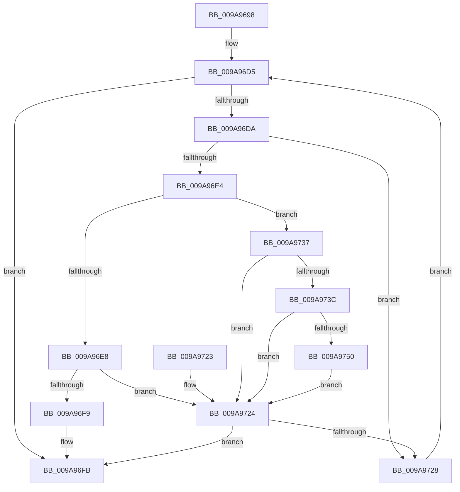

# SepFindMatchingCachedHandlesEntry

- RVA: `0x009A9698`–`0x009A9754` (길이 `188` bytes)
- VA: `0x00000001409A9698`
- 실행 섹션: `PAGE`
- PDB 이름 있음: `예`; PDB Function 태그: `아니요`
- unwind 정보 RVA: `0x0009D620`
- 디코드: `61`개 명령, `188/188` bytes 표시
- 미해석 바이트: `0` (있으면 어셈블리에 `.byte`로 보존)

> 이 문서는 커널 이미지의 기계어와 PDB 기호를 분석해 생성했습니다. 4번과 5번은 함수 원형과 자료형을 바이너리 사용 방식에서 추정한 C 해석이며 원본 소스 복구 결과는 아닙니다.

## 1. Dependencies

- 직접 호출 지점: **4**; 고유 호출 대상: **4**
- 직접 호출자로 확인된 함수: **1**
- RIP 상대 이미지 참조: **0**

### Outgoing calls
- `0x009A96D0` → [RtlLookupEntryHashTable](../../text/3F/RtlLookupEntryHashTable_function_003FAE50.md) (function, `0x003FAE50`)
- `0x009A96F0` → [RtlEqualSid](../../text/40/RtlEqualSid_function_00400AD0.md) (function, `0x00400AD0`)
- `0x009A9730` → [RtlGetNextEntryHashTable](../../text/44/RtlGetNextEntryHashTable_function_00446C20.md) (function, `0x00446C20`)
- `0x009A9747` → [RtlEqualUnicodeString](../93/RtlEqualUnicodeString_function_00932A20.md) (function, `0x00932A20`)

### Direct callers
- [SepGetCachedHandlesEntry](SepGetCachedHandlesEntry_function_009A95C0.md) at `0x009A9605`

### Static image references
- 디코드된 RIP-relative 메모리 참조가 없습니다.

## 2. Other-region calls and transfers

- 다른 실행 섹션으로 향하는 call: **3**
  - `0x009A96D0` → [RtlLookupEntryHashTable](../../text/3F/RtlLookupEntryHashTable_function_003FAE50.md) (`PAGE` → `.text`)
  - `0x009A96F0` → [RtlEqualSid](../../text/40/RtlEqualSid_function_00400AD0.md) (`PAGE` → `.text`)
  - `0x009A9730` → [RtlGetNextEntryHashTable](../../text/44/RtlGetNextEntryHashTable_function_00446C20.md) (`PAGE` → `.text`)
- 별도 외부 분기/꼬리 이동을 확인하지 못했습니다.

## 3. Assembly (complete function range)

```asm
009A9698  4C 8B DC                        mov r11, rsp
009A969B  49 89 5B 08                     mov qword ptr [r11 + 8], rbx
009A969F  49 89 6B 10                     mov qword ptr [r11 + 0x10], rbp
009A96A3  49 89 73 18                     mov qword ptr [r11 + 0x18], rsi
009A96A7  49 89 7B 20                     mov qword ptr [r11 + 0x20], rdi
009A96AB  41 56                           push r14
009A96AD  48 83 EC 40                     sub rsp, 0x40
009A96B1  0F 57 C0                        xorps xmm0, xmm0
009A96B4  49 8B F8                        mov rdi, r8
009A96B7  33 C0                           xor eax, eax
009A96B9  4D 8D 43 D8                     lea r8, [r11 - 0x28]
009A96BD  0F 11 44 24 20                  movups xmmword ptr [rsp + 0x20], xmm0
009A96C2  33 F6                           xor esi, esi
009A96C4  49 89 43 E8                     mov qword ptr [r11 - 0x18], rax
009A96C8  32 DB                           xor bl, bl
009A96CA  4D 8B F1                        mov r14, r9
009A96CD  48 8B E9                        mov rbp, rcx
009A96D0  E8 7B 17 A5 FF                  call 0x1403fae50
009A96D5  48 85 C0                        test rax, rax
009A96D8  74 21                           je 0x1409a96fb
009A96DA  8B 17                           mov edx, dword ptr [rdi]
009A96DC  48 8B F0                        mov rsi, rax
009A96DF  3B 50 20                        cmp edx, dword ptr [rax + 0x20]
009A96E2  75 44                           jne 0x1409a9728
009A96E4  85 D2                           test edx, edx
009A96E6  75 4F                           jne 0x1409a9737
009A96E8  48 8B 50 28                     mov rdx, qword ptr [rax + 0x28]
009A96EC  48 8B 4F 08                     mov rcx, qword ptr [rdi + 8]
009A96F0  E8 DB 73 A5 FF                  call 0x140400ad0
009A96F5  84 C0                           test al, al
009A96F7  74 2B                           je 0x1409a9724
009A96F9  B3 01                           mov bl, 1
009A96FB  F6 DB                           neg bl
009A96FD  48 1B C0                        sbb rax, rax
009A9700  48 23 C6                        and rax, rsi
009A9703  49 89 06                        mov qword ptr [r14], rax
009A9706  33 C0                           xor eax, eax
009A9708  48 8B 5C 24 50                  mov rbx, qword ptr [rsp + 0x50]
009A970D  48 8B 6C 24 58                  mov rbp, qword ptr [rsp + 0x58]
009A9712  48 8B 74 24 60                  mov rsi, qword ptr [rsp + 0x60]
009A9717  48 8B 7C 24 68                  mov rdi, qword ptr [rsp + 0x68]
009A971C  48 83 C4 40                     add rsp, 0x40
009A9720  41 5E                           pop r14
009A9722  C3                              ret
009A9723  CC                              int3
009A9724  84 DB                           test bl, bl
009A9726  75 D3                           jne 0x1409a96fb
009A9728  48 8D 54 24 20                  lea rdx, [rsp + 0x20]
009A972D  48 8B CD                        mov rcx, rbp
009A9730  E8 EB D4 A9 FF                  call 0x140446c20
009A9735  EB 9E                           jmp 0x1409a96d5
009A9737  83 FA 01                        cmp edx, 1
009A973A  75 E8                           jne 0x1409a9724
009A973C  48 8D 50 28                     lea rdx, [rax + 0x28]
009A9740  41 B0 01                        mov r8b, 1
009A9743  48 8D 4F 08                     lea rcx, [rdi + 8]
009A9747  E8 D4 92 F8 FF                  call 0x140932a20
009A974C  84 C0                           test al, al
009A974E  74 D4                           je 0x1409a9724
009A9750  B3 01                           mov bl, 1
009A9752  EB D0                           jmp 0x1409a9724
```

## 4. C-style interpretation (structured pseudocode)

```c
__int64 __fastcall SepFindMatchingCachedHandlesEntry(__int64 a1, __int64 a2, __int64 a3, __int64 a4)
{
    __int64 result;
    __int64 v_rbx;
    __int64 v_rsi;
    __int64 v_rsp;
    unsigned __int64 v_stack_m28;
    unsigned __int64 v_stack_p10;
    unsigned __int64 v_stack_p18;
    unsigned __int64 v_stack_p20;
    unsigned __int64 v_stack_p8;

    *(unsigned __int64 *)(v_rsp + 8) = v_rbx;
    *(unsigned __int64 *)(v_rsp + 16) = v_rbp;
    *(unsigned __int64 *)(v_rsp + 24) = v_rsi;
    *(unsigned __int64 *)(v_rsp + 32) = v_rdi;
    v_rsp = (v_rsp) - (64);
    result = 0;
    v_stack_m28 = v_xmm0;
    v_rsi = 0;
    *(unsigned __int64 *)(v_rsp - 24) = 0;
    v_rbx = 0;
    result = RtlLookupEntryHashTable(a1, a2, v_rsp - 40, a4);
loc_009A96D5:
    if (result == 0) goto loc_009A96FB;
    if (((unsigned int)((unsigned int)(*(unsigned int *)(a3)))) != (*(unsigned int *)(result + 32))) goto loc_009A9728;
    if ((unsigned int)((unsigned int)(*(unsigned int *)(a3))) != 0) goto loc_009A9737;
    result = RtlEqualSid(*(unsigned __int64 *)(a3 + 8), *(unsigned __int64 *)(result + 40), v_rsp - 40, a4);
    if ((unsigned __int8)(result) == 0) goto loc_009A9724;
loc_009A96FB:
    v_rbx = (unsigned __int8)(-(1));
    result = (result) & (result);
    *(unsigned __int64 *)(a4) = result;
    result = 0;
    v_rsp = (v_rsp) + (64);
    return result;
loc_009A9724:
    if ((unsigned __int8)(v_stack_p8) != 0) goto loc_009A96FB;
loc_009A9728:
    result = RtlGetNextEntryHashTable(v_stack_p10, v_stack_p20, v_rsp - 40, a4);
    goto loc_009A96D5;
loc_009A9737:
    if (((unsigned int)(v_stack_p20)) != 1) goto loc_009A9724;
    result = RtlEqualUnicodeString(v_stack_p20 + 8, result + 40, 1, a4);
    if ((unsigned __int8)(result) == 0) goto loc_009A9724;
    goto loc_009A9724;
}
```

## 5. (Beta) C Style

```c
int64_t SepFindMatchingCachedHandlesEntry(int64_t Arg1, int64_t Arg2, void *Arg3, void *Arg4)
{
    uint8_t *arg3 = (uint8_t *)Arg3;
    uint8_t *arg4 = (uint8_t *)Arg4;

    int64_t result;
    int64_t local_rbx;
    int64_t local_rsi;
    int64_t local_rsp;
    uint64_t v_stack_m28;
    uint64_t v_stack_p10;
    uint64_t v_stack_p18;
    uint64_t v_stack_p20;
    uint64_t v_stack_p8;

    *(uint64_t *)(local_rsp + 0x8) = local_rbx;
    *(uint64_t *)(local_rsp + 0x10) = local_rbp;
    *(uint64_t *)(local_rsp + 0x18) = local_rsi;
    *(uint64_t *)(local_rsp + 0x20) = local_rdi;
    local_rsp = (local_rsp) - (64);
    result = 0;
    v_stack_m28 = v_xmm0;
    local_rsi = 0;
    *(uint64_t *)(local_rsp - 0x18) = 0;
    local_rbx = 0;
    result = RtlLookupEntryHashTable(Arg1, Arg2, local_rsp - 40, Arg4);
loc_009A96D5:
    if (result == 0) goto loc_009A96FB;
    if (((uint32_t)((uint32_t)(*(uint32_t *)(arg3)))) != (*(uint32_t *)(result + 0x20))) goto loc_009A9728;
    if ((uint32_t)((uint32_t)(*(uint32_t *)(arg3))) != 0) goto loc_009A9737;
    result = RtlEqualSid(*(uint64_t *)(arg3 + 0x8), *(uint64_t *)(result + 0x28), local_rsp - 40, Arg4);
    if ((uint8_t)(result) == 0) goto loc_009A9724;
loc_009A96FB:
    local_rbx = (uint8_t)(-(1));
    result = (result) & (result);
    *(uint64_t *)(arg4) = result;
    result = 0;
    local_rsp = (local_rsp) + (64);
    return result;
loc_009A9724:
    if ((uint8_t)(v_stack_p8) != 0) goto loc_009A96FB;
loc_009A9728:
    result = RtlGetNextEntryHashTable(v_stack_p10, v_stack_p20, local_rsp - 40, Arg4);
    goto loc_009A96D5;
loc_009A9737:
    if (((uint32_t)(v_stack_p20)) != 1) goto loc_009A9724;
    result = RtlEqualUnicodeString(v_stack_p20 + 8, result + 40, 1, Arg4);
    if ((uint8_t)(result) == 0) goto loc_009A9724;
    goto loc_009A9724;
}
```

### 관측된 메모리 오프셋

구조체 형식이 확인되지 않은 접근은 인자 기준의 오프셋으로만 기록했습니다.

| 기준 인자 | 오프셋 표현 | 폭 (bit) | 접근 |
|---|---:|---:|---|
| `Arg3` | `+ 0x0` | `32` | `R` |
| `Arg3` | `+ 0x8` | `64` | `R` |
| `Arg4` | `+ 0x0` | `64` | `W` |

## 6. Execution-region graph

[열기: 2D/3D 그래프와 함수 탐색 컨트롤 패널](../../../control-panel.html?section=page&rva=0x009A9698&view=graph)

- 2D 그래프는 위에서 아래로 흐르고, 3D 그래프는 빈 공간을 드래그해 회전합니다. Shift+드래그는 이동, 휠은 확대·축소, 함수 노드 선택은 대상 보고서 이동입니다.

### Static fallback


