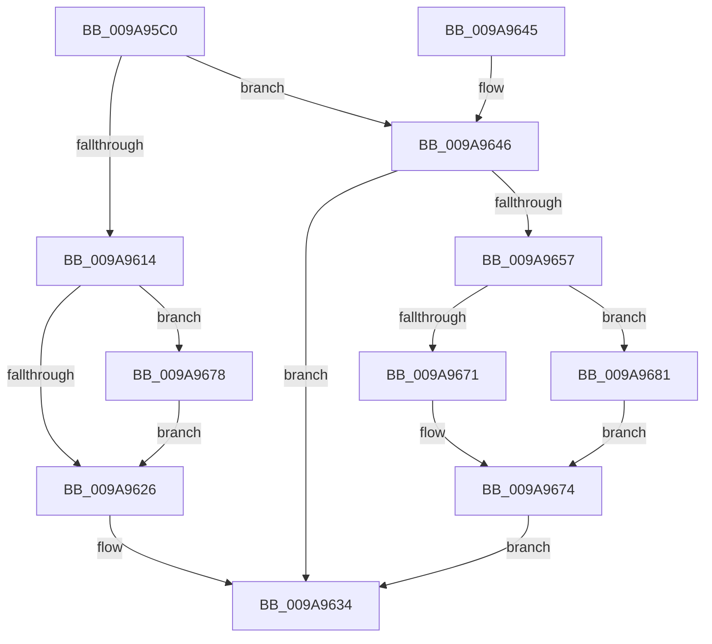

# SepGetCachedHandlesEntry

- RVA: `0x009A95C0`–`0x009A9692` (길이 `210` bytes)
- VA: `0x00000001409A95C0`
- 실행 섹션: `PAGE`
- PDB 이름 있음: `예`; PDB Function 태그: `아니요`
- unwind 정보 RVA: `0x0009D608`
- 디코드: `68`개 명령, `210/210` bytes 표시
- 미해석 바이트: `0` (있으면 어셈블리에 `.byte`로 보존)

> 이 문서는 커널 이미지의 기계어와 PDB 기호를 분석해 생성했습니다. 4번과 5번은 함수 원형과 자료형을 바이너리 사용 방식에서 추정한 C 해석이며 원본 소스 복구 결과는 아닙니다.

## 1. Dependencies

- 직접 호출 지점: **5**; 고유 호출 대상: **5**
- 직접 호출자로 확인된 함수: **1**
- RIP 상대 이미지 참조: **0**

### Outgoing calls
- `0x009A95EC` → [SepComputeCachedHandlesEntrySignature](SepComputeCachedHandlesEntrySignature_function_009A975C.md) (function, `0x009A975C`)
- `0x009A9605` → [SepFindMatchingCachedHandlesEntry](SepFindMatchingCachedHandlesEntry_function_009A9698.md) (function, `0x009A9698`)
- `0x009A964E` → [SepAllocateAndInitializeCachedHandleEntry](SepAllocateAndInitializeCachedHandleEntry_function_009A97B0.md) (function, `0x009A97B0`)
- `0x009A9668` → [RtlInsertEntryHashTable](../../text/43/RtlInsertEntryHashTable_function_00437660.md) (function, `0x00437660`)
- `0x009A9686` → [ExFreePoolWithTag](../../poolcode/B8/ExFreePoolWithTag_function_00B82870.md) (function, `0x00B82870`)

### Direct callers
- [SepSetTokenCachedHandles](SepSetTokenCachedHandles_function_009A939C.md) at `0x009A94AC`

### Static image references
- 디코드된 RIP-relative 메모리 참조가 없습니다.

## 2. Other-region calls and transfers

- 다른 실행 섹션으로 향하는 call: **2**
  - `0x009A9668` → [RtlInsertEntryHashTable](../../text/43/RtlInsertEntryHashTable_function_00437660.md) (`PAGE` → `.text`)
  - `0x009A9686` → [ExFreePoolWithTag](../../poolcode/B8/ExFreePoolWithTag_function_00B82870.md) (`PAGE` → `POOLCODE`)
- 별도 외부 분기/꼬리 이동을 확인하지 못했습니다.

## 3. Assembly (complete function range)

```asm
009A95C0  48 89 5C 24 10                  mov qword ptr [rsp + 0x10], rbx
009A95C5  55                              push rbp
009A95C6  56                              push rsi
009A95C7  57                              push rdi
009A95C8  41 56                           push r14
009A95CA  41 57                           push r15
009A95CC  48 83 EC 20                     sub rsp, 0x20
009A95D0  48 8B 69 08                     mov rbp, qword ptr [rcx + 8]
009A95D4  33 DB                           xor ebx, ebx
009A95D6  48 8B CA                        mov rcx, rdx
009A95D9  48 89 5C 24 50                  mov qword ptr [rsp + 0x50], rbx
009A95DE  48 89 5C 24 60                  mov qword ptr [rsp + 0x60], rbx
009A95E3  49 8B F1                        mov rsi, r9
009A95E6  4D 8B F0                        mov r14, r8
009A95E9  48 8B FA                        mov rdi, rdx
009A95EC  E8 6B 01 00 00                  call 0x1409a975c
009A95F1  4C 8D 4C 24 50                  lea r9, [rsp + 0x50]
009A95F6  41 88 1E                        mov byte ptr [r14], bl
009A95F9  4C 8B C7                        mov r8, rdi
009A95FC  48 8B D0                        mov rdx, rax
009A95FF  48 8B CD                        mov rcx, rbp
009A9602  4C 8B F8                        mov r15, rax
009A9605  E8 8E 00 00 00                  call 0x1409a9698
009A960A  48 8B 4C 24 50                  mov rcx, qword ptr [rsp + 0x50]
009A960F  48 85 C9                        test rcx, rcx
009A9612  74 32                           je 0x1409a9646
009A9614  8D 43 01                        lea eax, [rbx + 1]
009A9617  F0 48 0F C1 41 18               lock xadd qword ptr [rcx + 0x18], rax
009A961D  48 FF C0                        inc rax
009A9620  48 83 F8 01                     cmp rax, 1
009A9624  7E 52                           jle 0x1409a9678
009A9626  48 8B 44 24 50                  mov rax, qword ptr [rsp + 0x50]
009A962B  48 89 06                        mov qword ptr [rsi], rax
009A962E  33 C0                           xor eax, eax
009A9630  41 C6 06 01                     mov byte ptr [r14], 1
009A9634  48 8B 5C 24 58                  mov rbx, qword ptr [rsp + 0x58]
009A9639  48 83 C4 20                     add rsp, 0x20
009A963D  41 5F                           pop r15
009A963F  41 5E                           pop r14
009A9641  5F                              pop rdi
009A9642  5E                              pop rsi
009A9643  5D                              pop rbp
009A9644  C3                              ret
009A9645  CC                              int3
009A9646  48 8D 54 24 60                  lea rdx, [rsp + 0x60]
009A964B  48 8B CF                        mov rcx, rdi
009A964E  E8 5D 01 00 00                  call 0x1409a97b0
009A9653  85 C0                           test eax, eax
009A9655  78 DD                           js 0x1409a9634
009A9657  48 8B 7C 24 60                  mov rdi, qword ptr [rsp + 0x60]
009A965C  45 33 C9                        xor r9d, r9d
009A965F  48 8B D7                        mov rdx, rdi
009A9662  4D 8B C7                        mov r8, r15
009A9665  48 8B CD                        mov rcx, rbp
009A9668  E8 F3 DF A8 FF                  call 0x140437660
009A966D  84 C0                           test al, al
009A966F  74 10                           je 0x1409a9681
009A9671  48 89 3E                        mov qword ptr [rsi], rdi
009A9674  8B C3                           mov eax, ebx
009A9676  EB BC                           jmp 0x1409a9634
009A9678  B9 0E 00 00 00                  mov ecx, 0xe
009A967D  CD 29                           int 0x29
009A967F  EB A5                           jmp 0x1409a9626
009A9681  33 D2                           xor edx, edx
009A9683  48 8B CF                        mov rcx, rdi
009A9686  E8 E5 91 1D 00                  call 0x140b82870
009A968B  BB 9A 00 00 C0                  mov ebx, 0xc000009a
009A9690  EB E2                           jmp 0x1409a9674
```

## 4. C-style interpretation (structured pseudocode)

```c
__int64 __fastcall SepGetCachedHandlesEntry(__int64 a1, __int64 a2, __int64 a3, __int64 a4)
{
    __int64 result;
    __int64 v_rbx;
    __int64 v_rsp;
    unsigned __int64 v_stack_p10;
    unsigned __int64 v_stack_p18;
    unsigned __int64 v_stack_p60;
    unsigned __int64 v_stack_p8;

    v_stack_p10 = v_rbx;
    v_rsp = (v_rsp) - (32);
    v_rbx = 0;
    v_stack_p8 = 0;
    v_stack_p18 = 0;
    result = SepComputeCachedHandlesEntrySignature(a2, a2, a3, a4);
    *(unsigned __int8 *)(a3) = 0;
    result = SepFindMatchingCachedHandlesEntry(*(unsigned __int64 *)(a1 + 8), result, a2, v_stack_p8);
    if (v_stack_p8 == 0) goto loc_009A9646;
    result = (v_rbx + 1) + 1;
    if (result <= 1) goto loc_009A9678;
loc_009A9626:
    *(unsigned __int64 *)(a4) = v_stack_p8;
    result = 0;
    *(unsigned __int8 *)(a3) = 1;
loc_009A9634:
    v_rsp = (v_rsp) + (32);
    return result;
loc_009A9646:
    result = SepAllocateAndInitializeCachedHandleEntry(a2, v_stack_p60, a2, v_stack_p8);
    if (sign_flag) goto loc_009A9634;
    a4 = 0;
    result = RtlInsertEntryHashTable(*(unsigned __int64 *)(a1 + 8), v_stack_p60, result, a4);
    if ((unsigned __int8)(result) == 0) goto loc_009A9681;
    *(unsigned __int64 *)(a4) = v_stack_p60;
loc_009A9674:
    goto loc_009A9634;
loc_009A9678:
    goto loc_009A9626;
loc_009A9681:
    a2 = 0;
    result = ExFreePoolWithTag(v_stack_p60, a2, result, a4);
    goto loc_009A9674;
}
```

## 5. (Beta) C Style

```c
int64_t SepGetCachedHandlesEntry(void *Arg1, int64_t Arg2, void *Arg3, void *Arg4)
{
    uint8_t *arg1 = (uint8_t *)Arg1;
    uint8_t *arg3 = (uint8_t *)Arg3;
    uint8_t *arg4 = (uint8_t *)Arg4;

    int64_t result;
    int64_t local_rbx;
    int64_t local_rsp;
    uint64_t v_stack_p10;
    uint64_t v_stack_p18;
    uint64_t v_stack_p60;
    uint64_t v_stack_p8;

    v_stack_p10 = local_rbx;
    local_rsp = (local_rsp) - (32);
    local_rbx = 0;
    v_stack_p8 = 0;
    v_stack_p18 = 0;
    result = SepComputeCachedHandlesEntrySignature(Arg2, Arg2, Arg3, Arg4);
    *(uint8_t *)(arg3) = 0;
    result = SepFindMatchingCachedHandlesEntry(*(uint64_t *)(arg1 + 0x8), result, Arg2, v_stack_p8);
    if (v_stack_p8 == 0) goto loc_009A9646;
    result = (local_rbx + 1) + 1;
    if (result <= 1) goto loc_009A9678;
loc_009A9626:
    *(uint64_t *)(arg4) = v_stack_p8;
    result = 0;
    *(uint8_t *)(arg3) = 1;
loc_009A9634:
    local_rsp = (local_rsp) + (32);
    return result;
loc_009A9646:
    result = SepAllocateAndInitializeCachedHandleEntry(Arg2, v_stack_p60, Arg2, v_stack_p8);
    if (sign_flag) goto loc_009A9634;
    Arg4 = 0;
    result = RtlInsertEntryHashTable(*(uint64_t *)(arg1 + 0x8), v_stack_p60, result, Arg4);
    if ((uint8_t)(result) == 0) goto loc_009A9681;
    *(uint64_t *)(arg4) = v_stack_p60;
loc_009A9674:
    goto loc_009A9634;
loc_009A9678:
    goto loc_009A9626;
loc_009A9681:
    Arg2 = 0;
    result = ExFreePoolWithTag(v_stack_p60, Arg2, result, Arg4);
    goto loc_009A9674;
}
```

### 관측된 메모리 오프셋

구조체 형식이 확인되지 않은 접근은 인자 기준의 오프셋으로만 기록했습니다.

| 기준 인자 | 오프셋 표현 | 폭 (bit) | 접근 |
|---|---:|---:|---|
| `Arg1` | `+ 0x8` | `64` | `R` |
| `Arg3` | `+ 0x0` | `8` | `W` |
| `Arg4` | `+ 0x0` | `64` | `W` |

## 6. Execution-region graph

[열기: 2D/3D 그래프와 함수 탐색 컨트롤 패널](../../../control-panel.html?section=page&rva=0x009A95C0&view=graph)

- 2D 그래프는 위에서 아래로 흐르고, 3D 그래프는 빈 공간을 드래그해 회전합니다. Shift+드래그는 이동, 휠은 확대·축소, 함수 노드 선택은 대상 보고서 이동입니다.

### Static fallback


