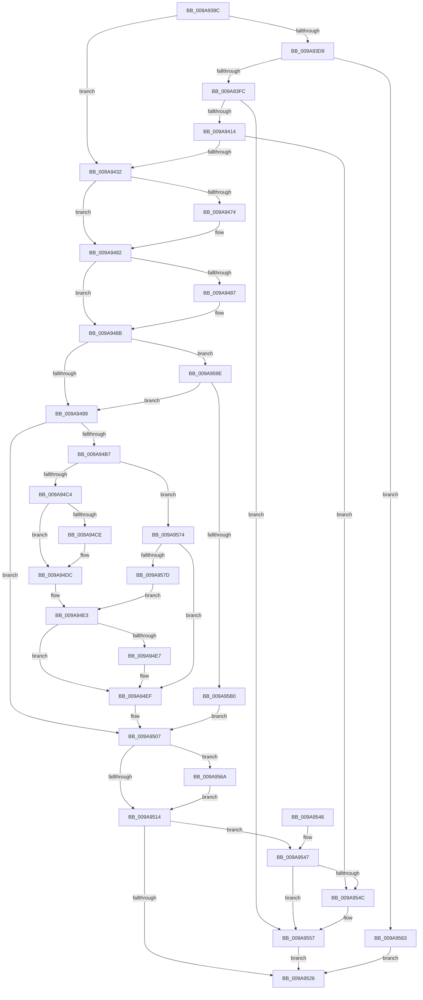

# SepSetTokenCachedHandles

- RVA: `0x009A939C`–`0x009A95BA` (길이 `542` bytes)
- VA: `0x00000001409A939C`
- 실행 섹션: `PAGE`
- PDB 이름 있음: `예`; PDB Function 태그: `아니요`
- unwind 정보 RVA: `0x0009D5E8`
- 디코드: `154`개 명령, `542/542` bytes 표시
- 미해석 바이트: `0` (있으면 어셈블리에 `.byte`로 보존)

> 이 문서는 커널 이미지의 기계어와 PDB 기호를 분석해 생성했습니다. 4번과 5번은 함수 원형과 자료형을 바이너리 사용 방식에서 추정한 C 해석이며 원본 소스 복구 결과는 아닙니다.

## 1. Dependencies

- 직접 호출 지점: **12**; 고유 호출 대상: **12**
- 직접 호출자로 확인된 함수: **3**
- RIP 상대 이미지 참조: **0**

### Outgoing calls
- `0x009A93EB` → [ExAllocatePool2](../../poolcode/B8/ExAllocatePool2_function_00B820F0.md) (function, `0x00B820F0`)
- `0x009A9405` → [SepReferenceCachedTokenHandles](../../text/49/SepReferenceCachedTokenHandles_function_0049BF58.md) (function, `0x0049BF58`)
- `0x009A9423` → [SepValidateReferencedCachedHandles](../8F/SepValidateReferencedCachedHandles_function_008F4BB0.md) (function, `0x008F4BB0`)
- `0x009A9464` → [KeAbPreAcquire](../../text/21/KeAbPreAcquire_function_00210230.md) (function, `0x00210230`)
- `0x009A947D` → [ExfAcquirePushLockExclusiveEx](../../text/20/ExfAcquirePushLockExclusiveEx_function_0020FC90.md) (function, `0x0020FC90`)
- `0x009A94AC` → [SepGetCachedHandlesEntry](SepGetCachedHandlesEntry_function_009A95C0.md) (function, `0x009A95C0`)
- `0x009A9517` → [KeAbPostRelease](../../text/2E/KeAbPostRelease_function_002E1600.md) (function, `0x002E1600`)
- `0x009A951C` → [KeLeaveCriticalRegion](../../text/25/KeLeaveCriticalRegion_function_0025D8B0.md) (function, `0x0025D8B0`)
- `0x009A9552` → [SepCloseCachedTokenHandles](../../text/4A/SepCloseCachedTokenHandles_function_004A247C.md) (function, `0x004A247C`)
- `0x009A955C` → [ExFreePoolWithTag](../../poolcode/B8/ExFreePoolWithTag_function_00B82870.md) (function, `0x00B82870`)
- `0x009A956D` → [ExfTryToWakePushLock](../../text/26/ExfTryToWakePushLock_function_00265DD0.md) (function, `0x00265DD0`)
- `0x009A95A3` → [RtlCreateHashTable](../../text/48/RtlCreateHashTable_function_0048C3E0.md) (function, `0x0048C3E0`)

### Direct callers
- [SepSetTokenBnoIsolation](../../text/49/SepSetTokenBnoIsolation_function_0049002C.md) at `0x00490108`
- [SepCreateAppContainerToken](../../text/4F/SepCreateAppContainerToken_function_004F43AC.md) at `0x004F4B17`
- [NtCreateLowBoxToken](../AB/NtCreateLowBoxToken_function_00AB9880.md) at `0x00ABA1A8`

### Static image references
- 디코드된 RIP-relative 메모리 참조가 없습니다.

## 2. Other-region calls and transfers

- 다른 실행 섹션으로 향하는 call: **10**
  - `0x009A93EB` → [ExAllocatePool2](../../poolcode/B8/ExAllocatePool2_function_00B820F0.md) (`PAGE` → `POOLCODE`)
  - `0x009A9405` → [SepReferenceCachedTokenHandles](../../text/49/SepReferenceCachedTokenHandles_function_0049BF58.md) (`PAGE` → `.text`)
  - `0x009A9464` → [KeAbPreAcquire](../../text/21/KeAbPreAcquire_function_00210230.md) (`PAGE` → `.text`)
  - `0x009A947D` → [ExfAcquirePushLockExclusiveEx](../../text/20/ExfAcquirePushLockExclusiveEx_function_0020FC90.md) (`PAGE` → `.text`)
  - `0x009A9517` → [KeAbPostRelease](../../text/2E/KeAbPostRelease_function_002E1600.md) (`PAGE` → `.text`)
  - `0x009A951C` → [KeLeaveCriticalRegion](../../text/25/KeLeaveCriticalRegion_function_0025D8B0.md) (`PAGE` → `.text`)
  - `0x009A9552` → [SepCloseCachedTokenHandles](../../text/4A/SepCloseCachedTokenHandles_function_004A247C.md) (`PAGE` → `.text`)
  - `0x009A955C` → [ExFreePoolWithTag](../../poolcode/B8/ExFreePoolWithTag_function_00B82870.md) (`PAGE` → `POOLCODE`)
  - `0x009A956D` → [ExfTryToWakePushLock](../../text/26/ExfTryToWakePushLock_function_00265DD0.md) (`PAGE` → `.text`)
  - `0x009A95A3` → [RtlCreateHashTable](../../text/48/RtlCreateHashTable_function_0048C3E0.md) (`PAGE` → `.text`)
- 별도 외부 분기/꼬리 이동을 확인하지 못했습니다.

## 3. Assembly (complete function range)

```asm
009A939C  48 8B C4                        mov rax, rsp
009A939F  48 89 58 08                     mov qword ptr [rax + 8], rbx
009A93A3  48 89 68 10                     mov qword ptr [rax + 0x10], rbp
009A93A7  48 89 70 20                     mov qword ptr [rax + 0x20], rsi
009A93AB  57                              push rdi
009A93AC  41 54                           push r12
009A93AE  41 55                           push r13
009A93B0  41 56                           push r14
009A93B2  41 57                           push r15
009A93B4  48 83 EC 40                     sub rsp, 0x40
009A93B8  33 F6                           xor esi, esi
009A93BA  45 8B F0                        mov r14d, r8d
009A93BD  48 21 70 C0                     and qword ptr [rax - 0x40], rsi
009A93C1  45 32 E4                        xor r12b, r12b
009A93C4  40 88 70 18                     mov byte ptr [rax + 0x18], sil
009A93C8  49 8B D9                        mov rbx, r9
009A93CB  4C 8B FA                        mov r15, rdx
009A93CE  4C 8B E9                        mov r13, rcx
009A93D1  8D 7E 01                        lea edi, [rsi + 1]
009A93D4  45 85 C0                        test r8d, r8d
009A93D7  74 59                           je 0x1409a9432
009A93D9  41 8B D6                        mov edx, r14d
009A93DC  B9 00 01 00 00                  mov ecx, 0x100
009A93E1  48 C1 E2 03                     shl rdx, 3
009A93E5  41 B8 53 65 48 63               mov r8d, 0x63486553
009A93EB  E8 00 8D 1D 00                  call 0x140b820f0
009A93F0  48 8B F0                        mov rsi, rax
009A93F3  48 85 C0                        test rax, rax
009A93F6  0F 84 67 01 00 00               je 0x1409a9563
009A93FC  4C 8B C0                        mov r8, rax
009A93FF  48 8B D3                        mov rdx, rbx
009A9402  41 8B CE                        mov ecx, r14d
009A9405  E8 4E 2B AF FF                  call 0x14049bf58
009A940A  8B E8                           mov ebp, eax
009A940C  85 C0                           test eax, eax
009A940E  0F 88 43 01 00 00               js 0x1409a9557
009A9414  4C 8B CE                        mov r9, rsi
009A9417  45 8B C6                        mov r8d, r14d
009A941A  49 8B D7                        mov rdx, r15
009A941D  49 8B CD                        mov rcx, r13
009A9420  44 8A E7                        mov r12b, dil
009A9423  E8 88 B7 F4 FF                  call 0x1408f4bb0
009A9428  8B E8                           mov ebp, eax
009A942A  85 C0                           test eax, eax
009A942C  0F 88 1A 01 00 00               js 0x1409a954c
009A9432  49 8B BD D8 00 00 00            mov rdi, qword ptr [r13 + 0xd8]
009A9439  48 83 CB FF                     or rbx, 0xffffffffffffffff
009A943D  65 48 8B 04 25 88 01 00 00      mov rax, qword ptr gs:[0x188]
009A9446  48 83 C7 60                     add rdi, 0x60
009A944A  45 33 C0                        xor r8d, r8d
009A944D  44 88 64 24 20                  mov byte ptr [rsp + 0x20], r12b
009A9452  33 D2                           xor edx, edx
009A9454  48 89 74 24 30                  mov qword ptr [rsp + 0x30], rsi
009A9459  48 8B CF                        mov rcx, rdi
009A945C  66 01 98 E4 01 00 00            add word ptr [rax + 0x1e4], bx
009A9463  90                              nop
009A9464  E8 C7 6D 86 FF                  call 0x140210230
009A9469  F0 48 0F BA 2F 00               lock bts qword ptr [rdi], 0
009A946F  48 8B E8                        mov rbp, rax
009A9472  73 0E                           jae 0x1409a9482
009A9474  4C 8B C7                        mov r8, rdi
009A9477  48 8B D0                        mov rdx, rax
009A947A  48 8B CF                        mov rcx, rdi
009A947D  E8 0E 68 86 FF                  call 0x14020fc90
009A9482  48 85 ED                        test rbp, rbp
009A9485  74 04                           je 0x1409a948b
009A9487  C6 45 0A 01                     mov byte ptr [rbp + 0xa], 1
009A948B  48 8D 4F 08                     lea rcx, [rdi + 8]
009A948F  48 83 39 00                     cmp qword ptr [rcx], 0
009A9493  0F 84 05 01 00 00               je 0x1409a959e
009A9499  4C 8D 4C 24 28                  lea r9, [rsp + 0x28]
009A949E  49 8B D7                        mov rdx, r15
009A94A1  4C 8D 84 24 80 00 00 00         lea r8, [rsp + 0x80]
009A94A9  48 8B CF                        mov rcx, rdi
009A94AC  E8 0F 01 00 00                  call 0x1409a95c0
009A94B1  8B E8                           mov ebp, eax
009A94B3  85 C0                           test eax, eax
009A94B5  75 50                           jne 0x1409a9507
009A94B7  41 8B 17                        mov edx, dword ptr [r15]
009A94BA  32 C9                           xor cl, cl
009A94BC  85 D2                           test edx, edx
009A94BE  0F 85 B0 00 00 00               jne 0x1409a9574
009A94C4  48 8B 54 24 28                  mov rdx, qword ptr [rsp + 0x28]
009A94C9  45 85 F6                        test r14d, r14d
009A94CC  74 0E                           je 0x1409a94dc
009A94CE  39 6A 38                        cmp dword ptr [rdx + 0x38], ebp
009A94D1  0F B6 C1                        movzx eax, cl
009A94D4  8D 4D 01                        lea ecx, [rbp + 1]
009A94D7  0F 44 C1                        cmove eax, ecx
009A94DA  8A C8                           mov cl, al
009A94DC  49 89 95 40 04 00 00            mov qword ptr [r13 + 0x440], rdx
009A94E3  84 C9                           test cl, cl
009A94E5  74 08                           je 0x1409a94ef
009A94E7  44 89 72 38                     mov dword ptr [rdx + 0x38], r14d
009A94EB  48 89 72 40                     mov qword ptr [rdx + 0x40], rsi
009A94EF  0F B6 44 24 20                  movzx eax, byte ptr [rsp + 0x20]
009A94F4  45 33 E4                        xor r12d, r12d
009A94F7  84 C9                           test cl, cl
009A94F9  44 0F 44 E0                     cmove r12d, eax
009A94FD  33 F6                           xor esi, esi
009A94FF  84 C9                           test cl, cl
009A9501  48 0F 44 74 24 30               cmove rsi, qword ptr [rsp + 0x30]
009A9507  F0 48 0F C1 1F                  lock xadd qword ptr [rdi], rbx
009A950C  80 E3 06                        and bl, 6
009A950F  80 FB 02                        cmp bl, 2
009A9512  74 56                           je 0x1409a956a
009A9514  48 8B CF                        mov rcx, rdi
009A9517  E8 E4 80 93 FF                  call 0x1402e1600
009A951C  E8 8F 43 8B FF                  call 0x14025d8b0
009A9521  48 85 F6                        test rsi, rsi
009A9524  75 21                           jne 0x1409a9547
009A9526  4C 8D 5C 24 40                  lea r11, [rsp + 0x40]
009A952B  8B C5                           mov eax, ebp
009A952D  49 8B 5B 30                     mov rbx, qword ptr [r11 + 0x30]
009A9531  49 8B 6B 38                     mov rbp, qword ptr [r11 + 0x38]
009A9535  49 8B 73 48                     mov rsi, qword ptr [r11 + 0x48]
009A9539  49 8B E3                        mov rsp, r11
009A953C  41 5F                           pop r15
009A953E  41 5E                           pop r14
009A9540  41 5D                           pop r13
009A9542  41 5C                           pop r12
009A9544  5F                              pop rdi
009A9545  C3                              ret
009A9546  CC                              int3
009A9547  45 84 E4                        test r12b, r12b
009A954A  74 0B                           je 0x1409a9557
009A954C  48 8B D6                        mov rdx, rsi
009A954F  41 8B CE                        mov ecx, r14d
009A9552  E8 25 8F AF FF                  call 0x1404a247c
009A9557  33 D2                           xor edx, edx
009A9559  48 8B CE                        mov rcx, rsi
009A955C  E8 0F 93 1D 00                  call 0x140b82870
009A9561  EB C3                           jmp 0x1409a9526
009A9563  BD 17 00 00 C0                  mov ebp, 0xc0000017
009A9568  EB BC                           jmp 0x1409a9526
009A956A  48 8B CF                        mov rcx, rdi
009A956D  E8 5E C8 8B FF                  call 0x140265dd0
009A9572  EB A0                           jmp 0x1409a9514
009A9574  83 FA 01                        cmp edx, 1
009A9577  0F 85 72 FF FF FF               jne 0x1409a94ef
009A957D  80 BC 24 80 00 00 00 00         cmp byte ptr [rsp + 0x80], 0
009A9585  8B C2                           mov eax, edx
009A9587  0F B6 C9                        movzx ecx, cl
009A958A  0F 44 CA                        cmove ecx, edx
009A958D  48 8B 54 24 28                  mov rdx, qword ptr [rsp + 0x28]
009A9592  49 89 95 80 04 00 00            mov qword ptr [r13 + 0x480], rdx
009A9599  E9 45 FF FF FF                  jmp 0x1409a94e3
009A959E  45 33 C0                        xor r8d, r8d
009A95A1  33 D2                           xor edx, edx
009A95A3  E8 38 2E AE FF                  call 0x14048c3e0
009A95A8  84 C0                           test al, al
009A95AA  0F 85 E9 FE FF FF               jne 0x1409a9499
009A95B0  BD 9A 00 00 C0                  mov ebp, 0xc000009a
009A95B5  E9 4D FF FF FF                  jmp 0x1409a9507
```

## 4. C-style interpretation (structured pseudocode)

```c
__int64 __fastcall SepSetTokenCachedHandles(__int64 a1, __int64 a2, int a3, __int64 a4)
{
    __int64 result;
    __int64 v_r12;
    __int64 v_rbx;
    __int64 v_rdi;
    __int64 v_rsi;
    __int64 v_rsp;
    unsigned __int64 v_stack_m18;
    unsigned __int64 v_stack_m28;
    unsigned __int64 v_stack_m38;
    unsigned __int64 v_stack_m40;
    unsigned __int8 v_stack_m48;
    unsigned __int64 v_stack_p18;
    unsigned __int8 v_stack_p40;

    *(unsigned __int64 *)(v_rsp + 8) = v_rbx;
    *(unsigned __int64 *)(v_rsp + 16) = v_rbp;
    *(unsigned __int64 *)(v_rsp + 32) = v_rsi;
    v_rsp = (v_rsp) - (64);
    v_rsi = 0;
    v_r12 = 0;
    *(unsigned __int8 *)(v_rsp + 24) = 0;
    if (a3 == 0) goto loc_009A9432;
    a2 = ((unsigned int)((unsigned int)((unsigned int)(a3)))) << (3);
    result = ExAllocatePool2(256, a2, (unsigned int)(0x63486553ULL), a4);
    if (result == 0) goto loc_009A9563;
    result = SepReferenceCachedTokenHandles((unsigned int)((unsigned int)((unsigned int)(a3))), a4, result, a4);
    if (sign_flag) goto loc_009A9557;
    result = SepValidateReferencedCachedHandles(a1, a2, (unsigned int)((unsigned int)((unsigned int)(a3))), result);
    if (sign_flag) goto loc_009A954C;
loc_009A9432:
    v_rbx = (a4) | (-1);
    v_rdi = (*(unsigned __int64 *)(a1 + 216)) + (96);
    a3 = 0;
    v_stack_m48 = (unsigned __int8)((unsigned __int8)(v_rsi + 1));
    a2 = 0;
    v_stack_m38 = result;
    result = KeAbPreAcquire(v_rdi, a2, a3, result);
    if (!(condition_is_above_or_equal)) {
        a3 = v_rdi;
        a2 = result;
        a1 = v_rdi;
        result = ExfAcquirePushLockExclusiveEx(a1, a2, a3, result);
    }
    if (result != 0) {
        *(unsigned __int8 *)(result + 10) = 1;
    }
    if ((*(unsigned __int64 *)(v_rdi + 8)) == 0) goto loc_009A959E;
loc_009A9499:
    result = SepGetCachedHandlesEntry(v_rdi, a2, v_stack_p18, v_stack_m40);
    if ((unsigned int)(result) != 0) goto loc_009A9507;
    a1 = 0;
    if ((unsigned int)((unsigned int)(*(unsigned int *)(a2))) != 0) goto loc_009A9574;
    if ((unsigned int)((unsigned int)(a3)) != 0) {
        result = 0;
        a1 = (unsigned int)((unsigned int)(result)) + 1;
        if ((*(unsigned int *)(v_stack_m40 + 56)) == ((unsigned int)((unsigned int)((unsigned int)(result))))) { result = (unsigned int)(a1); }
        a1 = (unsigned __int8)(result);
    }
    *(unsigned __int64 *)(a1 + 1088) = v_stack_m40;
loc_009A94E3:
    if ((unsigned __int8)(a1) != 0) {
        *(unsigned int *)(v_stack_m40 + 56) = (unsigned int)((unsigned int)(a3));
        *(unsigned __int64 *)(v_stack_m40 + 64) = result;
    }
    v_r12 = 0;
    if ((unsigned __int8)(a1) == 0) { v_r12 = (unsigned int)(v_stack_m48); }
    v_rsi = 0;
    if ((unsigned __int8)(a1) == 0) { v_rsi = v_stack_m38; }
loc_009A9507:
    v_rbx = (unsigned __int8)((v_rbx) & (6));
    if (((unsigned __int8)(v_rbx)) == 2) goto loc_009A956A;
loc_009A9514:
    result = KeAbPostRelease(v_rdi, v_stack_m40, v_stack_p18, v_stack_m40);
    result = KeLeaveCriticalRegion(v_rdi, v_stack_m40, v_stack_p18, v_stack_m40);
    if (v_rsi != 0) goto loc_009A9547;
loc_009A9526:
    return (unsigned int)((unsigned int)((unsigned int)((unsigned int)(result))));
loc_009A9547:
    result = (unsigned int)((unsigned int)((unsigned int)((unsigned int)(result))));
    if ((unsigned __int8)(v_r12) != 0) {
        a2 = *(unsigned __int64 *)(v_stack_m28 + 72);
        a1 = (unsigned int)((unsigned int)(a3));
        result = SepCloseCachedTokenHandles(a1, a2, v_stack_p18, v_stack_m40);
    }
    a2 = 0;
    result = ExFreePoolWithTag(*(unsigned __int64 *)(v_stack_m28 + 72), a2, v_stack_p18, v_stack_m40);
    goto loc_009A9526;
loc_009A9563:
    goto loc_009A9526;
loc_009A956A:
    result = ExfTryToWakePushLock(v_rdi, a2, v_stack_p18, v_stack_m40);
    goto loc_009A9514;
loc_009A9574:
    if (0 != 1) goto loc_009A94EF;
    a1 = (unsigned __int8)(v_rdi);
    if (v_stack_p40 == 0) { a1 = 0; }
    *(unsigned __int64 *)(a1 + 1152) = v_stack_m18;
    goto loc_009A94E3;
loc_009A959E:
    a3 = 0;
    a2 = 0;
    result = RtlCreateHashTable(a1, a2, a3, v_stack_m40);
    if ((unsigned __int8)(result) != 0) goto loc_009A9499;
    goto loc_009A9507;
}
```

## 5. (Beta) C Style

```c
int64_t SepSetTokenCachedHandles(void *Arg1, void *Arg2, int32_t Arg3, int64_t Arg4)
{
    uint8_t *arg1 = (uint8_t *)Arg1;
    uint8_t *arg2 = (uint8_t *)Arg2;

    int64_t result;
    int64_t local_r12;
    int64_t local_rbx;
    int64_t local_rdi;
    int64_t local_rsi;
    int64_t local_rsp;
    uint64_t v_stack_m18;
    uint64_t v_stack_m28;
    uint64_t v_stack_m38;
    uint64_t v_stack_m40;
    uint8_t v_stack_m48;
    uint64_t v_stack_p18;
    uint8_t v_stack_p40;

    *(uint64_t *)(local_rsp + 0x8) = local_rbx;
    *(uint64_t *)(local_rsp + 0x10) = local_rbp;
    *(uint64_t *)(local_rsp + 0x20) = local_rsi;
    local_rsp = (local_rsp) - (64);
    local_rsi = 0;
    local_r12 = 0;
    *(uint8_t *)(local_rsp + 0x18) = 0;
    if (Arg3 == 0) goto loc_009A9432;
    Arg2 = ((uint32_t)((uint32_t)((uint32_t)(Arg3)))) << (3);
    result = ExAllocatePool2(256, Arg2, (uint32_t)(0x63486553ULL), Arg4);
    if (result == 0) goto loc_009A9563;
    result = SepReferenceCachedTokenHandles((uint32_t)((uint32_t)((uint32_t)(Arg3))), Arg4, result, Arg4);
    if (sign_flag) goto loc_009A9557;
    result = SepValidateReferencedCachedHandles(Arg1, Arg2, (uint32_t)((uint32_t)((uint32_t)(Arg3))), result);
    if (sign_flag) goto loc_009A954C;
loc_009A9432:
    local_rbx = (Arg4) | (-1);
    local_rdi = (*(uint64_t *)(arg1 + 0xD8)) + (96);
    Arg3 = 0;
    v_stack_m48 = (uint8_t)((uint8_t)(local_rsi + 1));
    Arg2 = 0;
    v_stack_m38 = result;
    result = KeAbPreAcquire(local_rdi, Arg2, Arg3, result);
    if (!(condition_is_above_or_equal)) {
        Arg3 = local_rdi;
        Arg2 = result;
        Arg1 = local_rdi;
        result = ExfAcquirePushLockExclusiveEx(Arg1, Arg2, Arg3, result);
    }
    if (result != 0) {
        *(uint8_t *)(result + 0xA) = 1;
    }
    if ((*(uint64_t *)(local_rdi + 0x8)) == 0) goto loc_009A959E;
loc_009A9499:
    result = SepGetCachedHandlesEntry(local_rdi, Arg2, v_stack_p18, v_stack_m40);
    if ((uint32_t)(result) != 0) goto loc_009A9507;
    Arg1 = 0;
    if ((uint32_t)((uint32_t)(*(uint32_t *)(arg2))) != 0) goto loc_009A9574;
    if ((uint32_t)((uint32_t)(Arg3)) != 0) {
        result = 0;
        Arg1 = (uint32_t)((uint32_t)(result)) + 1;
        if ((*(uint32_t *)(v_stack_m40 + 0x38)) == ((uint32_t)((uint32_t)((uint32_t)(result))))) { result = (uint32_t)(Arg1); }
        Arg1 = (uint8_t)(result);
    }
    *(uint64_t *)(arg1 + 0x440) = v_stack_m40;
loc_009A94E3:
    if ((uint8_t)(Arg1) != 0) {
        *(uint32_t *)(v_stack_m40 + 0x38) = (uint32_t)((uint32_t)(Arg3));
        *(uint64_t *)(v_stack_m40 + 0x40) = result;
    }
    local_r12 = 0;
    if ((uint8_t)(Arg1) == 0) { local_r12 = (uint32_t)(v_stack_m48); }
    local_rsi = 0;
    if ((uint8_t)(Arg1) == 0) { local_rsi = v_stack_m38; }
loc_009A9507:
    local_rbx = (uint8_t)((local_rbx) & (6));
    if (((uint8_t)(local_rbx)) == 2) goto loc_009A956A;
loc_009A9514:
    result = KeAbPostRelease(local_rdi, v_stack_m40, v_stack_p18, v_stack_m40);
    result = KeLeaveCriticalRegion(local_rdi, v_stack_m40, v_stack_p18, v_stack_m40);
    if (local_rsi != 0) goto loc_009A9547;
loc_009A9526:
    return (uint32_t)((uint32_t)((uint32_t)((uint32_t)(result))));
loc_009A9547:
    result = (uint32_t)((uint32_t)((uint32_t)((uint32_t)(result))));
    if ((uint8_t)(local_r12) != 0) {
        Arg2 = *(uint64_t *)(v_stack_m28 + 0x48);
        Arg1 = (uint32_t)((uint32_t)(Arg3));
        result = SepCloseCachedTokenHandles(Arg1, Arg2, v_stack_p18, v_stack_m40);
    }
    Arg2 = 0;
    result = ExFreePoolWithTag(*(uint64_t *)(v_stack_m28 + 0x48), Arg2, v_stack_p18, v_stack_m40);
    goto loc_009A9526;
loc_009A9563:
    goto loc_009A9526;
loc_009A956A:
    result = ExfTryToWakePushLock(local_rdi, Arg2, v_stack_p18, v_stack_m40);
    goto loc_009A9514;
loc_009A9574:
    if (0 != 1) goto loc_009A94EF;
    Arg1 = (uint8_t)(local_rdi);
    if (v_stack_p40 == 0) { Arg1 = 0; }
    *(uint64_t *)(arg1 + 0x480) = v_stack_m18;
    goto loc_009A94E3;
loc_009A959E:
    Arg3 = 0;
    Arg2 = 0;
    result = RtlCreateHashTable(Arg1, Arg2, Arg3, v_stack_m40);
    if ((uint8_t)(result) != 0) goto loc_009A9499;
    goto loc_009A9507;
}
```

### 관측된 메모리 오프셋

구조체 형식이 확인되지 않은 접근은 인자 기준의 오프셋으로만 기록했습니다.

| 기준 인자 | 오프셋 표현 | 폭 (bit) | 접근 |
|---|---:|---:|---|
| `Arg1` | `+ 0xD8` | `64` | `R` |
| `Arg1` | `+ 0x440` | `64` | `W` |
| `Arg1` | `+ 0x480` | `64` | `W` |
| `Arg2` | `+ 0x0` | `32` | `R` |

## 6. Execution-region graph

[열기: 2D/3D 그래프와 함수 탐색 컨트롤 패널](../../../control-panel.html?section=page&rva=0x009A939C&view=graph)

- 2D 그래프는 위에서 아래로 흐르고, 3D 그래프는 빈 공간을 드래그해 회전합니다. Shift+드래그는 이동, 휠은 확대·축소, 함수 노드 선택은 대상 보고서 이동입니다.

### Static fallback


