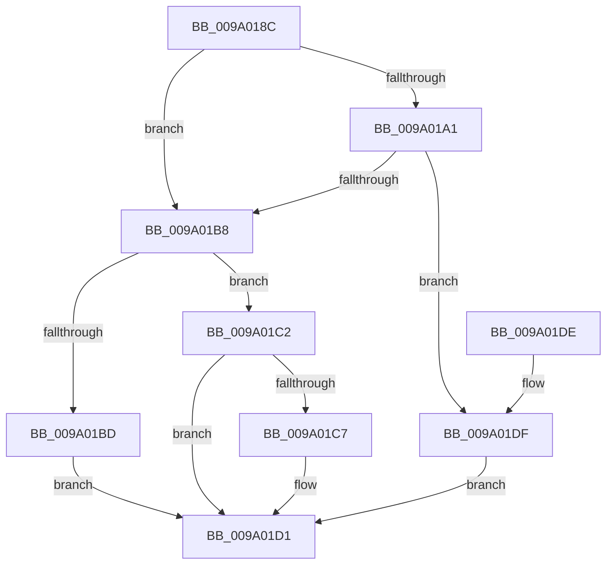

# sub_009A018C

- RVA: `0x009A018C`–`0x009A01E6` (길이 `90` bytes)
- VA: `0x00000001409A018C`
- 실행 섹션: `PAGE`
- PDB 이름 있음: `아니요`; PDB Function 태그: `아니요`
- unwind 정보 RVA: `0x0006CF28`
- 디코드: `31`개 명령, `90/90` bytes 표시
- 미해석 바이트: `0` (있으면 어셈블리에 `.byte`로 보존)

> 이 문서는 커널 이미지의 기계어와 PDB 기호를 분석해 생성했습니다. 4번과 5번은 함수 원형과 자료형을 바이너리 사용 방식에서 추정한 C 해석이며 원본 소스 복구 결과는 아닙니다.

## 1. Dependencies

- 직접 호출 지점: **2**; 고유 호출 대상: **2**
- 직접 호출자로 확인된 함수: **1**
- RIP 상대 이미지 참조: **0**

### Outgoing calls
- `0x009A01AE` → [ExAllocatePool2](../../poolcode/B8/ExAllocatePool2_function_00B820F0.md) (function, `0x00B820F0`)
- `0x009A01CC` → [ExFreePoolWithTag](../../poolcode/B8/ExFreePoolWithTag_function_00B82870.md) (function, `0x00B82870`)

### Direct callers
- [sub_0099FE78](../99/Unknown_function_0099FE78.md) at `0x0099FF1B`
- [sub_0099FE78](../99/Unknown_function_0099FE78.md) at `0x009A00D6`

### Static image references
- 디코드된 RIP-relative 메모리 참조가 없습니다.

## 2. Other-region calls and transfers

- 다른 실행 섹션으로 향하는 call: **2**
  - `0x009A01AE` → [ExAllocatePool2](../../poolcode/B8/ExAllocatePool2_function_00B820F0.md) (`PAGE` → `POOLCODE`)
  - `0x009A01CC` → [ExFreePoolWithTag](../../poolcode/B8/ExFreePoolWithTag_function_00B82870.md) (`PAGE` → `POOLCODE`)
- 별도 외부 분기/꼬리 이동을 확인하지 못했습니다.

## 3. Assembly (complete function range)

```asm
009A018C  48 89 5C 24 08                  mov qword ptr [rsp + 8], rbx
009A0191  57                              push rdi
009A0192  48 83 EC 20                     sub rsp, 0x20
009A0196  33 DB                           xor ebx, ebx
009A0198  48 8B FA                        mov rdi, rdx
009A019B  8B C3                           mov eax, ebx
009A019D  85 C9                           test ecx, ecx
009A019F  74 17                           je 0x1409a01b8
009A01A1  8B D1                           mov edx, ecx
009A01A3  41 B8 57 41 52 42               mov r8d, 0x42524157
009A01A9  B9 00 01 00 00                  mov ecx, 0x100
009A01AE  E8 3D 1F 1E 00                  call 0x140b820f0
009A01B3  48 85 C0                        test rax, rax
009A01B6  74 27                           je 0x1409a01df
009A01B8  48 85 FF                        test rdi, rdi
009A01BB  74 05                           je 0x1409a01c2
009A01BD  48 89 07                        mov qword ptr [rdi], rax
009A01C0  EB 0F                           jmp 0x1409a01d1
009A01C2  48 85 C0                        test rax, rax
009A01C5  74 0A                           je 0x1409a01d1
009A01C7  33 D2                           xor edx, edx
009A01C9  48 8B C8                        mov rcx, rax
009A01CC  E8 9F 26 1E 00                  call 0x140b82870
009A01D1  8B C3                           mov eax, ebx
009A01D3  48 8B 5C 24 30                  mov rbx, qword ptr [rsp + 0x30]
009A01D8  48 83 C4 20                     add rsp, 0x20
009A01DC  5F                              pop rdi
009A01DD  C3                              ret
009A01DE  CC                              int3
009A01DF  BB 17 00 00 C0                  mov ebx, 0xc0000017
009A01E4  EB EB                           jmp 0x1409a01d1
```

## 4. C-style interpretation (structured pseudocode)

```c
__int64 __fastcall sub_009A018C(int a1, __int64 a2)
{
    __int64 result;
    __int64 v_rbx;
    __int64 v_rsp;
    unsigned __int64 v_stack_p8;

    v_stack_p8 = v_rbx;
    v_rsp = (v_rsp) - (32);
    v_rbx = 0;
    if (a1 == 0) goto loc_009A01B8;
    result = ExAllocatePool2(256, (unsigned int)(a1), (unsigned int)(0x42524157ULL), a4);
    if (result == 0) goto loc_009A01DF;
loc_009A01B8:
    if (a2 == 0) goto loc_009A01C2;
    *(unsigned __int64 *)(a2) = result;
    goto loc_009A01D1;
loc_009A01C2:
    if (result != 0) {
        a2 = 0;
        a1 = result;
        result = ExFreePoolWithTag(a1, a2, (unsigned int)(0x42524157ULL), a4);
    }
    v_rsp = (v_rsp) + (32);
    return 0;
loc_009A01DF:
    goto loc_009A01D1;
}
```

## 5. (Beta) C Style

```c
int64_t sub_009A018C(int32_t Arg1, int64_t Arg2)
{
    int64_t result;
    int64_t local_rbx;
    int64_t local_rsp;
    uint64_t v_stack_p8;

    v_stack_p8 = local_rbx;
    local_rsp = (local_rsp) - (32);
    local_rbx = 0;
    if (Arg1 == 0) goto loc_009A01B8;
    result = ExAllocatePool2(256, (uint32_t)(Arg1), (uint32_t)(0x42524157ULL), a4);
    if (result == 0) goto loc_009A01DF;
loc_009A01B8:
    if (Arg2 == 0) goto loc_009A01C2;
    *(uint64_t *)(Arg2) = result;
    goto loc_009A01D1;
loc_009A01C2:
    if (result != 0) {
        Arg2 = 0;
        Arg1 = result;
        result = ExFreePoolWithTag(Arg1, Arg2, (uint32_t)(0x42524157ULL), a4);
    }
    local_rsp = (local_rsp) + (32);
    return 0;
loc_009A01DF:
    goto loc_009A01D1;
}
```

## 6. Execution-region graph

[열기: 2D/3D 그래프와 함수 탐색 컨트롤 패널](../../../control-panel.html?section=page&rva=0x009A018C&view=graph)

- 2D 그래프는 위에서 아래로 흐르고, 3D 그래프는 빈 공간을 드래그해 회전합니다. Shift+드래그는 이동, 휠은 확대·축소, 함수 노드 선택은 대상 보고서 이동입니다.

### Static fallback


